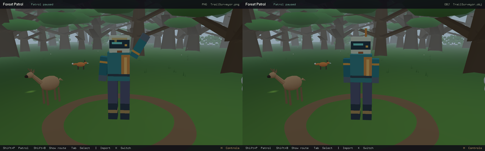
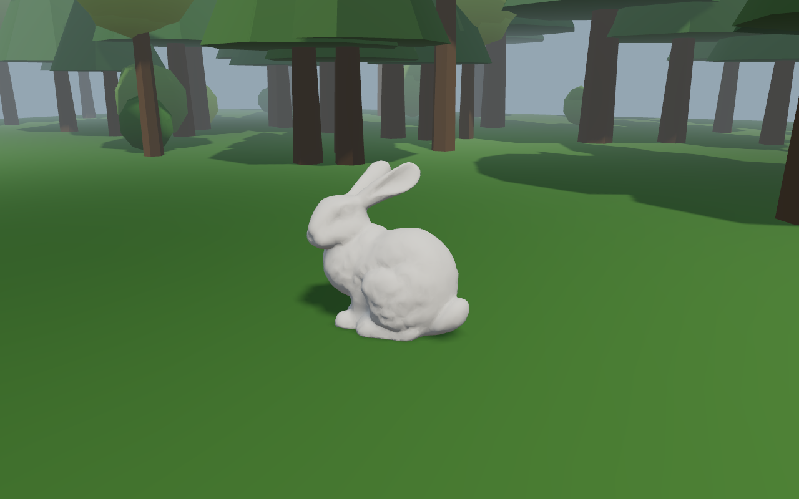
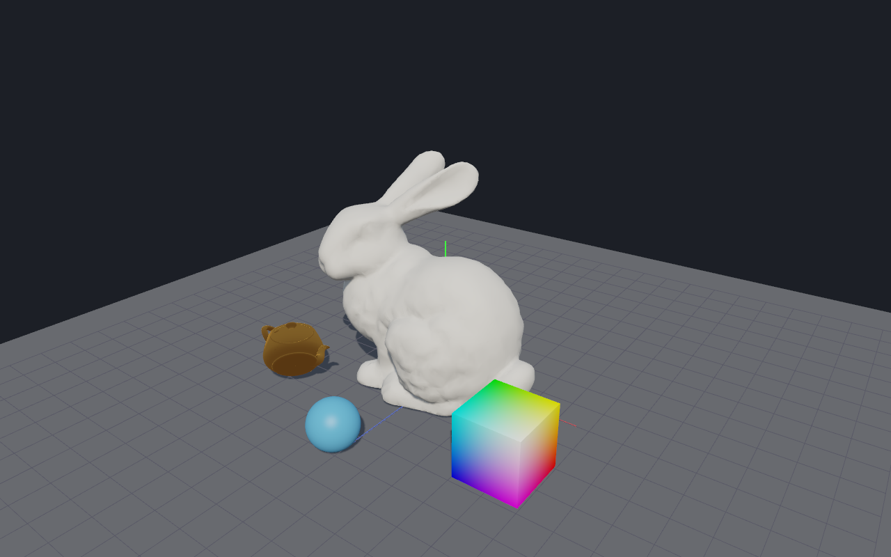

# 三维模型查看器 —— 完整源代码

计算机图形学总结实验（实验四 / 五 / 六 / 七 / 十 + 斜平行投影 + 程序化森林）

用 **OpenGL + GLSL** 实现逐像素光照与 PCF 阴影，保留 GLUT 与经典管线对照。

---

## 统计

| 项 | 值 |
|---|---|
| 源文件 | 54 个 |
| 代码总行数 | 8660 行（不含本页的 README 部分）|
| 模型 | `Models/bunny_10k.obj`（Stanford Bunny，10000 面，Y-up）|
| 依赖 | 已 vendor：freeglut（x64）+ stb_image v2.30，**离线可构建** |

## 构建与运行

```bash
CM="/c/Program Files/Microsoft Visual Studio/2022/Community/Common7/IDE/CommonExtensions/Microsoft/CMake/CMake/bin/cmake.exe"
"$CM" -S . -B build -G "Visual Studio 17 2022" -A x64
"$CM" --build build --config Release
./build/Release/viewer.exe
```

> CMake 不在 PATH 里，要用 VS 自带的那份；`freeglut.dll` 构建时会自动拷到 exe 旁。

## 文件清单

| # | 文件 | 行数 | 说明 |
|---|---|---|---|
| 1 | `tools/record_demos.py` | 57 | 可复现功能视频与 ffprobe 验证 |
| 2 | `tools/make_share_package.py` | 123 | 便携可运行包与 VS 源码分发 |
| 3 | `tools/update_manifest.py` | 56 | 文件哈希更新与校验 |
| 4 | `tools/setup_dependencies.ps1` | 51 | 依赖检查与 FFmpeg 安装 |
| 5 | `src/robot.h` | 77 | 机器人层级与动画接口 |
| 6 | `src/robot.cpp` | 808 | 机器人关节与路径动画 |
| 7 | `src/animals.h` | 26 | 动物行为接口 |
| 8 | `src/animals.cpp` | 364 | 鹿与狐狸建模、吃草和追赶 |
| 9 | `src/bezier.h` | 45 | 贝塞尔路径接口 |
| 10 | `src/bezier.cpp` | 208 | de Casteljau 与弧长参数化 |
| 11 | `src/gl_api.h` | 95 | OpenGL runtime entry points |
| 12 | `src/shaders.h` | 66 | GLSL per-pixel lighting and PCF shadows |
| 13 | `src/renderer.h` | 14 | Renderer interface |
| 14 | `src/renderer.cpp` | 150 | Shadow pass and forward shading |
| 15 | `tests/obj_loader_test.cpp` | 31 | OBJ regression tests |
| 16 | `tools/render_smoke.py` | 57 | GPU rendering regression checks |
| 17 | `CMakeLists.txt` | 115 | 构建配置（含 32 位防护） |
| 18 | `CMakePresets.json` | 40 | CMake 预设：x64 / Win32 |
| 19 | `build.bat` | 82 | 一键构建（Windows cmd / PowerShell） |
| 20 | `build.sh` | 78 | 一键构建（git-bash / MSYS2） |
| 21 | `viewer.vcxproj` | 181 | 经典 VS 工程（自包含，双击 viewer.sln 即可） |
| 22 | `.gitignore` | 34 | Git 忽略规则 |
| 23 | `src/types.h` | 27 | 全局模式枚举 |
| 24 | `src/math3d.h` | 136 | 向量 / 矩阵 / 四元数工具（header-only） |
| 25 | `src/obj_loader.h` | 62 | OBJ 导入接口（实验十） |
| 26 | `src/obj_loader.cpp` | 409 | OBJ / MTL 解析：四边形三角化 + 顶点去重 |
| 27 | `src/mesh.h` | 52 | 网格接口 |
| 28 | `src/mesh.cpp` | 288 | 网格：归一化、上轴判别、客户端顶点数组绘制 |
| 29 | `src/texture.h` | 10 | 纹理接口 |
| 30 | `src/texture.cpp` | 112 | stb_image → OpenGL 纹理 |
| 31 | `src/camera.h` | 38 | 观察变换相机接口 |
| 32 | `src/camera.cpp` | 123 | 相机：环绕 / 漫游 / 四元数旋转 / 退化保护（实验七） |
| 33 | `src/projection.h` | 21 | 投影接口 |
| 34 | `src/projection.cpp` | 171 | 透视 / 正交 / 斜平行投影 + 保宽高比 |
| 35 | `src/lighting.h` | 15 | 光照接口 |
| 36 | `src/lighting.cpp` | 89 | 光照与材质（展示台点光源 / 森林太阳光） |
| 37 | `src/forest.h` | 39 | 程序化森林接口 |
| 38 | `src/forest.cpp` | 602 | 森林：地面 + 三种树型，烘焙成一个顶点色网格 |
| 39 | `src/scene.h` | 67 | 场景与物体接口 |
| 40 | `src/scene.cpp` | 417 | 两套场景：展示台（实验四/五）与森林 |
| 41 | `src/anim.h` | 30 | 脚本动画接口 |
| 42 | `src/anim.cpp` | 289 | 动画（时间的纯函数）：自转/环绕/投影/变换/森林漫步 |
| 43 | `src/recorder.h` | 19 | 录制接口 |
| 44 | `src/recorder.cpp` | 76 | 逐帧数据管道进 ffmpeg 编码 mp4 |
| 45 | `src/hud.h` | 22 | 叠加文字接口 |
| 46 | `src/hud.cpp` | 96 | 屏幕叠加文字与帮助面板 |
| 47 | `src/input.h` | 60 | 输入接口 |
| 48 | `src/input.cpp` | 550 | 键盘 / 鼠标 / 滚轮 / 中键菜单（实验六） |
| 49 | `src/app.h` | 117 | 程序状态接口 |
| 50 | `src/app.cpp` | 858 | 渲染主流程、HUD、截图、四视口、录制调度 |
| 51 | `src/main.cpp` | 757 | 入口：GLUT 初始化、命令行解析、回调注册、自检 |
| 52 | `tools/bmp2png.py` | 74 | 截图 BMP → PNG（纯标准库） |
| 53 | `tools/make_shots.sh` | 54 | 一键重新生成 shots/ 全部截图 |
| 54 | `tools/make_package.py` | 222 | 本脚本：生成这份代码文档 |

---

## 源代码

### 1. `tools/record_demos.py`

可复现功能视频与 ffprobe 验证（57 行）

```python
"""Record reproducible feature clips and verify their encoded metadata with ffprobe."""
import argparse
import json
from pathlib import Path
import shutil
import subprocess

ROOT = Path(__file__).resolve().parents[1]


def main():
    parser = argparse.ArgumentParser(description=__doc__)
    parser.add_argument('--exe', type=Path, default=ROOT/'build/Release/viewer.exe')
    parser.add_argument('--out', type=Path, default=ROOT/'report-assets/review/video')
    args = parser.parse_args()
    if not all(shutil.which(tool) for tool in ('ffmpeg', 'ffprobe')):
        parser.error('ffmpeg and ffprobe must be on PATH; run tools/setup_dependencies.ps1 -InstallFfmpeg and reopen the terminal')
    out = args.out.resolve()
    out.mkdir(parents=True, exist_ok=True)
    cases = {
        'robot-wave': (4, ['--pose', 'wave']),
        'robot-path': (10, ['--path', '--path-guide']),
        'animals': (16, []),
        'chase': (8, ['--chase']),
    }
    report = []
    for name, (seconds, flags) in cases.items():
        target = out/(name+'.mp4')
        command = [str(args.exe.resolve()), '--record', str(target), '--anim', 'none',
                   '--seconds', str(seconds), '--fps', '24', '--size', '960x600', *flags]
        result = subprocess.run(command, cwd=ROOT, capture_output=True, timeout=180)
        log = (result.stdout+result.stderr).decode('utf-8', errors='replace')
        (out/(name+'.log')).write_text(log, encoding='utf-8')
        if result.returncode or '[gl] error:' in log or 'video written:' not in log:
            raise RuntimeError(f'{name}: recording failed: {log}')
        metadata = json.loads(subprocess.check_output([
            'ffprobe', '-v', 'error', '-show_entries',
            'stream=codec_name,width,height,r_frame_rate,nb_frames:format=duration',
            '-of', 'json', str(target)], text=True))
        stream = metadata['streams'][0]
        expected = dict(codec_name='h264', width=960, height=600,
                        r_frame_rate='24/1', nb_frames=str(seconds*24))
        if any(stream.get(k) != v for k, v in expected.items()):
            raise RuntimeError(f'{name}: unexpected metadata: {metadata}')
        if abs(float(metadata['format']['duration'])-seconds) > 0.05:
            raise RuntimeError(f'{name}: unexpected duration: {metadata}')
        # Sample the beginning, midpoint and final second for visual review.
        for label, timestamp in [('first', 0), ('middle', seconds/2), ('last', seconds-1)]:
            subprocess.run(['ffmpeg', '-v', 'error', '-ss', str(timestamp), '-i', str(target),
                            '-frames:v', '1', '-y', str(out/(name+'-'+label+'.png'))], check=True)
        report.append(dict(case=name, seconds=seconds, stream=stream, command=command))
        print('PASS', name, stream['nb_frames'], 'frames', flush=True)
    (out/'results.json').write_text(json.dumps(report, indent=2), encoding='utf-8')


if __name__ == '__main__':
    main()
```

### 2. `tools/make_share_package.py`

便携可运行包与 VS 源码分发（123 行）

```python
"""Build a portable Windows x64 binary + offline VS source distribution."""
from pathlib import Path
import argparse
import hashlib
import json
import shutil
import subprocess
import tempfile
import zipfile
from datetime import date

ROOT = Path(__file__).resolve().parents[1]


def main():
    parser = argparse.ArgumentParser()
    parser.add_argument('--vs', type=Path, help='VS installation root; detected with vswhere by default')
    parser.add_argument('--name', default='CG-Experiment-ReadyToRun-VS-'+date.today().strftime('%Y%m%d'))
    args = parser.parse_args()
    if Path(args.name).name != args.name or any(c in args.name for c in '/\\:'):
        parser.error('--name must be a single filename component')
    if args.vs is None:
        import os
        vswhere = Path(os.environ['ProgramFiles(x86)'])/'Microsoft Visual Studio/Installer/vswhere.exe'
        args.vs = Path(subprocess.check_output([str(vswhere), '-latest', '-products', '*',
            '-requires', 'Microsoft.VisualStudio.Component.VC.Tools.x86.x64',
            '-property', 'installationPath'], text=True).strip())
    if not (args.vs/'MSBuild/Current/Bin/MSBuild.exe').is_file():
        parser.error('VS C++ tools were not found; specify --vs explicitly')
    subprocess.run([str(args.vs/'MSBuild/Current/Bin/MSBuild.exe'),
                    str(ROOT/'viewer.sln'), '/t:Build', '/p:Configuration=Release',
                    '/p:Platform=x64', '/verbosity:minimal', '/nologo'], check=True)
    redists = sorted((args.vs/'VC/Redist/MSVC').glob('[0-9]*/x64/Microsoft.VC143.CRT'),
                     key=lambda p: tuple(map(int, p.parents[1].name.split('.'))))
    if not redists:
        raise RuntimeError('Microsoft redistributable CRT files were not found')
    output = ROOT/'dist'
    output.mkdir(exist_ok=True)
    archive = output/(args.name+'.zip')
    with tempfile.TemporaryDirectory(prefix='cg-share-') as temp:
        package = Path(temp)/'CG-Experiment'
        package.mkdir()
        for name in ['src', 'Models', 'third_party', 'tests', 'tools', 'docs', 'report-assets']:
            shutil.copytree(ROOT/name, package/name,
                            ignore=shutil.ignore_patterns('__pycache__', '*.pyc'))
        if (ROOT/'video').is_dir():
            shutil.copytree(ROOT/'video', package/'video')
        for name in ['viewer.sln', 'viewer.vcxproj', 'viewer.vcxproj.filters',
                     'CMakeLists.txt', 'CMakePresets.json', 'build.bat', 'build.sh',
                     'README.md', 'CG-Experiment-code.md', '.gitignore', '.gitattributes']:
            shutil.copy2(ROOT/name, package/name)
        for name in ['viewer.exe', 'freeglut.dll']:
            shutil.copy2(ROOT/'bin/x64/Release'/name, package/name)
        for dll in redists[-1].glob('*.dll'):
            shutil.copy2(dll, package/dll.name)
        # Preserve images linked by README without shipping old raw captures/logs.
        for image in (ROOT/'shots').rglob('*.png'):
            destination = package/image.relative_to(ROOT)
            destination.parent.mkdir(parents=True, exist_ok=True)
            shutil.copy2(image, destination)
        for name, options in [('Start-Forest.bat', '--scene forest'),
                              ('Start-Bunny-Hop.bat', '--scene forest --anim roam'),
                              ('Start-Studio.bat', '--scene studio')]:
            (package/name).write_bytes((
                '@echo off\r\ncd /d "%~dp0"\r\n'
                'start "" "%~dp0viewer.exe" '+options+'\r\n').encode('ascii'))
        (package/'START-HERE.txt').write_text('''CG-Experiment 运行与编译说明

请先完整解压，再运行；不要在 ZIP 压缩包内部直接双击 exe。

一、直接运行（无需安装 Visual Studio / Python / CMake）
双击 viewer.exe 或 Start-Forest.bat：打开森林场景，机器人从林间小径开始巡游。
双击 Start-Bunny-Hop.bat：兔子自动蹦跳漫游。
双击 Start-Studio.bat：打开课程展示台。
请保留 exe 旁边的 DLL 文件和 Models 文件夹。

空格：播放/暂停兔子动画；手动操作会停止动画。
右键拖动/WASD/QE：相机；左键拖动：物体变换。
F2：增强/经典渲染；F3：阴影；H：操作页，点页签或按 1/2/3 切换。Esc 返回场景或退出。
机器人：Shift+P 暂停/继续巡游，Shift+B 显示路径，Shift+G 追赶；n 换姿势，b 原地走/停。
Tab 选 Robot，按 t/r/y 后左键拖动做整体平移/旋转/缩放。
i 导入 64×64 现代 / 64×32 旧版 / HD PNG 皮肤或 Y-up OBJ；Shift+I 导入 Slim 皮肤。
k 在内置机器人、已加载的 PNG 和 OBJ 间切换；样例在 Models/TrailSurveyor/。

运行环境：Windows 10/11 64 位，正常安装的显卡驱动。
包内已带 freeglut 和微软可再分发的 VC++ 运行库。
普通运行、蹦跳动画、截图不需要 ffmpeg；仅导出 MP4 需要另装 ffmpeg 并加入 PATH。

二、在 Visual Studio 中编译
安装 Visual Studio 2022，并勾选“使用 C++ 的桌面开发”、MSVC v143 和 Windows SDK。
双击本目录 viewer.sln，选择 Release / x64，右键 viewer 设为启动项目，按 F5。
全部项目依赖已附带，不需要下载第三方库或配置绝对路径。
也提供 Debug 和 Win32 配置；编译产物在 bin/<平台>/<配置>/viewer.exe。
根目录 viewer.exe 是此次预编译版，修改源码后请运行 VS 新生成的程序。
可选 CMake 构建方式见 README.md；课程参考资料在 docs/。

三、文件说明
src/：完整渲染器源码；Models/：兔子模型和贴图。
third_party/：freeglut 的头文件、Win32/x64 库及 DLL，以及 stb_image。
tests/ 和 tools/：自检、截图验证及打包脚本。
MANIFEST.sha256：包内文件校验值。
未包含个人 VS 配置、编译缓存或本机 SSH 等配置。
''', encoding='utf-8-sig')
        manifest = []
        for file in sorted(package.rglob('*')):
            if file.is_file():
                manifest.append(hashlib.sha256(file.read_bytes()).hexdigest()+
                                '  '+file.relative_to(package).as_posix())
        (package/'MANIFEST.sha256').write_text('\n'.join(manifest)+'\n', encoding='utf-8')
        with zipfile.ZipFile(archive, 'w', zipfile.ZIP_DEFLATED, compresslevel=6) as z:
            for file in sorted(package.rglob('*')):
                if file.is_file():
                    z.write(file, file.relative_to(Path(temp)).as_posix())
    with zipfile.ZipFile(archive) as z:
        assert z.testzip() is None
    digest = hashlib.sha256(archive.read_bytes()).hexdigest()
    archive.with_suffix('.zip.sha256').write_text(digest+'  '+archive.name+'\n', encoding='ascii')
    print(json.dumps({'archive': str(archive), 'bytes': archive.stat().st_size,
                      'sha256': digest}, indent=2))


if __name__ == '__main__':
    main()
```

### 3. `tools/update_manifest.py`

文件哈希更新与校验（56 行）

```python
"""Refresh or verify SHA-256 hashes of the files staged in Git."""
import argparse
import hashlib
from pathlib import Path
import subprocess

ROOT = Path(__file__).resolve().parents[1]


def staged_hashes():
    entries = subprocess.check_output(['git', 'ls-files', '--stage', '-z'], cwd=ROOT)
    files = {}
    for entry in entries.decode('utf-8').split('\0'):
        if not entry:
            continue
        metadata, name = entry.split('\t', 1)
        mode, oid, stage = metadata.split()
        if stage != '0':
            raise SystemExit(f'Resolve the merge conflict before hashing: {name}')
        if name != 'MANIFEST.sha256' and mode != '160000':
            files[name] = oid
    names = sorted(files)
    blobs = subprocess.check_output(
        ['git', 'cat-file', '--batch'],
        input=''.join(files[name] + '\n' for name in names).encode('ascii'),
        cwd=ROOT,
    )
    cursor = 0
    for name in names:
        end = blobs.index(b'\n', cursor)
        oid, kind, size = blobs[cursor:end].split()
        if oid.decode('ascii') != files[name] or kind != b'blob':
            raise SystemExit(f'Cannot read staged file: {name}')
        start = end + 1
        cursor = start + int(size) + 1
        yield f'{hashlib.sha256(blobs[start:cursor - 1]).hexdigest()}  {name}\n'


def main():
    parser = argparse.ArgumentParser(description=__doc__)
    parser.add_argument('--check', action='store_true')
    args = parser.parse_args()
    lines = list(staged_hashes())
    content = ''.join(lines)
    target = ROOT/'MANIFEST.sha256'
    if args.check:
        if not target.is_file() or target.read_text(encoding='utf-8') != content:
            raise SystemExit('FAIL: MANIFEST.sha256 is stale; run tools/update_manifest.py')
        print(f'PASS: {len(lines)} staged files verified')
    else:
        target.write_text(content, encoding='utf-8')
        print(f'Updated: {len(lines)} staged files')


if __name__ == '__main__':
    main()
```

### 4. `tools/setup_dependencies.ps1`

依赖检查与 FFmpeg 安装（51 行）

```powershell
param([switch]$InstallFfmpeg)

$ErrorActionPreference = 'Stop'
$repoRoot = Split-Path -Parent $PSScriptRoot
# An already-open terminal may still have the PATH from before winget installed.
$env:Path = [Environment]::GetEnvironmentVariable('Path', 'Machine') + ';' +
    [Environment]::GetEnvironmentVariable('Path', 'User') + ';' + $env:Path

if ($InstallFfmpeg -and !(Get-Command ffmpeg -ErrorAction SilentlyContinue)) {
    if (!(Get-Command winget -ErrorAction SilentlyContinue)) {
        throw 'winget is unavailable. Install Windows App Installer, then retry.'
    }
    & winget install --id Gyan.FFmpeg --exact --source winget --accept-package-agreements --accept-source-agreements --disable-interactivity
    if ($LASTEXITCODE -ne 0) { throw "FFmpeg installation failed: $LASTEXITCODE" }
    $env:Path = [Environment]::GetEnvironmentVariable('Path', 'Machine') + ';' +
        [Environment]::GetEnvironmentVariable('Path', 'User') + ';' + $env:Path
}

$missing = @()
$vswhere = Join-Path ${env:ProgramFiles(x86)} 'Microsoft Visual Studio\Installer\vswhere.exe'
$vsRoot = if (Test-Path -LiteralPath $vswhere) {
    & $vswhere -latest -products '*' -requires Microsoft.VisualStudio.Component.VC.Tools.x86.x64 -property installationPath
}
if ($vsRoot) { Write-Output "[OK] MSVC C++ tools: $vsRoot" }
else { $missing += 'Visual Studio 2022 C++ desktop tools and Windows SDK' }

foreach ($file in @(
    'third_party/freeglut/include/GL/freeglut.h',
    'third_party/freeglut/lib/x64/freeglut.lib',
    'third_party/freeglut/bin/x64/freeglut.dll',
    'third_party/stb/stb_image.h',
    'Models/bunny_10k.obj'
)) {
    if (Test-Path -LiteralPath (Join-Path $repoRoot $file)) { Write-Output "[OK] $file" }
    else { $missing += $file }
}

foreach ($command in @('cmake', 'ctest', 'python', 'ffmpeg', 'ffprobe')) {
    $found = Get-Command $command -ErrorAction SilentlyContinue
    if ($found) { Write-Output "[OK] ${command}: $($found.Source)" }
    else { Write-Warning "$command is unavailable on PATH (see docs/IMPLEMENTATION_PLAN.md)." }
}
if (Get-Command ffmpeg -ErrorAction SilentlyContinue) {
    $encoders = & ffmpeg -hide_banner -encoders 2>&1
    if ($LASTEXITCODE -ne 0 -or !($encoders -match '\blibx264\b')) {
        $missing += 'FFmpeg libx264 encoder'
    } else { Write-Output '[OK] FFmpeg H.264 encoder (libx264)' }
} elseif ($InstallFfmpeg) { $missing += 'FFmpeg' }

if ($missing.Count) { throw ('Missing dependencies: ' + ($missing -join ', ')) }
Write-Output 'Dependency check complete. Use build.bat x64 to verify the compiler and SDK.'
```

### 5. `src/robot.h`

机器人层级与动画接口（77 行）

```cpp
#pragma once
// 机器人「小宇」：长方体层级建模 + 关节动画（2026 实验主角）。
//
// 结构与 cgexp 课程 lab1 同源，迁移到本工程的 Scene/Object 体系：
//   - 7 个基本部件（躯干/头/双臂/双腿）+ 天线和双眼两个细节部件；
//   - 每个部件是 Scene 里的一个 Object，本模块每帧把「根 · 局部关节链」的
//     层级矩阵拆成 pos + xform 写回 —— 经典管线与 GLSL 路径都按
//     T(pos)·xform·S(size) 组合模型矩阵，拆开喂给 Object 后两条路径自动一致，
//     阴影 pass 也无需特殊处理；
//   - 名为 "Robot" 的根物体（不绘制）接收用户的整体平移/旋转/缩放（实验五/六），
//     Tab 选中它之后 t/r/y 或左键拖动即可整体变换机器人；
//   - 四肢的关节链是标准的 T(关节)·R(关节角)·T(杆件偏移)·S(尺寸) 三明治结构，
//     几何建成就已是最终尺寸，所以链里省掉 S。
//
// 姿势系统：stand / wave / T-pose / walk-freeze 四个定格 + 时间驱动的走路循环，
// 关节角之间做指数平滑插值，切换不跳变。所有目标都是时间 t 的纯函数，
// 离线录制（帧号/fps 时间轴）与实时预览行为一致。
#include <string>

class Scene;
struct BezierPath;

enum class RobotPose { Stand = 0, Wave, TPose, WalkFreeze, Count };

// 在 Forest 场景里创建机器人（appSetup 调用，Studio 场景不建）。
void  robotCreate(Scene& scene);
bool  robotImportCharacter(Scene& scene, const std::string& path, bool slim, std::string& error);
bool  robotToggleCharacter(Scene& scene);
const std::string& robotCharacterSource();

// 每帧推进关节并写回各部件。t 用「录制=帧号/fps，预览=真实时钟」的时间轴。
void  robotUpdate(Scene& scene, float t);

// 姿势与走路开关（键盘 n / b 与菜单共用）。snap=true 时立即到位，不播过渡
// （--pose 出图用：headless 只渲染一帧，没时间做插值）。
void  robotSetPose(RobotPose pose, bool snap = false);
void  robotNextPose();
RobotPose robotPose();
const char* robotPoseName(RobotPose pose);
bool  robotParsePose(const std::string& s, RobotPose& out);   // stand|wave|tpose|walk

void  robotToggleWalk();
bool  robotWalking();

// ---- W3-1：三次贝塞尔闭曲线漫步（2026 加分项）----
// 路径是在林间空地里绕行的一圈；行走时按「弧长」参数化，速度恒定。
// 开/关路径散步；开启期间 robotUpdate 会覆写根物体的位置和朝向。
void  robotTogglePath();
void  robotSetPathWalk(bool on);
bool  robotOnPath();

// 曲线/控制点可视化（B 键）。路径网格在 robotCreate 时生成，默认隐藏。
void  robotTogglePathGuide();
void  robotSetPathGuide(bool on);
bool  robotPathGuide();

// W3-2 追赶演示：由 app 每帧把「鹿身后的位置」喂给机器人。
// 优先级高于贝塞尔路径；清除后恢复原地行走。
void  robotSetChasePose(float x, float z, float yawDeg);
void  robotClearChasePose();
bool  robotChasing();

// 供出图/自检读取机器人行走的曲线（对象内部静态数据）。
const BezierPath& robotPath();
float robotPathSpeed();          // 沿路径的恒定速度（世界单位/秒）

// 测试/出图钩子：锁定机器人的时间轴（--time）。负值解除锁定。
// 锁定时关节直接取该时刻的目标值（不做平滑），用于渲染行走循环的任意相位定格。
void  robotSetTimeOverride(float t);
float robotTimeOverride();       // <0 表示未锁定（供 app 把同一时间轴给动物）

// 按部件名查它在场景里的当前世界坐标（--selftest 断言层级矩阵用）。
// 找不到返回 false。
bool  robotPartPosition(const Scene& scene, const char* partName, float out[3]);

// 场景里有没有机器人（--scene studio 时为 false，输入侧据此忽略 n/b 键）。
bool  robotAlive();
```

### 6. `src/robot.cpp`

机器人关节与路径动画（808 行）

```cpp
#include "robot.h"
#include "scene.h"
#include "bezier.h"
#include "math3d.h"
#include "texture.h"

#include <algorithm>
#include <array>
#include <cctype>
#include <cmath>
#include <cstdio>
#include <cstring>
#include <filesystem>
#include <memory>
#include <vector>

namespace {

constexpr float kPi = 3.14159265358979323846f;

// ---------------------------------------------------------------------------
// 部件清单。枚举顺序即创建顺序。
// ---------------------------------------------------------------------------
enum RobotPartId
{
    P_Torso, P_Head, P_EyeL, P_EyeR, P_Antenna,
    P_ArmL, P_ArmR, P_LegL, P_LegR,
    P_Count
};
using PartMeshes = std::array<std::shared_ptr<Mesh>, P_Count>;
enum class CharacterLook { BuiltIn, Skin, Model };

// 所有关节角（度）+ 身体起伏（世界单位）的集中描述。
struct RobotJoints
{
    float armLiftL = 0, armLiftR = 0;     // 肩部侧抬，向外为正
    float armSwingL = 0, armSwingR = 0;   // 肩部前后摆
    float legSwingL = 0, legSwingR = 0;   // 髋部前后摆
    float headYaw = 0;                    // 头部偏航
    float bodyBob = 0;                    // 整体重心起伏
};

// 骨架尺寸（世界单位，脚底 y=0，机器人总高约 2.35）。
// 关节位置是「关节链的平移」，部件中心偏移是「杆件沿 -Y 的悬挂偏移」。
constexpr float kHipX = 0.16f,  kHipY = 1.08f;    // 髋关节
constexpr float kLegOffY = -0.54f;                // 腿中心挂在髋下（腿长 1.08，脚底到 0）
constexpr float kShoulderX = 0.36f, kShoulderY = 1.66f;
constexpr float kArmOffY = -0.31f;                // 臂中心挂在肩下（臂长 0.62）
constexpr float kNeckY = 1.82f, kHeadOffY = 0.16f;
constexpr float kTorsoY = 1.42f;

// 机器人面朝 +Z，出生时朝向默认机位方向（appSetup 的森林机位在 +X+Z 象限）。
constexpr float kRootYawDeg = 32.0f;
constexpr float kRootSpawn[3] = { 0.0f, 0.0f, 0.4f };

// 贝塞尔漫步路径：绕林间空地一圈（半径约 2 单位），速度恒定。
constexpr float kPathSpeed = 1.05f;      // 世界单位/秒

struct RobotCtl
{
    bool      exists   = false;
    bool      walking  = false;
    RobotPose pose     = RobotPose::Stand;
    int       root     = -1;                       // "Robot" 根物体（接收整体变换）
    int       part[P_Count] = { -1, -1, -1, -1, -1, -1, -1, -1, -1 };
    PartMeshes originalMeshes;
    PartMeshes skinMeshes;
    std::shared_ptr<Mesh> importedModel;
    std::string skinLabel;
    std::string modelLabel;
    CharacterLook look = CharacterLook::BuiltIn;
    int importedObject = -1;
    RobotJoints j;                                 // 当前关节角（向目标平滑逼近）
    float     lastT = -1.0f;
    float     tOverride = -1.0f;                   // --time：锁定时间轴出图用

    bool      onPath    = false;                   // 沿贝塞尔曲线漫步
    float     pathTime  = 0.0f;
    float     pathTick  = -1.0f;
    bool      chase     = false;                   // 追赶演示：外部指定的位姿优先
    float     chaseX = 0.0f, chaseZ = 0.0f, chaseYaw = 0.0f;
    bool      wasWalking = false;                  // 开路径前的走路开关（关路径时还原）
    bool      showPath  = false;                   // 显示曲线/锚点/控制柄
    float     yawDeg    = kRootYawDeg;             // 根朝向（路径行走时随切线转动）
    int       guide     = -1;                      // "Path Guide" 物体
};
RobotCtl g_robot;

// ---------------------------------------------------------------------------
// 长方体部件：中心在原点、半尺寸 (hx,hy,hz)、整块单一颜色。
// 与 forest.cpp 的 pushTri 同一套做法，这里自带一份（各 30 行，不值得跨模块抽公共）。
// ---------------------------------------------------------------------------
void pushBoxTri(MeshData& m, const Vec3& a, const Vec3& b, const Vec3& c, const float col[3])
{
    const Vec3 n = v3norm(v3cross(b - a, c - a));
    const GLuint base = (GLuint)(m.positions.size() / 3);
    const Vec3* pts[3] = { &a, &b, &c };
    for (int i = 0; i < 3; ++i)
    {
        m.positions.push_back(pts[i]->x);
        m.positions.push_back(pts[i]->y);
        m.positions.push_back(pts[i]->z);
        m.normals.push_back(n.x);
        m.normals.push_back(n.y);
        m.normals.push_back(n.z);
        m.colors.push_back(col[0]);
        m.colors.push_back(col[1]);
        m.colors.push_back(col[2]);
    }
    m.indices.push_back(base);
    m.indices.push_back(base + 1);
    m.indices.push_back(base + 2);
}

void addBox(MeshData& m, float hx, float hy, float hz, const float col[3],
            Vec3 offset = v3(0.0f, 0.0f, 0.0f))
{
    // 每个面：中心 = n*half(n轴)，面上两个切向 u/v 满足 u×v = n（外法线），
    // 四角按 (-u-v)(+u-v)(+u+v)(-u+v) 的 CCW 顺序拆两个三角形。
    struct Face { Vec3 n, u, v; float hn, hu, hv; };
    const Face faces[6] = {
        { v3( 1,0,0), v3(0,0,-1), v3(0,1,0),  hx, hz, hy },
        { v3(-1,0,0), v3(0,0, 1), v3(0,1,0),  hx, hz, hy },
        { v3(0, 1,0), v3(1,0, 0), v3(0,0,-1), hy, hx, hz },
        { v3(0,-1,0), v3(1,0, 0), v3(0,0, 1), hy, hx, hz },
        { v3(0,0, 1), v3(1,0, 0), v3(0,1,0),  hz, hx, hy },
        { v3(0,0,-1), v3(-1,0,0), v3(0,1,0),  hz, hx, hy },
    };
    for (const Face& f : faces)
    {
        const Vec3 c = offset + f.n * f.hn;
        const Vec3 u = f.u * f.hu;
        const Vec3 v = f.v * f.hv;
        const Vec3 p00 = c - u - v, p10 = c + u - v, p11 = c + u + v, p01 = c - u + v;
        pushBoxTri(m, p00, p10, p11, col);
        pushBoxTri(m, p00, p11, p01, col);
    }
    m.hasNormals = true;
    m.hasColors  = true;
}

struct SkinBox
{
    RobotPartId part;
    int x, y, overlayX, overlayY;
    int width, height, depth;
    float hx, hy, hz;
};

std::shared_ptr<Mesh> buildSkinBox(const SkinBox& box, const std::vector<unsigned char>& source)
{
    MeshData data;
    const float white[] = {1.0f, 1.0f, 1.0f};
    addBox(data, box.hx, box.hy, box.hz, white);
    data.hasColors = false;
    data.colors.clear();
    data.hasUVs = true;

    // Cuboid net in the same face order as addBox. Flip the vertical order
    // between UVs and bitmap rows, with row zero uploaded at v = 0.
    const int w = box.width, h = box.height, d = box.depth;
    struct Face { int x, y, w, h; };
    const Face faces[] = {
        {d+w,d,d,h}, {0,d,d,h}, {d,0,w,d}, {d+w,0,w,d},
        {d,d,w,h}, {2*d+w,d,w,h}
    };
    std::vector<unsigned char> pixels = source;
    for (const Face& face : faces)
    {
        const int x = box.x + face.x, y = box.y + face.y;
        for (int row = 0; row < face.h; ++row)
            for (int col = 0; col < face.w; ++col)
            {
                const int base = ((y + row) * 64 + x + col) * 4;
                const int outer = ((box.overlayY + face.y + row) * 64 +
                                   box.overlayX + face.x + col) * 4;
                const int alpha = source[outer + 3];
                for (int channel = 0; channel < 3; ++channel)
                {
                    const int color = source[base + 3] ? source[base + channel] : 166;
                    pixels[base + channel] = (color * (255 - alpha) + source[outer + channel] * alpha) / 255;
                }
                pixels[base + 3] = 255;
            }
        const float left = (x + 0.001f) / 64.0f, right = (x + face.w - 0.001f) / 64.0f;
        const float top = (y + 0.001f) / 64.0f, bottom = (y + face.h - 0.001f) / 64.0f;
        data.uvs.insert(data.uvs.end(), {left,bottom, right,bottom, right,top,
                                         left,bottom, right,top, left,top});
    }
    auto mesh = std::make_shared<Mesh>();
    mesh->adoptSkin(std::move(data), pixels.data());
    return mesh;
}

void applyCharacter(Scene& scene)
{
    RobotCtl& robot = g_robot;
    const bool skinActive = robot.look == CharacterLook::Skin;
    const bool modelActive = robot.look == CharacterLook::Model;
    for (int i = 0; i < P_Count; ++i)
    {
        Object& o = scene.objects[robot.part[i]];
        o.mesh = skinActive ? robot.skinMeshes[i] : robot.originalMeshes[i];
        o.visible = o.mesh && !modelActive;
    }
    Object& imported = scene.objects[robot.importedObject];
    imported.mesh = robot.importedModel;
    imported.visible = modelActive && imported.mesh;
}

void releaseImportedMeshes(Scene& scene, CharacterLook look)
{
    RobotCtl& robot = g_robot;
    for (auto& mesh : scene.meshes)
        if (mesh && (look == CharacterLook::Model ? mesh == robot.importedModel :
                    std::find(robot.skinMeshes.begin(), robot.skinMeshes.end(), mesh) != robot.skinMeshes.end()))
        {
            mesh->release();
            mesh.reset();
        }
    scene.meshes.erase(std::remove(scene.meshes.begin(), scene.meshes.end(), nullptr), scene.meshes.end());
}

// 把完整的部件世界矩阵拆成 Object 的 pos + xform（两条渲染路径共用同一组合规则）。
void writePart(Object& o, const float m[16])
{
    o.pos[0] = m[12];
    o.pos[1] = m[13];
    o.pos[2] = m[14];
    std::memcpy(o.xform, m, sizeof(float) * 16);
    o.xform[12] = o.xform[13] = o.xform[14] = 0.0f;
}

// ---------------------------------------------------------------------------
// 姿势目标与走路循环（全部是 t 的纯函数）
// ---------------------------------------------------------------------------
RobotJoints poseTarget(RobotPose p, float t)
{
    RobotJoints j;
    switch (p)
    {
    case RobotPose::Wave:
        j.armLiftR = 150.0f + 16.0f * std::sin(t * 6.5f);   // 高举过头左右挥
        j.armLiftL = 6.0f;
        j.headYaw  = 8.0f;                                  // 稍微看向挥手侧
        break;
    case RobotPose::TPose:
        j.armLiftL = j.armLiftR = 90.0f;                    // 双臂水平伸直
        break;
    case RobotPose::WalkFreeze:                             // 行走定格：四肢前后交错
        j.legSwingL = 30.0f;  j.legSwingR = -30.0f;
        j.armSwingL = -22.0f; j.armSwingR = 22.0f;
        j.bodyBob   = 0.03f;
        break;
    case RobotPose::Stand:
    default:
        j.armLiftL = j.armLiftR = 4.0f;                     // 自然下垂略外张
        j.bodyBob  = 0.012f * std::sin(t * 1.6f);           // 呼吸般的微起伏
        break;
    }
    return j;
}

RobotJoints walkTarget(float t)
{
    // 走路循环：双腿相位相反（评分点「两条腿交换向前」），双臂与同侧腿反相摆动，
    // 重心每周期起伏两次（双脚各落地一次）。
    constexpr float kCycleHz = 1.6f;
    const float w = 2.0f * kPi * kCycleHz * t;

    RobotJoints j;
    const float s = std::sin(w);
    j.legSwingL  =  32.0f * s;
    j.legSwingR  = -32.0f * s;
    j.armSwingL  = -24.0f * s;
    j.armSwingR  =  24.0f * s;
    j.armLiftL   = j.armLiftR = 6.0f;
    j.headYaw    = 3.0f * std::sin(w * 0.5f);
    j.bodyBob    = 0.05f * (0.5f - 0.5f * std::cos(2.0f * w));
    return j;
}

// 四肢关节链：Mbase · T(关节) · R(关节角) · T(杆件偏移)。
// 左臂侧抬绕 Z 的符号与右臂相反（左臂在 -X 侧，+Rz 会把手臂甩向身体内侧）。
void composeLimb(float out[16], const float Mbase[16],
                 float jx, float jy, float liftDeg, float swingDeg,
                 float offY, bool mirrorLift)
{
    float Tj[16], Rz[16], Rx[16], To[16], tmp[16];
    mat4FromTranslation(Tj, jx, jy, 0.0f);
    mat4FromAxisAngle(Rz, mirrorLift ? -liftDeg : liftDeg, 0.0f, 0.0f, 1.0f);
    mat4FromAxisAngle(Rx, swingDeg, 1.0f, 0.0f, 0.0f);
    mat4FromTranslation(To, 0.0f, offY, 0.0f);

    mat4Multiply(tmp, Mbase, Tj);
    float tmp2[16];
    mat4Multiply(tmp2, tmp, Rz);
    mat4Multiply(tmp, tmp2, Rx);
    mat4Multiply(out, tmp, To);
}

// ---------------------------------------------------------------------------
// 贝塞尔漫步路径的锚点（y 恒为 0，曲线贴地）。
// 顺序绕空地一圈；相邻锚点间距不完全相等，正好能体现「按弧长而不是按 u
// 参数化」的必要性 —— 用 u 均匀走会在长短段之间忽快忽慢。
// ---------------------------------------------------------------------------
BezierPath& pathStorage()
{
    static BezierPath p;
    static bool built = false;
    if (!built)
    {
        // 圆心略偏 +Z（0, 0.4）：避开右侧兔子（3.3,-2.6）与左侧鹿圈
        //（-4.2,0.6,r1.5），同时整圈仍在默认机位画面内。
        const Vec3 anchors[] = {
            v3( 1.70f, 0.0f,  0.40f),
            v3( 1.20f, 0.0f,  1.60f),
            v3( 0.00f, 0.0f,  2.10f),
            v3(-1.20f, 0.0f,  1.60f),
            v3(-1.70f, 0.0f,  0.40f),
            v3(-1.20f, 0.0f, -0.80f),
            v3( 0.00f, 0.0f, -1.30f),
            v3( 1.20f, 0.0f, -0.80f),
        };
        p.buildClosed(std::vector<Vec3>(anchors, anchors + sizeof(anchors) / sizeof(anchors[0])));
        built = true;
    }
    return p;
}

} // namespace

// ---------------------------------------------------------------------------
// 创建
// ---------------------------------------------------------------------------
void robotCreate(Scene& scene)
{
    if (g_robot.exists) return;
    RobotCtl& R = g_robot;

    // (半尺寸, 颜色)。明亮低多边形配色：暖橙躯干 + 奶油头 + 钢蓝四肢。
    struct PartDef { const char* name; float hx, hy, hz; float col[3]; };
    const PartDef defs[P_Count] = {
        { "Robot Torso",  0.28f, 0.36f, 0.17f, { 0.98f, 0.43f, 0.19f } },
        { "Robot Head",   0.22f, 0.17f, 0.18f, { 0.98f, 0.94f, 0.80f } },
        { "Robot Eye L",  0.031f, 0.044f, 0.010f, { 0.40f, 0.94f, 0.85f } },
        { "Robot Eye R",  0.031f, 0.044f, 0.010f, { 0.40f, 0.94f, 0.85f } },
        { "Robot Antenna", 0.025f, 0.10f, 0.025f, { 0.98f, 0.78f, 0.22f } },
        { "Robot Arm L",  0.08f, 0.31f, 0.08f, { 0.35f, 0.47f, 0.60f } },
        { "Robot Arm R",  0.08f, 0.31f, 0.08f, { 0.35f, 0.47f, 0.60f } },
        { "Robot Leg L",  0.11f, 0.54f, 0.12f, { 0.23f, 0.27f, 0.33f } },
        { "Robot Leg R",  0.11f, 0.54f, 0.12f, { 0.23f, 0.27f, 0.33f } },
    };

    for (int i = 0; i < P_Count; ++i)
    {
        MeshData d;
        addBox(d, defs[i].hx, defs[i].hy, defs[i].hz, defs[i].col);
        const float dark[3] = { 0.08f, 0.14f, 0.17f };
        const float ivory[3] = { 0.98f, 0.94f, 0.80f };
        if (i == P_Head)
            addBox(d, 0.184f, 0.083f, 0.022f, dark, v3(0.0f, 0.028f, 0.182f));
        if (i == P_Torso)
        {
            addBox(d, 0.172f, 0.032f, 0.012f, ivory, v3(0.0f, -0.118f, 0.17f));
            addBox(d, 0.167f, 0.215f, 0.047f, dark, v3(0.0f, 0.012f, -0.190f));
        }
        auto mesh = std::make_shared<Mesh>();
        mesh->adopt(std::move(d));
        R.originalMeshes[i] = mesh;
        scene.meshes.push_back(mesh);

        Object o;
        o.name      = defs[i].name;
        o.kind      = PrimKind::Mesh;
        o.mesh      = mesh;
        o.selectable = false;                          // Tab 只在 兔子/Robot根 之间切换
        mat4Identity(o.xform);
        scene.objects.push_back(o);
        R.part[i] = (int)scene.objects.size() - 1;
    }

    // 根物体：不绘制（mesh 为空 drawOne 直接跳过），只承载用户的整体变换。
    {
        Object o;
        o.name  = "Robot";
        o.kind  = PrimKind::Mesh;                      // mesh 留空 -> 不画
        o.pos[0] = kRootSpawn[0]; o.pos[1] = kRootSpawn[1]; o.pos[2] = kRootSpawn[2];
        mat4Identity(o.xform);
        scene.objects.push_back(o);
        R.root = (int)scene.objects.size() - 1;
    }

    {
        Object o;
        o.name = "Imported Character";
        o.kind = PrimKind::Mesh;
        o.selectable = false;
        o.visible = false;
        mat4Identity(o.xform);
        R.importedObject = (int)scene.objects.size();
        scene.objects.push_back(std::move(o));
    }

    // 贝塞尔路径可视化：曲线本体 + 锚点 + 控制柄合成一个网格，默认隐藏。
    {
        MeshData d;
        const float curveCol [3] = { 0.25f, 0.85f, 0.95f };
        const float anchorCol[3] = { 1.00f, 0.78f, 0.20f };
        const float handleCol[3] = { 0.62f, 0.72f, 0.88f };
        buildBezierVisual(d, pathStorage(), curveCol, anchorCol, handleCol);

        auto mesh = std::make_shared<Mesh>();
        mesh->adopt(std::move(d));
        scene.meshes.push_back(mesh);

        Object o;
        o.name       = "Path Guide";
        o.kind       = PrimKind::Mesh;
        o.mesh       = mesh;
        o.selectable = false;
        o.visible    = false;
        mat4Identity(o.xform);
        scene.objects.push_back(o);
        R.guide = (int)scene.objects.size() - 1;
    }

    R.j     = poseTarget(RobotPose::Stand, 0.0f);
    R.lastT = -1.0f;
    R.exists = true;
    std::printf("[robot] created: %d box parts, height ~2.35, path length %.2f\n",
                P_Count, pathStorage().total);
}

bool robotImportCharacter(Scene& scene, const std::string& path, bool slim, std::string& error)
{
    RobotCtl& robot = g_robot;
    if (!robot.exists) { error = "Open the forest scene to import a character."; return false; }
    const auto file = std::filesystem::u8path(path);
    std::string extension = file.extension().u8string();
    for (char& c : extension) c = (char)std::tolower((unsigned char)c);
    PartMeshes skin;
    std::shared_ptr<Mesh> model;
    if (extension == ".png")
    {
        std::vector<unsigned char> pixels;
        if (!readSkinPixels(path, pixels)) { error = "Expected a readable 64 x 64 skin PNG."; return false; }
        const int arm = slim ? 3 : 4;
        const float armHalf = slim ? 0.074f : 0.097f;
        const SkinBox boxes[] = {
            {P_Head, 0,0, 32,0, 8,8,8, .24f,.20f,.215f},
            {P_Torso, 16,16, 16,32, 8,12,4, .275f,.36f,.146f},
            {P_ArmL, 40,16, 40,32, arm,12,4, armHalf,.31f,.114f},
            {P_ArmR, 32,48, 48,48, arm,12,4, armHalf,.31f,.114f},
            {P_LegL, 0,16, 0,32, 4,12,4, .121f,.54f,.133f},
            {P_LegR, 16,48, 0,48, 4,12,4, .121f,.54f,.133f},
        };
        for (const SkinBox& box : boxes)
        {
            skin[box.part] = buildSkinBox(box, pixels);
            if (!skin[box.part]->hasTexture())
            {
                for (const auto& mesh : skin) if (mesh) mesh->release();
                error = "Could not create the skin texture.";
                return false;
            }
        }
    }
    else if (extension == ".obj")
    {
        model = std::make_shared<Mesh>();
        if (!model->loadFromOBJ(path, UpAxis::Y, false, &error)) return false;
        const MeshData& data = model->data();
        const float height = data.bboxMax[1] - data.bboxMin[1];
        if (!std::isfinite(height) || height < 1e-5f)
        {
            model->release();
            error = "The OBJ needs a nonzero height on the Y axis.";
            return false;
        }
        model->preserveSmallTexturePixels();
        scene.objects[robot.importedObject].size = 2.35f / height;
    }
    else { error = "Choose a 64 x 64 PNG skin or a Y-up OBJ."; return false; }

    robot.look = model ? CharacterLook::Model : CharacterLook::Skin;
    releaseImportedMeshes(scene, robot.look);
    if (model)
    {
        robot.modelLabel = "OBJ  " + file.filename().u8string();
        robot.importedModel = std::move(model);
        scene.meshes.push_back(robot.importedModel);
    }
    else
    {
        robot.skinLabel = (slim ? "Slim PNG  " : "PNG  ") + file.filename().u8string();
        robot.skinMeshes = std::move(skin);
        for (const auto& mesh : robot.skinMeshes) if (mesh) scene.meshes.push_back(mesh);
    }
    applyCharacter(scene);
    std::printf("[character] imported %s: %s\n", extension.c_str(), path.c_str());
    return true;
}

bool robotToggleCharacter(Scene& scene)
{
    RobotCtl& robot = g_robot;
    if (robot.skinLabel.empty() && robot.modelLabel.empty()) return false;
    if (robot.look == CharacterLook::BuiltIn && !robot.skinLabel.empty())
        robot.look = CharacterLook::Skin;
    else if (robot.look != CharacterLook::Model && !robot.modelLabel.empty())
        robot.look = CharacterLook::Model;
    else
        robot.look = CharacterLook::BuiltIn;
    applyCharacter(scene);
    return true;
}

const std::string& robotCharacterSource()
{
    static const std::string original = "Built-in robot";
    if (g_robot.look == CharacterLook::Skin) return g_robot.skinLabel;
    if (g_robot.look == CharacterLook::Model) return g_robot.modelLabel;
    return original;
}

// ---------------------------------------------------------------------------
// 每帧更新：关节平滑逼近目标 -> 组层级矩阵 -> 写回部件
// ---------------------------------------------------------------------------
void robotUpdate(Scene& scene, float t)
{
    if (!g_robot.exists) return;
    RobotCtl& R = g_robot;

    if (R.tOverride >= 0.0f)
    {
        // 时间轴锁定（--time 出图）：直接取该时刻目标，跳过平滑
        t = R.tOverride;
        R.j = R.walking ? walkTarget(t) : poseTarget(R.pose, t);
    }
    else
    {
    float dt = (R.lastT < 0.0f) ? 0.0f : (t - R.lastT);
    R.lastT = t;
    if (dt < 0.0f) dt = 0.0f;                          // 时间倒退（新录制开始）时保持现状
    if (dt > 0.05f) dt = 0.05f;

    const RobotJoints target = R.walking ? walkTarget(t) : poseTarget(R.pose, t);
    const float k = 1.0f - std::exp(-10.0f * dt);      // 指数平滑，切姿势不跳变
    struct { float& cur; float tgt; } blend[] = {
        { R.j.armLiftL,  target.armLiftL  }, { R.j.armLiftR,  target.armLiftR  },
        { R.j.armSwingL, target.armSwingL }, { R.j.armSwingR, target.armSwingR },
        { R.j.legSwingL, target.legSwingL }, { R.j.legSwingR, target.legSwingR },
        { R.j.headYaw,   target.headYaw   }, { R.j.bodyBob,   target.bodyBob   },
    };
    for (auto& b : blend) b.cur += (b.tgt - b.cur) * k;
    }

    // ---- 路径可视化开关（同步到物体，headless 单帧出图也能生效）----
    if (R.guide >= 0)
        scene.objects[R.guide].visible = R.showPath;

    // ---- W3-1：沿贝塞尔闭曲线漫步 ----
    // 位置用「弧长」求值（evalAtDistance），所以速度恒定；朝向取切线方向。
    // 机器人模型面朝 +Z，Ry(yaw) 把 +Z 转到 (sin yaw, 0, cos yaw)，
    // 因此 yaw = atan2(tangent.x, tangent.z)。
    if (R.chase)
    {
        // 追赶：位置/朝向由 app 从鹿的状态推出（优先于路径）
        Object& root = scene.objects[R.root];
        root.pos[0] = R.chaseX;
        root.pos[1] = 0.0f;
        root.pos[2] = R.chaseZ;
        R.yawDeg = R.chaseYaw;
        R.walking = true;
    }
    else if (R.onPath)
    {
        if (R.tOverride < 0.0f && R.pathTick >= 0.0f && t >= R.pathTick)
            R.pathTime += t - R.pathTick;
        R.pathTick = t;
        const float s = kPathSpeed * (R.tOverride >= 0.0f ? t : R.pathTime);
        const Vec3 p   = pathStorage().evalAtDistance(s);
        const Vec3 tan = pathStorage().tangentAtDistance(s);

        Object& root = scene.objects[R.root];
        root.pos[0] = p.x;
        root.pos[1] = 0.0f;
        root.pos[2] = p.z;

        R.yawDeg = std::atan2(tan.x, tan.z) * 180.0f / kPi;
        R.walking = true;                          // 沿路径走，腿当然要动
    }

    // ---- 根：T(出生/用户平移) · 用户累积变换 · Ry(朝向) · T(重心起伏) ----
    Object& root = scene.objects[R.root];
    float Tpos[16], A[16], Ry[16], Tbob[16], Mbase[16];
    mat4FromTranslation(Tpos, root.pos[0], root.pos[1], root.pos[2]);
    mat4Multiply(A, Tpos, root.xform);
    mat4FromAxisAngle(Ry, R.yawDeg, 0.0f, 1.0f, 0.0f);
    mat4Multiply(A, A, Ry);
    mat4FromTranslation(Tbob, 0.0f, R.j.bodyBob, 0.0f);
    mat4Multiply(Mbase, A, Tbob);

    if (R.importedModel)
    {
        Object& model = scene.objects[R.importedObject];
        const MeshData& data = R.importedModel->data();
        float offset[16], modelMatrix[16];
        mat4FromTranslation(offset, -data.center[0] * model.size,
                            -data.bboxMin[1] * model.size, -data.center[2] * model.size);
        mat4Multiply(modelMatrix, A, offset);
        writePart(model, modelMatrix);
    }

    // ---- 躯干 ----
    {
        float Tt[16], M[16];
        mat4FromTranslation(Tt, 0.0f, kTorsoY, 0.0f);
        mat4Multiply(M, Mbase, Tt);
        writePart(scene.objects[R.part[P_Torso]], M);
    }

    // ---- 头 + 天线 + 双眼（头链再挂子部件，展示层级可嵌套）----
    {
        float Tn[16], Rh[16], H[16], T[16], M[16];
        mat4FromTranslation(Tn, 0.0f, kNeckY, 0.0f);
        mat4FromAxisAngle(Rh, R.j.headYaw, 0.0f, 1.0f, 0.0f);
        mat4Multiply(H, Mbase, Tn);
        mat4Multiply(H, H, Rh);

        mat4FromTranslation(T, 0.0f, kHeadOffY, 0.0f);
        mat4Multiply(M, H, T);
        writePart(scene.objects[R.part[P_Head]], M);

        mat4FromTranslation(T, 0.0f, 0.43f, -0.06f);   // 头顶天线（随头转）
        mat4Multiply(M, H, T);
        writePart(scene.objects[R.part[P_Antenna]], M);

        mat4FromTranslation(T, -0.09f, 0.188f, 0.210f);
        mat4Multiply(M, H, T);
        writePart(scene.objects[R.part[P_EyeL]], M);
        mat4FromTranslation(T, 0.09f, 0.188f, 0.210f);
        mat4Multiply(M, H, T);
        writePart(scene.objects[R.part[P_EyeR]], M);
    }

    // ---- 四肢 ----
    {
        float M[16];
        composeLimb(M, Mbase, -kShoulderX, kShoulderY, R.j.armLiftL, R.j.armSwingL, kArmOffY, /*mirrorLift=*/true);
        writePart(scene.objects[R.part[P_ArmL]], M);
        composeLimb(M, Mbase,  kShoulderX, kShoulderY, R.j.armLiftR, R.j.armSwingR, kArmOffY, false);
        writePart(scene.objects[R.part[P_ArmR]], M);

        // 腿没有侧抬角，liftDeg 恒 0，链退化为 T(髋)·Rx(摆)·T(偏移)
        composeLimb(M, Mbase, -kHipX, kHipY, 0.0f, R.j.legSwingL, kLegOffY, true);
        writePart(scene.objects[R.part[P_LegL]], M);
        composeLimb(M, Mbase,  kHipX, kHipY, 0.0f, R.j.legSwingR, kLegOffY, false);
        writePart(scene.objects[R.part[P_LegR]], M);
    }
}

// ---------------------------------------------------------------------------
// 姿势控制
// ---------------------------------------------------------------------------
void robotSetPose(RobotPose pose, bool snap)
{
    if (pose < RobotPose::Stand || pose >= RobotPose::Count) return;
    robotSetPathWalk(false);
    robotClearChasePose();
    g_robot.pose = pose;
    g_robot.walking = false;                            // 定格姿势优先于走路循环
    if (snap) g_robot.j = poseTarget(pose, 0.0f);
}

void robotNextPose()
{
    int p = ((int)g_robot.pose + 1) % (int)RobotPose::Count;
    robotSetPose((RobotPose)p, false);
}

RobotPose robotPose()        { return g_robot.pose; }
bool       robotWalking()    { return g_robot.exists && g_robot.walking; }
bool       robotAlive()      { return g_robot.exists; }

const char* robotPoseName(RobotPose p)
{
    switch (p)
    {
    case RobotPose::Wave:      return "wave";
    case RobotPose::TPose:     return "T-pose";
    case RobotPose::WalkFreeze:return "walk-freeze";
    case RobotPose::Stand:
    default:                   return "stand";
    }
}

bool robotParsePose(const std::string& s, RobotPose& out)
{
    if      (s == "stand" || s == "idle")        out = RobotPose::Stand;
    else if (s == "wave")                        out = RobotPose::Wave;
    else if (s == "tpose" || s == "t-pose")      out = RobotPose::TPose;
    else if (s == "walk" || s == "walkfreeze"
          || s == "walk-freeze")                 out = RobotPose::WalkFreeze;
    else return false;
    return true;
}

void robotToggleWalk()
{
    if (!g_robot.exists) return;
    // 手动走路开关接管自动路径/追赶，否则下一帧又会被强制设为 walking。
    const bool wasWalking = g_robot.walking;
    robotSetPathWalk(false);
    robotClearChasePose();
    g_robot.walking = wasWalking;
    g_robot.walking = !g_robot.walking;
    if (g_robot.walking) g_robot.pose = RobotPose::WalkFreeze;  // 停下时停在行走姿态
}

// ---------------------------------------------------------------------------
// W3-1 贝塞尔路径漫步
// ---------------------------------------------------------------------------
const BezierPath& robotPath() { return pathStorage(); }
float robotPathSpeed()        { return kPathSpeed; }

bool robotOnPath()      { return g_robot.exists && g_robot.onPath; }
bool robotPathGuide()   { return g_robot.exists && g_robot.showPath; }

void robotSetPathWalk(bool on)
{
    if (!g_robot.exists) return;
    if (on == g_robot.onPath) return;

    g_robot.onPath = on;
    g_robot.pathTick = -1.0f;
    if (on)
    {
        // 记住进入路径前的走路状态，退出时还原（避免 P 键偷偷改掉 b 键的状态）
        g_robot.wasWalking = g_robot.walking;
        g_robot.walking    = true;
        g_robot.chase      = false;                // 路径与追赶互斥
    }
    else
    {
        g_robot.walking = g_robot.wasWalking;
    }
    std::printf("[robot] bezier path walk: %s\n", on ? "on" : "off");
}

void robotTogglePath() { robotSetPathWalk(!g_robot.onPath); }

void robotSetPathGuide(bool on)
{
    if (!g_robot.exists) return;
    g_robot.showPath = on;      // 物体可见性在下一帧 robotUpdate 里同步
    std::printf("[robot] path guide: %s\n", on ? "on" : "off");
}

void robotTogglePathGuide() { robotSetPathGuide(!g_robot.showPath); }

// ---------------------------------------------------------------------------
// W3-2 追赶演示
// ---------------------------------------------------------------------------
void robotSetChasePose(float x, float z, float yawDeg)
{
    if (!g_robot.exists) return;
    g_robot.chase     = true;
    g_robot.onPath    = false;                 // 追赶优先，退出路径模式
    g_robot.chaseX    = x;
    g_robot.chaseZ    = z;
    g_robot.chaseYaw  = yawDeg;
    g_robot.walking   = true;
    g_robot.pose      = RobotPose::WalkFreeze;
}

void robotClearChasePose()
{
    if (!g_robot.chase) return;
    g_robot.chase   = false;
    g_robot.walking = false;                   // 追完停下
    std::printf("[robot] chase pose cleared\n");
}

bool robotChasing() { return g_robot.exists && g_robot.chase; }

void robotSetTimeOverride(float t)
{
    g_robot.tOverride = t;
    g_robot.lastT = -1.0f;
    g_robot.pathTick = -1.0f;
}

float robotTimeOverride() { return g_robot.tOverride; }

bool robotPartPosition(const Scene& scene, const char* partName, float out[3])
{
    for (const Object& o : scene.objects)
    {
        if (o.name == partName)
        {
            out[0] = o.pos[0]; out[1] = o.pos[1]; out[2] = o.pos[2];
            return true;
        }
    }
    return false;
}
```

### 7. `src/animals.h`

动物行为接口（26 行）

```cpp
#pragma once
// 森林小动物（2026 加分项：增加小动物等三维对象）。
//
// 一只鹿和一只狐狸，几何全部程序化拼装（椭球/圆柱/锥，与分形树同一套形状库），
// 风格与低多边形森林一致。每只动物是场景里的一个 Object，面朝 +X、四脚落地。
//
// 行为是时间的纯函数（录制可复现）：各自沿三次贝塞尔闭曲线漫步（W3-2），
// 「走 11 秒 → 低头吃草 4 秒」循环；吃草时俯身贴地、位置冻结。
// 机器人靠近时进入「警觉」状态（抬头、不吃草）；追赶演示（G）时鹿持续逃跑。
// 兔子不归本模块管 —— 它仍是 roam 漫游动画的主角。
class Scene;

bool  animalsCreate(Scene& scene);            // 只在 Forest 场景调用
void  animalsUpdate(Scene& scene, float t);
bool  animalsAlive();
const char* animalsStatusText();              // HUD/日志：各动物当前状态

// W3-2 追赶演示：鹿进入逃跑状态；机器人应跟在鹿身后（目标点由下面给出）。
void  animalsToggleChase();
void  animalsSetChase(bool on);
bool  animalsChase();
// 输出「机器人应站的位置」（鹿身后 1.25）与朝向（度）。没有鹿时返回 false。
bool  animalsChaseTarget(const Scene& scene, float outPos[3], float* yawDeg);

// 按物体名取当前世界坐标（--selftest 用）
bool  animalPartPosition(const Scene& scene, const char* name, float out[3]);
```

### 8. `src/animals.cpp`

鹿与狐狸建模、吃草和追赶（364 行）

```cpp
#include "animals.h"
#include "scene.h"
#include "bezier.h"       // W3-2：动物的漫游路线同样是三次贝塞尔闭曲线
#include "forest.h"       // 形状库：addCylinderSide / addCone / addEllipsoid / appendTransformed
#include "math3d.h"

#include <cmath>
#include <algorithm>
#include <cstdio>
#include <cstring>
#include <memory>
#include <vector>

namespace {

constexpr float kPi = 3.14159265358979323846f;

// ---------------------------------------------------------------------------
// 几何：面朝 +X，四脚踩 y=0。全部用「局部建好的部件 + 4x4 矩阵摆位」拼装。
// ---------------------------------------------------------------------------
void place(MeshData& out, MeshData& part, float tx, float ty, float tz,
           float pitchZDeg = 0.0f, float scale = 1.0f)
{
    float m[16];
    mat4Identity(m);
    if (pitchZDeg != 0.0f)
    {
        float r[16];
        mat4FromAxisAngle(r, pitchZDeg, 0.0f, 0.0f, 1.0f);
        mat4Multiply(m, r, m);
    }
    if (scale != 1.0f)
    {
        float s[16];
        mat4FromScale(s, scale, scale, scale);
        mat4Multiply(m, s, m);
    }
    m[12] = tx; m[13] = ty; m[14] = tz;
    appendTransformed(out, part, m);
}

// 鹿：棕色长腿，头顶小角，颈部前倾
void buildDeer(MeshData& out)
{
    const float body[3] = { 0.68f, 0.50f, 0.34f };
    const float dark[3] = { 0.48f, 0.35f, 0.23f };
    const float nose[3] = { 0.16f, 0.12f, 0.10f };

    { MeshData p; addEllipsoid(p, v3(0, 0, 0), 0.34f, 0.24f, 0.19f, body, 10, 6);
      place(out, p, 0.0f, 0.66f, 0.0f); }

    {   // 颈：竖圆柱绕 Z 前倾 42°，头在颈顶
        MeshData neck; addCylinderSide(neck, 0.0f, 0.40f, 0.070f, 0.050f, body, 6);
        place(out, neck, 0.30f, 0.74f, 0.0f, -42.0f);
    }
    {   // 头 + 口鼻 + 双耳 + 小角（都在颈部顶端附近）
        const float hx = 0.30f + 0.40f * std::sin(42.0f * kPi / 180.0f);
        const float hy = 0.74f + 0.40f * std::cos(42.0f * kPi / 180.0f);
        { MeshData p; addEllipsoid(p, v3(0, 0, 0), 0.11f, 0.09f, 0.09f, body, 8, 5);
          place(out, p, hx + 0.04f, hy, 0.0f, -10.0f); }
        { MeshData p; addEllipsoid(p, v3(0, 0, 0), 0.07f, 0.045f, 0.05f, nose, 6, 4);
          place(out, p, hx + 0.14f, hy - 0.02f, 0.0f); }
        for (int s = -1; s <= 1; s += 2)
        {
            { MeshData p; addCone(p, 0.0f, 0.12f, 0.035f, dark, 4);
              place(out, p, hx - 0.03f, hy + 0.07f, 0.065f * s, 18.0f); }
            { MeshData p; addCylinderSide(p, 0.0f, 0.16f, 0.014f, 0.010f, dark, 4);
              place(out, p, hx - 0.02f, hy + 0.06f, 0.055f * s, -30.0f); }
        }
    }
    for (int fx = -1; fx <= 1; fx += 2)          // 四条长腿
        for (int fz = -1; fz <= 1; fz += 2)
        {
            MeshData p; addCylinderSide(p, 0.0f, 0.50f, 0.036f, 0.028f, dark, 5);
            place(out, p, 0.21f * fx, 0.0f, 0.115f * fz);
        }
    { MeshData p; addCone(p, 0.0f, 0.16f, 0.045f, body, 5);   // 短尾
      place(out, p, -0.36f, 0.72f, 0.0f, 120.0f); }
}

// 狐狸：橙红身体、大耳、蓬松白尖尾
void buildFox(MeshData& out)
{
    const float fur[3]   = { 0.83f, 0.42f, 0.16f };
    const float white[3] = { 0.94f, 0.92f, 0.88f };
    const float dark[3]  = { 0.20f, 0.15f, 0.12f };

    { MeshData p; addEllipsoid(p, v3(0, 0, 0), 0.27f, 0.145f, 0.14f, fur, 10, 6);
      place(out, p, 0.0f, 0.31f, 0.0f); }
    { MeshData p; addEllipsoid(p, v3(0, 0, 0), 0.10f, 0.075f, 0.08f, fur, 8, 5);
      place(out, p, 0.30f, 0.40f, 0.0f, -8.0f); }
    { MeshData p; addCone(p, 0.0f, 0.11f, 0.038f, white, 5);       // 尖吻
      place(out, p, 0.40f, 0.385f, 0.0f, -95.0f); }
    for (int s = -1; s <= 1; s += 2)                                // 大耳
    {
        MeshData p; addCone(p, 0.0f, 0.13f, 0.045f, dark, 4);
        place(out, p, 0.27f, 0.47f, 0.055f * s, 16.0f);
    }
    for (int fx = -1; fx <= 1; fx += 2)                             // 短腿
        for (int fz = -1; fz <= 1; fz += 2)
        {
            MeshData p; addCylinderSide(p, 0.0f, 0.22f, 0.026f, 0.020f, dark, 4);
            place(out, p, 0.17f * fx, 0.0f, 0.085f * fz);
        }
    { MeshData p; addEllipsoid(p, v3(0, 0, 0), 0.17f, 0.065f, 0.065f, fur, 8, 5);
      place(out, p, -0.34f, 0.33f, 0.0f, 8.0f); }                   // 蓬松尾
    { MeshData p; addEllipsoid(p, v3(0, 0, 0), 0.055f, 0.055f, 0.055f, white, 6, 4);
      place(out, p, -0.49f, 0.36f, 0.0f); }                         // 白尾尖
}

// ---------------------------------------------------------------------------
// 行为参数
//
// 走路路线从「圆」升级成三次贝塞尔闭曲线（W3-2）：锚点手摆成不规则环，
// 更像动物自己踩出来的小径；同样用弧长参数化，速度恒定。
// ---------------------------------------------------------------------------
const Vec3 kDeerAnchors[] = {
    v3(-2.45f, 0.0f,  0.80f),
    v3(-3.05f, 0.0f,  1.95f),
    v3(-4.45f, 0.0f,  1.90f),
    v3(-5.05f, 0.0f,  0.75f),
    v3(-4.45f, 0.0f, -0.55f),
    v3(-3.05f, 0.0f, -0.65f),
};

const Vec3 kFoxAnchors[] = {
    v3(-4.20f, 0.0f, -2.90f),
    v3(-4.75f, 0.0f, -1.90f),
    v3(-5.75f, 0.0f, -2.05f),
    v3(-6.20f, 0.0f, -3.00f),
    v3(-5.55f, 0.0f, -3.75f),
    v3(-4.55f, 0.0f, -3.65f),
};

struct AnimalDef
{
    const char* name;
    const Vec3* anchors;
    int         anchorCount;
    float       walkSpeed;      // 弧长速度（世界单位/秒）
    float       fleeSpeed;      // 被追时的逃跑速度
    float       phase0;         // 起始弧长偏移
    float       grazePitchDeg;  // 吃草俯身角
};

const AnimalDef kDefs[] = {
    // 路线与 scene.cpp buildForestPath 的避让圆一致（树不挡动物）。
    // 鹿在机器人左前方，狐狸在更左后方；两圈互不重叠。
    { "Deer", kDeerAnchors, 6, 0.38f, 1.60f, 0.0f,  9.0f },
    { "Fox",  kFoxAnchors,  6, 0.50f, 1.80f, 2.0f, 12.0f },
};

// 路线在 create 时构建一次（锚点数组是常量）。
BezierPath g_loop[2];
bool       g_loopsBuilt = false;

// 「走 11 秒 → 吃草 4 秒」：返回从 0 到 t 实际行走的弧长（吃草时冻结）。
// alwaysWalk=true 用于逃跑：不休息、按逃跑速度一直跑。
float walkedDistance(float t, float speed, bool alwaysWalk)
{
    constexpr float kWalk = 11.0f, kCycle = 15.0f;
    if (alwaysWalk) return speed * t;

    const float n    = std::floor(t / kCycle);
    const float rest = t - n * kCycle;                       // 本周期内时间
    const float walk = n * kWalk + std::min(rest, kWalk);
    return speed * walk;
}

struct AnimalsCtl
{
    bool  exists = false;
    int   obj[2] = { -1, -1 };
    float heading[2][2] = { { 1, 0 }, { 1, 0 } };   // 当前前进方向（单位向量）
    bool  chase = false;                             // W3-2 追赶演示
    bool  hasTime = false;
    float lastTime = 0.0f;
    float deerDistanceOffset = 0.0f;
    char  status[64] = "";
};
AnimalsCtl g_animals;

} // namespace

// ---------------------------------------------------------------------------
bool animalsCreate(Scene& scene)
{
    if (g_animals.exists) return true;

    if (!g_loopsBuilt)
    {
        for (int i = 0; i < 2; ++i)
        {
            const AnimalDef& d = kDefs[i];
            g_loop[i].buildClosed(std::vector<Vec3>(d.anchors, d.anchors + d.anchorCount));
        }
        g_loopsBuilt = true;
    }

    for (int i = 0; i < 2; ++i)
    {
        MeshData data;
        if (i == 0) buildDeer(data);
        else        buildFox(data);

        auto mesh = std::make_shared<Mesh>();
        mesh->adopt(std::move(data));
        scene.meshes.push_back(mesh);

        Object o;
        o.name       = kDefs[i].name;
        o.kind       = PrimKind::Mesh;
        o.mesh       = mesh;
        o.selectable = false;
        mat4Identity(o.xform);
        scene.objects.push_back(o);
        g_animals.obj[i] = (int)scene.objects.size() - 1;
    }

    g_animals.exists = true;
    std::printf("[animals] created: Deer + Fox (procedural low-poly, ~%.1fk tris)\n",
                (scene.objects[g_animals.obj[0]].mesh->data().triangleCount +
                 scene.objects[g_animals.obj[1]].mesh->data().triangleCount) / 1000.0f);
    return true;
}

void animalsUpdate(Scene& scene, float t)
{
    if (!g_animals.exists) return;
    g_animals.hasTime = true;
    g_animals.lastTime = t;

    // 机器人位置（「警觉」判定）。场景里没有机器人时视为很远。
    bool  hasRobot = false;
    float rx = 0.0f, rz = 0.0f;
    for (const Object& o : scene.objects)
        if (o.name == "Robot") { hasRobot = true; rx = o.pos[0]; rz = o.pos[2]; break; }

    const char* state[2] = { "walking", "walking" };

    for (int i = 0; i < 2; ++i)
    {
        const AnimalDef& d = kDefs[i];
        Object& o = scene.objects[g_animals.obj[i]];

        // 狐狸的作息整体错开 4 秒，避免两只动物同步低头吃草
        const float bt = t + (i == 1 ? 4.0f : 0.0f);

        // 追赶演示：鹿被追时一直跑（不进入吃草窗口）
        const bool fleeing = g_animals.chase && (i == 0);
        const float speed  = fleeing ? d.fleeSpeed : d.walkSpeed;
        const float dist   = d.phase0 + walkedDistance(bt, speed, fleeing) +
                             (i == 0 ? g_animals.deerDistanceOffset : 0.0f);

        const Vec3 p   = g_loop[i].evalAtDistance(dist);
        const Vec3 tan = g_loop[i].tangentAtDistance(dist);
        const float hx = tan.x, hz = tan.z;          // 前进方向（单位向量）
        const float yawDeg = std::atan2(-hz, hx) * 180.0f / kPi;

        g_animals.heading[i][0] = hx;
        g_animals.heading[i][1] = hz;

        // 吃草窗口：俯身 + 高度略降；机器人靠得太近则警觉（抬头、不吃草）
        constexpr float kWalk = 11.0f, kCycle = 15.0f;
        const bool alert   = hasRobot && !fleeing &&
                             std::sqrt((p.x - rx) * (p.x - rx) + (p.z - rz) * (p.z - rz)) < 1.35f;
        const bool grazing = !fleeing && !alert && std::fmod(bt, kCycle) > kWalk;

        float pitchDeg = 0.0f, bob = 0.0f;
        if (grazing)
        {
            // 模型朝 +X，绕 Z 的负角才会低头。
            pitchDeg = -d.grazePitchDeg * (0.75f + 0.25f * std::sin(bt * 2.3f));
            state[i] = "grazing";
        }
        else
        {
            // 步频与走过的弧长挂钩：每 ~1 单位起伏一次
            bob = 0.016f * (0.5f - 0.5f * std::cos(6.0f * dist));
            if (fleeing)   state[i] = "fleeing";
            else if (alert) state[i] = "alert";
        }

        float mYaw[16], mPitch[16];
        mat4FromAxisAngle(mYaw,   yawDeg,   0.0f, 1.0f, 0.0f);
        mat4FromAxisAngle(mPitch, pitchDeg, 0.0f, 0.0f, 1.0f);
        mat4Multiply(o.xform, mYaw, mPitch);

        // 整体俯身会使一侧脚落到地面以下；按实际网格最低点补偿高度。
        if (grazing)
        {
            float minY = 0.0f;
            const auto& vertices = o.mesh->data().positions;
            for (size_t v = 0; v < vertices.size(); v += 3)
                minY = std::min(minY, mat4MulPoint(mPitch,
                    v3(vertices[v], vertices[v + 1], vertices[v + 2])).y);
            bob = -minY;
        }

        o.pos[0] = p.x;
        o.pos[1] = bob;
        o.pos[2] = p.z;
    }

    std::snprintf(g_animals.status, sizeof(g_animals.status), "deer %s / fox %s",
                  state[0], state[1]);
}
// ---------------------------------------------------------------------------
// W3-2 追赶演示：鹿切换成逃跑状态，机器人跟在鹿身后 1.25 单位。
// ---------------------------------------------------------------------------
bool animalsChase() { return g_animals.exists && g_animals.chase; }

void animalsSetChase(bool on)
{
    if (!g_animals.exists || on == g_animals.chase) return;
    // 只改变后续速度，不把 speed*t 的历史路程整体换算，否则切换会瞬移。
    if (g_animals.hasTime)
    {
        const AnimalDef& deer = kDefs[0];
        const float t = g_animals.lastTime;
        g_animals.deerDistanceOffset +=
            walkedDistance(t, g_animals.chase ? deer.fleeSpeed : deer.walkSpeed, g_animals.chase) -
            walkedDistance(t, on ? deer.fleeSpeed : deer.walkSpeed, on);
    }
    g_animals.chase = on;
    std::printf("[animals] chase demo: %s\n", on ? "on (deer flees)" : "off");
}

void animalsToggleChase() { animalsSetChase(!g_animals.chase); }

bool animalsChaseTarget(const Scene& scene, float outPos[3], float* yawDeg)
{
    if (!g_animals.exists || g_animals.obj[0] < 0 ||
        g_animals.obj[0] >= (int)scene.objects.size())
        return false;

    const Object& deer = scene.objects[g_animals.obj[0]];
    const float hx = g_animals.heading[0][0], hz = g_animals.heading[0][1];

    // 站在鹿的正后方，朝同一个方向追
    outPos[0] = deer.pos[0] - hx * 1.25f;
    outPos[1] = 0.0f;
    outPos[2] = deer.pos[2] - hz * 1.25f;

    // 注意：动物模型面朝 +X，机器人模型面朝 +Z，两者的 yaw 公式不同。
    // 动物用 atan2(-hz, hx)；机器人 Ry(θ) 把 +Z 转到 (sinθ, cosθ)，
    // 所以这里必须是 atan2(hx, hz)。用错会让机器人一边追一边背对鹿。
    if (yawDeg) *yawDeg = std::atan2(hx, hz) * 180.0f / kPi;
    return true;
}

bool animalsAlive()               { return g_animals.exists; }
const char* animalsStatusText()   { return g_animals.status; }

bool animalPartPosition(const Scene& scene, const char* name, float out[3])
{
    for (const Object& o : scene.objects)
        if (o.name == name)
        {
            out[0] = o.pos[0]; out[1] = o.pos[1]; out[2] = o.pos[2];
            return true;
        }
    return false;
}
```

### 9. `src/bezier.h`

贝塞尔路径接口（45 行）

```cpp
#pragma once
// 三次贝塞尔闭曲线（2026 加分项：贝塞尔曲线路径）。
//
// 曲线由若干「锚点」给出：相邻锚点之间用一段三次贝塞尔连接，控制柄按
// Catmull-Rom 规则从相邻锚点推出 —— 曲线穿过每个锚点且切线连续（C1）。
// 每段仍用 de Casteljau 递归插值求值，控制点（锚点 + 控制柄）可可视化。
//
// 关键点：贝塞尔参数 u 与弧长不成正比（u 均匀走，速度会忽快忽慢）。
// 这里把整条闭曲线按固定步长采样成折线并累计弧长，位置用「弧长」参数化，
// 机器人/动物就能按弧长匀速移动。
#include "math3d.h"
#include "obj_loader.h"

#include <vector>

struct BezierPath
{
    struct Segment { Vec3 p[4]; };

    std::vector<Segment> segments;     // 每段 4 个控制点（首尾锚点 + 两个控制柄）
    std::vector<Vec3>    anchors;      // 曲线穿过的锚点（可视化用）
    std::vector<Vec3>    samples;      // 采样折线（不含闭合重复点）
    std::vector<float>   cum;          // 累计弧长，cum[i] 对应 samples[i]，末尾是总长
    float                total = 0.0f;

    // 由锚点生成闭合曲线（锚点按顺序首尾相连）。
    void buildClosed(const std::vector<Vec3>& anchorPoints);

    // 按比例 u∈[0,1] 直接求值（de Casteljau），用于生成采样点/画控制多边形。
    Vec3 evalProportional(float u) const;

    // 按弧长 s 求值（s 自动对总长取模）—— 匀速移动用这个。
    Vec3 evalAtDistance(float s) const;
    Vec3 tangentAtDistance(float s) const;

    // 距给定点最近的弧长参数（把对象放到曲线上时用）。
    float nearestDistance(const Vec3& p) const;
};

// 把曲线画成低多边形「胶管 + 控制点标记」的网格，拼进场景后走正常渲染/阴影管线。
//   curveCol 曲线颜色；anchorCol 锚点颜色；handleCol 控制柄颜色
void buildBezierVisual(MeshData& out, const BezierPath& path,
                       const float curveCol[3],
                       const float anchorCol[3],
                       const float handleCol[3]);
```

### 10. `src/bezier.cpp`

de Casteljau 与弧长参数化（208 行）

```cpp
#include "bezier.h"
#include "forest.h"        // 形状库：圆柱 / 椭球

#include <algorithm>
#include <cmath>

namespace {

constexpr float kPi = 3.14159265358979323846f;

// 每段采样数：24 段折线在 4 单位半径的环上已经看不出棱角，
// 同时弧长误差远小于一步位移（机器人每帧约 0.03 单位）。
constexpr int kSamplesPerSegment = 24;

Vec3 lerp3(const Vec3& a, const Vec3& b, float t)
{
    return v3(a.x + (b.x - a.x) * t,
              a.y + (b.y - a.y) * t,
              a.z + (b.z - a.z) * t);
}

// 三次贝塞尔 de Casteljau：三次线性插值后取最后一点。
Vec3 deCasteljau(const Vec3 p[4], float u)
{
    const Vec3 a = lerp3(p[0], p[1], u);
    const Vec3 b = lerp3(p[1], p[2], u);
    const Vec3 c = lerp3(p[2], p[3], u);
    const Vec3 d = lerp3(a, b, u);
    const Vec3 e = lerp3(b, c, u);
    return lerp3(d, e, u);
}

float dist2D(const Vec3& a, const Vec3& b)
{
    const float dx = a.x - b.x, dz = a.z - b.z;
    return std::sqrt(dx * dx + dz * dz);
}

// 把一段竖直单位圆柱（y=0..1）摆到 a->b 的连线上。
void addLink(MeshData& out, const Vec3& a, const Vec3& b,
             float radius, const float col[3])
{
    const Vec3 delta = b - a;
    const float len = v3len(delta);
    if (len < 1e-5f) return;
    const Vec3 dir = delta * (1.0f / len);

    float rot[16], scale[16], rs[16], trans[16], m[16];
    const float dot = std::max(-1.0f, std::min(1.0f, dir.y));
    const float angle = std::acos(dot) * 180.0f / kPi;
    const Vec3 axis = v3cross(v3(0.0f, 1.0f, 0.0f), dir);
    mat4FromAxisAngle(rot, angle, axis.x, axis.y, axis.z);
    mat4FromScale(scale, 1.0f, len, 1.0f);
    mat4Multiply(rs, rot, scale);
    mat4FromTranslation(trans, a.x, a.y, a.z);
    mat4Multiply(m, trans, rs);

    MeshData part;
    addCylinderSide(part, 0.0f, 1.0f, radius, radius, col, 5);
    appendTransformed(out, part, m);
}

} // namespace

// ---------------------------------------------------------------------------
void BezierPath::buildClosed(const std::vector<Vec3>& anchorPoints)
{
    segments.clear();
    anchors = anchorPoints;
    samples.clear();
    cum.clear();
    total = 0.0f;

    const int n = (int)anchors.size();
    if (n < 2) return;

    // Catmull-Rom -> 三次贝塞尔控制柄：保证曲线穿过锚点、且相邻段切线连续。
    for (int i = 0; i < n; ++i)
    {
        const Vec3& p0 = anchors[(i + n - 1) % n];
        const Vec3& p1 = anchors[i];
        const Vec3& p2 = anchors[(i + 1) % n];
        const Vec3& p3 = anchors[(i + 2) % n];

        Segment s;
        s.p[0] = p1;
        s.p[1] = p1 + (p2 - p0) * (1.0f / 6.0f);
        s.p[2] = p2 - (p3 - p1) * (1.0f / 6.0f);
        s.p[3] = p2;
        segments.push_back(s);
    }

    // 采样成折线并累计弧长（不含闭合点，末点与首点之间由 cum 收尾）。
    for (const Segment& s : segments)
        for (int k = 0; k < kSamplesPerSegment; ++k)
            samples.push_back(deCasteljau(s.p, (float)k / (float)kSamplesPerSegment));

    const int m = (int)samples.size();
    cum.resize((size_t)m + 1);
    cum[0] = 0.0f;
    for (int i = 0; i < m; ++i)
        cum[i + 1] = cum[i] + dist2D(samples[i], samples[(i + 1) % m]);
    total = cum[m];
}

Vec3 BezierPath::evalProportional(float u) const
{
    if (segments.empty()) return v3(0, 0, 0);
    u = std::fmod(u, 1.0f);
    if (u < 0.0f) u += 1.0f;

    const int n = (int)segments.size();
    float local = u * (float)n;
    int idx = (int)local;
    if (idx >= n) idx = n - 1;
    return deCasteljau(segments[idx].p, local - (float)idx);
}

Vec3 BezierPath::evalAtDistance(float s) const
{
    if (samples.empty() || total <= 1e-6f) return v3(0, 0, 0);

    s = std::fmod(s, total);
    if (s < 0.0f) s += total;

    const int m = (int)samples.size();
    // cum 单调递增，找到 s 落在哪一小段
    int lo = 0, hi = m;                         // cum[lo] <= s < cum[hi]
    while (lo + 1 < hi)
    {
        const int mid = (lo + hi) / 2;
        if (cum[mid] <= s) lo = mid;
        else               hi = mid;
    }
    const float segLen = cum[lo + 1] - cum[lo];
    const float t = (segLen > 1e-6f) ? (s - cum[lo]) / segLen : 0.0f;
    return lerp3(samples[lo], samples[(lo + 1) % m], t);
}

Vec3 BezierPath::tangentAtDistance(float s) const
{
    if (samples.empty() || total <= 1e-6f) return v3(0, 0, 1);

    s = std::fmod(s, total);
    if (s < 0.0f) s += total;

    const int m = (int)samples.size();
    int lo = 0, hi = m;
    while (lo + 1 < hi)
    {
        const int mid = (lo + hi) / 2;
        if (cum[mid] <= s) lo = mid;
        else               hi = mid;
    }
    return v3norm(samples[(lo + 1) % m] - samples[lo]);
}

float BezierPath::nearestDistance(const Vec3& p) const
{
    if (samples.empty()) return 0.0f;
    float best = 0.0f, bestD = 1e30f;
    for (size_t i = 0; i < samples.size(); ++i)
    {
        const float d = dist2D(samples[i], p);
        if (d < bestD) { bestD = d; best = cum[i]; }
    }
    return best;
}

// ---------------------------------------------------------------------------
void buildBezierVisual(MeshData& out, const BezierPath& path,
                       const float curveCol[3],
                       const float anchorCol[3],
                       const float handleCol[3])
{
    if (path.samples.empty()) return;

    const float lift = 0.04f;                  // 略高于地面，避免深度冲突
    const int   m = (int)path.samples.size();

    // 曲线本体：每 2 个采样点连一段短圆柱（步长减半，三角形仍只有几千）
    for (int i = 0; i < m; i += 2)
    {
        Vec3 a = path.samples[i];
        Vec3 b = path.samples[(i + 2) % m];
        a.y += lift;
        b.y += lift;
        addLink(out, a, b, 0.035f, curveCol);
    }

    // 锚点：曲线必经的大标记
    for (const Vec3& p : path.anchors)
    {
        const Vec3 c = v3(p.x, p.y + lift + 0.02f, p.z);
        addEllipsoid(out, c, 0.11f, 0.11f, 0.11f, anchorCol, 8, 5);
    }

    // 控制柄：每段两个，展示贝塞尔控制多边形（Catmull-Rom 推出的位置）
    for (const auto& s : path.segments)
    {
        for (int h = 1; h <= 2; ++h)
        {
            const Vec3 p = s.p[h];
            const Vec3 c = v3(p.x, p.y + lift + 0.02f, p.z);
            addEllipsoid(out, c, 0.05f, 0.05f, 0.05f, handleCol, 6, 4);
        }
    }
}
```

### 11. `src/gl_api.h`

OpenGL runtime entry points（95 行）

```cpp
#pragma once
#include <GL/freeglut.h>
#include <cstddef>
#include <cstdint>
// Small, explicit runtime API table; no additional binary dependency.
namespace glapi {
inline GLuint (APIENTRY *CreateShader)(GLenum) = nullptr;
inline void (APIENTRY *ShaderSource)(GLuint, GLsizei, const char* const*, const GLint*) = nullptr;
inline void (APIENTRY *CompileShader)(GLuint) = nullptr;
inline void (APIENTRY *GetShaderiv)(GLuint, GLenum, GLint*) = nullptr;
inline void (APIENTRY *GetShaderInfoLog)(GLuint, GLsizei, GLsizei*, char*) = nullptr;
inline void (APIENTRY *DeleteShader)(GLuint) = nullptr;
inline GLuint (APIENTRY *CreateProgram)(void) = nullptr;
inline void (APIENTRY *AttachShader)(GLuint, GLuint) = nullptr;
inline void (APIENTRY *LinkProgram)(GLuint) = nullptr;
inline void (APIENTRY *GetProgramiv)(GLuint, GLenum, GLint*) = nullptr;
inline void (APIENTRY *GetProgramInfoLog)(GLuint, GLsizei, GLsizei*, char*) = nullptr;
inline void (APIENTRY *DeleteProgram)(GLuint) = nullptr;
inline void (APIENTRY *UseProgram)(GLuint) = nullptr;
inline GLint (APIENTRY *GetUniformLocation)(GLuint, const char*) = nullptr;
inline void (APIENTRY *Uniform1i)(GLint, GLint) = nullptr;
inline void (APIENTRY *Uniform1f)(GLint, GLfloat) = nullptr;
inline void (APIENTRY *Uniform3f)(GLint, GLfloat, GLfloat, GLfloat) = nullptr;
inline void (APIENTRY *UniformMatrix4fv)(GLint, GLsizei, GLboolean, const GLfloat*) = nullptr;
inline void (APIENTRY *ActiveTexture)(GLenum) = nullptr;
inline void (APIENTRY *GenFramebuffers)(GLsizei, GLuint*) = nullptr;
inline void (APIENTRY *BindFramebuffer)(GLenum, GLuint) = nullptr;
inline void (APIENTRY *FramebufferTexture2D)(GLenum, GLenum, GLenum, GLuint, GLint) = nullptr;
inline GLenum (APIENTRY *CheckFramebufferStatus)(GLenum) = nullptr;
inline void (APIENTRY *DeleteFramebuffers)(GLsizei, const GLuint*) = nullptr;
inline void (APIENTRY *GenBuffers)(GLsizei, GLuint*) = nullptr;
inline void (APIENTRY *BindBuffer)(GLenum, GLuint) = nullptr;
inline void (APIENTRY *BufferData)(GLenum, std::ptrdiff_t, const void*, GLenum) = nullptr;
inline void (APIENTRY *DeleteBuffers)(GLsizei, const GLuint*) = nullptr;
inline bool load() {
 bool ok = true;
 CreateShader = reinterpret_cast<decltype(CreateShader)>(glutGetProcAddress("glCreateShader"));
 ok = ok && CreateShader != nullptr && reinterpret_cast<std::uintptr_t>(CreateShader) > 3 && reinterpret_cast<std::uintptr_t>(CreateShader) != static_cast<std::uintptr_t>(-1);
 ShaderSource = reinterpret_cast<decltype(ShaderSource)>(glutGetProcAddress("glShaderSource"));
 ok = ok && ShaderSource != nullptr && reinterpret_cast<std::uintptr_t>(ShaderSource) > 3 && reinterpret_cast<std::uintptr_t>(ShaderSource) != static_cast<std::uintptr_t>(-1);
 CompileShader = reinterpret_cast<decltype(CompileShader)>(glutGetProcAddress("glCompileShader"));
 ok = ok && CompileShader != nullptr && reinterpret_cast<std::uintptr_t>(CompileShader) > 3 && reinterpret_cast<std::uintptr_t>(CompileShader) != static_cast<std::uintptr_t>(-1);
 GetShaderiv = reinterpret_cast<decltype(GetShaderiv)>(glutGetProcAddress("glGetShaderiv"));
 ok = ok && GetShaderiv != nullptr && reinterpret_cast<std::uintptr_t>(GetShaderiv) > 3 && reinterpret_cast<std::uintptr_t>(GetShaderiv) != static_cast<std::uintptr_t>(-1);
 GetShaderInfoLog = reinterpret_cast<decltype(GetShaderInfoLog)>(glutGetProcAddress("glGetShaderInfoLog"));
 ok = ok && GetShaderInfoLog != nullptr && reinterpret_cast<std::uintptr_t>(GetShaderInfoLog) > 3 && reinterpret_cast<std::uintptr_t>(GetShaderInfoLog) != static_cast<std::uintptr_t>(-1);
 DeleteShader = reinterpret_cast<decltype(DeleteShader)>(glutGetProcAddress("glDeleteShader"));
 ok = ok && DeleteShader != nullptr && reinterpret_cast<std::uintptr_t>(DeleteShader) > 3 && reinterpret_cast<std::uintptr_t>(DeleteShader) != static_cast<std::uintptr_t>(-1);
 CreateProgram = reinterpret_cast<decltype(CreateProgram)>(glutGetProcAddress("glCreateProgram"));
 ok = ok && CreateProgram != nullptr && reinterpret_cast<std::uintptr_t>(CreateProgram) > 3 && reinterpret_cast<std::uintptr_t>(CreateProgram) != static_cast<std::uintptr_t>(-1);
 AttachShader = reinterpret_cast<decltype(AttachShader)>(glutGetProcAddress("glAttachShader"));
 ok = ok && AttachShader != nullptr && reinterpret_cast<std::uintptr_t>(AttachShader) > 3 && reinterpret_cast<std::uintptr_t>(AttachShader) != static_cast<std::uintptr_t>(-1);
 LinkProgram = reinterpret_cast<decltype(LinkProgram)>(glutGetProcAddress("glLinkProgram"));
 ok = ok && LinkProgram != nullptr && reinterpret_cast<std::uintptr_t>(LinkProgram) > 3 && reinterpret_cast<std::uintptr_t>(LinkProgram) != static_cast<std::uintptr_t>(-1);
 GetProgramiv = reinterpret_cast<decltype(GetProgramiv)>(glutGetProcAddress("glGetProgramiv"));
 ok = ok && GetProgramiv != nullptr && reinterpret_cast<std::uintptr_t>(GetProgramiv) > 3 && reinterpret_cast<std::uintptr_t>(GetProgramiv) != static_cast<std::uintptr_t>(-1);
 GetProgramInfoLog = reinterpret_cast<decltype(GetProgramInfoLog)>(glutGetProcAddress("glGetProgramInfoLog"));
 ok = ok && GetProgramInfoLog != nullptr && reinterpret_cast<std::uintptr_t>(GetProgramInfoLog) > 3 && reinterpret_cast<std::uintptr_t>(GetProgramInfoLog) != static_cast<std::uintptr_t>(-1);
 DeleteProgram = reinterpret_cast<decltype(DeleteProgram)>(glutGetProcAddress("glDeleteProgram"));
 ok = ok && DeleteProgram != nullptr && reinterpret_cast<std::uintptr_t>(DeleteProgram) > 3 && reinterpret_cast<std::uintptr_t>(DeleteProgram) != static_cast<std::uintptr_t>(-1);
 UseProgram = reinterpret_cast<decltype(UseProgram)>(glutGetProcAddress("glUseProgram"));
 ok = ok && UseProgram != nullptr && reinterpret_cast<std::uintptr_t>(UseProgram) > 3 && reinterpret_cast<std::uintptr_t>(UseProgram) != static_cast<std::uintptr_t>(-1);
 GetUniformLocation = reinterpret_cast<decltype(GetUniformLocation)>(glutGetProcAddress("glGetUniformLocation"));
 ok = ok && GetUniformLocation != nullptr && reinterpret_cast<std::uintptr_t>(GetUniformLocation) > 3 && reinterpret_cast<std::uintptr_t>(GetUniformLocation) != static_cast<std::uintptr_t>(-1);
 Uniform1i = reinterpret_cast<decltype(Uniform1i)>(glutGetProcAddress("glUniform1i"));
 ok = ok && Uniform1i != nullptr && reinterpret_cast<std::uintptr_t>(Uniform1i) > 3 && reinterpret_cast<std::uintptr_t>(Uniform1i) != static_cast<std::uintptr_t>(-1);
 Uniform1f = reinterpret_cast<decltype(Uniform1f)>(glutGetProcAddress("glUniform1f"));
 ok = ok && Uniform1f != nullptr && reinterpret_cast<std::uintptr_t>(Uniform1f) > 3 && reinterpret_cast<std::uintptr_t>(Uniform1f) != static_cast<std::uintptr_t>(-1);
 Uniform3f = reinterpret_cast<decltype(Uniform3f)>(glutGetProcAddress("glUniform3f"));
 ok = ok && Uniform3f != nullptr && reinterpret_cast<std::uintptr_t>(Uniform3f) > 3 && reinterpret_cast<std::uintptr_t>(Uniform3f) != static_cast<std::uintptr_t>(-1);
 UniformMatrix4fv = reinterpret_cast<decltype(UniformMatrix4fv)>(glutGetProcAddress("glUniformMatrix4fv"));
 ok = ok && UniformMatrix4fv != nullptr && reinterpret_cast<std::uintptr_t>(UniformMatrix4fv) > 3 && reinterpret_cast<std::uintptr_t>(UniformMatrix4fv) != static_cast<std::uintptr_t>(-1);
 ActiveTexture = reinterpret_cast<decltype(ActiveTexture)>(glutGetProcAddress("glActiveTexture"));
 ok = ok && ActiveTexture != nullptr && reinterpret_cast<std::uintptr_t>(ActiveTexture) > 3 && reinterpret_cast<std::uintptr_t>(ActiveTexture) != static_cast<std::uintptr_t>(-1);
 GenFramebuffers = reinterpret_cast<decltype(GenFramebuffers)>(glutGetProcAddress("glGenFramebuffers"));
 ok = ok && GenFramebuffers != nullptr && reinterpret_cast<std::uintptr_t>(GenFramebuffers) > 3 && reinterpret_cast<std::uintptr_t>(GenFramebuffers) != static_cast<std::uintptr_t>(-1);
 BindFramebuffer = reinterpret_cast<decltype(BindFramebuffer)>(glutGetProcAddress("glBindFramebuffer"));
 ok = ok && BindFramebuffer != nullptr && reinterpret_cast<std::uintptr_t>(BindFramebuffer) > 3 && reinterpret_cast<std::uintptr_t>(BindFramebuffer) != static_cast<std::uintptr_t>(-1);
 FramebufferTexture2D = reinterpret_cast<decltype(FramebufferTexture2D)>(glutGetProcAddress("glFramebufferTexture2D"));
 ok = ok && FramebufferTexture2D != nullptr && reinterpret_cast<std::uintptr_t>(FramebufferTexture2D) > 3 && reinterpret_cast<std::uintptr_t>(FramebufferTexture2D) != static_cast<std::uintptr_t>(-1);
 CheckFramebufferStatus = reinterpret_cast<decltype(CheckFramebufferStatus)>(glutGetProcAddress("glCheckFramebufferStatus"));
 ok = ok && CheckFramebufferStatus != nullptr && reinterpret_cast<std::uintptr_t>(CheckFramebufferStatus) > 3 && reinterpret_cast<std::uintptr_t>(CheckFramebufferStatus) != static_cast<std::uintptr_t>(-1);
 DeleteFramebuffers = reinterpret_cast<decltype(DeleteFramebuffers)>(glutGetProcAddress("glDeleteFramebuffers"));
 ok = ok && DeleteFramebuffers != nullptr && reinterpret_cast<std::uintptr_t>(DeleteFramebuffers) > 3 && reinterpret_cast<std::uintptr_t>(DeleteFramebuffers) != static_cast<std::uintptr_t>(-1);
 GenBuffers = reinterpret_cast<decltype(GenBuffers)>(glutGetProcAddress("glGenBuffers"));
 ok = ok && GenBuffers != nullptr && reinterpret_cast<std::uintptr_t>(GenBuffers) > 3 && reinterpret_cast<std::uintptr_t>(GenBuffers) != static_cast<std::uintptr_t>(-1);
 BindBuffer = reinterpret_cast<decltype(BindBuffer)>(glutGetProcAddress("glBindBuffer"));
 ok = ok && BindBuffer != nullptr && reinterpret_cast<std::uintptr_t>(BindBuffer) > 3 && reinterpret_cast<std::uintptr_t>(BindBuffer) != static_cast<std::uintptr_t>(-1);
 BufferData = reinterpret_cast<decltype(BufferData)>(glutGetProcAddress("glBufferData"));
 ok = ok && BufferData != nullptr && reinterpret_cast<std::uintptr_t>(BufferData) > 3 && reinterpret_cast<std::uintptr_t>(BufferData) != static_cast<std::uintptr_t>(-1);
 DeleteBuffers = reinterpret_cast<decltype(DeleteBuffers)>(glutGetProcAddress("glDeleteBuffers"));
 ok = ok && DeleteBuffers != nullptr && reinterpret_cast<std::uintptr_t>(DeleteBuffers) > 3 && reinterpret_cast<std::uintptr_t>(DeleteBuffers) != static_cast<std::uintptr_t>(-1);
 return ok;
}
}
```

### 12. `src/shaders.h`

GLSL per-pixel lighting and PCF shadows（66 行）

```cpp
#pragma once
// Embedded to keep VS, CMake, and relocated executables independent of the working directory.
namespace shaders {
inline const char* vertex = R"GLSL(#version 120
uniform mat4 model, lightVP;
uniform bool vertexColor;
uniform vec3 albedo;
varying vec3 normalEye, positionEye, baseColor;
varying vec4 shadowPosition;
varying vec2 uv;
void main() {
 vec4 eye = gl_ModelViewMatrix * gl_Vertex;
 positionEye = eye.xyz;
 normalEye = gl_NormalMatrix * gl_Normal;
 baseColor = vertexColor ? gl_Color.rgb : albedo;
 uv = gl_MultiTexCoord0.xy;
 shadowPosition = lightVP * model * gl_Vertex;
 gl_Position = gl_ProjectionMatrix * eye;
}
)GLSL";
inline const char* fragment = R"GLSL(#version 120
uniform sampler2D diffuseMap;
uniform sampler2DShadow shadowMap;
uniform bool textured, shadows, fogEnabled, smoothNormals, orthographic;
uniform vec3 sunEye, skyEye, fogColor, specular;
uniform float fogDensity, shininess;
varying vec3 normalEye, positionEye, baseColor;
varying vec4 shadowPosition;
varying vec2 uv;
float visibility(float ndl) {
 vec3 p = shadowPosition.xyz / shadowPosition.w * 0.5 + 0.5;
 if (!shadows || p.z <= 0.0 || p.z >= 1.0 || p.x <= 0.002 || p.x >= 0.998 || p.y <= 0.002 || p.y >= 0.998) return 1.0;
 float bias = max(0.00010, 0.00065 * (1.0 - ndl));
 float sum = 0.0;
 for (int x=-1;x<=1;x++) for (int y=-1;y<=1;y++) {
  sum += shadow2D(shadowMap, vec3(p.xy + vec2(float(x),float(y))/2048.0,p.z-bias)).r;
 }
 return sum/9.0;
}
void main() {
 vec3 n = normalize(normalEye);
 if (!smoothNormals) n = normalize(cross(dFdx(positionEye), dFdy(positionEye)));
 if (!gl_FrontFacing && smoothNormals) n = -n;
 vec3 l = normalize(sunEye);
 vec3 v = orthographic ? vec3(0.0,0.0,1.0) : normalize(-positionEye);
 float ndl = max(dot(n,l),0.0);
 float vis = visibility(ndl);
 vec3 base = baseColor;
 if (textured) base *= texture2D(diffuseMap,uv).rgb;
 // Decode artist colours, light in linear space, then map to the display once.
 base = pow(max(base,vec3(0.0)),vec3(2.2));
 float hemi = dot(n,normalize(skyEye))*0.5+0.5;
 vec3 ambient = mix(vec3(0.10,0.085,0.065),vec3(0.32,0.40,0.49),hemi);
 float highlight = pow(max(dot(n,normalize(l+v)),0.0),max(shininess,8.0)) * ndl;
 vec3 color = base*(ambient + vec3(1.65,1.48,1.20)*ndl*vis) + specular*highlight*vis;
 color = color/(color+vec3(0.65));
 color = pow(max(color,vec3(0.0)),vec3(1.0/2.2));
 if (fogEnabled) {
  float distance = length(positionEye);
  float f = 1.0-exp(-fogDensity*fogDensity*distance*distance);
  color = mix(color,fogColor,clamp(f,0.0,1.0));
 }
 gl_FragColor = vec4(color,1.0);
}
)GLSL";
}
```

### 13. `src/renderer.h`

Renderer interface（14 行）

```cpp
#pragma once
#include "scene.h"
#include "camera.h"
// Renderer owns programs and shadow resources. All methods require a current GL context.
namespace renderer {
bool initialize();
void shutdown();
bool available();
const char* name();
void shadowPass(const Scene& scene, SceneKind kind, bool ground, bool enabled);
void beginView(const Camera& camera, SceneKind kind, bool fog, float density, const float* fogColor, bool enabled, bool smooth);
void draw(const Object& object, bool texture);
void endView();
}
```

### 14. `src/renderer.cpp`

Shadow pass and forward shading（150 行）

```cpp
#include "renderer.h"
#include "gl_api.h"
#include "shaders.h"
#include <cstdio>
#include <algorithm>

namespace renderer {
namespace {
constexpr GLenum Framebuffer = 0x8D40, DepthAttachment = 0x8D00;
constexpr int ShadowSize = 2048;
GLuint program = 0, framebuffer = 0, depthTexture = 0;
bool active = false, shadowReady = false;
float lightVP[16];
struct Uniforms {
 GLint model, lightVP, vertexColor, albedo, diffuseMap, shadowMap, textured,
       shadows, fogEnabled, smoothNormals, orthographic, sunEye, skyEye,
       fogColor, specular, fogDensity, shininess;
} u;
GLuint compile(GLenum type, const char* source) {
 GLuint shader = glapi::CreateShader(type);
 glapi::ShaderSource(shader,1,&source,nullptr);
 glapi::CompileShader(shader);
 GLint ok=0; glapi::GetShaderiv(shader,0x8B81,&ok);
 if (!ok) {
  char log[4096]{}; glapi::GetShaderInfoLog(shader,sizeof(log),nullptr,log);
  std::fprintf(stderr,"[renderer] shader compilation failed: %s\n",log);
  glapi::DeleteShader(shader); return 0;
 }
 return shader;
}
Vec3 sunDirection(SceneKind kind) {
 return v3norm(kind==SceneKind::Forest ? v3(0.45f,0.80f,0.40f) : v3(0.6f,1.0f,0.8f));
}
bool visible(const Object& o, bool ground) {
 return o.visible && o.kind!=PrimKind::Grid && o.kind!=PrimKind::Axes && (ground || o.kind!=PrimKind::Ground);
}
}
bool available() { return program!=0; }
const char* name() { return available() ? "GLSL / PCF shadows" : "Classic OpenGL"; }
bool initialize() {
 if (!glapi::load()) { std::fprintf(stderr,"[renderer] required GL entry points unavailable; classic fallback\n"); return false; }
 GLuint vs=compile(0x8B31,shaders::vertex), fs=compile(0x8B30,shaders::fragment);
 if (!vs || !fs) { if(vs) glapi::DeleteShader(vs); if(fs) glapi::DeleteShader(fs); return false; }
 program=glapi::CreateProgram();
 glapi::AttachShader(program,vs); glapi::AttachShader(program,fs); glapi::LinkProgram(program);
 glapi::DeleteShader(vs); glapi::DeleteShader(fs);
 GLint ok=0; glapi::GetProgramiv(program,0x8B82,&ok);
 if (!ok) {
  char log[4096]{}; glapi::GetProgramInfoLog(program,sizeof(log),nullptr,log);
  std::fprintf(stderr,"[renderer] program link failed: %s\n",log); shutdown(); return false;
 }
#define LOCATION(field) u.field=glapi::GetUniformLocation(program,#field)
 LOCATION(model); LOCATION(lightVP); LOCATION(vertexColor); LOCATION(albedo);
 LOCATION(diffuseMap); LOCATION(shadowMap); LOCATION(textured); LOCATION(shadows);
 LOCATION(fogEnabled); LOCATION(smoothNormals); LOCATION(orthographic); LOCATION(sunEye);
 LOCATION(skyEye); LOCATION(fogColor); LOCATION(specular); LOCATION(fogDensity); LOCATION(shininess);
#undef LOCATION
 glGenTextures(1,&depthTexture); glBindTexture(GL_TEXTURE_2D,depthTexture);
 glTexImage2D(GL_TEXTURE_2D,0,0x81A6,ShadowSize,ShadowSize,0,GL_DEPTH_COMPONENT,GL_UNSIGNED_INT,nullptr);
 glTexParameteri(GL_TEXTURE_2D,GL_TEXTURE_MIN_FILTER,GL_LINEAR);
 glTexParameteri(GL_TEXTURE_2D,GL_TEXTURE_MAG_FILTER,GL_LINEAR);
 glTexParameteri(GL_TEXTURE_2D,0x884C,0x884E); // compare mode: reference to texture
 glTexParameteri(GL_TEXTURE_2D,0x884D,GL_LEQUAL);
 glTexParameteri(GL_TEXTURE_2D,GL_TEXTURE_WRAP_S,0x812F);
 glTexParameteri(GL_TEXTURE_2D,GL_TEXTURE_WRAP_T,0x812F);
 glapi::GenFramebuffers(1,&framebuffer); glapi::BindFramebuffer(Framebuffer,framebuffer);
 glapi::FramebufferTexture2D(Framebuffer,DepthAttachment,GL_TEXTURE_2D,depthTexture,0);
 glDrawBuffer(GL_NONE); glReadBuffer(GL_NONE);
 bool complete=glapi::CheckFramebufferStatus(Framebuffer)==0x8CD5;
 glapi::BindFramebuffer(Framebuffer,0); glDrawBuffer(GL_BACK); glReadBuffer(GL_BACK);
 glBindTexture(GL_TEXTURE_2D,0);
 if (!complete) { std::fprintf(stderr,"[renderer] shadow framebuffer unavailable; unshadowed GLSL\n"); glapi::DeleteFramebuffers(1,&framebuffer); framebuffer=0; }
 std::printf("[renderer] GLSL initialized; shadow map %s\n",complete ? "2048 x 2048" : "disabled");
 return true;
}
void shutdown() {
 active=false; shadowReady=false;
 if(program) { glapi::UseProgram(0); glapi::DeleteProgram(program); program=0; }
 if(framebuffer) { glapi::DeleteFramebuffers(1,&framebuffer); framebuffer=0; }
 if(depthTexture) { glDeleteTextures(1,&depthTexture); depthTexture=0; }
}
void shadowPass(const Scene& scene, SceneKind kind, bool ground, bool enabled) {
 shadowReady=false;
 if (!enabled || !program || !framebuffer) return;
 // A stable world-space projection avoids camera-dependent shadow swimming.
 const float extent=kind==SceneKind::Forest ? 48.0f : std::max(4.0f,scene.radius()*2.0f);
 Vec3 light=sunDirection(kind)*(extent*2.0f);
 glPushAttrib(GL_ALL_ATTRIB_BITS);
 glapi::UseProgram(0); glapi::BindFramebuffer(Framebuffer,framebuffer);
 glViewport(0,0,ShadowSize,ShadowSize);
 glDrawBuffer(GL_NONE); glReadBuffer(GL_NONE);
 glColorMask(GL_FALSE,GL_FALSE,GL_FALSE,GL_FALSE);
 glEnable(GL_DEPTH_TEST); glDepthMask(GL_TRUE); glClear(GL_DEPTH_BUFFER_BIT);
 glDisable(GL_LIGHTING); glDisable(GL_TEXTURE_2D); glDisable(GL_FOG); glDisable(GL_BLEND);
 glDisable(GL_CULL_FACE); glPolygonMode(GL_FRONT_AND_BACK,GL_FILL);
 glEnable(GL_POLYGON_OFFSET_FILL); glPolygonOffset(2.0f,4.0f);
 glMatrixMode(GL_PROJECTION); glPushMatrix(); glLoadIdentity();
 glOrtho(-extent,extent,-extent,extent,0.1,extent*4.0f);
 float projection[16]; glGetFloatv(GL_PROJECTION_MATRIX,projection);
 glMatrixMode(GL_MODELVIEW); glPushMatrix(); glLoadIdentity();
 gluLookAt(light.x,light.y,light.z,0,0,0,0,1,0);
 float view[16]; glGetFloatv(GL_MODELVIEW_MATRIX,view); mat4Multiply(lightVP,projection,view);
 for(const Object& o:scene.objects) if(visible(o,ground)) Scene::drawOne(o,false);
 glPopMatrix(); glMatrixMode(GL_PROJECTION); glPopMatrix(); glMatrixMode(GL_MODELVIEW);
 glapi::BindFramebuffer(Framebuffer,0); glPopAttrib();
 shadowReady=true;
}
void beginView(const Camera&, SceneKind kind, bool fog, float density, const float* color, bool enabled, bool smooth) {
 active=enabled && available(); if(!active) return;
 glapi::UseProgram(program);
 glapi::UniformMatrix4fv(u.lightVP,1,GL_FALSE,lightVP);
 float view[16],projection[16]; glGetFloatv(GL_MODELVIEW_MATRIX,view); glGetFloatv(GL_PROJECTION_MATRIX,projection);
 Vec3 sun=mat4MulDir(view,sunDirection(kind)), sky=mat4MulDir(view,v3(0,1,0));
 glapi::Uniform3f(u.sunEye,sun.x,sun.y,sun.z); glapi::Uniform3f(u.skyEye,sky.x,sky.y,sky.z);
 glapi::Uniform1i(u.orthographic,std::fabs(projection[15]-1.0f)<0.001f);
 glapi::Uniform1i(u.fogEnabled,fog); glapi::Uniform1f(u.fogDensity,density);
 glapi::Uniform3f(u.fogColor,color[0],color[1],color[2]);
 glapi::Uniform1i(u.smoothNormals,smooth); glapi::Uniform1i(u.shadows,shadowReady);
 glapi::Uniform1i(u.diffuseMap,0); glapi::Uniform1i(u.shadowMap,1);
 glapi::ActiveTexture(0x84C1); glBindTexture(GL_TEXTURE_2D,depthTexture); glapi::ActiveTexture(0x84C0);
}
void draw(const Object& o, bool texture) {
 const bool helper=o.kind==PrimKind::Grid || o.kind==PrimKind::Axes;
 if(active && helper) glapi::UseProgram(0);
 if(active && !helper) {
  float translation[16],scale[16],model[16]; mat4FromTranslation(translation,o.pos[0],o.pos[1],o.pos[2]);
  mat4FromScale(scale,o.size,o.size,o.size); mat4Multiply(model,translation,o.xform); mat4Multiply(model,model,scale);
  glapi::UniformMatrix4fv(u.model,1,GL_FALSE,model);
  const MeshData* data=o.mesh ? &o.mesh->data() : nullptr;
  bool colors=o.kind==PrimKind::Cube || (data && data->hasColors);
  bool tex=texture && o.mesh && o.mesh->hasTexture() && data->hasUVs;
  glapi::Uniform1i(u.vertexColor,colors); glapi::Uniform1i(u.textured,tex);
  const float* albedo=data ? data->material.diffuse : o.color;
  glapi::Uniform3f(u.albedo,tex?1.0f:albedo[0],tex?1.0f:albedo[1],tex?1.0f:albedo[2]);
  const float* spec=data ? data->material.specular : nullptr;
  glapi::Uniform3f(u.specular,colors?0.025f:(spec?spec[0]:0.25f),colors?0.025f:(spec?spec[1]:0.25f),colors?0.025f:(spec?spec[2]:0.25f));
  glapi::Uniform1f(u.shininess,data?data->material.shininess:48.0f);
 }
 // Scope legacy material/enable changes to one object, including unlit helpers.
 glPushAttrib(GL_ENABLE_BIT|GL_LIGHTING_BIT|GL_CURRENT_BIT|GL_TEXTURE_BIT|GL_POLYGON_BIT);
 Scene::drawOne(o,texture);
 glPopAttrib();
 if(active && helper) glapi::UseProgram(program);
}
void endView() {
 if(!active) return;
 glapi::UseProgram(0); glapi::ActiveTexture(0x84C1); glBindTexture(GL_TEXTURE_2D,0); glapi::ActiveTexture(0x84C0);
 active=false;
}
}
```

### 15. `tests/obj_loader_test.cpp`

OBJ regression tests（31 行）

```cpp
#include "obj_loader.h"
#include <filesystem>
#include <fstream>
#include <iostream>
#include <cmath>
int main() {
 const auto file=std::filesystem::temp_directory_path()/"cg_obj_loader_regression.obj";
 int failures=0;
 auto test=[&](const char* name,const char* body,bool expected,bool checkNormal=false) {
  {std::ofstream out(file);out<<body;}
  MeshData data; std::string error;
  bool loaded=loadOBJ(file.string(),data,&error);
  bool pass=loaded==expected;
  if(pass && loaded && checkNormal) {
   pass=data.hasNormals;
   for(size_t i=0;i<data.normals.size();i+=3)
    pass=pass && std::fabs(data.normals[i])<1e-5f && std::fabs(data.normals[i+1])<1e-5f && std::fabs(data.normals[i+2]-1.0f)<1e-5f;
  }
  std::cout<<(pass?"PASS ":"FAIL ")<<name<<"\n"; failures+=!pass;
 };
 test("missing normals", "v 0 0 0\nv 1 0 0\nv 0 1 0\nf 1 2 3\n",true,true);
 test("whitespace / negative indices / comment", "  v 0 0 0\n\tv 1 0 0\nv 0 1 0\n f -3 -2 -1 # triangle\n",true,true);
 test("mixed authored and generated normals", "v 0 0 0\nv 1 0 0\nv 0 1 0\nvn 0 0 1\nf 1//1 2 3\n",true,true);
 test("invalid position index", "v 0 0 0\nv 1 0 0\nv 0 1 0\nf 1 2 4\n",false);
 test("invalid normal index", "v 0 0 0\nv 1 0 0\nv 0 1 0\nf 1//2 2 3\n",false);
 test("short face", "v 0 0 0\nv 1 0 0\nf 1 2\n",false);
 test("empty model", "# no geometry\n",false);
 test("quad triangulation", "v 0 0 0\nv 1 0 0\nv 1 1 0\nv 0 1 0\nf 1 2 3 4\n",true,true);
 std::filesystem::remove(file);
 return failures?1:0;
}
```

### 16. `tools/render_smoke.py`

GPU rendering regression checks（57 行）

```python
"""Actual OpenGL integration checks. Run after building; requires a GPU context."""
from pathlib import Path
import argparse, subprocess, sys, struct, json
root = Path(__file__).resolve().parents[1]
parser = argparse.ArgumentParser(description=__doc__)
parser.add_argument('exe', nargs='?', type=Path, default=root/'build/Release/viewer.exe')
parser.add_argument('--out', type=Path, default=root/'out/review/render')
options = parser.parse_args()
exe = options.exe.resolve()
out = options.out.resolve(); out.mkdir(parents=True,exist_ok=True)
cases = {
 'after': ['--no-hud'],
 'classic': ['--classic','--no-hud'],
 'no-shadows': ['--no-shadows','--no-hud'],
 'studio': ['--scene','studio','--no-hud'],
 'quad': ['--scene','studio','--quad'],
 'ortho': ['--scene','studio','--proj','ortho','--view','front'],
 'cavalier': ['--scene','studio','--proj','cav','--view','front'],
 'cabinet': ['--scene','studio','--proj','cab','--view','front'],
 'wire': ['--scene','studio','--render','wire'],
 'points': ['--scene','studio','--render','points'],
 'wide': ['--size','1600x300','--no-hud'],
 'textured': ['Models/Rabbit/10037_Rabbit_v1_L3.obj','--scene','studio','--no-hud'],
 'robot-wave': ['--pose','wave','--no-hud'],
 'robot-walk': ['--robot-walk','--no-hud'],
 'forest-quad': ['--quad'],
 'forest-front': ['--proj','ortho','--view','front'],
 'forest-top': ['--proj','ortho','--view','top'],
 'forest-cavalier': ['--proj','cav','--view','front'],
 'path-guide': ['--path','--path-guide','--no-hud'],
 'chase': ['--chase','--no-hud'],
 'grazing': ['--time','12','--no-hud'],
 'help': ['--show-help'],
 'import-skin': ['--character','Models/TrailSurveyor/TrailSurveyor.png','--pose','wave','--time','0'],
 'import-model': ['--character','Models/TrailSurveyor/TrailSurveyor.obj','--path','--time','0.4'],
}
report=[]
for name,args in cases.items():
 shot=out/(name+'.bmp')
 result=subprocess.run([str(exe),'--shot',str(shot),'--time','3',*args],cwd=root,capture_output=True,timeout=60)
 log=(result.stdout+result.stderr).decode('utf-8',errors='replace')
 (out/(name+'.log')).write_text(log,encoding='utf-8')
 assert result.returncode==0,(name,result.returncode,log)
 assert 'GLSL initialized' in log,(name,log)
 assert '[gl] error:' not in log,(name,log)
 if name == 'import-skin':
  assert '[character] imported .png:' in log,(name,log)
 if name == 'import-model':
  assert '[character] imported .obj:' in log,(name,log)
 data=shot.read_bytes(); w,h=struct.unpack_from('<ii',data,18)
 assert len(data)==struct.unpack_from('<I',data,2)[0] and len(set(data[54:]))>32,name
 subprocess.run([sys.executable,str(root/'tools/bmp2png.py'),str(shot)],check=True,capture_output=True)
 report.append({'case':name,'width':w,'height':h,'exit':result.returncode})
 print('PASS',name,f'{w}x{h}',flush=True)
assert (out/'after.bmp').read_bytes()!=(out/'no-shadows.bmp').read_bytes(),'shadows have no effect'
assert (out/'after.bmp').read_bytes()!=(out/'classic.bmp').read_bytes(),'shader has no effect'
(out/'smoke-results.json').write_text(json.dumps(report,indent=2),encoding='utf-8')
```

### 17. `CMakeLists.txt`

构建配置（含 32 位防护）（115 行）

```cmake
cmake_minimum_required(VERSION 3.21)
project(CGExperiment_3DViewer LANGUAGES CXX)

set(CMAKE_CXX_STANDARD 17)
set(CMAKE_CXX_STANDARD_REQUIRED ON)


# ---------------------------------------------------------------------------
# Vendored freeglut (offline build), 32 位和 64 位都提供。
#
#   third_party/freeglut/include/GL/        头文件（架构无关）
#   third_party/freeglut/lib/Win32|x64/     导入库
#   third_party/freeglut/bin/Win32|x64/     DLL
#
# Deliberately NO find_package(GLUT) and NO CMAKE_PREFIX_PATH: FindGLUT on
# Windows searches PATH/registry and would silently latch onto whatever copy
# happens to be installed (this machine has an unrelated one in Anaconda),
# making the build machine-specific and defeating the point of vendoring.
# ---------------------------------------------------------------------------
set(FREEGLUT_DIR "${CMAKE_CURRENT_SOURCE_DIR}/third_party/freeglut")

# 依赖按平台分目录：lib/Win32、lib/x64，bin 同理。
# 用指针宽度判断而不是 CMAKE_GENERATOR_PLATFORM —— 后者只在 VS 生成器下有值，
# 换 NMake / Ninja 就是空的。
if(CMAKE_SIZEOF_VOID_P EQUAL 8)
    set(FREEGLUT_PLATFORM "x64")
else()
    set(FREEGLUT_PLATFORM "Win32")
endif()

set(FREEGLUT_LIB "${FREEGLUT_DIR}/lib/${FREEGLUT_PLATFORM}/freeglut.lib")
set(FREEGLUT_DLL "${FREEGLUT_DIR}/bin/${FREEGLUT_PLATFORM}/freeglut.dll")

if(NOT EXISTS "${FREEGLUT_LIB}")
    message(FATAL_ERROR
        "\n找不到 ${FREEGLUT_PLATFORM} 版的 freeglut.lib：\n  ${FREEGLUT_LIB}\n")
endif()

add_library(freeglut_vendored SHARED IMPORTED GLOBAL)
set_target_properties(freeglut_vendored PROPERTIES
    IMPORTED_IMPLIB               "${FREEGLUT_LIB}"
    IMPORTED_LOCATION             "${FREEGLUT_DLL}"
    INTERFACE_INCLUDE_DIRECTORIES "${FREEGLUT_DIR}/include"
)

# ---------------------------------------------------------------------------
# Viewer
# ---------------------------------------------------------------------------
add_executable(viewer WIN32
    src/renderer.cpp
    src/main.cpp
    src/app.cpp
    src/input.cpp
    src/scene.cpp
    src/mesh.cpp
    src/obj_loader.cpp
    src/texture.cpp
    src/camera.cpp
    src/projection.cpp
    src/lighting.cpp
    src/hud.cpp
    src/anim.cpp
    src/forest.cpp
    src/recorder.cpp
    src/robot.cpp
    src/animals.cpp
    src/bezier.cpp
)

set_target_properties(viewer PROPERTIES WIN32_EXECUTABLE TRUE)

target_include_directories(viewer PRIVATE
    "${CMAKE_CURRENT_SOURCE_DIR}/src"
    "${CMAKE_CURRENT_SOURCE_DIR}/third_party/stb"
)

# /utf-8 is mandatory on this zh-CN Windows: MSVC would otherwise assume the GBK
# codepage for source files, mangling the Chinese comments.
# /wd4819 suppresses the "character cannot be represented in the current code
#   page" nag -- a false positive once /utf-8 has fixed the source encoding.
# _CRT_SECURE_NO_WARNINGS silences the fopen/snprintf deprecation noise.
# /MP builds the translation units in parallel.
target_compile_options(viewer PRIVATE
    $<$<CXX_COMPILER_ID:MSVC>:/utf-8>
    $<$<CXX_COMPILER_ID:MSVC>:/W3>
    $<$<CXX_COMPILER_ID:MSVC>:/wd4819>
    $<$<CXX_COMPILER_ID:MSVC>:/MP>
)
target_compile_definitions(viewer PRIVATE _CRT_SECURE_NO_WARNINGS)

# freeglut.lib provides no WinMain.  With /SUBSYSTEM:WINDOWS the linker's default
# entry (WinMainCRTStartup) would reference WinMain and fail with LNK2019.
target_link_options(viewer PRIVATE $<$<CXX_COMPILER_ID:MSVC>:/ENTRY:mainCRTStartup>)

# glu32 is needed for gluLookAt / gluOrtho2D / gluBuild2DMipmaps.
target_link_libraries(viewer PRIVATE freeglut_vendored opengl32 glu32)

# Place freeglut.dll beside the exe (multi-config aware under the VS generator).
add_custom_command(TARGET viewer POST_BUILD
    COMMAND "${CMAKE_COMMAND}" -E copy_if_different
            "${FREEGLUT_DLL}"
            "$<TARGET_FILE_DIR:viewer>"
    VERBATIM
)

include(CTest)
if(BUILD_TESTING)
    add_test(NAME math_camera COMMAND viewer --selftest)
    add_executable(obj_loader_test tests/obj_loader_test.cpp src/obj_loader.cpp)
    target_include_directories(obj_loader_test PRIVATE src "${FREEGLUT_DIR}/include")
    target_compile_options(obj_loader_test PRIVATE $<$<CXX_COMPILER_ID:MSVC>:/utf-8>)
    target_compile_definitions(obj_loader_test PRIVATE _CRT_SECURE_NO_WARNINGS)
    target_link_libraries(obj_loader_test PRIVATE freeglut_vendored opengl32 glu32)
    add_test(NAME obj_loader COMMAND obj_loader_test)
endif()
```

### 18. `CMakePresets.json`

CMake 预设：x64 / Win32（40 行）

```json
{
  "version": 3,
  "cmakeMinimumRequired": { "major": 3, "minor": 21, "patch": 0 },
  "configurePresets": [
    {
      "name": "x64-release",
      "displayName": "x64 Release (64 位)",
      "generator": "Visual Studio 17 2022",
      "architecture": "x64",
      "binaryDir": "${sourceDir}/build"
    },
    {
      "name": "x64-debug",
      "displayName": "x64 Debug (64 位)",
      "generator": "Visual Studio 17 2022",
      "architecture": "x64",
      "binaryDir": "${sourceDir}/build"
    },
    {
      "name": "win32-release",
      "displayName": "Win32 Release (32 位)",
      "generator": "Visual Studio 17 2022",
      "architecture": "Win32",
      "binaryDir": "${sourceDir}/build32"
    },
    {
      "name": "win32-debug",
      "displayName": "Win32 Debug (32 位)",
      "generator": "Visual Studio 17 2022",
      "architecture": "Win32",
      "binaryDir": "${sourceDir}/build32"
    }
  ],
  "buildPresets": [
    { "name": "x64-release",   "configurePreset": "x64-release",   "configuration": "Release" },
    { "name": "x64-debug",     "configurePreset": "x64-debug",     "configuration": "Debug" },
    { "name": "win32-release", "configurePreset": "win32-release", "configuration": "Release" },
    { "name": "win32-debug",   "configurePreset": "win32-debug",   "configuration": "Debug" }
  ]
}
```

### 19. `build.bat`

一键构建（Windows cmd / PowerShell）（82 行）

```bat
@echo off
setlocal enabledelayedexpansion
rem ===========================================================================
rem  一键构建（Windows cmd / PowerShell）：双击本文件，或在本目录执行
rem
rem      build.bat            默认编译 64 位
rem      build.bat x64        64 位
rem      build.bat Win32      32 位（指导书默认的「Debug Win32」就是这个）
rem
rem  CMake 不在 PATH 里也没关系 —— 脚本会去找 Visual Studio 2022 自带的那份。
rem
rem  注意：这里所有 echo 输出都用 ASCII。本文件是 UTF-8，而中文 Windows 的
rem  cmd 默认代码页是 GBK，UTF-8 的中文在 GBK 控制台里会变成乱码（而且是位置
rem  相关的：某个字节刚好落在 ASCII 边界上就崩）。注释里留中文不影响执行。
rem ===========================================================================
cd /d "%~dp0"

set "ARCH=%~1"
if "%ARCH%"=="" set "ARCH=x64"

rem 每个架构用独立的构建目录：CMake 缓存和生成器平台绑死，
rem 同一个目录里先从 x64 再切 Win32 会报 generator platform does not match。
if /i "%ARCH%"=="Win32" (
    set "BUILDDIR=build32"
) else (
    set "BUILDDIR=build"
)

set "CMAKE="

rem 1) Prefer whatever is on PATH
where cmake >nul 2>nul
if not errorlevel 1 set "CMAKE=cmake"

rem 2) Otherwise look for the copy bundled with Visual Studio 2022
if not defined CMAKE (
    for %%E in (Community Professional Enterprise Preview BuildTools) do (
        if not defined CMAKE (
            set "CAND=C:\Program Files\Microsoft Visual Studio\2022\%%E\Common7\IDE\CommonExtensions\Microsoft\CMake\CMake\bin\cmake.exe"
            if exist "!CAND!" set "CMAKE=!CAND!"
        )
    )
)

if not defined CMAKE (
    echo.
    echo [ERROR] cmake.exe not found.
    echo.
    echo   Install Visual Studio 2022 with the "Desktop development with C++"
    echo   workload, or put cmake on your PATH and retry.
    echo.
    exit /b 1
)

echo Using CMake: %CMAKE%
echo Architecture: %ARCH%   ^(build dir: %BUILDDIR%^)
echo.

"%CMAKE%" -S . -B "%BUILDDIR%" -G "Visual Studio 17 2022" -A %ARCH%
if errorlevel 1 (
    echo.
    echo [ERROR] configure failed.
    echo   If you configured this directory with a different generator or
    echo   architecture before, delete %BUILDDIR%\CMakeCache.txt and retry.
    exit /b 1
)

"%CMAKE%" --build "%BUILDDIR%" --config Release
if errorlevel 1 (
    echo.
    echo [ERROR] build failed.
    exit /b 1
)

echo.
echo ============================================================
echo  Build complete  (%ARCH%)
echo    executable: %BUILDDIR%\Release\viewer.exe
echo    run:        %BUILDDIR%\Release\viewer.exe
echo    forest:     %BUILDDIR%\Release\viewer.exe Models\bunny_10k.obj --scene forest --anim roam
echo ============================================================
endlocal
```

### 20. `build.sh`

一键构建（git-bash / MSYS2）（78 行）

```bash
#!/usr/bin/env bash
# 一键构建（git-bash / MSYS2 / WSL 里跑）：
#
#   bash build.sh          默认 64 位
#   bash build.sh x64      64 位
#   bash build.sh Win32    32 位
#
# CMake 不在 PATH 里也没关系 —— 脚本会去找 Visual Studio 2022 自带的那份。
#
# 输出统一用 ASCII：和 build.bat 保持一致，也避开各种控制台代码页的坑。
# 中文说明都在 README 和源码注释里。
set -e
cd "$(dirname "$0")"

ARCH="${1:-x64}"

# 每个架构用独立的构建目录：CMake 缓存和生成器平台绑死，
# 同一个目录里从 x64 切 Win32 会报 generator platform does not match。
if [ "$ARCH" = "Win32" ] || [ "$ARCH" = "win32" ]; then
    ARCH="Win32"
    BUILDDIR="build32"
else
    ARCH="x64"
    BUILDDIR="build"
fi

CMAKE=""

# 1) 先用 PATH 里的
if command -v cmake >/dev/null 2>&1; then
    CMAKE="$(command -v cmake)"
fi

# 2) 再找 VS2022 自带的（Community / Professional / Enterprise / BuildTools）
if [ -z "$CMAKE" ]; then
    for ed in Community Professional Enterprise Preview BuildTools; do
        cand="/c/Program Files/Microsoft Visual Studio/2022/$ed/Common7/IDE/CommonExtensions/Microsoft/CMake/CMake/bin/cmake.exe"
        if [ -x "$cand" ]; then CMAKE="$cand"; break; fi
    done
fi

if [ -z "$CMAKE" ]; then
    echo
    echo "[ERROR] cmake not found."
    echo
    echo "  Install Visual Studio 2022 with the \"Desktop development with C++\""
    echo "  workload, or put cmake on your PATH and retry."
    echo
    exit 1
fi

# 输出统一用 ASCII：和 build.bat 保持一致，也避开各种控制台代码页的坑。
# 中文说明都在 README 和源码注释里。
echo "Using CMake:  $CMAKE"
echo "Architecture: $ARCH  (build dir: $BUILDDIR)"
echo

if ! "$CMAKE" -S . -B "$BUILDDIR" -G "Visual Studio 17 2022" -A "$ARCH"; then
    echo
    echo "[ERROR] configure failed."
    echo "  If you configured this directory with a different generator or"
    echo "  architecture before, delete $BUILDDIR/CMakeCache.txt and retry."
    exit 1
fi

if ! "$CMAKE" --build "$BUILDDIR" --config Release; then
    echo
    echo "[ERROR] build failed."
    exit 1
fi

echo
echo "============================================================"
echo " Build complete  ($ARCH)"
echo "   executable: $BUILDDIR/Release/viewer.exe"
echo "   run:        ./$BUILDDIR/Release/viewer.exe"
echo "   forest:     ./$BUILDDIR/Release/viewer.exe Models/bunny_10k.obj --scene forest --anim roam"
echo "============================================================"
```

### 21. `viewer.vcxproj`

经典 VS 工程（自包含，双击 viewer.sln 即可）（181 行）

```xml
<?xml version="1.0" encoding="utf-8"?>
<!--
  三维模型查看器 —— 经典 VS 工程（自包含，不依赖 CMake）

  双击同目录的 viewer.sln 打开，选好配置，F5 运行。

  提供 4 个配置：Debug/Release × Win32/x64。两个平台都能编 ——
  third_party/freeglut 下按平台分好了目录（lib/Win32、lib/x64、bin/Win32、bin/x64），
  所以直接用 $(Platform) 拼路径就行：VS 的平台名正好就是 "Win32" 和 "x64"。

  全部路径都用 $(ProjectDir) 相对定位，整个文件夹可以搬到任何位置、任何机器。
-->
<Project DefaultTargets="Build" xmlns="http://schemas.microsoft.com/developer/msbuild/2003">
  <ItemGroup Label="ProjectConfigurations">
    <ProjectConfiguration Include="Debug|Win32">
      <Configuration>Debug</Configuration>
      <Platform>Win32</Platform>
    </ProjectConfiguration>
    <ProjectConfiguration Include="Release|Win32">
      <Configuration>Release</Configuration>
      <Platform>Win32</Platform>
    </ProjectConfiguration>
    <ProjectConfiguration Include="Debug|x64">
      <Configuration>Debug</Configuration>
      <Platform>x64</Platform>
    </ProjectConfiguration>
    <ProjectConfiguration Include="Release|x64">
      <Configuration>Release</Configuration>
      <Platform>x64</Platform>
    </ProjectConfiguration>
  </ItemGroup>

  <PropertyGroup Label="Globals">
    <VCProjectVersion>17.0</VCProjectVersion>
    <Keyword>Win32Proj</Keyword>
    <ProjectGuid>{3F8E2A91-6C4D-4E7B-9A15-8D2F5B7C1E30}</ProjectGuid>
    <RootNamespace>viewer</RootNamespace>
    <!-- 10.0 = 用已安装的最新 Windows SDK -->
    <WindowsTargetPlatformVersion>10.0</WindowsTargetPlatformVersion>
  </PropertyGroup>

  <Import Project="$(VCTargetsPath)\Microsoft.Cpp.Default.props" />

  <PropertyGroup Condition="'$(Configuration)'=='Debug'" Label="Configuration">
    <ConfigurationType>Application</ConfigurationType>
    <UseDebugLibraries>true</UseDebugLibraries>
    <PlatformToolset>v143</PlatformToolset>
    <CharacterSet>MultiByte</CharacterSet>
  </PropertyGroup>
  <PropertyGroup Condition="'$(Configuration)'=='Release'" Label="Configuration">
    <ConfigurationType>Application</ConfigurationType>
    <UseDebugLibraries>false</UseDebugLibraries>
    <PlatformToolset>v143</PlatformToolset>
    <WholeProgramOptimization>true</WholeProgramOptimization>
    <CharacterSet>MultiByte</CharacterSet>
  </PropertyGroup>

  <Import Project="$(VCTargetsPath)\Microsoft.Cpp.props" />
  <ImportGroup Label="ExtensionSettings" />
  <ImportGroup Label="Shared" />
  <ImportGroup Label="PropertySheets">
    <Import Project="$(UserRootDir)\Microsoft.Cpp.$(Platform).user.props"
            Condition="exists('$(UserRootDir)\Microsoft.Cpp.$(Platform).user.props')"
            Label="LocalAppDataPlatform" />
  </ImportGroup>

  <PropertyGroup Label="UserMacros" />

  <!--
    显式指定输出目录。都用默认值的话两个平台会落到不同形状：
      Win32 -> Release\viewer.exe          （Win32 是默认平台，不带平台子目录）
      x64   -> x64\Release\viewer.exe
    这种历史遗留的不对称很难看也容易搞混，统一成 bin\平台\配置\。
  -->
  <PropertyGroup>
    <OutDir>$(SolutionDir)bin\$(Platform)\$(Configuration)\</OutDir>
    <IntDir>$(SolutionDir)obj\$(Platform)\$(Configuration)\</IntDir>
  </PropertyGroup>

  <ItemDefinitionGroup>
    <ClCompile>
      <WarningLevel>Level3</WarningLevel>
      <SDLCheck>true</SDLCheck>
      <ConformanceMode>true</ConformanceMode>
      <LanguageStandard>stdcpp17</LanguageStandard>
      <PrecompiledHeader>NotUsing</PrecompiledHeader>
      <MultiProcessorCompilation>true</MultiProcessorCompilation>
      <PreprocessorDefinitions>_CRT_SECURE_NO_WARNINGS;%(PreprocessorDefinitions)</PreprocessorDefinitions>
      <AdditionalIncludeDirectories>$(ProjectDir)src;$(ProjectDir)third_party\freeglut\include;$(ProjectDir)third_party\stb;%(AdditionalIncludeDirectories)</AdditionalIncludeDirectories>
      <!--
        /utf-8        源码是 UTF-8，不指定的话 MSVC 会按系统 GBK 代码页解析，中文注释全乱
        /wd4819       抑制「当前代码页无法表示的字符」—— /utf-8 已定好编码，这是误报
      -->
      <AdditionalOptions>/utf-8 /wd4819 %(AdditionalOptions)</AdditionalOptions>
    </ClCompile>
    <Link>
      <SubSystem>Windows</SubSystem>
      <!--
        freeglut.lib 不提供 WinMain。默认入口 WinMainCRTStartup 会引用 WinMain，
        在 /SUBSYSTEM:WINDOWS 下必然 LNK2019。把入口指到 CRT 给 int main() 用的
        mainCRTStartup 上。
      -->
      <EntryPointSymbol>mainCRTStartup</EntryPointSymbol>
      <!-- $(Platform) 展开成 Win32 或 x64，正好对上依赖目录名 -->
      <AdditionalDependencies>opengl32.lib;glu32.lib;$(ProjectDir)third_party\freeglut\lib\$(Platform)\freeglut.lib;%(AdditionalDependencies)</AdditionalDependencies>
    </Link>
    <PostBuildEvent>
      <!-- 把对应架构的 freeglut.dll 拷到 exe 旁边，否则运行时找不到 DLL -->
      <Command>copy /Y "$(ProjectDir)third_party\freeglut\bin\$(Platform)\freeglut.dll" "$(OutDir)" &gt;nul</Command>
      <Message>copy freeglut.dll ($(Platform))</Message>
    </PostBuildEvent>
  </ItemDefinitionGroup>

  <ItemDefinitionGroup Condition="'$(Configuration)'=='Debug'">
    <ClCompile>
      <Optimization>Disabled</Optimization>
      <RuntimeLibrary>MultiThreadedDebugDLL</RuntimeLibrary>
    </ClCompile>
  </ItemDefinitionGroup>
  <ItemDefinitionGroup Condition="'$(Configuration)'=='Release'">
    <ClCompile>
      <Optimization>MaxSpeed</Optimization>
      <FunctionLevelLinking>true</FunctionLevelLinking>
      <IntrinsicFunctions>true</IntrinsicFunctions>
      <RuntimeLibrary>MultiThreadedDLL</RuntimeLibrary>
    </ClCompile>
    <Link>
      <EnableCOMDATFolding>true</EnableCOMDATFolding>
      <OptimizeReferences>true</OptimizeReferences>
    </Link>
  </ItemDefinitionGroup>

  <ItemGroup>
    <ClCompile Include="src\renderer.cpp" />
    <ClCompile Include="src\main.cpp" />
    <ClCompile Include="src\app.cpp" />
    <ClCompile Include="src\input.cpp" />
    <ClCompile Include="src\scene.cpp" />
    <ClCompile Include="src\mesh.cpp" />
    <ClCompile Include="src\obj_loader.cpp" />
    <ClCompile Include="src\texture.cpp" />
    <ClCompile Include="src\camera.cpp" />
    <ClCompile Include="src\projection.cpp" />
    <ClCompile Include="src\lighting.cpp" />
    <ClCompile Include="src\forest.cpp" />
    <ClCompile Include="src\anim.cpp" />
    <ClCompile Include="src\recorder.cpp" />
    <ClCompile Include="src\hud.cpp" />
    <ClCompile Include="src\robot.cpp" />
    <ClCompile Include="src\animals.cpp" />
    <ClCompile Include="src\bezier.cpp" />
  </ItemGroup>
  <ItemGroup>
    <ClInclude Include="src\types.h" />
    <ClInclude Include="src\math3d.h" />
    <ClInclude Include="src\obj_loader.h" />
    <ClInclude Include="src\mesh.h" />
    <ClInclude Include="src\texture.h" />
    <ClInclude Include="src\camera.h" />
    <ClInclude Include="src\projection.h" />
    <ClInclude Include="src\lighting.h" />
    <ClInclude Include="src\forest.h" />
    <ClInclude Include="src\scene.h" />
    <ClInclude Include="src\anim.h" />
    <ClInclude Include="src\recorder.h" />
    <ClInclude Include="src\hud.h" />
    <ClInclude Include="src\input.h" />
    <ClInclude Include="src\renderer.h" />
    <ClInclude Include="src\shaders.h" />
    <ClInclude Include="src\gl_api.h" />
    <ClInclude Include="src\app.h" />
    <ClInclude Include="src\robot.h" />
    <ClInclude Include="src\animals.h" />
  </ItemGroup>
  <ItemGroup>
    <None Include="README.md" />
  </ItemGroup>

  <Import Project="$(VCTargetsPath)\Microsoft.Cpp.targets" />
  <ImportGroup Label="ExtensionTargets" />
</Project>
```

### 22. `.gitignore`

Git 忽略规则（34 行）

```text
# 构建产物
# 注意：.gitignore 不支持行尾注释（注释必须单独占一行），
# 否则整串（含空格和 #）会被当成匹配模式，等于没写。
# CMake 构建目录（x64 / Win32）
build/
build32/
# VS 工程 viewer.sln 的输出（bin/<平台>/<配置>/）
bin/
# VS 工程的中间文件
obj/
# 旧版 VS 默认输出，保留忽略以防手滑
x64/
Release/
Debug/
out/
dist/
__pycache__/
*.pyc
.vs/

# 注意：不要忽略 *.sln / *.vcxproj —— viewer.sln / viewer.vcxproj 是本项目
# 手写并提交的经典 VS 工程，不是生成物。只有 .user / .suo 这类用户级状态才忽略。

# 用户级状态
*.user
*.suo
*.opendb
*.VC.db

# 截图：BMP 单张 3 MB，只保留 shots/ 下的 PNG
*.bmp

# 编辑器
.vscode/
```

### 23. `src/types.h`

全局模式枚举（27 行）

```cpp
#pragma once
// 全局模式枚举。单独放一个头，避免 app / input / projection 之间的循环包含。

// 投影模式（实验七 + 斜平行投影加分项）
enum class ProjMode
{
    Perspective,    // 透视投影
    Ortho,          // 正平行投影（正投影）
    Cavalier,       // 斜平行投影 - 斜等测（L = 1.0）
    Cabinet         // 斜平行投影 - 斜二测（L = 0.5）
};

// 标准视图预设（正平行投影三视图 + 前后上下）
enum class ViewPreset { Free, Front, Back, Left, Right, Top, Bottom };

// 几何变换模式（实验六）
enum class TransMode { Translate, Rotate, Scale };

// 绘制模式
enum class RenderMode { Solid, Wireframe, Points };

// 场景类型
enum class SceneKind
{
    Studio,   // 展示台：实验四立方体 + 茶壶 + 球 + 地面 + 网格 + 坐标轴
    Forest    // 森林：程序化树木 + 起伏草地 + 雾，兔子在里面漫步
};
```

### 24. `src/math3d.h`

向量 / 矩阵 / 四元数工具（header-only）（136 行）

```cpp
#pragma once
// 三维数学小工具（header-only）。
// 矩阵一律使用 OpenGL 的列主序 GLfloat[16]：m[col*4 + row]。
#include <cmath>

struct Vec3
{
    float x, y, z;
    Vec3() : x(0.0f), y(0.0f), z(0.0f) {}
    Vec3(float ax, float ay, float az) : x(ax), y(ay), z(az) {}
};

inline Vec3 v3(float x, float y, float z) { return Vec3{ x, y, z }; }
inline Vec3 operator+(Vec3 a, Vec3 b) { return v3(a.x + b.x, a.y + b.y, a.z + b.z); }
inline Vec3 operator-(Vec3 a, Vec3 b) { return v3(a.x - b.x, a.y - b.y, a.z - b.z); }
inline Vec3 operator*(Vec3 a, float s) { return v3(a.x * s, a.y * s, a.z * s); }

inline float v3dot(Vec3 a, Vec3 b) { return a.x * b.x + a.y * b.y + a.z * b.z; }
inline float v3len(Vec3 a) { return std::sqrt(v3dot(a, a)); }

inline Vec3 v3cross(Vec3 a, Vec3 b)
{
    return v3(a.y * b.z - a.z * b.y,
              a.z * b.x - a.x * b.z,
              a.x * b.y - a.y * b.x);
}

inline Vec3 v3norm(Vec3 a)
{
    const float len = v3len(a);
    if (len < 1e-8f) return v3(0.0f, 0.0f, 0.0f);
    return a * (1.0f / len);
}

// ---------------------------------------------------------------------------
// 四元数旋转（实验七）
// 把点 (px,py,pz) 绕过原点的单位轴 (ux,uy,uz) 旋转 theta 弧度，结果直接写回引用。
// 与指导书 quatRotate 的引用传参写法等价，这里用显式的临时副本保证旧坐标参与全部计算。
// ---------------------------------------------------------------------------
inline void quatRotate(float theta, float ux, float uy, float uz,
                       float& px, float& py, float& pz)
{
    const float c = std::cos(theta);
    const float s = std::sin(theta);
    const float t = 1.0f - c;

    const float inx = px, iny = py, inz = pz;

    px = (ux * ux * t + c)       * inx + (ux * uy * t - uz * s) * iny + (ux * uz * t + uy * s) * inz;
    py = (uy * ux * t + uz * s)  * inx + (uy * uy * t + c)      * iny + (uy * uz * t - ux * s) * inz;
    pz = (uz * ux * t - uy * s)  * inx + (uz * uy * t + ux * s) * iny + (uz * uz * t + c)      * inz;
}

// ---------------------------------------------------------------------------
// 4x4 矩阵（列主序）
// ---------------------------------------------------------------------------
inline void mat4Identity(float m[16])
{
    for (int i = 0; i < 16; ++i) m[i] = 0.0f;
    m[0] = m[5] = m[10] = m[15] = 1.0f;
}

// out = a * b   （列主序：m[col*4+row]）
inline void mat4Multiply(float out[16], const float a[16], const float b[16])
{
    float tmp[16];
    for (int col = 0; col < 4; ++col) {
        for (int row = 0; row < 4; ++row) {
            float sum = 0.0f;
            for (int k = 0; k < 4; ++k)
                sum += a[k * 4 + row] * b[col * 4 + k];
            tmp[col * 4 + row] = sum;
        }
    }
    for (int i = 0; i < 16; ++i) out[i] = tmp[i];
}

// 变换一个点（含平移分量）
inline Vec3 mat4MulPoint(const float m[16], Vec3 p)
{
    return v3(m[0] * p.x + m[4] * p.y + m[8]  * p.z + m[12],
              m[1] * p.x + m[5] * p.y + m[9]  * p.z + m[13],
              m[2] * p.x + m[6] * p.y + m[10] * p.z + m[14]);
}

// 变换一个方向向量（忽略平移分量）
inline Vec3 mat4MulDir(const float m[16], Vec3 p)
{
    return v3(m[0] * p.x + m[4] * p.y + m[8]  * p.z,
              m[1] * p.x + m[5] * p.y + m[9]  * p.z,
              m[2] * p.x + m[6] * p.y + m[10] * p.z);
}

// 绕任意轴 (ux,uy,uz) 旋转 angleDeg 度的矩阵（列主序）。
// 轴会被内部归一化；退化时返回单位阵。
inline void mat4FromAxisAngle(float m[16], float angleDeg, float ux, float uy, float uz)
{
    const float len = std::sqrt(ux * ux + uy * uy + uz * uz);
    if (len < 1e-8f) { mat4Identity(m); return; }
    ux /= len; uy /= len; uz /= len;

    const float r = angleDeg * 3.14159265358979323846f / 180.0f;
    const float c = std::cos(r), s = std::sin(r), t = 1.0f - c;

    m[0]  = t * ux * ux + c;        // r0c0
    m[1]  = t * ux * uy + s * uz;   // r1c0
    m[2]  = t * ux * uz - s * uy;   // r2c0
    m[3]  = 0.0f;

    m[4]  = t * ux * uy - s * uz;   // r0c1
    m[5]  = t * uy * uy + c;        // r1c1
    m[6]  = t * uy * uz + s * ux;   // r2c1
    m[7]  = 0.0f;

    m[8]  = t * ux * uz + s * uy;   // r0c2
    m[9]  = t * uy * uz - s * ux;   // r1c2
    m[10] = t * uz * uz + c;        // r2c2
    m[11] = 0.0f;

    m[12] = m[13] = m[14] = 0.0f;
    m[15] = 1.0f;
}

// 平移矩阵
inline void mat4FromTranslation(float m[16], float tx, float ty, float tz)
{
    mat4Identity(m);
    m[12] = tx; m[13] = ty; m[14] = tz;
}

// 缩放矩阵
inline void mat4FromScale(float m[16], float sx, float sy, float sz)
{
    mat4Identity(m);
    m[0] = sx; m[5] = sy; m[10] = sz;
}
```

### 25. `src/obj_loader.h`

OBJ 导入接口（实验十）（62 行）

```cpp
#pragma once
// 实验十：OBJ / MTL 模型导入。
//
// 与指导书示例的差别（都是为了让兔子这种真实模型能跑起来）：
//   1. 指导书只支持三角形面，本模型 38352 个面**全部是四边形**，必须扇形三角化；
//   2. 指导书逐三角形 glBegin/glEnd 绘制，7.6 万面每帧约 46 万次立即模式调用，
//      这里改成去重后的统一顶点缓冲 + glDrawElements，一次调用画完；
//   3. 指导书用平滑法线生成（带 90 度夹角阈值），本模型自带 38353 个 vn，直接用。
#include <string>
#include <vector>
// 用 <GL/freeglut.h>（而不是裸 <GL/gl.h>）：它会先定义 WIN32_LEAN_AND_MEAN /
// NOMINMAX 再引入 <windows.h>，从而给 <GL/gl.h> 提供 WINGDIAPI 和 APIENTRY。
// 直接包含 <GL/gl.h> 会因缺少这两个宏而报 C2182/C2086。指导书的 OBJImporter.h
// 也是以 <GL/glut.h> 开头，思路一致。
#include <GL/freeglut.h>

// .mtl 里的一个材质
struct ObjMaterial
{
    std::string name;
    float ambient[4]  = { 0.2f, 0.2f, 0.2f, 1.0f };
    float diffuse[4]  = { 0.8f, 0.8f, 0.8f, 1.0f };
    float specular[4] = { 0.0f, 0.0f, 0.0f, 1.0f };
    float emission[4] = { 0.0f, 0.0f, 0.0f, 1.0f };
    float shininess   = 65.0f;          // 已从 [0,1000] 映射到 OpenGL 的 [0,128]
    std::string diffuseMap;             // map_Kd，相对 .mtl 所在目录
};

// 去重后的渲染数据，可直接交给 glDrawElements
struct MeshData
{
    std::vector<GLfloat> positions;     // 3 floats / 顶点
    std::vector<GLfloat> normals;       // 3
    std::vector<GLfloat> uvs;           // 2
    std::vector<GLfloat> colors;        // 3，可选：程序化生成的网格用（OBJ 不会填）
    std::vector<GLuint>  indices;       // 3 / 三角形
    bool hasNormals = false;
    bool hasUVs     = false;
    bool hasColors  = false;

    ObjMaterial material;
    std::string diffuseMapPath;         // 拼好的贴图路径（可能为空）

    // 归一化用
    float bboxMin[3] = { 0, 0, 0 };
    float bboxMax[3] = { 0, 0, 0 };
    float center[3]  = { 0, 0, 0 };
    float radius     = 1.0f;            // 包围球半径（相对外接中心）

    // 统计信息，用于自检与实验报告
    int srcVertexCount   = 0;
    int srcFaceCount     = 0;
    int uniqueVertexCount = 0;
    int triangleCount    = 0;
    int quadFaceCount    = 0;
    int otherFaceCount   = 0;           // 非三角形/四边形的面

    bool valid = false;
};

// 读取 .obj（并按其 mtllib 读取 .mtl）。失败时返回 false，原因写入 errOut。
bool loadOBJ(const std::string& path, MeshData& out, std::string* errOut = nullptr);
```

### 26. `src/obj_loader.cpp`

OBJ / MTL 解析：四边形三角化 + 顶点去重（409 行）

```cpp
#include "obj_loader.h"
#include "math3d.h"

#include <cstdio>
#include <cstdlib>
#include <cstring>
#include <fstream>
#include <filesystem>
#include <sstream>
#include <unordered_map>

namespace {

// ---------------------------------------------------------------------------
// 路径小工具
// ---------------------------------------------------------------------------
std::string dirOf(const std::string& path)
{
    const size_t pos = path.find_last_of("/\\");
    return (pos == std::string::npos) ? std::string() : path.substr(0, pos + 1);
}

std::string joinPath(const std::string& dir, const std::string& name)
{
    if (name.empty()) return std::string();
    // 绝对路径（含盘符或前导斜杠）直接返回
    if (name[0] == '/' || name[0] == '\\') return name;
    if (name.size() > 1 && name[1] == ':') return name;
    return dir + name;
}

// 去掉行尾的 '\r'（本模型的 OBJ 是 CRLF 行尾）
void chompCR(std::string& s)
{
    while (!s.empty() && (s.back() == '\r' || s.back() == '\n')) s.pop_back();
}

// 把 OBJ 的索引转成 0 基下标。OBJ 允许负数，表示"从末尾往前数"。
inline int resolveIndex(int raw, int count)
{
    if (raw > 0)  return raw - 1;
    if (raw < 0)  return count + raw;
    return -1;      // 0 表示该项不存在
}

// ---------------------------------------------------------------------------
// 解析一个面的顶点项：a | a/b | a//c | a/b/c
// 返回 false 表示这一项格式不认识
// ---------------------------------------------------------------------------
struct CornerRef { int v = 0, vt = 0, vn = 0; };

bool parseCorner(const std::string& tok, CornerRef& out)
{
    // 拆出由 '/' 分隔的至多 3 段
    int  field[3] = { 0, 0, 0 };
    bool present[3] = { false, false, false };
    int  fi = 0;

    const char* p = tok.c_str();
    while (fi < 3)
    {
        // 跳过可能的空段（"a//c" 中间那段为空）
        if (*p == '/') { ++fi; ++p; continue; }

        char* end = nullptr;
        const long val = std::strtol(p, &end, 10);
        if (end == p) break;             // 没有数字了
        field[fi]   = (int)val;
        present[fi] = true;
        p = end;

        if (*p == '/') { ++fi; ++p; continue; }
        break;
    }

    if (!present[0]) return false;
    out.v  = field[0];
    out.vt = present[1] ? field[1] : 0;
    out.vn = present[2] ? field[2] : 0;
    return true;
}

// ---------------------------------------------------------------------------
// 解析 .mtl
// ---------------------------------------------------------------------------
bool parseMTL(const std::string& mtlPath, ObjMaterial& out, std::string& mapOut)
{
    std::ifstream ifs(std::filesystem::u8path(mtlPath));
    if (!ifs.is_open()) return false;

    const std::string mtlDir = dirOf(mtlPath);

    std::string line;
    while (std::getline(ifs, line))
    {
        chompCR(line);
        const auto first = line.find_first_not_of(" \t");
        if (first == std::string::npos) continue;
        line.erase(0, first);
        if (line.empty() || line[0] == '#') continue;

        std::istringstream ls(line);
        std::string key;
        ls >> key;
        if (key.empty()) continue;

        if (key == "newmtl")
        {
            ls >> out.name;
        }
        else if (key == "Ka" || key == "Kd" || key == "Ks" || key == "Ke")
        {
            float r = 0, g = 0, b = 0;
            ls >> r >> g >> b;
            float* dst = (key == "Ka") ? out.ambient
                       : (key == "Kd") ? out.diffuse
                       : (key == "Ks") ? out.specular
                                       : out.emission;
            dst[0] = r; dst[1] = g; dst[2] = b; dst[3] = 1.0f;
        }
        else if (key == "Ns")
        {
            float ns = 65.0f;
            ls >> ns;
            // wavefront 的 shininess 范围是 [0,1000]，换算到 OpenGL 的 [0,128]
            out.shininess = ns / 1000.0f * 128.0f;
            if (out.shininess < 0.0f)   out.shininess = 0.0f;
            if (out.shininess > 128.0f) out.shininess = 128.0f;
        }
        else if (key == "map_Kd")
        {
            std::string file;
            ls >> file;
            if (!file.empty()) mapOut = joinPath(mtlDir, file);
        }
    }
    return true;
}

// 去重用的键：OBJ 的 (v, vt, vn) 三元组
struct VertexKey
{
    int v = 0, vt = 0, vn = 0;
    bool operator==(const VertexKey& o) const { return v == o.v && vt == o.vt && vn == o.vn; }
};

struct VertexKeyHash
{
    size_t operator()(const VertexKey& k) const noexcept
    {
        // 三个 21 位字段打包（覆盖下标 < 2^21）
        unsigned long long x = (unsigned long long)(unsigned)k.v
                             | ((unsigned long long)(unsigned)k.vt << 21)
                             | ((unsigned long long)(unsigned)k.vn << 42);
        x ^= x >> 33; x *= 0xff51afd7ed558ccdULL;
        x ^= x >> 33; x *= 0xc4ceb9fe1a85ec53ULL;
        x ^= x >> 33;
        return (size_t)x;
    }
};

} // namespace

// ---------------------------------------------------------------------------
bool loadOBJ(const std::string& path, MeshData& out, std::string* errOut)
{
    auto fail = [&](const std::string& msg) {
        if (errOut) *errOut = msg;
        return false;
    };

    std::ifstream ifs(std::filesystem::u8path(path));
    if (!ifs.is_open()) return fail("cannot open OBJ file: " + path);

    const std::string objDir = dirOf(path);

    // 原始数据（OBJ 的独立索引空间）
    struct RawVert { float x, y, z; };
    struct RawUV   { float u, v; };
    std::vector<RawVert> V;
    std::vector<RawUV>   T;
    std::vector<RawVert> N;

    // 去重后的统一顶点缓冲
    std::unordered_map<VertexKey, GLuint, VertexKeyHash> unique;
    unique.reserve(160000);

    std::string curMaterial;
    std::string mtlFile;
    bool sawFace = false;
    std::vector<int> sourceVertices;
    std::vector<bool> missingNormals;

    std::string line;
    while (std::getline(ifs, line))
    {
        chompCR(line);
        const auto first = line.find_first_not_of(" \t");
        if (first == std::string::npos) continue;
        line.erase(0, first);
        if (line.empty() || line[0] == '#') continue;

        // 按首字符分派（与指导书 parseStream 的思路一致）
        switch (line[0])
        {
        case 'v':
            if (line.size() > 1 && line[1] == 't')          // vt u v
            {
                std::istringstream ls(line);
                std::string k; RawUV t{ 0, 0 };
                ls >> k >> t.u >> t.v;
                T.push_back(t);
            }
            else if (line.size() > 1 && line[1] == 'n')     // vn x y z
            {
                std::istringstream ls(line);
                std::string k; RawVert n{ 0, 0, 0 };
                ls >> k >> n.x >> n.y >> n.z;
                N.push_back(n);
            }
            else                                            // v x y z
            {
                std::istringstream ls(line);
                std::string k; RawVert p{ 0, 0, 0 };
                ls >> k >> p.x >> p.y >> p.z;
                V.push_back(p);
            }
            break;

        case 'f':
        {
            sawFace = true;
            std::istringstream ls(line);
            std::string k;
            ls >> k;

            // 收集所有角点
            std::vector<CornerRef> corners;
            std::string tok;
            while (ls >> tok)
            {
                CornerRef c;
                if (tok[0] == '#') break;
                if (!parseCorner(tok, c)) return fail("invalid face corner: " + tok);
                const bool hasUV = c.vt != 0, hasNormal = c.vn != 0;
                c.v  = resolveIndex(c.v,  (int)V.size());
                c.vt = resolveIndex(c.vt, (int)T.size());
                c.vn = resolveIndex(c.vn, (int)N.size());
                if (c.v < 0 || c.v >= (int)V.size() ||
                    (hasUV && (c.vt < 0 || c.vt >= (int)T.size())) ||
                    (hasNormal && (c.vn < 0 || c.vn >= (int)N.size())))
                    return fail("face index out of range: " + tok);
                corners.push_back(c);
            }
            if (corners.size() < 3) return fail("face has fewer than three corners");

            if (corners.size() == 3)      out.srcFaceCount += 1;
            else if (corners.size() == 4) { out.srcFaceCount += 1; out.quadFaceCount += 1; }
            else                          { out.srcFaceCount += 1; out.otherFaceCount += 1; }

            // 把每个角点映射到统一顶点缓冲里的下标
            std::vector<GLuint> ci(corners.size());
            for (size_t i = 0; i < corners.size(); ++i)
            {
                const CornerRef& c = corners[i];
                const VertexKey key{ c.v, c.vt, c.vn };

                auto it = unique.find(key);
                if (it == unique.end())
                {
                    const GLuint id = (GLuint)(out.positions.size() / 3);
                    sourceVertices.push_back(c.v);
                    missingNormals.push_back(c.vn < 0);

                    if (c.v >= 0 && c.v < (int)V.size())
                        out.positions.insert(out.positions.end(),
                            { V[c.v].x, V[c.v].y, V[c.v].z });
                    else
                        out.positions.insert(out.positions.end(), { 0.0f, 0.0f, 0.0f });

                    if (c.vn >= 0 && c.vn < (int)N.size())
                    {
                        out.normals.insert(out.normals.end(),
                            { N[c.vn].x, N[c.vn].y, N[c.vn].z });
                        out.hasNormals = true;
                    }
                    else
                    {
                        out.normals.insert(out.normals.end(), { 0.0f, 0.0f, 1.0f });
                    }

                    if (c.vt >= 0 && c.vt < (int)T.size())
                    {
                        out.uvs.insert(out.uvs.end(), { T[c.vt].u, T[c.vt].v });
                        out.hasUVs = true;
                    }
                    else
                    {
                        out.uvs.insert(out.uvs.end(), { 0.0f, 0.0f });
                    }

                    it = unique.emplace(key, id).first;
                }
                ci[i] = it->second;
            }

            // 扇形三角化 (0,1,2) (0,2,3) ... —— 保持 OBJ 的 CCW 绕序
            for (size_t i = 1; i + 1 < ci.size(); ++i)
            {
                out.indices.push_back(ci[0]);
                out.indices.push_back(ci[i]);
                out.indices.push_back(ci[i + 1]);
            }
            break;
        }

        case 'm':
            if (line.rfind("mtllib", 0) == 0)
            {
                std::istringstream ls(line);
                std::string k;
                ls >> k >> mtlFile;
            }
            break;

        case 'u':
            if (line.rfind("usemtl", 0) == 0)
            {
                std::istringstream ls(line);
                std::string k;
                ls >> k >> curMaterial;
                if (out.material.name.empty()) out.material.name = curMaterial;
            }
            break;

        default:
            break;      // o / g / s 等暂不处理
        }
    }

    if (!sawFace || out.indices.empty()) return fail("no face data in OBJ: " + path);
    // Area-weighted normals for missing vn entries; accumulate by source position
    // so a UV seam does not introduce a lighting seam. Authored normals survive.
    std::vector<Vec3> sums(V.size());
    for (size_t i=0; i<out.indices.size(); i+=3) {
        GLuint a=out.indices[i], b=out.indices[i+1], c=out.indices[i+2];
        auto point=[&](GLuint v) { return v3(out.positions[v*3],out.positions[v*3+1],out.positions[v*3+2]); };
        Vec3 n=v3cross(point(b)-point(a),point(c)-point(a));
        for (GLuint v : {a,b,c}) sums[sourceVertices[v]]=sums[sourceVertices[v]]+n;
    }
    for (size_t i=0;i<missingNormals.size();++i) if (missingNormals[i]) {
        Vec3 n=v3norm(sums[sourceVertices[i]]);
        if(v3len(n)<1e-8f) n=v3(0,1,0);
        out.normals[i*3]=n.x; out.normals[i*3+1]=n.y; out.normals[i*3+2]=n.z;
    }
    out.hasNormals=true;

    // ---- 材质与贴图 ----
    if (!mtlFile.empty())
    {
        ObjMaterial mtl;
        std::string mapPath;
        if (parseMTL(joinPath(objDir, mtlFile), mtl, mapPath))
        {
            out.material      = mtl;
            out.diffuseMapPath = mapPath;
        }
    }

    // ---- 包围盒 / 包围球（供归一化使用）----
    const size_t nv = out.positions.size() / 3;
    if (nv == 0) return fail("no vertices in OBJ: " + path);

    float mn[3] = { out.positions[0], out.positions[1], out.positions[2] };
    float mx[3] = { mn[0], mn[1], mn[2] };
    for (size_t i = 1; i < nv; ++i)
    {
        for (int a = 0; a < 3; ++a)
        {
            const float v = out.positions[i * 3 + a];
            if (v < mn[a]) mn[a] = v;
            if (v > mx[a]) mx[a] = v;
        }
    }
    for (int a = 0; a < 3; ++a)
    {
        out.bboxMin[a] = mn[a];
        out.bboxMax[a] = mx[a];
        out.center[a]  = (mn[a] + mx[a]) * 0.5f;
    }

    float maxDistSq = 0.0f;
    for (size_t i = 0; i < nv; ++i)
    {
        const float dx = out.positions[i * 3 + 0] - out.center[0];
        const float dy = out.positions[i * 3 + 1] - out.center[1];
        const float dz = out.positions[i * 3 + 2] - out.center[2];
        const float d2 = dx * dx + dy * dy + dz * dz;
        if (d2 > maxDistSq) maxDistSq = d2;
    }
    out.radius = std::sqrt(maxDistSq);
    if (out.radius < 1e-6f) out.radius = 1.0f;

    out.uniqueVertexCount = (int)nv;
    out.triangleCount     = (int)(out.indices.size() / 3);
    out.srcVertexCount    = (int)V.size();
    out.valid             = true;
    return true;
}
```

### 27. `src/mesh.h`

网格接口（52 行）

```cpp
#pragma once
// 网格：持有 OBJ 解析结果 + 纹理，并负责绘制。
// 绘制用「客户端顶点数组 + 一次 glDrawElements」，替代指导书里逐三角形的
// glBegin/glEnd —— 对 76704 个三角形这是 1 次 GL 调用 vs 约 46 万次。
#include "obj_loader.h"
#include <GL/freeglut.h>
#include <string>

// 模型的「上」是哪根轴。Auto 会按几何自动判断，判断不出来的场合可以显式指定。
//   - 原来那只兔子（3ds Max 导出）是 Z-up
//   - Stanford Bunny 是 Y-up，而且底面就在 y = 0
enum class UpAxis { Auto, Y, Z };

class Mesh
{
public:
    Mesh() = default;
    Mesh(const Mesh&) = delete;
    Mesh& operator=(const Mesh&) = delete;
    // 读取 OBJ。up != Y 时把模型旋转成 Y-up。
    // normalize=true 时把模型平移到原点并缩放到单位包围球，这样取景和相机距离
    // 就与模型原始单位无关（老兔子原始半径 25.42、高 40 单位；新兔子只有 ~1 单位高）。
    bool loadFromOBJ(const std::string& path, UpAxis up, bool normalize,
                     std::string* errOut = nullptr);

    // 程序化构造（森林等）：直接塞顶点数据进去，不经过文件
    void adopt(MeshData&& data);
    void adoptSkin(MeshData&& data, const unsigned char* pixels);

    // 用当前材质设定 + 纹理绘制。useTexture 关掉时退化为纯材质着色。
    void draw(bool useTexture) const;
    // 只发 draw call，不碰材质/纹理（由 glPolygonMode 决定填充方式）
    void drawRaw(bool useTexture) const;

    void applyMaterial() const;         // 把 .mtl 材质喂给固定管线
    void bindTexture(bool useTexture) const;

    void release();                  // 删除纹理、释放内存

    const MeshData& data() const { return data_; }
    bool  hasTexture() const { return tex_ != 0; }
    void  preserveSmallTexturePixels() const;
    float radius()     const { return data_.radius; }
    const float* center() const { return data_.center; }

private:
    void upload() const;
    mutable GLuint buffers_[5] = {}; // position, normal, UV, colour, indices
    MeshData data_;
    GLuint   tex_ = 0;
    int      texW_ = 0, texH_ = 0;
};
```

### 28. `src/mesh.cpp`

网格：归一化、上轴判别、客户端顶点数组绘制（288 行）

```cpp
#include "mesh.h"
#include "texture.h"
#include "gl_api.h"

#include <cmath>
#include <cstdio>

namespace {

// Z-up → Y-up：绕 X 轴 -90°，(x,y,z) → (x, z, -y)。
// 本兔子模型是 Z-up 且高 40 单位，不转换的话「正视图」看到的是脚底板。
void rotateZUpToYUp(MeshData& m)
{
    const size_t nv = m.positions.size() / 3;
    for (size_t i = 0; i < nv; ++i)
    {
        float& y = m.positions[i * 3 + 1];
        float& z = m.positions[i * 3 + 2];
        const float ny = z, nz = -y;
        y = ny; z = nz;
    }
    for (size_t i = 0; i < m.normals.size() / 3; ++i)
    {
        float& y = m.normals[i * 3 + 1];
        float& z = m.normals[i * 3 + 2];
        const float ny = z, nz = -y;
        y = ny; z = nz;
    }
}

// 旋转后重新计算包围盒 / 包围球（三视图共用缩放要用到）
void recomputeBounds(MeshData& m)
{
    const size_t nv = m.positions.size() / 3;
    if (nv == 0) return;

    float mn[3] = { m.positions[0], m.positions[1], m.positions[2] };
    float mx[3] = { mn[0], mn[1], mn[2] };
    for (size_t i = 1; i < nv; ++i)
    {
        for (int a = 0; a < 3; ++a)
        {
            const float v = m.positions[i * 3 + a];
            if (v < mn[a]) mn[a] = v;
            if (v > mx[a]) mx[a] = v;
        }
    }
    for (int a = 0; a < 3; ++a)
    {
        m.bboxMin[a] = mn[a];
        m.bboxMax[a] = mx[a];
        m.center[a]  = (mn[a] + mx[a]) * 0.5f;
    }

    float maxDistSq = 0.0f;
    for (size_t i = 0; i < nv; ++i)
    {
        const float dx = m.positions[i * 3 + 0] - m.center[0];
        const float dy = m.positions[i * 3 + 1] - m.center[1];
        const float dz = m.positions[i * 3 + 2] - m.center[2];
        const float d2 = dx * dx + dy * dy + dz * dz;
        if (d2 > maxDistSq) maxDistSq = d2;
    }
    m.radius = std::sqrt(maxDistSq);
    if (m.radius < 1e-6f) m.radius = 1.0f;
}

// 平移到原点 + 缩放到单位包围球
void normalizeToUnitSphere(MeshData& m)
{
    if (m.radius < 1e-8f) return;
    const float s = 1.0f / m.radius;
    const size_t nv = m.positions.size() / 3;
    for (size_t i = 0; i < nv; ++i)
    {
        m.positions[i * 3 + 0] = (m.positions[i * 3 + 0] - m.center[0]) * s;
        m.positions[i * 3 + 1] = (m.positions[i * 3 + 1] - m.center[1]) * s;
        m.positions[i * 3 + 2] = (m.positions[i * 3 + 2] - m.center[2]) * s;
    }
    recomputeBounds(m);      // 归一化后 center≈0、radius≈1
}

// 判断模型的「上」是哪根轴：取「底面贴着的那根轴」，也就是 min 值相对自身跨度
// 最小的那根。归一化之后这个比例能很好地区分两种常见朝向：
//   老兔子   z[0.02, 40.21]  -> ratio 0.0005  -> Z-up
//   新兔子   y[0.00,  1.03]  -> ratio 0.0000  -> Y-up
// 只用 Y / Z 两种结果：实际模型基本只有这两种朝向，X-up 的按 Z-up 处理。
UpAxis detectUpAxis(const MeshData& d)
{
    float best = 1e30f;
    int   bestAxis = 2;
    for (int a = 0; a < 3; ++a)
    {
        const float ext = d.bboxMax[a] - d.bboxMin[a];
        if (ext < 1e-9f) continue;
        const float ratio = std::fabs(d.bboxMin[a]) / ext;
        if (ratio < best) { best = ratio; bestAxis = a; }
    }
    return (bestAxis == 1) ? UpAxis::Y : UpAxis::Z;
}

} // namespace

void Mesh::adopt(MeshData&& data)
{
    release();
    data_ = std::move(data);
    recomputeBounds(data_);
    // 这两个统计量平时由 loadOBJ 填，程序化生成的网格要自己补上，
    // 否则 HUD 和日志里的三角形数会显示成 0
    data_.uniqueVertexCount = (int)(data_.positions.size() / 3);
    data_.triangleCount     = (int)(data_.indices.size() / 3);
    data_.valid             = true;
}

void Mesh::adoptSkin(MeshData&& data, const unsigned char* pixels)
{
    adopt(std::move(data));
    tex_ = uploadSkinPixels(pixels);
    texW_ = texH_ = 64;
}

bool Mesh::loadFromOBJ(const std::string& path, UpAxis up, bool normalize, std::string* errOut)
{
    MeshData loaded;
    if (!loadOBJ(path, loaded, errOut)) return false;
    release();
    data_ = std::move(loaded);

    if (up == UpAxis::Auto) up = detectUpAxis(data_);
    if (up == UpAxis::Z) rotateZUpToYUp(data_);
    recomputeBounds(data_);
    if (normalize) normalizeToUnitSphere(data_);

    if (!data_.diffuseMapPath.empty())
    {
        tex_ = loadTexture2D(data_.diffuseMapPath, &texW_, &texH_);
        if (tex_ == 0)
            std::fprintf(stderr, "[mesh] texture load failed; material colour only\n");
    }

    std::printf("[mesh] %s  (up axis = %s)\n", path.c_str(),
                up == UpAxis::Y ? "Y (no rotation)" : "Z -> rotated to Y");
    std::printf("       vertices %d -> unique %d | faces %d (quads %d) -> triangles %d\n",
                data_.srcVertexCount, data_.uniqueVertexCount,
                data_.srcFaceCount, data_.quadFaceCount, data_.triangleCount);
    std::printf("       bbox x[%.2f,%.2f] y[%.2f,%.2f] z[%.2f,%.2f]  radius %.2f\n",
                data_.bboxMin[0], data_.bboxMax[0],
                data_.bboxMin[1], data_.bboxMax[1],
                data_.bboxMin[2], data_.bboxMax[2], data_.radius);
    return true;
}

void Mesh::applyMaterial() const
{
    const ObjMaterial& mtl = data_.material;

    // 有贴图时把漫反射设为白色：GL_MODULATE 会把纹理乘以材质色，
    // 若沿用 .mtl 的 Kd=0.5882，兔子会整体发灰。
    float kd[4] = { mtl.diffuse[0], mtl.diffuse[1], mtl.diffuse[2], 1.0f };
    if (hasTexture()) kd[0] = kd[1] = kd[2] = 1.0f;

    // Ka 调小：0.5882 的环境光叠加 GL_LIGHT_MODEL_AMBIENT 会让模型发白变平。
    const float ka[4] = { mtl.ambient[0] * 0.35f, mtl.ambient[1] * 0.35f, mtl.ambient[2] * 0.35f, 1.0f };
    // Ke 置零：.mtl 里的 0.1765 自发光会让兔子显得发乳白。
    const float ke[4] = { 0.0f, 0.0f, 0.0f, 1.0f };

    glMaterialfv(GL_FRONT_AND_BACK, GL_AMBIENT,   ka);
    glMaterialfv(GL_FRONT_AND_BACK, GL_DIFFUSE,   kd);
    glMaterialfv(GL_FRONT_AND_BACK, GL_SPECULAR,  mtl.specular);
    glMaterialfv(GL_FRONT_AND_BACK, GL_EMISSION,  ke);
    glMaterialf (GL_FRONT_AND_BACK, GL_SHININESS, mtl.shininess);
}

void Mesh::bindTexture(bool useTexture) const
{
    if (tex_ != 0 && useTexture)
    {
        glEnable(GL_TEXTURE_2D);
        glBindTexture(GL_TEXTURE_2D, tex_);
    }
    else
    {
        glDisable(GL_TEXTURE_2D);
    }
}

void Mesh::preserveSmallTexturePixels() const
{
    if (!tex_ || texW_ > 128 || texH_ > 128) return;
    glBindTexture(GL_TEXTURE_2D, tex_);
    glTexParameteri(GL_TEXTURE_2D, GL_TEXTURE_MAG_FILTER, GL_NEAREST);
    glTexParameteri(GL_TEXTURE_2D, GL_TEXTURE_MIN_FILTER, GL_NEAREST);
    glBindTexture(GL_TEXTURE_2D, 0);
}

void Mesh::upload() const
{
    if (buffers_[0] || !glapi::GenBuffers || !glapi::BufferData || !glapi::BindBuffer) return;
    glapi::GenBuffers(5, buffers_);
    auto uploadArray = [&](int slot, const std::vector<GLfloat>& values) {
        glapi::BindBuffer(0x8892, buffers_[slot]);
        glapi::BufferData(0x8892, values.size()*sizeof(GLfloat), values.data(), 0x88E4);
    };
    uploadArray(0, data_.positions); uploadArray(1, data_.normals);
    uploadArray(2, data_.uvs); uploadArray(3, data_.colors);
    glapi::BindBuffer(0x8893, buffers_[4]);
    glapi::BufferData(0x8893, data_.indices.size()*sizeof(GLuint), data_.indices.data(), 0x88E4);
    glapi::BindBuffer(0x8892, 0); glapi::BindBuffer(0x8893, 0);
}

void Mesh::drawRaw(bool useTexture) const
{
    if (data_.indices.empty()) return;
    upload();
    glPushClientAttrib(GL_CLIENT_VERTEX_ARRAY_BIT);
    auto pointer = [&](int slot, const std::vector<GLfloat>& values) -> const void* {
        if (!buffers_[0]) return values.data();
        glapi::BindBuffer(0x8892, buffers_[slot]); return nullptr;
    };
    glEnableClientState(GL_VERTEX_ARRAY);
    glVertexPointer(3, GL_FLOAT, 0, pointer(0, data_.positions));
    if (data_.hasNormals) {
        glEnableClientState(GL_NORMAL_ARRAY);
        glNormalPointer(GL_FLOAT, 0, pointer(1, data_.normals));
    } else { glDisableClientState(GL_NORMAL_ARRAY); glNormal3f(0,1,0); }
    const bool useTex = tex_ && useTexture && data_.hasUVs;
    if (useTex) {
        glEnableClientState(GL_TEXTURE_COORD_ARRAY);
        glTexCoordPointer(2, GL_FLOAT, 0, pointer(2, data_.uvs));
    } else glDisableClientState(GL_TEXTURE_COORD_ARRAY);
    if (data_.hasColors) {
        glEnableClientState(GL_COLOR_ARRAY);
        glColorPointer(3, GL_FLOAT, 0, pointer(3, data_.colors));
    } else glDisableClientState(GL_COLOR_ARRAY);
    if (buffers_[0]) glapi::BindBuffer(0x8893, buffers_[4]);
    glDrawElements(GL_TRIANGLES, (GLsizei)data_.indices.size(), GL_UNSIGNED_INT,
                   buffers_[0] ? nullptr : data_.indices.data());
    if (buffers_[0]) { glapi::BindBuffer(0x8892,0); glapi::BindBuffer(0x8893,0); }
    glPopClientAttrib();
}

void Mesh::draw(bool useTexture) const
{
    if (data_.hasColors)
    {
        // 顶点色驱动材质。注意 GL_COLOR_MATERIAL 一开，glMaterialfv 的
        // AMBIENT/DIFFUSE 就被忽略，所以这里不调 applyMaterial，而是把材质设成
        // 中性偏白 —— 否则顶点色会和材质色相乘，整片森林变暗。
        glEnable(GL_COLOR_MATERIAL);
        glColorMaterial(GL_FRONT_AND_BACK, GL_AMBIENT_AND_DIFFUSE);
        const float white[4]   = { 1.0f, 1.0f, 1.0f, 1.0f };
        const float ambient[4] = { 0.45f, 0.45f, 0.45f, 1.0f };
        // 高光要压得很低：草地/树叶基本是漫反射材质，给 0.45 的镜面反射
        // 会在地面上烧出一块明显的光斑，非常假
        const float specular[4] = { 0.05f, 0.05f, 0.05f, 1.0f };
        glMaterialfv(GL_FRONT_AND_BACK, GL_DIFFUSE,   white);
        glMaterialfv(GL_FRONT_AND_BACK, GL_AMBIENT,   ambient);
        glMaterialfv(GL_FRONT_AND_BACK, GL_SPECULAR,  specular);
        glMaterialf (GL_FRONT_AND_BACK, GL_SHININESS, 8.0f);
    }
    else
    {
        // 用 .mtl 材质时必须关掉 GL_COLOR_MATERIAL，否则材质会被残留的"当前颜色"覆盖
        glDisable(GL_COLOR_MATERIAL);
        // 关掉光照时材质不起作用，模型会沿用一个残留的 glColor —— 显式设成浅灰，
        // 否则可能整只兔子被上一次 glColor 染成奇怪的颜色。
        if (!glIsEnabled(GL_LIGHTING))
            glColor3f(0.82f, 0.80f, 0.78f);
        applyMaterial();
    }

    bindTexture(useTexture);
    drawRaw(useTexture);
    glDisable(GL_TEXTURE_2D);
}

void Mesh::release()
{
    if (buffers_[0] && glapi::DeleteBuffers) glapi::DeleteBuffers(5, buffers_);
    for (auto& buffer : buffers_) buffer = 0;
    if (tex_ != 0)
    {
        glDeleteTextures(1, &tex_);
        tex_ = 0;
    }
    data_ = MeshData{};
}
```

### 29. `src/texture.h`

纹理接口（10 行）

```cpp
#pragma once
// 纹理加载：stb_image（public domain，单头文件，无需额外 DLL）→ OpenGL 纹理对象。
#include <GL/freeglut.h>
#include <string>
#include <vector>

// 加载图片并上传为 2D 纹理。失败返回 0。宽高通过出参返回（可为 nullptr）。
GLuint loadTexture2D(const std::string& path, int* wOut = nullptr, int* hOut = nullptr);
bool readSkinPixels(const std::string& path, std::vector<unsigned char>& pixels);
GLuint uploadSkinPixels(const unsigned char* pixels);
```

### 30. `src/texture.cpp`

stb_image → OpenGL 纹理（112 行）

```cpp
#include "texture.h"

// stb_image 的实现在这个 .cpp 里展开，且只在这一个编译单元里展开。
#define STB_IMAGE_IMPLEMENTATION
#define STBI_NO_STDIO_DEPRECATED
#if defined(_MSC_VER)
  #pragma warning(push, 0)      // 第三方头文件不参与 /W3 告警
#endif
#include "stb_image.h"
#if defined(_MSC_VER)
  #pragma warning(pop)
#endif

#include <cstdio>
#include <filesystem>
#include <memory>

// GL_CLAMP_TO_EDGE 是 OpenGL 1.2 的令牌，Windows SDK 的 <GL/gl.h> 只到 1.1，
// 所以这里自己定义，避免依赖 glext.h。
#ifndef GL_CLAMP_TO_EDGE
  #define GL_CLAMP_TO_EDGE 0x812F
#endif

namespace {
std::FILE* openImage(const std::string& path)
{
#ifdef _WIN32
    return _wfopen(std::filesystem::u8path(path).c_str(), L"rb");
#else
    return std::fopen(path.c_str(), "rb");
#endif
}
}

GLuint loadTexture2D(const std::string& path, int* wOut, int* hOut)
{
    if (wOut) *wOut = 0;
    if (hOut) *hOut = 0;
    if (path.empty()) return 0;

    stbi_set_flip_vertically_on_load(1);   // OBJ 的 vt 原点在左下，stb 首行是图像顶部

    int w = 0, h = 0, comp = 0;
    std::unique_ptr<std::FILE, decltype(&std::fclose)> file(openImage(path), std::fclose);
    unsigned char* pixels = file ? stbi_load_from_file(file.get(), &w, &h, &comp, STBI_rgb_alpha) : nullptr;
    if (!pixels)
    {
        std::fprintf(stderr, "[texture] load failed: %s (%s)\n", path.c_str(),
                     file ? stbi_failure_reason() : "unable to open image");
        return 0;
    }

    const GLenum fmt = GL_RGBA;

    GLuint tex = 0;
    glGenTextures(1, &tex);
    glBindTexture(GL_TEXTURE_2D, tex);

    // 用 gluBuild2DMipmaps 而不是裸 glTexImage2D：它会对非 2 的幂尺寸自动缩放，
    // 这样任意贴图都不会因 NPOT 而失效。
    gluBuild2DMipmaps(GL_TEXTURE_2D, fmt, w, h, fmt, GL_UNSIGNED_BYTE, pixels);

    glTexParameteri(GL_TEXTURE_2D, GL_TEXTURE_WRAP_S, GL_CLAMP_TO_EDGE);
    glTexParameteri(GL_TEXTURE_2D, GL_TEXTURE_WRAP_T, GL_CLAMP_TO_EDGE);
    glTexParameteri(GL_TEXTURE_2D, GL_TEXTURE_MAG_FILTER, GL_LINEAR);
    glTexParameteri(GL_TEXTURE_2D, GL_TEXTURE_MIN_FILTER, GL_LINEAR_MIPMAP_LINEAR);

    // 用白模调制：GL_MODULATE 下纹理会乘以材质色，若不设白色，兔子会被 .mtl 的
    // Kd(0.5882) 整体压暗。
    glBindTexture(GL_TEXTURE_2D, 0);

    stbi_image_free(pixels);

    if (wOut) *wOut = w;
    if (hOut) *hOut = h;
    std::printf("[texture] %s -> %dx%d, %d channels\n", path.c_str(), w, h, comp);
    return tex;
}

bool readSkinPixels(const std::string& path, std::vector<unsigned char>& pixels)
{
    std::unique_ptr<std::FILE, decltype(&std::fclose)> file(openImage(path), std::fclose);
    if (!file) return false;
    const unsigned char signature[] = {137, 80, 78, 71, 13, 10, 26, 10};
    for (unsigned char byte : signature)
        if (std::fgetc(file.get()) != byte) return false;
    std::rewind(file.get());
    int w = 0, h = 0, channels = 0;
    if (!stbi_info_from_file(file.get(), &w, &h, &channels) || w != 64 || h != 64)
        return false;
    std::rewind(file.get());
    stbi_set_flip_vertically_on_load(0);
    std::unique_ptr<unsigned char, decltype(&stbi_image_free)> decoded(
        stbi_load_from_file(file.get(), &w, &h, &channels, STBI_rgb_alpha), stbi_image_free);
    if (!decoded || w != 64 || h != 64) return false;
    pixels.assign(decoded.get(), decoded.get() + 64 * 64 * 4);
    return true;
}

GLuint uploadSkinPixels(const unsigned char* pixels)
{
    GLuint texture = 0;
    glGenTextures(1, &texture);
    glBindTexture(GL_TEXTURE_2D, texture);
    glTexImage2D(GL_TEXTURE_2D, 0, GL_RGBA, 64, 64, 0, GL_RGBA, GL_UNSIGNED_BYTE, pixels);
    glTexParameteri(GL_TEXTURE_2D, GL_TEXTURE_WRAP_S, GL_CLAMP_TO_EDGE);
    glTexParameteri(GL_TEXTURE_2D, GL_TEXTURE_WRAP_T, GL_CLAMP_TO_EDGE);
    glTexParameteri(GL_TEXTURE_2D, GL_TEXTURE_MAG_FILTER, GL_NEAREST);
    glTexParameteri(GL_TEXTURE_2D, GL_TEXTURE_MIN_FILTER, GL_NEAREST);
    glBindTexture(GL_TEXTURE_2D, 0);
    return texture;
}
```

### 31. `src/camera.h`

观察变换相机接口（38 行）

```cpp
#pragma once
// 观察变换相机（实验七）。
// eye/target/up 三个向量就是 gluLookAt 的参数；绕参考点的旋转用四元数 quatRotate，
// 与指导书里 rotateCamera 分支的算法一致。
#include "math3d.h"

struct Camera
{
    Vec3  eye    { 0.0f, 0.0f, 3.0f };
    Vec3  target { 0.0f, 0.0f, 0.0f };
    Vec3  up     { 0.0f, 1.0f, 0.0f };
    float fovY   = 45.0f;      // 透视投影的垂直视场角（度）

    Vec3  forward()  const { return v3norm(target - eye); }
    Vec3  right()    const { return v3norm(v3cross(forward(), up)); }
    float distance() const { return v3len(target - eye); }

    // 回到默认观察位置（相机放在 +Z 方向上，距离随场景半径自适应）
    void reset(float sceneRadius);

    // 绕参考点旋转：dPitchDeg 为俯仰、dYawDeg 为偏航（单位：度）
    void orbit(float dPitchDeg, float dYawDeg);

    // 相机平面内平移（world 单位）
    void pan(float dxWorld, float dyWorld);

    // 沿视线推拉；factor > 1 拉远，< 1 拉近
    void dolly(float factor);

    // 漫游：沿视线前后 / 沿右向量左右 / 沿世界 Y 升降，amount 单位为当前距离的比例
    void fly(float fwd, float strafe, float rise);

    // 把当前 eye/target/up 交给 gluLookAt，并处理顶视图的退化情况
    void applyLookAt() const;

    // 切到某个标准视图（正平行投影三视图）
    void setPreset(int presetIndex, float sceneRadius);
};
```

### 32. `src/camera.cpp`

相机：环绕 / 漫游 / 四元数旋转 / 退化保护（实验七）（123 行）

```cpp
#include "camera.h"
#include "types.h"

#include <GL/freeglut.h>
#include <cmath>

namespace {
constexpr float kPi = 3.14159265358979323846f;
constexpr float kDeg2Rad = kPi / 180.0f;

// 视线方向与 up 反平行时 gluLookAt 的基会退化（叉积为零），且它不报错，
// 画面直接空白。这里检测到就换成备用 up。
constexpr float kDegenerateDot = 0.999f;
} // namespace

void Camera::reset(float sceneRadius)
{
    const float d = sceneRadius * 2.8f;
    eye    = v3(0.55f * d, 0.40f * d, 0.75f * d);
    target = v3(0.0f, 0.0f, 0.0f);
    up     = v3(0.0f, 1.0f, 0.0f);
    fovY   = 45.0f;
}

void Camera::orbit(float dPitchDeg, float dYawDeg)
{
    // 与指导书一致：绕「当前视线 × up」得到的局部右向量做俯仰，
    // 绕世界 Y 轴做偏航，只更新视点（参考点不动）。
    const Vec3 r = right();
    if (v3len(r) < 1e-6f) return;          // 已退化，本次忽略

    const float thetaX = -dPitchDeg * kDeg2Rad;
    const float thetaY = -dYawDeg   * kDeg2Rad;

    float px = target.x - eye.x;
    float py = target.y - eye.y;
    float pz = target.z - eye.z;
    quatRotate(thetaX, r.x, r.y, r.z, px, py, pz);
    quatRotate(thetaY, 0.0f, 1.0f, 0.0f, px, py, pz);
    target = v3(eye.x + px, eye.y + py, eye.z + pz);

    float ux = up.x, uy = up.y, uz = up.z;
    quatRotate(thetaX, r.x, r.y, r.z, ux, uy, uz);
    quatRotate(thetaY, 0.0f, 1.0f, 0.0f, ux, uy, uz);
    up = v3norm(v3(ux, uy, uz));
    if (v3len(up) < 1e-6f) up = v3(0.0f, 1.0f, 0.0f);
}

void Camera::pan(float dxWorld, float dyWorld)
{
    const Vec3 r = right();
    const Vec3 u = v3norm(v3cross(r, forward()));
    const Vec3 delta = r * dxWorld + u * dyWorld;
    eye    = eye    + delta;
    target = target + delta;
}

void Camera::dolly(float factor)
{
    if (factor <= 0.0f) return;
    const float dist = distance();
    const float nd   = dist * factor;
    if (nd < 1e-3f) return;
    const Vec3 f = forward();
    target = eye + f * nd;
}

void Camera::fly(float fwd, float strafe, float rise)
{
    const Vec3 f = forward();
    const Vec3 r = right();
    // 平移量与当前距离成比例，远处移动快、近处移动慢
    const float speed = distance() * 0.25f;
    const Vec3 delta = f * (fwd * speed) + r * (strafe * speed) + v3(0.0f, rise * speed, 0.0f);
    eye    = eye    + delta;
    target = target + delta;
}

void Camera::applyLookAt() const
{
    const Vec3 f = forward();
    if (v3len(target - eye) < 1e-6f) return;      // 视点与参考点重合，放弃本次

    const float d = std::fabs(v3dot(f, up));
    if (d > kDegenerateDot)
    {
        // 视线与 up 几乎平行（顶视图/仰视图）：换 (0,0,-1) 作为 up，
        // 得到标准俯视平面视图：屏幕右 = 世界 +X，屏幕上 = 世界 -Z。
        gluLookAt(eye.x, eye.y, eye.z, target.x, target.y, target.z, 0.0f, 0.0f, -1.0f);
        return;
    }
    gluLookAt(eye.x, eye.y, eye.z,
              target.x, target.y, target.z,
              up.x, up.y, up.z);
}

void Camera::setPreset(int presetIndex, float sceneRadius)
{
    const float D = sceneRadius * 2.8f;
    target = v3(0.0f, 0.0f, 0.0f);
    up     = v3(0.0f, 1.0f, 0.0f);

    switch (static_cast<ViewPreset>(presetIndex))
    {
    case ViewPreset::Front:  eye = v3(0.0f,  0.0f,  D); break;   // 正视图（看向 -Z）
    case ViewPreset::Back:   eye = v3(0.0f,  0.0f, -D); break;   // 后视图
    case ViewPreset::Left:   eye = v3(-D,    0.0f,  0.0f); break; // 左视图
    case ViewPreset::Right:  eye = v3( D,    0.0f,  0.0f); break; // 右视图
    case ViewPreset::Top:                                          // 顶视图
        eye = v3(0.0f,  D,     0.0f);
        // up 与视线反平行会退化，指导书这里也用 (0,0,-1)
        up  = v3(0.0f,  0.0f, -1.0f);
        break;
    case ViewPreset::Bottom:                                       // 仰视图
        eye = v3(0.0f, -D,     0.0f);
        up  = v3(0.0f,  0.0f,  1.0f);
        break;
    case ViewPreset::Free:
    default:
        reset(sceneRadius);
        break;
    }
}
```

### 33. `src/projection.h`

投影接口（21 行）

```cpp
#pragma once
// 投影变换与「窗口变化图形不变形」（实验七 + 要求 3）。
//
// 注意：不要照抄指导书的 glFrustum(-2.5, 2.5, -2.5, 2.5, near, far) ——
// 它在近平面上永远是 1:1，窗口一变宽图形就被压扁，正好踩中要求 3。
#include "types.h"

struct Camera;

// 在 GL_PROJECTION 上设置好投影矩阵。调用方需保证已 glMatrixMode(GL_PROJECTION)。
//   winW/winH   : 当前窗口像素尺寸
//   cam         : 观察相机（透视模式需要其距离与 FOV）
//   sceneRadius : 场景包围球半径，用于自适应取景
//   obliqueAngleDeg : 斜平行投影的斜边与水平方向夹角（屏幕上呈现的角度）
void applyProjection(ProjMode mode, int winW, int winH, const Camera& cam,
                     float sceneRadius, float obliqueAngleDeg = 45.0f);

// 该模式是否使用平行投影（正交 / 斜平行），供 HUD 与菜单显示用
bool isParallelProjection(ProjMode mode);

const char* projModeName(ProjMode mode);
```

### 34. `src/projection.cpp`

透视 / 正交 / 斜平行投影 + 保宽高比（171 行）

```cpp
#include "projection.h"
#include "camera.h"

#include <GL/freeglut.h>
#include <algorithm>
#include <cmath>

namespace {

constexpr float kPi = 3.14159265358979323846f;
constexpr float kDeg2Rad = kPi / 180.0f;

// 取景余量：包围球半径乘这个系数，保证物体四周留一圈空白
constexpr float kFitMargin = 1.06f;

// ---------------------------------------------------------------------------
// 斜平行投影的错切矩阵（列主序 GLfloat[16]）
//
// 推导：斜平行投影 = 正交投影 ∘ 沿视线方向的错切。眼空间里可见点的 z_e = -d (d>0)，
// 错切量正比于深度，于是
//     x' = x - L·cosφ·z_e
//     y' = y - L·sinφ·z_e
// 其中 L = cot α 是斜边的缩短系数：斜等测(cavalier) α=45° → L=1；
// 斜二测(cabinet) α≈63.43° → L=0.5。
//
// 关键：m[10] 必须是 1，不能是 0。教材上那个斜投影矩阵是奇异的（把 z 压平成一个平面），
// 直接拿来用会让所有片元落到同一个 NDC 深度，深度测试彻底失效，整个模型 z-fighting。
// 保持仿射形式投影方向完全一致（屏幕上 x,y 结果相同），但深度缓冲仍然可用。
// ---------------------------------------------------------------------------
void buildObliqueShear(float L, float phiRad, float m[16])
{
    m[0] = 1.0f;  m[1] = 0.0f;  m[2]  = 0.0f;  m[3]  = 0.0f;
    m[4] = 0.0f;  m[5] = 1.0f;  m[6]  = 0.0f;  m[7]  = 0.0f;
    m[8] = -L * std::cos(phiRad);      // 错切列（对应 z_e 的系数）
    m[9] = -L * std::sin(phiRad);
    m[10] = 1.0f;
    m[11] = 0.0f;
    m[12] = 0.0f; m[13] = 0.0f; m[14] = 0.0f; m[15] = 1.0f;
}

} // namespace

bool isParallelProjection(ProjMode mode)
{
    return mode != ProjMode::Perspective;
}

const char* projModeName(ProjMode mode)
{
    switch (mode)
    {
    case ProjMode::Perspective: return "Perspective";
    case ProjMode::Ortho:       return "Orthographic";
    case ProjMode::Cavalier:    return "Oblique cavalier (L=1)";
    case ProjMode::Cabinet:     return "Oblique cabinet (L=0.5)";
    }
    return "?";
}

void applyProjection(ProjMode mode, int winW, int winH, const Camera& cam,
                     float sceneRadius, float obliqueAngleDeg)
{
    if (winH <= 0) winH = 1;
    if (winW <= 0) winW = 1;
    if (sceneRadius < 1e-4f) sceneRadius = 1.0f;

    // 保证「世界单位/像素」在 x、y 两个方向相等 —— 这就是不变形的充要条件
    const float aspect = (float)winW / (float)winH;
    const float fitHalfH = sceneRadius * kFitMargin;

    // 取景半高/半宽。
    //
    // 先按高度取景；但窗口很扁（aspect < 1）时，如果还按高度取景，水平方向能看到的
    // 范围就会小于场景，物体左右会被裁掉。所以此时改成按宽度取景、把竖直范围放大。
    //
    // 无论走哪个分支，halfW / halfH 恒等于 aspect —— 这是不变形的关键。
    auto fitExtents = [&](float& halfW, float& halfH) {
        halfH = (aspect >= 1.0f) ? fitHalfH : fitHalfH / aspect;
        halfW = halfH * aspect;
    };

    switch (mode)
    {
    case ProjMode::Perspective:
    {
        const float dist = cam.distance();
        // near 取「到最近几何的距离」和半径的一个小比例中的较大者，避免相机贴近时被裁掉；
        // glFrustum 要求 near > 0，必须夹住。
        float nearZ = dist - sceneRadius * 1.5f;
        const float minNear = sceneRadius * 0.01f;
        if (nearZ < minNear) nearZ = minNear;

        // 相机在场景**内部**时（森林里追尾相机就是这种情形），上面那个式子会给出
        // 一个远大于相机距离的近平面 —— 例如 dist=28、半径 10 时算出 13，
        // 于是把 13 单位内的树整个切掉，露出树干的内部截面，画面上一道道深色尖刺。
        // 近平面永远不该超过相机到目标的四分之一。
        const float maxNear = dist * 0.12f;
        if (nearZ > maxNear) nearZ = maxNear;

        float farZ = dist + sceneRadius * 4.0f;
        if (farZ <= nearZ) farZ = nearZ + sceneRadius;

        // glFrustum 的四个边界是「在近平面上」量的，所以要乘 nearZ。
        // 与正交同理：宽窗口固定竖直 FOV，扁窗口固定水平 FOV。
        const float tanV = std::tan(cam.fovY * 0.5f * kDeg2Rad);
        float halfW, halfH;
        if (aspect >= 1.0f) { halfH = nearZ * tanV;         halfW = halfH * aspect; }
        else                { halfW = nearZ * tanV;         halfH = halfW / aspect; }

        glFrustum(-halfW, halfW, -halfH, halfH, nearZ, farZ);
        break;
    }

    case ProjMode::Ortho:
    {
        float halfW, halfH;
        fitExtents(halfW, halfH);
        // 正交投影用「永不裁剪」的近远平面：glOrtho 允许 near 为负，而且正交深度
        // 精度是线性的，±1000 对 24 位深度缓冲完全够用。这样六种视图和相机漫游
        // 都不会因为相机跑到物体另一侧而把物体裁掉。
        glOrtho(-halfW, halfW, -halfH, halfH, -1000.0, 1000.0);
        break;
    }

    case ProjMode::Cavalier:
    case ProjMode::Cabinet:
    {
        const float L = (mode == ProjMode::Cavalier) ? 1.0f : 0.5f;

        // 屏幕上看到的斜边夹角 θ 与世界空间的 φ 满足 tanθ = tanφ · aspect。
        // 想让屏幕上正好是 obliqueAngleDeg（斜二测教科书上的 45°），要反解 φ。
        const float phiScreen = obliqueAngleDeg * kDeg2Rad;
        const float phi = std::atan(std::tan(phiScreen) / aspect);

        const float d = cam.distance();

        float baseW, baseH;
        fitExtents(baseW, baseH);

        // 错切会把物体整体平移 L·cosφ·d，并额外撑开 L·|cosφ|·r。
        // 前者靠平移 ortho 窗口抵消（顺带让斜投影不再依赖相机距离 —— 平行投影
        // 本来就与距离无关），后者靠放大窗口覆盖。
        //
        // 放大时必须对宽高用同一个比例：如果 x、y 各加各的，halfW/halfH 就不再等于
        // aspect，物体正对相机的那一面会被拉伸 —— 而"正对相机的面保持真实形状"
        // 恰恰是斜平行投影的定义。
        const float spreadX = L * std::fabs(std::cos(phi)) * sceneRadius;
        const float spreadY = L * std::fabs(std::sin(phi)) * sceneRadius;
        const float grow    = std::max(1.0f,
                              std::max((baseW + spreadX) / baseW, (baseH + spreadY) / baseH));

        const float halfW = baseW * grow;
        const float halfH = baseH * grow;

        const float shiftX = L * std::cos(phi) * d;
        const float shiftY = L * std::sin(phi) * d;

        glOrtho(-halfW + shiftX, halfW + shiftX,
                -halfH + shiftY, halfH + shiftY,
                -1000.0, 1000.0);

        // glMultMatrixf 是右乘：M ← M·S，即先错切再正交，正是斜平行投影的定义。
        // 必须放在投影矩阵上：错切是相对投影平面（眼空间）定义的，放到 modelview
        // 就变成世界空间错切，相机一转斜边方向就错了。
        float shear[16];
        buildObliqueShear(L, phi, shear);
        glMultMatrixf(shear);
        break;
    }
    }
}
```

### 35. `src/lighting.h`

光照接口（15 行）

```cpp
#pragma once
// 光照（实验十）。
// 关键顺序：glLightfv(GL_POSITION) 会被「当前 MODELVIEW 矩阵」变换，所以必须在
// gluLookAt 之后、任何物体变换之前调用，否则光会跟着模型一起转、漫游时高光乱飘。
#include <GL/freeglut.h>

// 只设置光照常量（颜色、模型参数、开关）。在 GL 初始化时调用一次。
void initLighting();

// 在每帧的 gluLookAt 之后、物体变换之前调用：把光源位置按当前模型视图变换一次。
// 这样光源固定在世界坐标里，相机移动时明暗关系保持稳定。
void applyLightPositions();

// 顶点法线在交互缩放（非均匀）下会失效，必须重新归一化
inline void enableNormalizeIfLighting() { glEnable(GL_NORMALIZE); }
```

### 36. `src/lighting.cpp`

光照与材质（展示台点光源 / 森林太阳光）（89 行）

```cpp
#include "lighting.h"
#include "app.h"

namespace {

// ---------------------------------------------------------------------------
// 展示台场景（单位尺度）的光源。
// 场景已归一化到单位包围球，所以光源距离取 2~3 个单位。
// w = 1 表示点光源（位置），w = 0 表示定向光（方向）。
// ---------------------------------------------------------------------------
const GLfloat kLight0Pos[]      = {  2.2f,  3.0f,  2.6f, 1.0f };   // 主光：右上前方
const GLfloat kLight0Ambient[]  = {  0.12f, 0.12f, 0.14f, 1.0f };
const GLfloat kLight0Diffuse[]  = {  0.92f, 0.90f, 0.86f, 1.0f };
const GLfloat kLight0Specular[] = {  1.00f, 1.00f, 1.00f, 1.0f };

const GLfloat kLight1Pos[]      = { -2.5f,  1.2f, -2.0f, 0.0f };   // 补光：左后方定向
const GLfloat kLight1Diffuse[]  = {  0.30f, 0.33f, 0.40f, 1.0f };
const GLfloat kLight1Specular[] = {  0.10f, 0.10f, 0.10f, 1.0f };

const GLfloat kGlobalAmbient[]  = {  0.22f, 0.22f, 0.24f, 1.0f };

// ---------------------------------------------------------------------------
// 森林场景的光源。尺度完全不同（树高 10~22 单位、视野 60+ 单位），
// 直接沿用展示台那套会在地上"烧"出一块光斑：点光源挂在 y=3 而地面在 y=0，
// 加上线性衰减，亮度就全集中在原点附近，看着非常假。
// 这里改成太阳：定向光、不衰减、偏暖。
// ---------------------------------------------------------------------------
const GLfloat kSunPos[]      = {  0.45f,  0.80f,  0.40f, 0.0f };   // w=0 -> 方向
const GLfloat kSunAmbient[]  = {  0.30f,  0.32f,  0.30f, 1.0f };
const GLfloat kSunDiffuse[]  = {  0.78f,  0.76f,  0.62f, 1.0f };
const GLfloat kSunSpecular[] = {  0.10f,  0.10f,  0.08f, 1.0f };

// 林间漫射：环境光要明显高于展示台，否则背光面死黑
const GLfloat kForestAmbient[] = {  0.34f,  0.38f,  0.36f, 1.0f };

inline bool isForest() { return g_app.sceneKind == SceneKind::Forest; }

} // namespace

void initLighting()
{
    glEnable(GL_LIGHTING);
    glEnable(GL_LIGHT0);

    // 交互缩放会产生非均匀缩放，法线必须重新归一化，否则光照会失真
    glEnable(GL_NORMALIZE);

    // 双面光照：地面平台和任何开放曲面的背面也需要被照亮，否则是黑的
    glLightModeli(GL_LIGHT_MODEL_TWO_SIDE, GL_TRUE);

    // 局部视点：高光更紧致、更正确（无限远视点下高光会散开）
    glLightModeli(GL_LIGHT_MODEL_LOCAL_VIEWER, GL_TRUE);

    if (isForest())
    {
        glLightfv(GL_LIGHT0, GL_AMBIENT,  kSunAmbient);
        glLightfv(GL_LIGHT0, GL_DIFFUSE,  kSunDiffuse);
        glLightfv(GL_LIGHT0, GL_SPECULAR, kSunSpecular);
        // 定向光没有位置，线性衰减无从谈起
        glLightf(GL_LIGHT0, GL_LINEAR_ATTENUATION, 0.0f);
        glDisable(GL_LIGHT1);

        glLightModelfv(GL_LIGHT_MODEL_AMBIENT, kForestAmbient);
    }
    else
    {
        glEnable(GL_LIGHT1);
        glLightfv(GL_LIGHT0, GL_AMBIENT,  kLight0Ambient);
        glLightfv(GL_LIGHT0, GL_DIFFUSE,  kLight0Diffuse);
        glLightfv(GL_LIGHT0, GL_SPECULAR, kLight0Specular);
        glLightf (GL_LIGHT0, GL_LINEAR_ATTENUATION, 0.06f);

        glLightfv(GL_LIGHT1, GL_DIFFUSE,  kLight1Diffuse);
        glLightfv(GL_LIGHT1, GL_SPECULAR, kLight1Specular);

        glLightModelfv(GL_LIGHT_MODEL_AMBIENT, kGlobalAmbient);
    }
}

void applyLightPositions()
{
    if (isForest())
    {
        glLightfv(GL_LIGHT0, GL_POSITION, kSunPos);
        return;
    }
    glLightfv(GL_LIGHT0, GL_POSITION, kLight0Pos);
    glLightfv(GL_LIGHT1, GL_POSITION, kLight1Pos);
}
```

### 37. `src/forest.h`

程序化森林接口（39 行）

```cpp
#pragma once
// 程序化森林 v2：L-system 分形树 + 花草（2026 加分项：树木花草用分形算法实现）。
//
// 全部几何烘焙进**一个**带顶点色的 MeshData（整片森林一次 glDrawElements），
// 固定种子 xorshift 随机数保证同一种子生成同一片森林，录像可复现。
//
// 树的生成 = L-system：字符串重写（F → 展开式）迭代 depth 代，
// 再用 3D 海龟（前进/偏航/俯仰/翻滚/入栈出栈）解释成锥形枝干，
// 末端小枝挂叶团。迭代深度与分支角可运行期调整（菜单/按键）并即时重建森林。
#include "math3d.h"
#include "obj_loader.h"

#include <string>
#include <vector>

// ---- 基本形状（动物等其它程序化网格也复用）----
void pushTri(MeshData& m, const Vec3& a, const Vec3& b, const Vec3& c, const float col[3]);
void addCylinderSide(MeshData& m, float y0, float y1, float r0, float r1,
                     const float col[3], int sides);               // 竖直圆柱（可锥形）
void addCone(MeshData& m, float y0, float y1, float r, const float col[3], int sides);
void addEllipsoid(MeshData& m, const Vec3& c, float rx, float ry, float rz,
                  const float col[3], int slices, int stacks);
// 把 part 的顶点经 4x4 矩阵（列主序）变换后追加进 out —— 拼装多部件模型用
void appendTransformed(MeshData& out, const MeshData& part, const float m[16]);

// 把整片森林（地面 + 分形树 + 花草）写进 out。out 会被清空。
//   path / clearance：漫步路线两侧留空地；seed 固定可复现
void buildForest(MeshData& out,
                 float halfSize,
                 int   treeCount,
                 const std::vector<Vec3>& path,
                 float clearance,
                 unsigned seed);

// ---- 运行期分形参数（调整后调 sceneRebuildForest 重建）----
void forestSetDetail(int bump);        // -1/0/+1：迭代深度 减一/基准/加一
int  forestDetail();
void forestAdjustAngle(float scale);   // 分支角整体缩放，1.0 为基准
const char* forestParamsText();        // HUD/日志，如 "depth 3+1, angle x1.15"
```

### 38. `src/forest.cpp`

森林：地面 + 三种树型，烘焙成一个顶点色网格（602 行）

```cpp
#include "forest.h"
#include "robot.h"
#include "bezier.h"

#include <cmath>
#include <cstring>

namespace {

constexpr float kPi = 3.14159265358979323846f;

// ---------------------------------------------------------------------------
// 确定性伪随机：xorshift32。固定种子保证每次运行生成完全一样的森林。
// ---------------------------------------------------------------------------
struct Rng
{
    unsigned s;
    explicit Rng(unsigned seed) : s(seed ? seed : 1u) {}

    unsigned next()
    {
        s ^= s << 13;
        s ^= s >> 17;
        s ^= s << 5;
        return s;
    }
    float unit() { return (float)(next() & 0xFFFFFFu) / (float)0x1000000u; }   // [0,1)
    float range(float a, float b) { return a + (b - a) * unit(); }
};

} // namespace

// ---------------------------------------------------------------------------
// 基本形状（在 forest.h 里声明，供动物等其它程序化网格复用）
// ---------------------------------------------------------------------------
void pushTri(MeshData& m, const Vec3& a, const Vec3& b, const Vec3& c, const float col[3])
{
    const Vec3 n = v3norm(v3cross(b - a, c - a));
    const GLuint base = (GLuint)(m.positions.size() / 3);

    const Vec3* pts[3] = { &a, &b, &c };
    for (int i = 0; i < 3; ++i)
    {
        m.positions.push_back(pts[i]->x);
        m.positions.push_back(pts[i]->y);
        m.positions.push_back(pts[i]->z);
        m.normals.push_back(n.x);
        m.normals.push_back(n.y);
        m.normals.push_back(n.z);
        m.colors.push_back(col[0]);
        m.colors.push_back(col[1]);
        m.colors.push_back(col[2]);
    }
    m.indices.push_back(base);
    m.indices.push_back(base + 1);
    m.indices.push_back(base + 2);

    m.hasNormals = true;
    m.hasColors  = true;
}

void addCylinderSide(MeshData& m, float y0, float y1, float r0, float r1,
                     const float col[3], int sides)
{
    for (int i = 0; i < sides; ++i)
    {
        const float t0 = 2.0f * kPi * (float)i / (float)sides;
        const float t1 = 2.0f * kPi * (float)(i + 1) / (float)sides;

        const Vec3 p0(r0 * std::cos(t0), y0, r0 * std::sin(t0));
        const Vec3 p1(r0 * std::cos(t1), y0, r0 * std::sin(t1));
        const Vec3 q0(r1 * std::cos(t0), y1, r1 * std::sin(t0));
        const Vec3 q1(r1 * std::cos(t1), y1, r1 * std::sin(t1));

        pushTri(m, p0, q0, q1, col);
        pushTri(m, p0, q1, p1, col);
    }
}

void addCone(MeshData& m, float y0, float y1, float r, const float col[3], int sides)
{
    const Vec3 apex(0.0f, y1, 0.0f);
    for (int i = 0; i < sides; ++i)
    {
        const float t0 = 2.0f * kPi * (float)i / (float)sides;
        const float t1 = 2.0f * kPi * (float)(i + 1) / (float)sides;
        const Vec3 p0(r * std::cos(t0), y0, r * std::sin(t0));
        const Vec3 p1(r * std::cos(t1), y0, r * std::sin(t1));

        pushTri(m, p0, apex, p1, col);
        pushTri(m, v3(0.0f, y0, 0.0f), p0, p1, col);      // 底盖朝下
    }
}

void addEllipsoid(MeshData& m, const Vec3& c, float rx, float ry, float rz,
                  const float col[3], int slices, int stacks)
{
    const GLuint base = (GLuint)(m.positions.size() / 3);

    for (int i = 0; i <= stacks; ++i)
    {
        const float phi = kPi * (float)i / (float)stacks;      // 0 = 北极
        for (int j = 0; j <= slices; ++j)
        {
            const float th = 2.0f * kPi * (float)j / (float)slices;
            const float sx = std::sin(phi) * std::cos(th);
            const float sy = std::cos(phi);
            const float sz = std::sin(phi) * std::sin(th);

            m.positions.push_back(c.x + rx * sx);
            m.positions.push_back(c.y + ry * sy);
            m.positions.push_back(c.z + rz * sz);

            const Vec3 n = v3norm(v3(sx / rx, sy / ry, sz / rz));
            m.normals.push_back(n.x);
            m.normals.push_back(n.y);
            m.normals.push_back(n.z);

            m.colors.push_back(col[0]);
            m.colors.push_back(col[1]);
            m.colors.push_back(col[2]);
        }
    }

    for (int i = 0; i < stacks; ++i)
        for (int j = 0; j < slices; ++j)
        {
            const GLuint a = base + (GLuint)(i * (slices + 1) + j);
            const GLuint b = a + (GLuint)(slices + 1);
            m.indices.push_back(a);     m.indices.push_back(a + 1); m.indices.push_back(b);
            m.indices.push_back(a + 1); m.indices.push_back(b + 1); m.indices.push_back(b);
        }
    m.hasNormals = true;
    m.hasColors  = true;
}

void appendTransformed(MeshData& out, const MeshData& part, const float m[16])
{
    const GLuint base = (GLuint)(out.positions.size() / 3);
    const size_t nv = part.positions.size() / 3;
    for (size_t i = 0; i < nv; ++i)
    {
        const Vec3 p = mat4MulPoint(m, v3(part.positions[i * 3], part.positions[i * 3 + 1],
                                          part.positions[i * 3 + 2]));
        out.positions.push_back(p.x);
        out.positions.push_back(p.y);
        out.positions.push_back(p.z);

        const Vec3 d = mat4MulDir(m, v3(part.normals[i * 3], part.normals[i * 3 + 1],
                                        part.normals[i * 3 + 2]));
        const Vec3 n = v3norm(d);
        out.normals.push_back(n.x);
        out.normals.push_back(n.y);
        out.normals.push_back(n.z);

        out.colors.push_back(part.colors[i * 3]);
        out.colors.push_back(part.colors[i * 3 + 1]);
        out.colors.push_back(part.colors[i * 3 + 2]);
    }
    for (GLuint idx : part.indices) out.indices.push_back(base + idx);
    out.hasNormals = true;
    out.hasColors  = true;
}

namespace {

// ---------------------------------------------------------------------------
// 地面：细分网格 + 平滑的草色变化（细分是为了逐顶点雾不出硬边）
// ---------------------------------------------------------------------------
void addGround(MeshData& m, float halfSize, int div)
{
    const GLuint base = static_cast<GLuint>(m.positions.size()/3);
    const float step=2.0f*halfSize/div;
    for(int i=0;i<=div;++i) for(int j=0;j<=div;++j) {
        float x=-halfSize+step*i, z=-halfSize+step*j;
        float g=0.5f+0.5f*std::sin(x*0.23f)*std::cos(z*0.19f);
        float d=0.5f+0.5f*std::sin(x*0.07f+2.1f)*std::sin(z*0.09f-1.3f);
        const float clearing = std::exp(-(x*x + z*z) / 40.0f);
        m.positions.insert(m.positions.end(),{x,0.0f,z});
        m.normals.insert(m.normals.end(),{0.0f,1.0f,0.0f});
        m.colors.insert(m.colors.end(),{0.12f+0.09f*g+0.07f*d+0.11f*clearing,
                                        0.25f+0.15f*g+0.03f*d+0.11f*clearing,
                                        0.09f+0.06f*g+0.03f*d+0.04f*clearing});
    }
    for(int i=0;i<div;++i) for(int j=0;j<div;++j) {
        GLuint a=base+i*(div+1)+j, b=a+1, c=b+div+1, d=a+div+1;
        m.indices.insert(m.indices.end(),{a,b,c,a,c,d});
    }
    m.hasNormals=true; m.hasColors=true;
}

// ---------------------------------------------------------------------------
// L-system 分形树
//
// 文法（只重写 F，其它符号原样保留）：
//   F   沿当前方向长一段枝（锥台），末端小枝挂叶
//   + - 绕「上」参考轴左/右偏航
//   & ^ 绕「左」参考轴俯/仰
//   / \ 绕前进方向翻滚（让分支在三维里错开，不共面）
//   [ ] 海龟状态入栈 / 出栈（分支）
// ---------------------------------------------------------------------------

// 运行期参数：迭代深度增减与分支角缩放（菜单/按键调整，重建森林生效）
int   g_detailBump  = 0;
float g_angleScale  = 1.0f;

struct LTreeRule
{
    const char* axiom;
    const char* expansion;      // F 的重写结果
    int         iterations;     // 基准迭代代数
    float       angleDeg;       // 分支角
    float       lenShrink;      // 每级分支长度衰减
    float       radShrink;      // 每级分支半径衰减
    float       leafSize;       // 末端叶团尺寸（相对单位树高）
    bool        leafIsCone;     // 针叶用小锥，阔叶用椭球团
    float       trunkCol[3];
    float       leafCol[3];
};

// 三套物种预设。
// 注意符号顺序必须是「先翻滚 / 、后俯仰 &」：翻滚改变的是俯仰所绕的轴，
// 先转轴再低头，同一层的分支才会朝不同方位展开（轮生）；写反了所有枝条
// 会伸向同一方向，整棵树退化成一把梳子（2026-11-14 实测教训）。
// / 确定性 ±120° 不加抖动：连续多个 / 需要精确累计 360° 才能均分方位，
// 抖动只放在 +-&^ 的角度幅值上。
const LTreeRule kConifer = {
    // 每层：主干续一段 + 三枝轮生（方位角 0°/120°/240°）再低头
    "F", "F[/&F][//&F][///&F]F", 3, 32.0f, 0.86f, 0.70f, 0.075f, true,
    { 0.21f, 0.14f, 0.07f }, { 0.10f, 0.26f, 0.10f }
};
const LTreeRule kBroadleaf = {
    // 两枝分叉（方位差 120°）+ 主干续段，下一代继承已转的坐标系 → 冠幅自然错开
    "F", "F[/+&F][//-&F]F", 3, 38.0f, 0.84f, 0.62f, 0.17f, false,
    { 0.26f, 0.18f, 0.10f }, { 0.15f, 0.35f, 0.12f }
};
const LTreeRule kBush = {
    "[F][+F][-F]", "F[/+&F][//-&F]F", 2, 44.0f, 0.80f, 0.72f, 0.14f, false,
    { 0.24f, 0.17f, 0.09f }, { 0.18f, 0.33f, 0.10f }
};

// 字符串重写：迭代 depth 代
std::string lExpand(const LTreeRule& rule, int depth)
{
    std::string s = rule.axiom;
    for (int it = 0; it < depth; ++it)
    {
        std::string next;
        next.reserve(s.size() * 8);
        for (char c : s)
        {
            if (c == 'F') next += rule.expansion;
            else          next += c;
        }
        s.swap(next);
    }
    return s;
}

// 海龟状态：位置 + 正交坐标系（heading 前进方向 / up 俯仰参考 / left 翻滚参考）
struct Turtle
{
    Vec3  pos, heading, up, left;
    float len;          // 当前段长
    float radius;       // 当前段半径
    int   depth;        // 分支层级（决定叶团与尺寸衰减）
};

// 任意朝向的锥台枝干。绕序与 addCylinderSide 同构（外法线，CCW）。
void addSegment(MeshData& m, const Vec3& p0, const Vec3& p1,
                float r0, float r1, const float col[3], int sides)
{
    const Vec3 axis = p1 - p0;
    const float h = v3len(axis);
    if (h < 1e-6f) return;
    const Vec3 d = axis * (1.0f / h);

    Vec3 u = v3cross(d, v3(0.0f, 1.0f, 0.0f));       // 与竖直不共线时的横向基
    if (v3len(u) < 1e-5f) u = v3(1.0f, 0.0f, 0.0f);
    u = v3norm(u);
    const Vec3 v = v3cross(d, u);

    for (int i = 0; i < sides; ++i)
    {
        const float t0 = 2.0f * kPi * (float)i / (float)sides;
        const float t1 = 2.0f * kPi * (float)(i + 1) / (float)sides;

        const Vec3 r0u = u * (r0 * std::cos(t0)) + v * (r0 * std::sin(t0));
        const Vec3 r0w = u * (r0 * std::cos(t1)) + v * (r0 * std::sin(t1));
        const Vec3 r1u = u * (r1 * std::cos(t0)) + v * (r1 * std::sin(t0));
        const Vec3 r1w = u * (r1 * std::cos(t1)) + v * (r1 * std::sin(t1));

        pushTri(m, p0 + r0u, p1 + r1u, p1 + r1w, col);
        pushTri(m, p0 + r0u, p1 + r1w, p0 + r0w, col);
    }
}

// 解释字符串生成一棵「单位高度」的树（底面 y=0，最高点 y=1）
void buildFractalTree(MeshData& out, Rng& rng, const LTreeRule& rule, int depth)
{
    const std::string s = lExpand(rule, depth);
    const float angle = rule.angleDeg * g_angleScale;

    std::vector<Turtle> stack;
    Turtle t;
    t.pos     = v3(0.0f, 0.0f, 0.0f);
    t.heading = v3(0.0f, 1.0f, 0.0f);
    t.up      = v3(0.0f, 0.0f, 1.0f);
    t.left    = v3(1.0f, 0.0f, 0.0f);
    t.len     = 0.34f;                       // 首段后由 bbox 归一化，绝对值不敏感
    t.radius  = 0.05f;
    t.depth   = 0;

    const int   leafDepth = depth;           // 最外层分支挂叶
    const int   sides     = 5;

    auto yaw   = [&](float deg) { const float r = deg * kPi / 180.0f;
                                  quatRotate(r, t.up.x, t.up.y, t.up.z, t.heading.x, t.heading.y, t.heading.z);
                                  quatRotate(r, t.up.x, t.up.y, t.up.z, t.left.x,   t.left.y,   t.left.z); };
    auto pitch = [&](float deg) { const float r = deg * kPi / 180.0f;
                                  quatRotate(r, t.left.x, t.left.y, t.left.z, t.heading.x, t.heading.y, t.heading.z);
                                  quatRotate(r, t.left.x, t.left.y, t.left.z, t.up.x,      t.up.y,      t.up.z); };
    auto roll  = [&](float deg) { const float r = deg * kPi / 180.0f;
                                  quatRotate(r, t.heading.x, t.heading.y, t.heading.z, t.up.x,   t.up.y,   t.up.z);
                                  quatRotate(r, t.heading.x, t.heading.y, t.heading.z, t.left.x, t.left.y, t.left.z); };

    for (char c : s)
    {
        switch (c)
        {
        case 'F':
        {
            // 每棵树在固定规则上叠加少量确定性抖动，同种树不重样
            const float jitterL = 1.0f + rng.range(-0.10f, 0.10f);
            const float jit = 1.0f + rng.range(-0.12f, 0.12f);
            const Vec3 p1 = t.pos + t.heading * (t.len * jitterL);

            const float leafy = (t.depth >= leafDepth - 1) ? 0.6f : 1.0f;   // 末梢略细
            addSegment(out, t.pos, p1, t.radius * leafy, t.radius * leafy * 0.7f,
                       rule.trunkCol, sides);

            if (t.depth >= leafDepth - 1)
            {
                // 末端叶团：针叶用小锥（贴枝），阔叶用椭球团（裹枝头）
                const float lv = rng.range(0.0f, 0.12f);
                const float lc[3] = { rule.leafCol[0] + lv * 0.5f,
                                      rule.leafCol[1] + lv,
                                      rule.leafCol[2] + lv * 0.3f };
                const Vec3 lcPos = p1 + t.heading * (t.len * 0.4f);
                if (rule.leafIsCone)
                {
                    MeshData blob;
                    const float s = rule.leafSize * 3.2f * jit;
                    addCone(blob, 0.0f, s, s * 0.42f, lc, 4);
                    float m[16];
                    // 小锥沿枝方向立起来：构造 heading 为主轴的旋转
                    const Vec3 h = t.heading;
                    const float a = std::acos(h.y) * 180.0f / kPi;       // 与 +Y 的夹角
                    const Vec3 ax = v3norm(v3cross(v3(0, 1, 0), h));
                    if (v3len(ax) > 1e-5f) mat4FromAxisAngle(m, a, ax.x, ax.y, ax.z);
                    else                  mat4Identity(m);
                    m[12] = lcPos.x; m[13] = lcPos.y; m[14] = lcPos.z;
                    appendTransformed(out, blob, m);
                }
                else
                {
                    const float r0 = rule.leafSize * jit;
                    addEllipsoid(out, lcPos, r0, r0 * 0.85f, r0, lc, 6, 4);
                }
            }
            t.pos = p1;
            break;
        }
        case '+': yaw(  angle * rng.range(0.85f, 1.15f)); break;
        case '-': yaw( -angle * rng.range(0.85f, 1.15f)); break;
        case '&': pitch( angle * rng.range(0.85f, 1.15f)); break;
        case '^': pitch(-angle * rng.range(0.85f, 1.15f)); break;
        case '/': roll( 120.0f); break;      // 确定性：多符号累计需精确均分方位
        case '\\': roll(-120.0f); break;
        case '[':
            stack.push_back(t);
            t.len    *= rule.lenShrink;
            t.radius *= rule.radShrink;
            t.depth  += 1;
            break;
        case ']':
            if (!stack.empty()) { t = stack.back(); stack.pop_back(); }
            break;
        default: break;
        }
    }
}

// 归一化到「高度 1、底面 y=0」，摆树时统一缩放
void normalizeTree(MeshData& tree)
{
    float minY = 1e30f, maxY = -1e30f;
    for (size_t i = 0; i < tree.positions.size(); i += 3)
    {
        minY = std::min(minY, tree.positions[i + 1]);
        maxY = std::max(maxY, tree.positions[i + 1]);
    }
    const float h = maxY - minY;
    if (h < 1e-6f) return;
    for (size_t i = 0; i < tree.positions.size(); i += 3)
        tree.positions[i + 1] = (tree.positions[i + 1] - minY) / h;
}

// 把一棵「单位高度」的树缩放 height 倍后平移到 (x, z)，随机偏航后追加进 out。
void appendScaled(MeshData& out, const MeshData& tree,
                  float x, float z, float height, float yawRad)
{
    const GLuint base = (GLuint)(out.positions.size() / 3);
    const float cs = std::cos(yawRad), sn = std::sin(yawRad);

    const size_t nv = tree.positions.size() / 3;
    for (size_t i = 0; i < nv; ++i)
    {
        const float px = tree.positions[i * 3 + 0] * height;
        const float py = tree.positions[i * 3 + 1] * height;
        const float pz = tree.positions[i * 3 + 2] * height;

        out.positions.push_back(px * cs + pz * sn + x);
        out.positions.push_back(py);
        out.positions.push_back(-px * sn + pz * cs + z);

        out.normals.push_back(tree.normals[i * 3 + 0]);
        out.normals.push_back(tree.normals[i * 3 + 1]);
        out.normals.push_back(tree.normals[i * 3 + 2]);

        out.colors.push_back(tree.colors[i * 3 + 0]);
        out.colors.push_back(tree.colors[i * 3 + 1]);
        out.colors.push_back(tree.colors[i * 3 + 2]);
    }

    for (GLuint idx : tree.indices)
        out.indices.push_back(base + idx);

    out.hasNormals = true;
    out.hasColors  = true;
}

// 点到路径采样点的最近距离平方（XZ 平面）
float distSqToPath(const std::vector<Vec3>& path, float x, float z)
{
    float best = 1e30f;
    for (const Vec3& p : path)
    {
        const float dx = p.x - x;
        const float dz = p.z - z;
        const float d2 = dx * dx + dz * dz;
        if (d2 < best) best = d2;
    }
    return best;
}

bool spotBlocked(const std::vector<Vec3>& path, float clearSq, float x, float z)
{
    return distSqToPath(path, x, z) < clearSq;
}

} // namespace

// ---------------------------------------------------------------------------
// 运行期分形参数
// ---------------------------------------------------------------------------
void forestSetDetail(int bump)  { g_detailBump = bump; }
int  forestDetail()             { return g_detailBump; }
void forestAdjustAngle(float scale) { g_angleScale = std::max(0.5f, std::min(g_angleScale * scale, 1.8f)); }
const char* forestParamsText()
{
    static char buf[64];
    std::snprintf(buf, sizeof(buf), "depth%s, angle x%.2f",
                  g_detailBump == 0 ? "3" : (g_detailBump > 0 ? "3+1" : "3-1"),
                  g_angleScale);
    return buf;
}

// ---------------------------------------------------------------------------
// 整片森林：地面 + 分形树 + 花草
// ---------------------------------------------------------------------------
void buildForest(MeshData& out,
                 float halfSize,
                 int   treeCount,
                 const std::vector<Vec3>& path,
                 float clearance,
                 unsigned seed)
{
    out = MeshData{};
    Rng rng(seed);

    addGround(out, halfSize, 48);

    // Use the same curve for the visible trail and the robot's patrol.
    const BezierPath& trail = robotPath();
    constexpr int trailSteps = 96;
    constexpr float trailColor[3] = { 0.44f, 0.32f, 0.21f };
    Vec3 edge[2];
    for (int step = 0; step <= trailSteps; ++step)
    {
        const float distance = trail.total * (step % trailSteps) / trailSteps;
        Vec3 center = trail.evalAtDistance(distance);
        center.y = 0.014f;
        const Vec3 tangent = trail.tangentAtDistance(distance);
        const float phase = 6.2831853f * step / trailSteps;
        const float halfWidth = 0.25f + 0.025f * std::cos(phase * 5.0f);
        const Vec3 offset = v3(-tangent.z, 0.0f, tangent.x) * halfWidth;
        const Vec3 left = center + offset;
        const Vec3 right = center - offset;
        if (step > 0)
        {
            pushTri(out, edge[0], left, right, trailColor);
            pushTri(out, edge[0], right, edge[1], trailColor);
        }
        edge[0] = left;
        edge[1] = right;
    }

    // 拒绝采样：太靠近漫步路线的点丢弃
    const float clearSq = clearance * clearance;
    const float margin  = 2.5f;
    const int   maxTries = treeCount * 30;

    MeshData tree;
    int placed = 0;

    for (int tries = 0; tries < maxTries && placed < treeCount; ++tries)
    {
        const float x = rng.range(-halfSize + margin, halfSize - margin);
        const float z = rng.range(-halfSize + margin, halfSize - margin);
        if (spotBlocked(path, clearSq, x, z)) continue;

        tree = MeshData{};

        const float pick = rng.unit();
        const LTreeRule* rule;
        float height;
        int depth;
        if (pick < 0.42f)      { rule = &kConifer;   height = rng.range(11.0f, 22.0f); }
        else if (pick < 0.75f) { rule = &kBroadleaf; height = rng.range(8.0f, 16.0f);  }
        else                   { rule = &kBush;      height = rng.range(1.8f, 3.6f);   }
        depth = std::max(1, rule->iterations + g_detailBump);

        buildFractalTree(tree, rng, *rule, depth);
        normalizeTree(tree);
        appendScaled(out, tree, x, z, height, rng.range(0.0f, 2.0f * kPi));
        ++placed;
    }

    // ---- 花草（同样避开路线；草簇 + 花 = 茎 + 花头）----
    static const float kFlowerCols[][3] = {
        { 0.95f, 0.62f, 0.72f },   // 粉
        { 0.95f, 0.93f, 0.82f },   // 白
        { 0.96f, 0.84f, 0.30f },   // 黄
    };

    const int grassCount = 220;
    for (int i = 0; i < grassCount; ++i)
    {
        const float x = rng.range(-halfSize + 1.0f, halfSize - 1.0f);
        const float z = rng.range(-halfSize + 1.0f, halfSize - 1.0f);
        if (spotBlocked(path, 2.2f * 2.2f, x, z)) continue;

        const int blades = 3 + (int)rng.unit() * 3;         // 3~5 根一簇
        for (int b = 0; b < blades; ++b)
        {
            const float h = rng.range(0.10f, 0.30f);
            const float g = rng.range(0.0f, 0.10f);
            const float col[3] = { 0.14f + g * 0.5f, 0.30f + g, 0.10f + g * 0.4f };

            MeshData blade;
            addCone(blade, 0.0f, h, rng.range(0.012f, 0.022f), col, 3);
            float m[16];
            mat4Identity(m);
            m[12] = x + rng.range(-0.12f, 0.12f);
            m[13] = 0.0f;
            m[14] = z + rng.range(-0.12f, 0.12f);
            appendTransformed(out, blade, m);
        }
    }

    const int flowerCount = 70;
    for (int i = 0; i < flowerCount; ++i)
    {
        const float x = rng.range(-halfSize + 1.0f, halfSize - 1.0f);
        const float z = rng.range(-halfSize + 1.0f, halfSize - 1.0f);
        if (spotBlocked(path, 2.2f * 2.2f, x, z)) continue;

        const float stemH = rng.range(0.22f, 0.34f);
        const float stem[3] = { 0.20f, 0.38f, 0.14f };

        MeshData flower;
        addCylinderSide(flower, 0.0f, stemH, 0.010f, 0.006f, stem, 3);
        addEllipsoid(flower, v3(0.0f, stemH + 0.03f, 0.0f), 0.035f, 0.026f, 0.035f,
                     kFlowerCols[i % 3], 6, 4);

        float m[16];
        mat4Identity(m);
        m[12] = x; m[13] = 0.0f; m[14] = z;
        appendTransformed(out, flower, m);
    }
}
```

### 39. `src/scene.h`

场景与物体接口（67 行）

```cpp
#pragma once
// 三维场景：若干个物体 + 每个物体自己的累积变换矩阵 objectXform（实验五）。
#include "mesh.h"
#include "math3d.h"
#include "types.h"

#include <memory>
#include <string>
#include <vector>

// 物体类型。Mesh 之外的几种用 GLUT 预定义图元 / 手写顶点绘制。
enum class PrimKind
{
    Mesh,       // 导入的 OBJ 模型
    Cube,       // 实验四的手写立方体（8 顶点 6 面 + 顶点色）
    Teapot,     // glutSolidTeapot
    Sphere,     // glutSolidSphere
    Ground,     // 地面平台
    Grid,       // 地面网格线
    Axes        // 坐标轴
};

struct Object
{
    std::string           name;
    PrimKind              kind        = PrimKind::Cube;
    std::shared_ptr<Mesh> mesh;                    // kind == Mesh 时有效
    float                 xform[16];               // objectXform：累积变换矩阵
    float                 size        = 1.0f;
    float                 pos[3]      = { 0, 0, 0 };
    float                 color[3]    = { 1, 1, 1 };
    bool                  visible     = true;
    bool                  selectable  = true;
    bool                  useMeshMaterial = false; // 用 .mtl 材质还是 glColor
};

class Scene
{
public:
    // 建场景。modelPath 为空时跳过模型，只留图元。
    bool build(const std::string& modelPath, UpAxis up, SceneKind kind,
               std::string* errOut = nullptr);

    void  drawAll(bool useTexture) const;
    static void drawOne(const Object& o, bool useTexture);

    void  resetTransforms();                       // 所有物体变换复位为单位阵

    // 森林场景运行期重建（分形参数调整后调用）：复用 "Forest" 物体已持有的 Mesh，
    // 只重新生成几何数据。返回是否成功。
    bool  rebuildForest();

    float radius() const { return radius_; }       // 场景半径，用于自适应取景
    const std::string& modelStatus() const { return modelStatus_; }

    // 在场景中把第 idx 个「可选中的物体」加 1，返回新的下标（供 Tab 循环切换）
    int  nextSelectable(int idx) const;
    const Object* selectedObject() const;

    std::vector<Object>                 objects;
    std::vector<std::shared_ptr<Mesh>>  meshes;
    int                                 selected = 0;

private:
    float       radius_      = 2.2f;
    std::string modelStatus_ = "(no model loaded)";
};
```

### 40. `src/scene.cpp`

两套场景：展示台（实验四/五）与森林（417 行）

```cpp
#include "scene.h"
#include "anim.h"      // roamPath：种树时要避开兔子真正走的路线
#include "forest.h"

#include <cmath>
#include <cstdio>

namespace {

// 森林生成参数（初次建场景与运行期重建共用，保证两次生成完全一致）
constexpr float    kForestHalf   = 34.0f;
constexpr int      kForestTrees  = 150;
constexpr float    kForestClear  = 7.0f;
constexpr unsigned kForestSeed   = 20260924u;

// 采样兔子的漫游路线（种树避让 + 重建时保持一致）。
// 小动物的绕圈路线同样纳入避让，否则树会长在动物散步的路径上、挡住视线。
void buildForestPath(std::vector<Vec3>& path)
{
    path.clear();
    path.reserve(722 + 64);
    for (int i = 0; i <= 720; ++i)
        path.push_back(roamPath(0.02f * (float)i));       // 覆盖 0 ~ 14.4 秒
    path.push_back(v3(0.0f, 0.0f, 0.0f));                 // 林间空地（机器人+默认机位）

    // 鹿与狐狸的绕圈路线（圆心/半径与 animals.cpp 的 kDefs 一致）
    const float circles[][3] = {
        { -3.7f,  0.7f, 1.60f },    // Deer（W3：贝塞尔环的外接圆）
        { -5.2f, -2.8f, 1.15f },    // Fox
    };
    for (const auto& c : circles)
        for (int i = 0; i < 32; ++i)
        {
            const float a = 2.0f * 3.14159265f * (float)i / 32.0f;
            path.push_back(v3(c[0] + c[2] * std::cos(a), 0.0f, c[1] + c[2] * std::sin(a)));
        }
}

// ---------------------------------------------------------------------------
// 实验四的立方体：8 个顶点 + 8 个顶点颜色 + 6 个面。
// 顶点色配合默认的 GL_SMOOTH 会在表面上做双线性插值，得到「五彩斑斓的立方体」。
// ---------------------------------------------------------------------------
const GLfloat kCubeVerts[8][3] = {
    { -1.0f, -1.0f, -1.0f }, {  1.0f, -1.0f, -1.0f },
    {  1.0f,  1.0f, -1.0f }, { -1.0f,  1.0f, -1.0f },
    { -1.0f, -1.0f,  1.0f }, {  1.0f, -1.0f,  1.0f },
    {  1.0f,  1.0f,  1.0f }, { -1.0f,  1.0f,  1.0f }
};

const GLfloat kCubeColors[8][3] = {
    { 0.0f, 0.0f, 0.0f }, { 1.0f, 0.0f, 0.0f },
    { 1.0f, 1.0f, 0.0f }, { 0.0f, 1.0f, 0.0f },
    { 0.0f, 0.0f, 1.0f }, { 1.0f, 0.0f, 1.0f },
    { 1.0f, 1.0f, 1.0f }, { 0.0f, 1.0f, 1.0f }
};

const int kCubeFaces[6][4] = {
    { 1, 0, 3, 2 }, { 3, 7, 6, 2 }, { 7, 3, 0, 4 },
    { 2, 6, 5, 1 }, { 4, 5, 6, 7 }, { 5, 4, 0, 1 }
};

void polygonQuad(int a, int b, int c, int d)
{
    Vec3 pa=v3(kCubeVerts[a][0],kCubeVerts[a][1],kCubeVerts[a][2]);
    Vec3 pb=v3(kCubeVerts[b][0],kCubeVerts[b][1],kCubeVerts[b][2]);
    Vec3 pc=v3(kCubeVerts[c][0],kCubeVerts[c][1],kCubeVerts[c][2]);
    Vec3 n=v3norm(v3cross(pb-pa,pc-pa));
    glNormal3f(n.x,n.y,n.z);
    glBegin(GL_QUADS);
        glColor3fv(kCubeColors[a]); glVertex3fv(kCubeVerts[a]);
        glColor3fv(kCubeColors[b]); glVertex3fv(kCubeVerts[b]);
        glColor3fv(kCubeColors[c]); glVertex3fv(kCubeVerts[c]);
        glColor3fv(kCubeColors[d]); glVertex3fv(kCubeVerts[d]);
    glEnd();
}

void drawColorCube()
{
    for (int f = 0; f < 6; ++f)
        polygonQuad(kCubeFaces[f][0], kCubeFaces[f][1], kCubeFaces[f][2], kCubeFaces[f][3]);
}

// 地面网格：在 y = groundY 平面上画线。半透明感靠深灰颜色模拟。
void drawGrid(float y, float half, int div, float r, float g, float b)
{
    glColor3f(r, g, b);
    glBegin(GL_LINES);
    for (int i = 0; i <= div; ++i)
    {
        const float t = -half + (2.0f * half) * (float)i / (float)div;
        glVertex3f(t, y, -half);
        glVertex3f(t, y,  half);
        glVertex3f(-half, y, t);
        glVertex3f( half, y, t);
    }
    glEnd();
}

// 坐标轴：X 红、Y 绿、Z 蓝
void drawAxes(float len)
{
    glBegin(GL_LINES);
        glColor3f(1.0f, 0.25f, 0.25f); glVertex3f(0, 0, 0); glVertex3f(len, 0, 0);
        glColor3f(0.25f, 1.0f, 0.25f); glVertex3f(0, 0, 0); glVertex3f(0, len, 0);
        glColor3f(0.35f, 0.5f, 1.0f);  glVertex3f(0, 0, 0); glVertex3f(0, 0, len);
    glEnd();
}

} // namespace

void Scene::drawOne(const Object& o, bool useTexture)
{
    if (!o.visible) return;

    glPushMatrix();
    glTranslatef(o.pos[0], o.pos[1], o.pos[2]);
    // 实验五/六：把累积出来的 objectXform 乘进当前模型视图矩阵
    glMultMatrixf(o.xform);
    glScalef(o.size, o.size, o.size);

    switch (o.kind)
    {
    case PrimKind::Mesh:
        if (o.mesh)
        {
            // 关键：先关掉 GL_COLOR_MATERIAL。它会让材质跟随当前颜色，
            // 从而忽略 glMaterialfv 设置的 AMBIENT/DIFFUSE，.mtl 材质就失效了。
            glDisable(GL_COLOR_MATERIAL);
            o.mesh->draw(useTexture);
            glEnable(GL_COLOR_MATERIAL);
        }
        break;

    case PrimKind::Cube:
        glEnable(GL_COLOR_MATERIAL);
        drawColorCube();
        break;

    case PrimKind::Teapot:
        glEnable(GL_COLOR_MATERIAL);
        glColor3fv(o.color);
        glutSolidTeapot(1.0);
        break;

    case PrimKind::Sphere:
        glEnable(GL_COLOR_MATERIAL);
        glColor3fv(o.color);
        glutSolidSphere(1.0, 32, 24);
        break;

    case PrimKind::Ground:
        glEnable(GL_COLOR_MATERIAL);
        glColor3fv(o.color);
        glBegin(GL_QUADS);
            // 绕序必须让法线朝上（+Y），否则会被背面剔除掉，地面完全看不见
            glNormal3f(0, 1, 0);
            glVertex3f(-1, 0, -1); glVertex3f(-1, 0,  1);
            glVertex3f( 1, 0,  1); glVertex3f( 1, 0, -1);
        glEnd();
        break;

    case PrimKind::Grid:
        glDisable(GL_LIGHTING);
        drawGrid(0.0f, 1.0f, 24, 0.35f, 0.35f, 0.40f);
        glEnable(GL_LIGHTING);
        break;

    case PrimKind::Axes:
        glDisable(GL_LIGHTING);
        glLineWidth(2.0f);
        drawAxes(1.0f);
        glLineWidth(1.0f);
        glEnable(GL_LIGHTING);
        break;
    }

    glPopMatrix();
}

void Scene::drawAll(bool useTexture) const
{
    for (const Object& o : objects) drawOne(o, useTexture);
}

bool Scene::build(const std::string& modelPath, UpAxis up, SceneKind kind, std::string* errOut)
{
    objects.clear();
    meshes.clear();
    selected = 0;

    // ---- 导入的复杂三维模型（加分项：导入 3D 模型数据文件）----
    std::shared_ptr<Mesh> model;
    if (!modelPath.empty())
    {
        model = std::make_shared<Mesh>();
        std::string err;
        if (model->loadFromOBJ(modelPath, up, /*normalize=*/true, &err))
        {
            meshes.push_back(model);
            const MeshData& d = model->data();
            char buf[512];
            std::snprintf(buf, sizeof(buf),
                "OBJ: %d verts / %d faces -> %d unique verts, %d triangles%s",
                d.srcVertexCount, d.srcFaceCount, d.uniqueVertexCount, d.triangleCount,
                model->hasTexture() ? " [textured]" : "");
            modelStatus_ = buf;
        }
        else
        {
            model.reset();
            // HUD 用 GLUT 位图字体绘制，只能显示 ASCII，所以这里不留中文
            modelStatus_ = "model load failed: " + err;
            if (errOut) *errOut = err;
        }
    }

    // ---- 森林场景 ----
    if (kind == SceneKind::Forest)
    {
        std::vector<Vec3> path;
        buildForestPath(path);

        MeshData forestData;
        buildForest(forestData, kForestHalf, kForestTrees, path, kForestClear, kForestSeed);

        auto forestMesh = std::make_shared<Mesh>();
        forestMesh->adopt(std::move(forestData));
        meshes.push_back(forestMesh);

        std::printf("[scene] forest: %d vertices, %d triangles\n",
                    (int)(forestMesh->data().positions.size() / 3),
                    forestMesh->data().triangleCount);

        if (model)
        {
            Object o;
            o.name = "Bunny";
            o.kind = PrimKind::Mesh;
            o.mesh = model;
            o.size = 1.0f;
            // 森林地面在 y = 0，而模型原点在包围球中心，所以要垫到脚底刚好贴地。
            // 2026 实验的主角是机器人（robot.cpp，站在林间空地原点），
            // 兔子挪到空地边缘作陪衬；漫游动画播放时会沿 roamPath 走，不受此影响。
            // W3：机器人贝塞尔环半径 1.7，兔子从 (2.6,-1.6) 后移到环外，
            // 否则机器人经过右侧锚点时会从兔子身体里穿过去。
            o.pos[0] = 3.3f;
            o.pos[1] = -model->data().bboxMin[1];
            o.pos[2] = -2.6f;
            o.useMeshMaterial = true;
            mat4Identity(o.xform);
            objects.push_back(o);                             // 先加兔子：findFirstMesh 要拿到它
        }

        {
            Object o;                                         // 整片森林合成一个物体，一次画完
            o.name = "Forest";
            o.kind = PrimKind::Mesh;
            o.mesh = forestMesh;
            o.size = 1.0f;
            o.selectable = false;
            mat4Identity(o.xform);
            objects.push_back(o);
        }

        radius_  = 10.0f;      // 供自由相机取景与投影 near/far 使用
        selected = nextSelectable(-1);
        return true;
    }

    // ---- 展示台场景 ----
    // ---- 组装场景 ----
    // 地面高度对齐模型的脚底而不是写死：模型归一化后各轴范围并不相同
    // （本兔子 y ∈ [-0.79, 0.79]），写死 -1.0 会让它悬空。
    const float groundY = model ? (model->data().bboxMin[1] - 0.004f) : -1.0f;

    if (model)
    {
        Object o;
        o.name = "Rabbit (OBJ)";
        o.kind = PrimKind::Mesh;
        o.mesh = model;
        o.size = 1.0f;
        o.pos[0] = 0.0f; o.pos[1] = 0.0f; o.pos[2] = 0.0f;
        o.useMeshMaterial = true;
        mat4Identity(o.xform);
        objects.push_back(o);
    }

    {
        Object o;                                   // 实验四立方体
        o.name = "Color Cube";
        o.kind = PrimKind::Cube;
        o.size = 0.21f;
        o.pos[0] =  0.86f; o.pos[1] = groundY + 0.21f; o.pos[2] = 0.62f;
        mat4Identity(o.xform);
        objects.push_back(o);
    }
    {
        Object o;                                   // 茶壶
        o.name = "Teapot";
        o.kind = PrimKind::Teapot;
        o.size = 0.21f;
        o.pos[0] = -0.88f; o.pos[1] = groundY + 0.21f; o.pos[2] = 0.58f;
        o.color[0] = 0.85f; o.color[1] = 0.55f; o.color[2] = 0.20f;
        mat4Identity(o.xform);
        objects.push_back(o);
    }
    {
        Object o;                                   // 球
        o.name = "Sphere";
        o.kind = PrimKind::Sphere;
        o.size = 0.16f;
        o.pos[0] = -0.06f; o.pos[1] = groundY + 0.16f; o.pos[2] = 1.02f;
        o.color[0] = 0.30f; o.color[1] = 0.62f; o.color[2] = 0.85f;
        mat4Identity(o.xform);
        objects.push_back(o);
    }
    {
        Object o;                                   // 地面平台（参考实验七）
        o.name = "Ground";
        o.kind = PrimKind::Ground;
        o.size = 3.0f;
        o.pos[0] = 0.0f; o.pos[1] = groundY; o.pos[2] = 0.0f;
        o.color[0] = 0.30f; o.color[1] = 0.31f; o.color[2] = 0.34f;
        o.selectable = false;
        mat4Identity(o.xform);
        objects.push_back(o);
    }
    {
        Object o;                                   // 网格
        o.name = "Grid";
        o.kind = PrimKind::Grid;
        o.size = 2.6f;
        o.pos[0] = 0.0f; o.pos[1] = groundY + 0.002f; o.pos[2] = 0.0f;
        o.selectable = false;
        mat4Identity(o.xform);
        objects.push_back(o);
    }
    {
        Object o;                                   // 坐标轴
        o.name = "Axes";
        o.kind = PrimKind::Axes;
        o.size = 1.0f;
        o.pos[0] = 0.0f; o.pos[1] = groundY + 0.002f; o.pos[2] = 0.0f;
        o.selectable = false;
        mat4Identity(o.xform);
        objects.push_back(o);
    }

    // ---- 场景半径：用于自适应取景 ----
    // 只统计「内容」物体（模型 + 图元）。地面 / 网格 / 坐标轴是背景元素，本来就该
    // 延伸到画面之外；把它们算进来会把半径撑大（实测会从 1.5 涨到 3.7），
    // 相机被迫后退，模型在画面里缩成一小团。
    float r = 1.0f;
    for (const Object& o : objects)
    {
        if (!o.visible) continue;
        if (o.kind == PrimKind::Ground || o.kind == PrimKind::Grid || o.kind == PrimKind::Axes)
            continue;

        float objR = o.size;
        if (o.kind == PrimKind::Mesh && o.mesh) objR = o.mesh->radius() * o.size;
        else if (o.kind == PrimKind::Cube)      objR = o.size * 1.732f;   // 立方体半对角线

        const float extent = std::sqrt(o.pos[0] * o.pos[0] + o.pos[1] * o.pos[1] + o.pos[2] * o.pos[2]) + objR;
        if (extent > r) r = extent;
    }
    radius_ = r;

    selected = nextSelectable(-1);
    return true;
}

void Scene::resetTransforms()
{
    for (Object& o : objects)
        if (o.selectable) mat4Identity(o.xform);
}

bool Scene::rebuildForest()
{
    // 找到森林物体（build 时整片森林烘焙成一个 Mesh）
    std::shared_ptr<Mesh> forestMesh;
    for (Object& o : objects)
        if (o.name == "Forest" && o.mesh) { forestMesh = o.mesh; break; }
    if (!forestMesh) return false;

    std::vector<Vec3> path;
    buildForestPath(path);

    MeshData data;
    buildForest(data, kForestHalf, kForestTrees, path, kForestClear, kForestSeed);
    forestMesh->adopt(std::move(data));      // adopt 会释放旧 GL 缓冲，下帧自动重传

    std::printf("[scene] forest rebuilt: %d vertices, %d triangles (%s)\n",
                (int)(forestMesh->data().positions.size() / 3),
                forestMesh->data().triangleCount, forestParamsText());
    return true;
}

int Scene::nextSelectable(int idx) const
{
    const int n = (int)objects.size();
    if (n == 0) return -1;
    for (int k = 1; k <= n; ++k)
    {
        const int i = ((idx + k) % n + n) % n;
        if (objects[i].selectable && objects[i].visible) return i;
    }
    return -1;
}

const Object* Scene::selectedObject() const
{
    if (selected < 0 || selected >= (int)objects.size()) return nullptr;
    return &objects[selected];
}
```

### 41. `src/anim.h`

脚本动画接口（30 行）

```cpp
#pragma once
// 录制用的脚本动画。
//
// 关键约束：applyAnimation 必须是**时间的纯函数** —— 同一个 t 永远得到同一个场景/相机状态。
// 录像时渲染速度是不确定的（这台机器快、换台机器慢），如果动画按真实时间推进，
// 出来的视频就会忽快忽慢。用「帧序号 / fps」当时间轴，离线渲染多少帧都由参数决定，
// 视频必然匀速且可复现。
#include "math3d.h"

#include <string>

enum class AnimKind
{
    None,          // 不动（只用于单帧截图）
    Turntable,     // 模型绕 Y 轴自转，相机不动
    Orbit,         // 相机绕模型环绕，模型不动（演示观察变换 / 实验七）
    Projections,   // 依次切换四种投影模式（实验七 + 斜平行投影加分项）
    Transforms,    // 立方体依次做平移 / 旋转 / 缩放（实验五几何变换加分项）
    Roam           // 兔子在森林里蹦跳漫步（程序化步态 + 追尾相机）
};

// 漫步路径（XZ 平面上的平滑曲线）。森林生成和漫游动画共用这一个函数，
// 保证「种树时避开的路线」正是「兔子真正走过的路线」。
Vec3 roamPath(float t);

bool parseAnimKind(const std::string& s, AnimKind& out);
const char* animKindName(AnimKind k);

// 把场景/相机设置到该动画在 t 秒时的状态。totalSeconds 是动画总时长。
void applyAnimation(AnimKind kind, float t, float totalSeconds);
```

### 42. `src/anim.cpp`

动画（时间的纯函数）：自转/环绕/投影/变换/森林漫步（289 行）

```cpp
#include "anim.h"
#include "app.h"

#include <algorithm>
#include <cmath>
#include <cstring>

namespace {

constexpr float kPi = 3.14159265358979323846f;

// 蹦跳步态参数（森林漫游用）
constexpr float kHopFreq   = 2.2f;    // 每秒跳几下
constexpr float kHopHeight = 0.52f;   // 跳跃高度，模型已归一化（兔子高约 1.5 单位）
constexpr float kCamDist   = 4.6f;    // 追尾相机在兔子后方的距离
constexpr float kCamHeight = 1.75f;   // 追尾相机高度

Object* findObjectByName(const char* name)
{
    for (Object& o : g_app.scene.objects)
        if (o.name == name) return &o;
    return nullptr;
}

// 优先拿导入的模型，没有就退回彩色立方体
Object* findSpinTarget()
{
    for (Object& o : g_app.scene.objects)
        if (o.kind == PrimKind::Mesh) return &o;
    return findObjectByName("Color Cube");
}

// 场景里第一个导入的模型（森林场景里就是兔子）
Object* findFirstMesh()
{
    for (Object& o : g_app.scene.objects)
        if (o.kind == PrimKind::Mesh && o.mesh) return &o;
    return nullptr;
}

inline float smoothOutAndBack(float local01)
{
    // local 0 -> 0, 0.5 -> 1, 1 -> 0，两端速度为 0，看起来不突兀
    return std::sin(local01 * kPi);
}

} // namespace

bool parseAnimKind(const std::string& s, AnimKind& out)
{
    if (s == "turntable" || s == "turn" || s == "spin") out = AnimKind::Turntable;
    else if (s == "orbit"  || s == "circle")            out = AnimKind::Orbit;
    else if (s == "projections" || s == "proj" || s == "projection") out = AnimKind::Projections;
    else if (s == "transforms" || s == "transform" || s == "xform")  out = AnimKind::Transforms;
    else if (s == "roam" || s == "walk" || s == "hop")  out = AnimKind::Roam;
    else if (s == "none")                               out = AnimKind::None;
    else return false;
    return true;
}

Vec3 roamPath(float t)
{
    // 两个不同频率的正弦叠加：轨迹平滑、不闭合，看起来像在悠闲地逛而不是绕圈
    const float x = 13.0f * std::sin(0.115f * t) + 5.0f * std::sin(0.283f * t + 1.3f);
    const float z = 13.0f * std::cos(0.097f * t) + 5.0f * std::cos(0.241f * t + 2.1f);
    return v3(x, 0.0f, z);
}

const char* animKindName(AnimKind k)
{
    switch (k)
    {
    case AnimKind::None:        return "none";
    case AnimKind::Turntable:   return "turntable (model spins about Y)";
    case AnimKind::Orbit:       return "orbit (camera circles the model)";
    case AnimKind::Projections: return "projections (perspective/ortho/cavalier/cabinet)";
    case AnimKind::Transforms:  return "transforms (translate/rotate/scale the cube)";
    case AnimKind::Roam:        return "roam (bunny hopping through the forest)";
    }
    return "?";
}

void applyAnimation(AnimKind kind, float t, float totalSeconds)
{
    if (totalSeconds <= 0.0f) totalSeconds = 1.0f;
    const float u = std::min(1.0f, t / totalSeconds);        // 归一化进度 0..1

    // 几何变换演示只留立方体 + 地面/网格/坐标轴作空间参照。
    // 兔子半径 1.0（两单位宽）、离相机又只有两三个单位，不管把相机挪到哪一侧都会
    // 占掉一大块画面；要让立方体的旋转和缩放看清楚，只能把它藏起来。
    // 每个动画分支都显式设置可见性，保证同一 kind 下结果可复现。
    const bool cubeOnly = (kind == AnimKind::Transforms);
    for (Object& o : g_app.scene.objects)
    {
        if (!cubeOnly)
        {
            o.visible = true;
        }
        else
        {
            o.visible = (o.kind == PrimKind::Ground || o.kind == PrimKind::Grid ||
                         o.kind == PrimKind::Axes   || o.name == "Color Cube");
        }
    }

    switch (kind)
    {
    // -----------------------------------------------------------------------
    case AnimKind::Turntable:
    {
        Object* o = findSpinTarget();
        if (o) mat4FromAxisAngle(o->xform, 360.0f * u, 0.0f, 1.0f, 0.0f);

        // 相机固定在默认站位，让模型自己在转
        g_app.viewPreset = ViewPreset::Free;
        g_app.camera.reset(g_app.scene.radius());
        break;
    }

    // -----------------------------------------------------------------------
    case AnimKind::Orbit:
    {
        Camera& c = g_app.camera;
        const float R = g_app.scene.radius() * 2.8f;
        const float a = 2.0f * kPi * u;

        c.target = v3(0.0f, 0.0f, 0.0f);
        c.eye    = v3(R * std::sin(a), 0.42f * R, R * std::cos(a));
        c.up     = v3(0.0f, 1.0f, 0.0f);
        c.fovY   = 45.0f;

        g_app.viewPreset = ViewPreset::Free;
        break;
    }

    // -----------------------------------------------------------------------
    case AnimKind::Projections:
    {
        // 四段等长，依次是 透视 / 正平行 / 斜等测 / 斜二测
        const int phase = std::min(3, (int)(u * 4.0f));

        // 平行投影（含斜平行）从正视图方向看最能体现"投影"的差别；
        // 透视则用自由相机，有纵深感。
        if (phase == 0)
        {
            g_app.projMode   = ProjMode::Perspective;
            g_app.viewPreset = ViewPreset::Free;
        }
        else
        {
            g_app.projMode   = (phase == 1) ? ProjMode::Ortho
                             : (phase == 2) ? ProjMode::Cavalier
                                            : ProjMode::Cabinet;
            g_app.viewPreset = ViewPreset::Front;
            g_app.camera.setPreset((int)ViewPreset::Front, g_app.scene.radius());
        }
        break;
    }

    // -----------------------------------------------------------------------
    case AnimKind::Transforms:
    {
        Object* cube = findObjectByName("Color Cube");
        if (!cube) cube = findSpinTarget();
        if (!cube) break;

        // 把相机拉到立方体附近并正对着它。场景级取景（相机距离 ~4.4）下立方体
        // 只占画面高度的 11%，旋转和缩放的幅度根本看不出来。
        const Vec3 base = v3(cube->pos[0], cube->pos[1], cube->pos[2]);
        Camera& c = g_app.camera;
        // 归一化的观察方向，这样 D 就是真正的相机距离。用常规的四分之三视角。
        const Vec3 dir = v3norm(v3(0.35f, 0.42f, 1.00f));
        const float D = 2.3f;
        c.target = base;
        c.eye    = base + dir * D;
        c.up     = v3(0.0f, 1.0f, 0.0f);
        c.fovY   = 45.0f;
        g_app.viewPreset = ViewPreset::Free;
        g_app.projMode   = ProjMode::Perspective;

        // 三段：平移 → 旋转 → 缩放
        const int   phase = std::min(2, (int)(u * 3.0f));
        const float local = std::min(1.0f, std::max(0.0f, u * 3.0f - (float)phase));

        // 物体自身的尺寸作为幅度基准，换模型不用改常数
        const float amp = cube->size;

        float m[16];
        mat4Identity(m);
        switch (phase)
        {
        case 0:   // 平移：往 +X 出去再回来，同时略微抬起，避免和地面视觉上粘住
        {
            const float k = smoothOutAndBack(local);
            mat4FromTranslation(m, amp * 2.0f * k, amp * 0.7f * k, 0.0f);
            break;
        }
        case 1:   // 旋转：绕 Y 轴整整一圈
            mat4FromAxisAngle(m, 360.0f * local, 0.0f, 1.0f, 0.0f);
            break;
        default:  // 缩放：从地面往上长
        {
            // 立方体的 xform 作用在「已经按 size 缩放过的」坐标上，底面在 -1*size。
            // 放大约 1.8 倍后底面会掉到 -1.8*size，也就是陷进地面里；这里同步抬升
            // size*(s-1) 让底面保持在原处。
            const float s = 1.0f + 0.8f * smoothOutAndBack(local);
            mat4FromScale(m, s, s, s);
            m[13] = cube->size * (s - 1.0f);
            break;
        }
        }
        std::memcpy(cube->xform, m, sizeof(m));

        // 让 HUD 的 "Selected" 跟着指向立方体：画面里只剩它，写着 Rabbit 会误导
        for (size_t i = 0; i < g_app.scene.objects.size(); ++i)
            if (&g_app.scene.objects[i] == cube) g_app.scene.selected = (int)i;
        break;
    }

    // -----------------------------------------------------------------------
    case AnimKind::Roam:
    {
        Object* bunny = findFirstMesh();
        if (!bunny || !bunny->mesh) break;

        // 水平位置沿漫步曲线走
        const Vec3 p = roamPath(t);

        // 朝向取路径切线。模型自身朝 -X（顶视图确认过）：绕 Y 转 θ 后模型前向是
        // (-cosθ, 0, sinθ)，令它等于单位切线 h，即 θ = atan2(h.z, -h.x)。
        const Vec3 ahead = roamPath(t + 0.06f);
        const Vec3 h = v3norm(v3(ahead.x - p.x, 0.0f, ahead.z - p.z));
        if (v3len(h) < 1e-6f) break;
        const float yawDeg = std::atan2(h.z, -h.x) * 180.0f / kPi;

        // 蹦跳弧线用抛物线（4k(1-k)）而不是正弦 —— 更接近真实的弹道，
        // 落地那一下的顿挫感明显得多。k: 0 在地面，1 在最高点。
        const float phase = t * kHopFreq;
        const float frac  = phase - std::floor(phase);
        const float k     = 4.0f * frac * (1.0f - frac);
        const float lift  = kHopHeight * k;

        // 腾空拉长、落地压扁（动画十二原则的 squash & stretch），用 1/sqrt 保持体积
        const float sy  = 1.0f + 0.26f * (k - 0.32f);
        const float sxz = 1.0f / std::sqrt(sy);

        // 起跳抬头、下落低头。
        //
        // 注意轴：模型朝 -X，所以"俯仰"（机头上下）是绕 **Z** 轴转，不是绕 X 轴 ——
        // 绕 X 转只会让它左右翻滚。绕 Z 转 θ 时前向 (-1,0,0) 变成 (-cosθ,-sinθ,0)，
        // 即 θ>0 低头、θ<0 抬头。
        const float pitchDeg = 13.0f * (frac * 2.0f - 1.0f);   // 起跳 -13(抬头) → 落地 +13(低头)

        float mYaw[16], mPitch[16], mSquash[16], tmp[16];
        mat4FromAxisAngle(mYaw,   yawDeg,   0.0f, 1.0f, 0.0f);
        mat4FromAxisAngle(mPitch, pitchDeg, 0.0f, 0.0f, 1.0f);
        mat4FromScale(mSquash, sxz, sy, sxz);
        mat4Multiply(tmp, mYaw, mPitch);
        mat4Multiply(bunny->xform, tmp, mSquash);

        // 模型原点在包围球中心而不是脚底，得垫高 standY 才踩在地上；
        // 压扁时脚还会往上跑，乘 sy 抵回来让脚始终贴着地面。
        const float standY = -bunny->mesh->data().bboxMin[1];
        bunny->pos[0] = p.x;
        bunny->pos[1] = lift + standY * sy;
        bunny->pos[2] = p.z;

        // 追尾相机：斜后上方，看向兔子前方一点，让兔子落在画面中下部
        Camera& c = g_app.camera;
        c.eye    = v3(p.x - h.x * kCamDist, kCamHeight + lift * 0.30f, p.z - h.z * kCamDist);
        c.target = v3(p.x + h.x * 2.2f, 0.85f + lift * 0.55f, p.z + h.z * 2.2f);
        c.up     = v3(0.0f, 1.0f, 0.0f);
        c.fovY   = 45.0f;

        g_app.viewPreset = ViewPreset::Free;
        g_app.projMode   = ProjMode::Perspective;

        // HUD 指着兔子
        for (size_t i = 0; i < g_app.scene.objects.size(); ++i)
            if (&g_app.scene.objects[i] == bunny) g_app.scene.selected = (int)i;
        break;
    }

    // -----------------------------------------------------------------------
    case AnimKind::None:
    default:
        break;
    }
}
```

### 43. `src/recorder.h`

录制接口（19 行）

```cpp
#pragma once
// 视频录制：把逐帧 RGB 数据管进 ffmpeg 的 stdin，由它编码成 H.264 mp4。
// 全程不落临时文件。
//
// 用管道而不是「先存一堆图再调 ffmpeg」的原因：1280x800 一帧就是 3 MB，
// 6 秒 30fps 要 540 MB 临时空间，而管道是流式的。
#include <string>

// 启动 ffmpeg 子进程。w/h 必须与实际帧尺寸一致，fps 决定输出帧率。
bool recStart(const std::string& outPath, int w, int h, int fps, std::string* err);

// 写入一帧。rgb 为自下而上的 RGB24（glReadPixels 的原生行序），
// ffmpeg 侧用 -vf vflip 翻正。
bool recWriteFrame(const unsigned char* rgb);

// 关闭管道并等待 ffmpeg 结束。返回 false 表示编码失败（含 ffmpeg 不在 PATH）。
bool recStop(std::string* err);

bool recActive();
```

### 44. `src/recorder.cpp`

逐帧数据管道进 ffmpeg 编码 mp4（76 行）

```cpp
#include "recorder.h"

#include <cstdio>
#include <cstring>

#if defined(_MSC_VER)
  #define POPEN  _popen
  #define PCLOSE _pclose
#else
  #define POPEN  popen
  #define PCLOSE pclose
#endif

namespace {
std::FILE*  g_pipe = nullptr;
int         g_w = 0, g_h = 0;
std::string g_out;
} // namespace

bool recActive() { return g_pipe != nullptr; }

bool recStart(const std::string& outPath, int w, int h, int fps, std::string* err)
{
    if (g_pipe) { if (err) *err = "recorder already running"; return false; }
    if (w <= 0 || h <= 0 || fps <= 0)
    {
        if (err) *err = "bad record parameters";
        return false;
    }

    // -y 覆盖旧文件；-loglevel error 只保留错误输出，不干扰控制台
    // -f rawvideo + -i - 表示从 stdin 读原始帧
    // -vf vflip 把 glReadPixels 的自下而上行序翻正
    // -pix_fmt yuv420p 是兼容性最好的像素格式（QuickTime / 播放器 / PPT 都能放）
    char cmd[1200];
    std::snprintf(cmd, sizeof(cmd),
        "ffmpeg -y -hide_banner -loglevel error "
        "-f rawvideo -pixel_format rgb24 -video_size %dx%d -framerate %d -i - "
        "-vf vflip -c:v libx264 -preset medium -crf 18 -pix_fmt yuv420p \"%s\"",
        w, h, fps, outPath.c_str());

    g_pipe = POPEN(cmd, "wb");
    if (!g_pipe)
    {
        if (err) *err = "failed to start ffmpeg (is ffmpeg.exe on PATH?)";
        return false;
    }
    g_w = w;
    g_h = h;
    g_out = outPath;
    return true;
}

bool recWriteFrame(const unsigned char* rgb)
{
    if (!g_pipe || !rgb) return false;
    const size_t n = (size_t)g_w * (size_t)g_h * 3u;
    return std::fwrite(rgb, 1, n, g_pipe) == n;
}

bool recStop(std::string* err)
{
    if (!g_pipe) return false;

    std::FILE* p = g_pipe;
    g_pipe = nullptr;

    // 关掉 stdin 让 ffmpeg 收尾（写 moov atom），_pclose 会等它退出
    const int rc = PCLOSE(p);
    if (rc != 0)
    {
        if (err) *err = "ffmpeg exited with code " + std::to_string(rc);
        return false;
    }
    return true;
}
```

### 45. `src/hud.h`

叠加文字接口（22 行）

```cpp
#pragma once
// 屏幕叠加文字（对应实验六里用 glutBitmapCharacter 显示信息的做法）。
// 注意：GLUT 的位图字体只支持 ASCII，所以 HUD 文案用英文。
#include <string>

// 在当前视口上开启 2D 叠加层（内部保存并恢复投影/模型视图矩阵，关闭光照与深度测试）
void hudBegin(int viewportW, int viewportH);
void hudEnd();

void hudColor(float r, float g, float b);
void hudText(float x, float y, const std::string& s);
void hudTitle(float x, float y, const std::string& s);
void hudTextf(float x, float y, const char* fmt, ...);

// 一行文字的实际像素宽度（用 glutBitmapWidth 逐字符累加）。
// 面板尺寸要靠它实测，写死宽度会把长行截断。
float hudTextWidth(const std::string& s);

// 画一个半透明底板，给帮助面板用
void hudPanel(float x, float y, float w, float h, float alpha);

constexpr float kHudLineH = 16.0f;    // 行高（配合 GLUT_BITMAP_9_BY_15）
```

### 46. `src/hud.cpp`

屏幕叠加文字与帮助面板（96 行）

```cpp
#include "hud.h"

#include <GL/freeglut.h>
#include <cstdarg>
#include <cstdio>

namespace {
void* font() { return GLUT_BITMAP_9_BY_15; }
} // namespace

void hudBegin(int viewportW, int viewportH)
{
    glPushAttrib(GL_ENABLE_BIT | GL_CURRENT_BIT | GL_COLOR_BUFFER_BIT | GL_POLYGON_BIT);
    glDisable(GL_FOG);
    glPolygonMode(GL_FRONT_AND_BACK, GL_FILL);
    if (viewportW <= 0) viewportW = 1;
    if (viewportH <= 0) viewportH = 1;

    glMatrixMode(GL_PROJECTION);
    glPushMatrix();
    glLoadIdentity();
    // 直接用像素坐标：glViewport 已经把 NDC 映射到当前视口，
    // 所以这里的 (0,0) 就是当前视口的左下角。
    gluOrtho2D(0.0, (double)viewportW, 0.0, (double)viewportH);

    glMatrixMode(GL_MODELVIEW);
    glPushMatrix();
    glLoadIdentity();

    glDisable(GL_LIGHTING);
    glDisable(GL_DEPTH_TEST);
    glDisable(GL_TEXTURE_2D);
    glDisable(GL_CULL_FACE);
}

void hudEnd()
{
    glPopAttrib();

    glMatrixMode(GL_PROJECTION);
    glPopMatrix();
    glMatrixMode(GL_MODELVIEW);
    glPopMatrix();
}

void hudColor(float r, float g, float b)
{
    glColor3f(r, g, b);
}

void hudText(float x, float y, const std::string& s)
{
    glRasterPos2f(x, y);
    for (unsigned char c : s)
        glutBitmapCharacter(font(), (int)c);
}

void hudTitle(float x, float y, const std::string& s)
{
    glRasterPos2f(x, y);
    for (unsigned char c : s)
        glutBitmapCharacter(GLUT_BITMAP_HELVETICA_18, (int)c);
}

void hudTextf(float x, float y, const char* fmt, ...)
{
    char buf[512];
    va_list ap;
    va_start(ap, fmt);
    std::vsnprintf(buf, sizeof(buf), fmt, ap);
    va_end(ap);
    hudText(x, y, buf);
}

float hudTextWidth(const std::string& s)
{
    int w = 0;
    for (unsigned char c : s)
        w += glutBitmapWidth(font(), (int)c);
    return (float)w;
}

void hudPanel(float x, float y, float w, float h, float alpha)
{
    glEnable(GL_BLEND);
    glBlendFunc(GL_SRC_ALPHA, GL_ONE_MINUS_SRC_ALPHA);
    glColor4f(0.05f, 0.05f, 0.08f, alpha);
    glBegin(GL_QUADS);
        glVertex2f(x,     y);
        glVertex2f(x + w, y);
        glVertex2f(x + w, y + h);
        glVertex2f(x,     y + h);
    glEnd();
    glDisable(GL_BLEND);
    glColor3f(1.0f, 1.0f, 1.0f);
}
```

### 47. `src/input.h`

输入接口（60 行）

```cpp
#pragma once
// 键盘 / 鼠标 / 滚轮 / 右键菜单（实验六）。
// 键位安排遵循指导书的提醒：缩放键用 y 而不是 s，避免与 WASD 相机漫游的 s 冲突。

// 菜单项编号。子菜单用不同的区间，父菜单只做分发。
enum MenuId
{
    M_NONE = 0,

    // 变换
    M_TRANS_T = 100, M_TRANS_R, M_TRANS_S,
    M_RESET_OBJ,
    M_SELECT_NEXT,

    // 投影
    M_PROJ_PERSP = 200, M_PROJ_ORTHO, M_PROJ_CAV, M_PROJ_CAB,
    M_OBL_ANGLE_DOWN, M_OBL_ANGLE_UP,
    M_FOV_DOWN, M_FOV_UP,

    // 视图
    M_VIEW_FRONT = 300, M_VIEW_BACK, M_VIEW_LEFT, M_VIEW_RIGHT,
    M_VIEW_TOP, M_VIEW_BOTTOM, M_VIEW_FREE,
    M_RESET_CAM,
    M_TOGGLE_QUAD,

    // 渲染
    M_RENDER_SOLID = 400, M_RENDER_WIRE, M_RENDER_POINT,
    M_TOGGLE_CULL, M_TOGGLE_SHADE, M_TOGGLE_LIGHT, M_TOGGLE_TEX,

    // 显示
    M_TOGGLE_GRID = 500, M_TOGGLE_AXES, M_TOGGLE_GROUND, M_TOGGLE_HUD,

    // 其他
    M_SCREENSHOT = 600, M_HELP, M_QUIT,

    // 机器人（2026 实验主角）
    M_ROBOT_STAND = 700, M_ROBOT_WAVE, M_ROBOT_TPOSE, M_ROBOT_WALKFREEZE,
    M_ROBOT_TOGGLE_WALK,
    M_ROBOT_TOGGLE_PATH,          // W3-1：贝塞尔曲线漫步
    M_ROBOT_TOGGLE_PATHGUIDE,     // 曲线/控制点可视化
    M_ANIMALS_CHASE,              // W3-2：追赶演示（鹿逃跑）
    M_CHARACTER_OPEN, M_CHARACTER_OPEN_SLIM, M_CHARACTER_SWITCH,

    // 森林分形参数（2026 加分项：分形算法）
    M_FOREST_DETAIL_UP = 720, M_FOREST_DETAIL_DOWN,
    M_FOREST_ANGLE_DOWN, M_FOREST_ANGLE_UP,
    M_FOREST_REBUILD
};

void inputKeyboard(unsigned char key, int x, int y);
void inputSpecial(int key, int x, int y);
void inputMouseButton(int button, int state, int x, int y);
void inputMouseMotion(int x, int y);
void inputMouseWheel(int wheel, int direction, int x, int y);

void inputBuildMenu();
void inputMenu(int choice);

// 供菜单直接复用键盘动作
void inputAction(int action);
```

### 48. `src/input.cpp`

键盘 / 鼠标 / 滚轮 / 中键菜单（实验六）（550 行）

```cpp
#include "input.h"
#include "animals.h"
#include "app.h"
#include "forest.h"
#include "math3d.h"
#include "robot.h"

#include <GL/freeglut.h>
#include <algorithm>
#include <cmath>
#include <cstdio>
#include <filesystem>

#ifdef _WIN32
#include <commdlg.h>
#ifdef _MSC_VER
#pragma comment(lib, "comdlg32.lib")
#endif
#endif

namespace {

void chooseCharacter(bool slim)
{
    if (!robotAlive()) return;
#ifdef _WIN32
    wchar_t file[32768] = {};
    OPENFILENAMEW dialog = {};
    dialog.lStructSize = sizeof(dialog);
    dialog.hwndOwner = GetActiveWindow();
    dialog.lpstrFilter = L"Character files (*.png;*.obj)\0*.png;*.obj\0";
    dialog.lpstrFile = file;
    dialog.nMaxFile = (DWORD)(sizeof(file) / sizeof(file[0]));
    dialog.lpstrTitle = slim ? L"Import a slim skin PNG or OBJ" : L"Import a classic skin PNG or OBJ";
    dialog.Flags = OFN_EXPLORER | OFN_FILEMUSTEXIST | OFN_PATHMUSTEXIST | OFN_NOCHANGEDIR;
    if (GetOpenFileNameW(&dialog))
        appImportCharacter(std::filesystem::path(file).u8string(), slim);
    else if (CommDlgExtendedError() != 0)
        g_app.statusMsg = "Could not open the file picker.";
#else
    g_app.statusMsg = "Use --character to open a PNG or OBJ.";
#endif
}

// 拖动时鼠标位移 → 变换量的换算基准
constexpr float kTransWorldPerWindow = 2.0f;    // 拖过整个窗口约等于移动 2 个场景半径
constexpr float kRotDegPerWindow     = 180.0f;
constexpr float kScalePerWindow      = 2.0f;

inline bool shiftDown() { return (glutGetModifiers() & GLUT_ACTIVE_SHIFT) != 0; }

inline float clampf(float v, float lo, float hi) { return v < lo ? lo : (v > hi ? hi : v); }

// 相机被手动操作过之后，视图预设要让位给自由相机。
//
// 同时停掉动画预览：预热播放时每帧都会覆写相机，用户拖半天看不到反应。
// 手动一介入就交还控制权，预览可以随时按空格再开。
// appStopPreview() 内部对「本来就没在播」直接返回，所以这里可以放心反复调。
inline void leavePreset()
{
    g_app.viewPreset = ViewPreset::Free;
    appStopPreview();
}

void manualRobotPose(RobotPose pose)
{
    animalsSetChase(false);
    robotSetPose(pose);
}

void manualRobotWalk()
{
    animalsSetChase(false);
    robotToggleWalk();
}

void toggleRobotPath()
{
    animalsSetChase(false);
    robotClearChasePose();
    robotTogglePath();
}

// ---------------------------------------------------------------------------
// 实验五/六：由鼠标位移构造一次增量变换矩阵
// ---------------------------------------------------------------------------
void buildObjectDelta(TransMode mode, float dx, float dy, float delta[16])
{
    const float winW = (float)std::max(1, g_app.winW);
    const float winH = (float)std::max(1, g_app.winH);
    const float r    = g_app.scene.radius();

    switch (mode)
    {
    case TransMode::Translate:
    {
        // 窗口坐标系的 y 轴与世界坐标系相反，所以 dy 取负
        const float tx =  dx * (kTransWorldPerWindow * r / winW);
        const float ty = -dy * (kTransWorldPerWindow * r / winH);
        mat4FromTranslation(delta, tx, ty, 0.0f);
        break;
    }

    case TransMode::Rotate:
    {
        // 拖动方向决定旋转轴，拖动距离决定角度（轨球式手感）
        const float angle = std::sqrt(dx * dx + dy * dy) * (kRotDegPerWindow / std::max(winW, winH));
        float ax = dy, ay = dx, az = 0.0f;
        // 两个分量都接近 0 时轴退化，mat4FromAxisAngle 会返回单位阵，正好表示无旋转
        mat4FromAxisAngle(delta, angle, ax, ay, az);
        break;
    }

    case TransMode::Scale:
    {
        // 指导书提醒：轴向量本身不加 1，调用时才加 —— 否则鼠标没动时缩放会归零
        const float sx = clampf(1.0f + dx * (kScalePerWindow / winW), 0.05f, 20.0f);
        const float sy = clampf(1.0f - dy * (kScalePerWindow / winH), 0.05f, 20.0f);
        const float sz = std::sqrt(sx * sy);       // 保持体积大致不变
        mat4FromScale(delta, sx, sy, sz);
        break;
    }
    }
}

} // namespace

// ---------------------------------------------------------------------------
// 统一动作入口：键盘与菜单共用同一套编号
// ---------------------------------------------------------------------------
void inputAction(int action)
{
    switch (action)
    {
    // ---- 变换模式 ----
    case M_TRANS_T: g_app.transMode = TransMode::Translate; break;
    case M_TRANS_R: g_app.transMode = TransMode::Rotate;    break;
    case M_TRANS_S: g_app.transMode = TransMode::Scale;     break;
    case M_RESET_OBJ: appResetObjects(); break;
    case M_SELECT_NEXT:
        g_app.scene.selected = g_app.scene.nextSelectable(g_app.scene.selected);
        appUpdateTitle();
        break;

    // ---- 投影 ----
    case M_PROJ_PERSP: appSetProjection(ProjMode::Perspective); break;
    case M_PROJ_ORTHO: appSetProjection(ProjMode::Ortho);       break;
    case M_PROJ_CAV:   appSetProjection(ProjMode::Cavalier);    break;
    case M_PROJ_CAB:   appSetProjection(ProjMode::Cabinet);     break;
    case M_OBL_ANGLE_DOWN: g_app.obliqueAngleDeg = clampf(g_app.obliqueAngleDeg - 5.0f, 5.0f, 85.0f); break;
    case M_OBL_ANGLE_UP:   g_app.obliqueAngleDeg = clampf(g_app.obliqueAngleDeg + 5.0f, 5.0f, 85.0f); break;
    case M_FOV_DOWN: g_app.camera.fovY = clampf(g_app.camera.fovY - 5.0f, 5.0f, 120.0f); break;
    case M_FOV_UP:   g_app.camera.fovY = clampf(g_app.camera.fovY + 5.0f, 5.0f, 120.0f); break;

    // ---- 视图 ----
    case M_VIEW_FRONT:  appSetViewPreset(ViewPreset::Front);  break;
    case M_VIEW_BACK:   appSetViewPreset(ViewPreset::Back);   break;
    case M_VIEW_LEFT:   appSetViewPreset(ViewPreset::Left);   break;
    case M_VIEW_RIGHT:  appSetViewPreset(ViewPreset::Right);  break;
    case M_VIEW_TOP:    appSetViewPreset(ViewPreset::Top);    break;
    case M_VIEW_BOTTOM: appSetViewPreset(ViewPreset::Bottom); break;
    case M_VIEW_FREE:   leavePreset(); break;
    case M_RESET_CAM:   appResetCamera(); break;
    case M_TOGGLE_QUAD: g_app.quadView = !g_app.quadView; break;

    // ---- 渲染 ----
    case M_RENDER_SOLID: g_app.renderMode = RenderMode::Solid;     break;
    case M_RENDER_WIRE:  g_app.renderMode = RenderMode::Wireframe; break;
    case M_RENDER_POINT: g_app.renderMode = RenderMode::Points;    break;
    case M_TOGGLE_CULL:  g_app.cullFace    = !g_app.cullFace;    break;
    case M_TOGGLE_SHADE: g_app.smoothShade = !g_app.smoothShade; break;
    case M_TOGGLE_LIGHT: g_app.lighting    = !g_app.lighting;    break;
    case M_TOGGLE_TEX:   g_app.textureOn   = !g_app.textureOn;   break;

    // ---- 显示 ----
    case M_TOGGLE_GRID:   g_app.showGrid   = !g_app.showGrid;   break;
    case M_TOGGLE_AXES:   g_app.showAxes   = !g_app.showAxes;   break;
    case M_TOGGLE_GROUND: g_app.showGround = !g_app.showGround; break;
    case M_TOGGLE_HUD:    g_app.showHUD    = !g_app.showHUD;    break;

    // ---- 其他 ----
    case M_HELP:       g_app.showHelp = !g_app.showHelp; break;
    case M_SCREENSHOT: appSaveScreenshot("screenshot.bmp"); break;
    case M_QUIT:       glutLeaveMainLoop(); return;

    // ---- 机器人（2026 实验主角：局部几何变换 / 关节动画加分项）----
    case M_ROBOT_STAND:      manualRobotPose(RobotPose::Stand);      break;
    case M_ROBOT_WAVE:       manualRobotPose(RobotPose::Wave);       break;
    case M_ROBOT_TPOSE:      manualRobotPose(RobotPose::TPose);      break;
    case M_ROBOT_WALKFREEZE: manualRobotPose(RobotPose::WalkFreeze); break;
    case M_ROBOT_TOGGLE_WALK: manualRobotWalk();                  break;
    case M_ROBOT_TOGGLE_PATH: toggleRobotPath();                  break;
    case M_ROBOT_TOGGLE_PATHGUIDE: robotTogglePathGuide();        break;
    case M_CHARACTER_OPEN:      chooseCharacter(false);         break;
    case M_CHARACTER_OPEN_SLIM: chooseCharacter(true);          break;
    case M_CHARACTER_SWITCH:
        if (robotAlive())
            g_app.statusMsg = robotToggleCharacter(g_app.scene) ? "" : "Press I to import a character first.";
        break;

    // ---- 追赶演示（鹿逃跑、机器人跟随）----
    case M_ANIMALS_CHASE:
        animalsToggleChase();
        if (animalsChase()) robotSetPathWalk(false);   // 两条运动线互斥
        else                robotClearChasePose();
        break;

    // ---- 森林分形参数（L-system 迭代深度 / 分支角，调整后即时重建）----
    case M_FOREST_DETAIL_UP:   forestSetDetail(std::min(1, forestDetail() + 1));
                               g_app.scene.rebuildForest(); break;
    case M_FOREST_DETAIL_DOWN: forestSetDetail(std::max(-1, forestDetail() - 1));
                               g_app.scene.rebuildForest(); break;
    case M_FOREST_ANGLE_UP:    forestAdjustAngle(1.12f);
                               g_app.scene.rebuildForest(); break;
    case M_FOREST_ANGLE_DOWN:  forestAdjustAngle(1.0f / 1.12f);
                               g_app.scene.rebuildForest(); break;
    case M_FOREST_REBUILD:     g_app.scene.rebuildForest(); break;

    default: break;
    }

    glutPostRedisplay();
}

// ---------------------------------------------------------------------------
void inputKeyboard(unsigned char key, int /*x*/, int /*y*/)
{
    if (g_app.showHelp)
    {
        if (key == 27 || key == 'h' || key == 'H') inputAction(M_HELP);
        else if (key >= '1' && key <= '3')
        {
            g_app.helpPage = key - '1';
            glutPostRedisplay();
        }
        return;
    }
    switch (key)
    {
    case 27:  inputAction(M_QUIT); return;                    // ESC

    // 变换模式（s 让给相机漫游，缩放用 y —— 指导书的建议）
    case 't': inputAction(M_TRANS_T); return;
    case 'r': inputAction(M_TRANS_R); return;
    case 'y': inputAction(M_TRANS_S); return;

    case '0':
        // Shift+0 复位相机，单独按 0 复位物体变换
        if (shiftDown()) inputAction(M_RESET_CAM);
        else             inputAction(M_RESET_OBJ);
        return;

    case '\t': inputAction(M_SELECT_NEXT); return;            // Tab

    // 绘制模式循环
    case '1':
        g_app.renderMode = (g_app.renderMode == RenderMode::Solid)     ? RenderMode::Wireframe
                         : (g_app.renderMode == RenderMode::Wireframe) ? RenderMode::Points
                                                                       : RenderMode::Solid;
        break;

    // 投影
    case '3': inputAction(M_PROJ_PERSP); return;
    case 'o': inputAction(M_PROJ_ORTHO); return;
    case '7': inputAction(M_PROJ_CAV);   return;
    case '9': inputAction(M_PROJ_CAB);   return;
    case '-': inputAction(M_OBL_ANGLE_DOWN); return;
    case '=': inputAction(M_OBL_ANGLE_UP);   return;
    case '[': inputAction(M_FOV_DOWN); return;
    case ']': inputAction(M_FOV_UP);   return;

    // 正平行投影三视图
    case '2': inputAction(M_VIEW_FRONT);  return;
    case '8': inputAction(M_VIEW_BACK);   return;
    case '4': inputAction(M_VIEW_LEFT);   return;
    case '6': inputAction(M_VIEW_RIGHT);  return;
    case '5': inputAction(M_VIEW_TOP);    return;

    case 'v': inputAction(M_TOGGLE_QUAD); return;
    case 'i': inputAction(M_CHARACTER_OPEN); return;
    case 'I': inputAction(M_CHARACTER_OPEN_SLIM); return;
    case 'k': case 'K': inputAction(M_CHARACTER_SWITCH); return;

    // 机器人：姿势切换与走路循环（数字键已被视图/投影占满，用字母）
    case 'n':
        if (robotAlive()) { animalsSetChase(false); robotNextPose(); glutPostRedisplay(); }
        return;
    case 'b':
        if (robotAlive()) inputAction(M_ROBOT_TOGGLE_WALK);
        return;
    // 大写字母：W3 贝塞尔路径（P 走/停，B 显示曲线与控制点）
    case 'P':
        if (robotAlive()) inputAction(M_ROBOT_TOGGLE_PATH);
        return;
    case 'B':
        if (robotAlive()) { robotTogglePathGuide(); glutPostRedisplay(); }
        return;
    case 'G':
        if (animalsAlive()) inputAction(M_ANIMALS_CHASE);
        return;

    // 森林分形参数：f 循环迭代深度 (0 → +1 → -1 → 0)，u/j 调分支角（调整即重建）
    case 'f':
        if (g_app.sceneKind == SceneKind::Forest)
        {
            if (forestDetail() == 0) inputAction(M_FOREST_DETAIL_UP);
            else
            {
                forestSetDetail(forestDetail() > 0 ? -1 : 0);
                g_app.scene.rebuildForest();
                glutPostRedisplay();
            }
        }
        return;
    case 'u':
        if (g_app.sceneKind == SceneKind::Forest) inputAction(M_FOREST_ANGLE_DOWN);
        return;
    case 'j':
        if (g_app.sceneKind == SceneKind::Forest) inputAction(M_FOREST_ANGLE_UP);
        return;

    // 空格：播放 / 暂停动画预览。森林场景里默认就是兔子漫步。
    case ' ': appTogglePreview(); return;

    // 相机漫游
    case 'w': leavePreset(); g_app.camera.fly( 0.30f,  0.00f, 0.0f); break;
    case 's': leavePreset(); g_app.camera.fly(-0.30f,  0.00f, 0.0f); break;
    case 'a': leavePreset(); g_app.camera.fly( 0.00f, -0.30f, 0.0f); break;
    case 'd': leavePreset(); g_app.camera.fly( 0.00f,  0.30f, 0.0f); break;
    case 'q': leavePreset(); g_app.camera.fly( 0.00f,  0.00f, -0.30f); break;
    case 'e': leavePreset(); g_app.camera.fly( 0.00f,  0.00f,  0.30f); break;

    // 渲染与显示开关
    case 'c': inputAction(M_TOGGLE_CULL);   return;
    case 'm': inputAction(M_TOGGLE_SHADE);  return;
    case 'l': inputAction(M_TOGGLE_LIGHT);  return;
    case 'T': inputAction(M_TOGGLE_TEX);    return;
    case 'g': inputAction(M_TOGGLE_GRID);   return;
    case 'x': inputAction(M_TOGGLE_AXES);   return;
    case 'p': inputAction(M_TOGGLE_GROUND); return;
    case 'h': case 'H': inputAction(M_HELP); return;

    default: return;
    }

    glutPostRedisplay();
}

void inputSpecial(int key, int /*x*/, int /*y*/)
{
    if (g_app.showHelp && key != GLUT_KEY_F1) return;
    switch (key)
    {
    case GLUT_KEY_F2: g_app.enhanced = !g_app.enhanced; appPostRedisplay(); return;
    case GLUT_KEY_F3: g_app.shadows = !g_app.shadows; appPostRedisplay(); return;
    case GLUT_KEY_F12: inputAction(M_SCREENSHOT); return;
    case GLUT_KEY_F1:  inputAction(M_HELP);       return;

    // 方向键也能平移相机，方便没有中键的鼠标
    case GLUT_KEY_LEFT:  leavePreset(); g_app.camera.fly(0.0f, -0.30f, 0.0f); break;
    case GLUT_KEY_RIGHT: leavePreset(); g_app.camera.fly(0.0f,  0.30f, 0.0f); break;
    case GLUT_KEY_UP:    leavePreset(); g_app.camera.fly(0.30f, 0.0f,  0.0f); break;
    case GLUT_KEY_DOWN:  leavePreset(); g_app.camera.fly(-0.30f, 0.0f, 0.0f); break;
    default: return;
    }
    glutPostRedisplay();
}

// ---------------------------------------------------------------------------
void inputMouseButton(int button, int state, int x, int y)
{
    if (g_app.showHelp)
    {
        g_app.dragMode = AppState::DragMode::None;
        if (button == GLUT_LEFT_BUTTON && state == GLUT_DOWN) appClickHelp(x, y);
        return;
    }
    if (state == GLUT_DOWN)
    {
        g_app.lastX = x;
        g_app.lastY = y;

        if (button == GLUT_LEFT_BUTTON)
        {
            // Shift+左键 = 平移相机（中键留给菜单，右键留给旋转相机）
            g_app.dragMode = shiftDown() ? AppState::DragMode::Pan
                                         : AppState::DragMode::Object;
        }
        else if (button == GLUT_RIGHT_BUTTON)
        {
            g_app.dragMode = AppState::DragMode::Camera;
        }
        else
        {
            g_app.dragMode = AppState::DragMode::None;
        }
    }
    else if (state == GLUT_UP)
    {
        g_app.dragMode = AppState::DragMode::None;
    }
}

void inputMouseMotion(int x, int y)
{
    if (g_app.showHelp) return;
    if (g_app.dragMode == AppState::DragMode::None) return;

    const float dx = (float)(x - g_app.lastX);
    const float dy = (float)(y - g_app.lastY);
    g_app.lastX = x;
    g_app.lastY = y;

    if (dx == 0.0f && dy == 0.0f) return;

    const float winW = (float)std::max(1, g_app.winW);
    const float winH = (float)std::max(1, g_app.winH);

    switch (g_app.dragMode)
    {
    case AppState::DragMode::Object:
    {
        // 同理：预览播放时兔子每帧都被动画摆回原位，手动变换会被立刻覆盖
        appStopPreview();

        float delta[16];
        buildObjectDelta(g_app.transMode, dx, dy, delta);
        appAccumulateObjectTransform(delta);
        break;
    }

    case AppState::DragMode::Camera:
        // 绕参考点旋转视角（实验七的 quatRotate 分支）
        leavePreset();
        g_app.camera.orbit(dy * (180.0f / winH), dx * (180.0f / winW));
        break;

    case AppState::DragMode::Pan:
    {
        leavePreset();
        const float s = g_app.camera.distance() * 2.0f;
        g_app.camera.pan(-dx * (s / winW), dy * (s / winH));
        break;
    }

    default:
        break;
    }

    glutPostRedisplay();
}

void inputMouseWheel(int /*wheel*/, int direction, int /*x*/, int /*y*/)
{
    if (g_app.showHelp) return;
    leavePreset();
    // freeglut: direction > 0 表示向前滚（远离用户）
    g_app.camera.dolly(direction > 0 ? 1.10f : (1.0f / 1.10f));
    glutPostRedisplay();
}

// ---------------------------------------------------------------------------
void inputMenu(int choice)
{
    if (!g_app.showHelp || choice == M_HELP || choice == M_QUIT)
        inputAction(choice);
}

void inputBuildMenu()
{
    // 菜单文字一律用 ASCII：freeglut 的菜单/位图字体只能画 ASCII，
    // 中文会变成空白或乱码。
    const int mTrans = glutCreateMenu(inputMenu);
    glutAddMenuEntry("Translate        (t)",       M_TRANS_T);
    glutAddMenuEntry("Rotate           (r)",       M_TRANS_R);
    glutAddMenuEntry("Scale            (y)",       M_TRANS_S);
    glutAddMenuEntry("Reset object transform (0)", M_RESET_OBJ);
    glutAddMenuEntry("Select next object  (Tab)",  M_SELECT_NEXT);

    const int mProj = glutCreateMenu(inputMenu);
    glutAddMenuEntry("Perspective            (3)", M_PROJ_PERSP);
    glutAddMenuEntry("Orthographic           (o)", M_PROJ_ORTHO);
    glutAddMenuEntry("Oblique cavalier  L=1  (7)", M_PROJ_CAV);
    glutAddMenuEntry("Oblique cabinet   L=0.5(9)", M_PROJ_CAB);
    glutAddMenuEntry("Oblique angle  -       (-)", M_OBL_ANGLE_DOWN);
    glutAddMenuEntry("Oblique angle  +       (=)", M_OBL_ANGLE_UP);
    glutAddMenuEntry("FOV -                  ([)", M_FOV_DOWN);
    glutAddMenuEntry("FOV +                  (])", M_FOV_UP);

    const int mView = glutCreateMenu(inputMenu);
    glutAddMenuEntry("Front   (2)", M_VIEW_FRONT);
    glutAddMenuEntry("Back    (8)", M_VIEW_BACK);
    glutAddMenuEntry("Left    (4)", M_VIEW_LEFT);
    glutAddMenuEntry("Right   (6)", M_VIEW_RIGHT);
    glutAddMenuEntry("Top     (5)", M_VIEW_TOP);
    glutAddMenuEntry("Bottom",      M_VIEW_BOTTOM);
    glutAddMenuEntry("Free view",   M_VIEW_FREE);
    glutAddMenuEntry("Reset camera (Shift+0)", M_RESET_CAM);
    glutAddMenuEntry("4-viewport layout  (v)", M_TOGGLE_QUAD);

    const int mRender = glutCreateMenu(inputMenu);
    glutAddMenuEntry("Solid",                   M_RENDER_SOLID);
    glutAddMenuEntry("Wireframe",               M_RENDER_WIRE);
    glutAddMenuEntry("Points",                  M_RENDER_POINT);
    glutAddMenuEntry("Back-face culling   (c)", M_TOGGLE_CULL);
    glutAddMenuEntry("Smooth/Flat shading (m)", M_TOGGLE_SHADE);
    glutAddMenuEntry("Lighting            (l)", M_TOGGLE_LIGHT);
    glutAddMenuEntry("Texture             (T)", M_TOGGLE_TEX);

    const int mShow = glutCreateMenu(inputMenu);
    glutAddMenuEntry("Grid    (g)", M_TOGGLE_GRID);
    glutAddMenuEntry("Axes    (x)", M_TOGGLE_AXES);
    glutAddMenuEntry("Ground  (p)", M_TOGGLE_GROUND);
    glutAddMenuEntry("HUD",         M_TOGGLE_HUD);

    const int mRobot = glutCreateMenu(inputMenu);
    glutAddMenuEntry("Import classic skin / OBJ (I key)", M_CHARACTER_OPEN);
    glutAddMenuEntry("Import slim skin (Shift+I)", M_CHARACTER_OPEN_SLIM);
    glutAddMenuEntry("Switch character (K)", M_CHARACTER_SWITCH);
    glutAddMenuEntry("Pose: stand       ",  M_ROBOT_STAND);
    glutAddMenuEntry("Pose: wave        ",  M_ROBOT_WAVE);
    glutAddMenuEntry("Pose: T-pose      ",  M_ROBOT_TPOSE);
    glutAddMenuEntry("Pose: walk freeze ",  M_ROBOT_WALKFREEZE);
    glutAddMenuEntry("Walk animation (b)",  M_ROBOT_TOGGLE_WALK);
    glutAddMenuEntry("Bezier path walk (P)", M_ROBOT_TOGGLE_PATH);
    glutAddMenuEntry("Path curve guide (B)", M_ROBOT_TOGGLE_PATHGUIDE);
    glutAddMenuEntry("Chase deer demo (G)",  M_ANIMALS_CHASE);

    const int mForest = glutCreateMenu(inputMenu);
    glutAddMenuEntry("L-system depth +   (f)", M_FOREST_DETAIL_UP);
    glutAddMenuEntry("L-system depth -   (f)", M_FOREST_DETAIL_DOWN);
    glutAddMenuEntry("Branch angle -     (u)", M_FOREST_ANGLE_DOWN);
    glutAddMenuEntry("Branch angle +     (j)", M_FOREST_ANGLE_UP);
    glutAddMenuEntry("Rebuild forest         ", M_FOREST_REBUILD);

    glutCreateMenu(inputMenu);
    glutAddSubMenu("Transform",   mTrans);
    glutAddSubMenu("Projection",  mProj);
    glutAddSubMenu("View",        mView);
    glutAddSubMenu("Render",      mRender);
    glutAddSubMenu("Show",        mShow);
    glutAddSubMenu("Robot",       mRobot);
    glutAddSubMenu("Forest (fractal)", mForest);
    glutAddMenuEntry("Save screenshot (F12)", M_SCREENSHOT);
    glutAddMenuEntry("Toggle help (h)",       M_HELP);
    glutAddMenuEntry("Quit (ESC)",            M_QUIT);

    // 指导书原话：右键拖动用来旋转相机，所以菜单绑到鼠标中键
    glutAttachMenu(GLUT_MIDDLE_BUTTON);
}
```

### 49. `src/app.h`

程序状态接口（117 行）

```cpp
#pragma once
// 程序全局状态与渲染主流程。
#include "anim.h"
#include "camera.h"
#include "scene.h"
#include "types.h"

#include <string>

struct AppState
{
    Scene  scene;
    Camera camera;

    ProjMode   projMode   = ProjMode::Perspective;
    ViewPreset viewPreset = ViewPreset::Free;      // Free 表示用 camera 自己的朝向
    TransMode  transMode  = TransMode::Rotate;
    RenderMode renderMode = RenderMode::Solid;

    bool enhanced    = true;
    bool shadows     = true;
    bool lighting    = true;
    bool textureOn   = true;
    bool cullFace    = true;
    bool smoothShade = true;

    bool showGrid   = true;
    bool showAxes   = true;
    bool showGround = true;
    bool showHUD    = true;
    bool showHelp   = false;
    int  helpPage   = 0;

    bool quadView   = false;                       // 四视口：三视图 + 透视同屏

    // 默认就是森林 + 兔子。展示台那套（实验四立方体/茶壶/球）改成 --scene studio 才进，
    // 它主要是给实验报告出图用的。
    SceneKind sceneKind = SceneKind::Forest;
    // 雾（森林场景）：固定管线的雾是逐顶点的，能拉出纵深、也遮住林地边界
    bool  fog        = false;
    float fogDensity = 0.026f;
    float fogColor[4] = { 0.58f, 0.65f, 0.70f, 1.0f };

    int  winW = 1280;
    int  winH = 800;

    // 鼠标拖动状态
    enum class DragMode { None, Object, Camera, Pan };
    DragMode dragMode = DragMode::None;
    int      lastX = 0, lastY = 0;

    float obliqueAngleDeg = 45.0f;                 // 斜平行投影屏幕上呈现的斜边夹角

    std::string modelPath;
    UpAxis      modelUp = UpAxis::Auto;   // 模型的上轴，Auto 按几何判断
    std::string statusMsg;
    std::string modelStatus;

    // 帧率统计
    int   frameCount  = 0;
    int   lastFpsMs   = 0;
    float fps         = 0.0f;
};

extern AppState g_app;

void appSetup(const std::string& modelPath);
void appReshape(int w, int h);
void appDisplay();
void appCleanup();
void appPostRedisplay();

// 切换投影 / 视图 / 复位
void appSetProjection(ProjMode m);
void appSetViewPreset(ViewPreset v);
void appResetCamera();
void appResetObjects();

// 实验五/六：把一次增量变换左乘进选中物体的 objectXform
void appAccumulateObjectTransform(const float delta[16]);

// 把当前帧缓冲存成 BMP（F12），也方便写实验报告
void appSaveScreenshot(const char* path);
void appUpdateTitle();
void appClickHelp(int x, int y);
bool appImportCharacter(const std::string& path, bool slim);

// 请求在「下一帧画完、交换缓冲之前」截图，然后退出主循环。
// 从后缓冲读，所以窗口可以隐藏（batch 出图时不会再闪窗口）。
void appRequestShot(const char* path);

// ---- 视频录制 ----
struct RecordOptions
{
    std::string path;                 // 输出 mp4 路径
    AnimKind    anim    = AnimKind::None;
    int         fps     = 30;
    float       seconds = 6.0f;
};

// 请求录制。真正的 ffmpeg 子进程要等窗口尺寸确定（reshape 被调用过）之后才启动，
// 否则会用错误的尺寸去读帧缓冲。
void appStartRecording(const RecordOptions& opt);

// ---- 实时预览 ----
// 不录制，直接在窗口里循环播放某段动画（空格键切换）。
// 时间轴走真实时钟，和录制的「帧序号 / fps」不同 —— 录制要的是可复现，
// 预览要的是看着舒服。
void appStartPreview(AnimKind kind, float loopSeconds);
void appStopPreview();
void appTogglePreview();
bool appPreviewActive();
AnimKind appPreviewKind();

int appExitCode();

bool appRecordingActive();
```

### 50. `src/app.cpp`

渲染主流程、HUD、截图、四视口、录制调度（858 行）

```cpp
#include "app.h"
#include "animals.h"
#include "hud.h"
#include "lighting.h"
#include "projection.h"
#include "recorder.h"
#include "renderer.h"
#include "robot.h"

#include <GL/freeglut.h>
#include <algorithm>
#include <cmath>
#include <cstdio>
#include <cstring>
#include <string>
#include <vector>

AppState g_app;

namespace {

// 非空时表示「下一帧画完就截图并退出」（--shot 批处理用）
std::string g_pendingShot;
int g_exitCode = 0;

// ---------------------------------------------------------------------------
// 录制状态
//
// 出帧不依赖真实时间：帧序号 n 对应动画时间 n / fps，渲染多快都不影响视频节奏。
// 所以每帧画完立刻 glutPostRedisplay 请求下一帧，尽可能快地离线渲染。
// ---------------------------------------------------------------------------
struct RecordState
{
    bool        requested = false;      // 已请求，等窗口尺寸就绪
    bool        active    = false;      // ffmpeg 已启动，正在出帧
    std::string path;
    AnimKind    anim    = AnimKind::None;
    float       seconds = 6.0f;
    int         fps     = 30;
    int         total   = 0;
    int         frame   = 0;
};
RecordState g_rec;
bool        g_reshaped = false;         // reshape 至少调用过一次，尺寸才可信

// ---------------------------------------------------------------------------
// 实时预览状态（空格键切换）
//
// 和录制刻意用不同的时间轴：录制取「帧序号 / fps」，是纯函数、可复现；
// 预览取真实时钟，卡了也不影响观感。
// ---------------------------------------------------------------------------
struct PreviewState
{
    bool     active  = false;
    AnimKind anim    = AnimKind::Turntable;
    int      startMs = 0;
    float    seconds = 6.0f;
};
PreviewState g_preview;

// 定时器链里「已有一帧在排队」的标志。输入事件也会 glutPostRedisplay，
// 如果每次 display 都无条件再挂一个定时器，按一次键就会多出一条并行的重绘链，
// 连按几次后帧率成倍上涨（每个 display 又挂一个新定时器，链数只增不减）。
bool g_tickScheduled = false;
void previewTick(int) { g_tickScheduled = false; glutPostRedisplay(); }

void finishRecording()
{
    std::string err;
    if (recStop(&err))
        std::printf("[rec] video written: %s (%d frames @ %d fps)\n",
                    g_rec.path.c_str(), g_rec.total, g_rec.fps);
    else {
        g_exitCode = 1;
        std::printf("[rec] encode FAILED: %s\n", err.c_str());
    }

    g_rec.active    = false;
    g_rec.requested = false;
}

// ---------------------------------------------------------------------------
// 渲染状态
// ---------------------------------------------------------------------------
void setupRenderState()
{
    // 线框 / 点模式下关掉光照：线稿本来就该是纯色，开了光照反而看不清结构
    const bool lit = g_app.lighting && g_app.renderMode == RenderMode::Solid;

    if (lit)
    {
        glEnable(GL_LIGHTING);
        // 图元用 glColor 驱动材质；否则 glColor3f 在光照下会被完全忽略，全变灰
        glColorMaterial(GL_FRONT_AND_BACK, GL_AMBIENT_AND_DIFFUSE);
        glEnable(GL_COLOR_MATERIAL);
    }
    else
    {
        glDisable(GL_LIGHTING);
        glDisable(GL_COLOR_MATERIAL);
    }

    glShadeModel(g_app.smoothShade ? GL_SMOOTH : GL_FLAT);

    if (g_app.cullFace)
    {
        glEnable(GL_CULL_FACE);
        glCullFace(GL_BACK);
    }
    else
    {
        glDisable(GL_CULL_FACE);
    }

    // 雾：固定管线的雾是逐顶点线性插值的，所以森林的地面必须细分成网格，
    // 一整块大平面上只有四个角有雾值，远处会突变成一条硬边。
    if (g_app.fog)
    {
        glEnable(GL_FOG);
        glFogi(GL_FOG_MODE, GL_EXP2);
        glFogf(GL_FOG_DENSITY, g_app.fogDensity);
        glFogfv(GL_FOG_COLOR, g_app.fogColor);
    }
    else
    {
        glDisable(GL_FOG);
    }

    switch (g_app.renderMode)
    {
    case RenderMode::Solid:
        glPolygonMode(GL_FRONT_AND_BACK, GL_FILL);
        break;
    case RenderMode::Wireframe:
        glPolygonMode(GL_FRONT_AND_BACK, GL_LINE);
        glLineWidth(1.0f);
        break;
    case RenderMode::Points:
        glPolygonMode(GL_FRONT_AND_BACK, GL_POINT);
        glPointSize(2.5f);
        break;
    }
}

// 物体可见性开关（网格/坐标轴/地面各有独立开关）
bool objectVisible(const Object& o)
{
    if (!o.visible) return false;
    switch (o.kind)
    {
    case PrimKind::Grid:   return g_app.showGrid;
    case PrimKind::Axes:   return g_app.showAxes;
    case PrimKind::Ground: return g_app.showGround;
    default:               return true;
    }
}

void drawSceneFiltered(bool subjectsOnly = false)
{
    for (const Object& o : g_app.scene.objects)
        if (objectVisible(o) && !(subjectsOnly && o.name == "Forest"))
            renderer::draw(o, g_app.textureOn);
}

// ---------------------------------------------------------------------------
// 画一个视口。label 非空时在左上角画标题。
// ---------------------------------------------------------------------------
void drawViewport(int x, int y, int w, int h, ProjMode pm, ViewPreset vp, const char* label)
{
    if (w <= 0 || h <= 0) return;

    glViewport(x, y, w, h);

    // 1. 投影矩阵（内部按 aspect 修正，保证不变形）
    glMatrixMode(GL_PROJECTION);
    glLoadIdentity();
    Camera cam = g_app.camera;                 // 副本：视图预设不能污染真实相机
    // 外围树木与地面合在同一网格，正交相机从林外看会完全被树冠遮挡。
    // 平行投影专注空地主体，透视视口仍显示完整环境。
    const bool subjectsOnly = g_app.sceneKind == SceneKind::Forest && isParallelProjection(pm);
    const float fitRadius = subjectsOnly ? 4.0f : g_app.scene.radius();
    if (vp != ViewPreset::Free)
    {
        cam.setPreset((int)vp, fitRadius);
        if (subjectsOnly)
        {
            const Vec3 center = v3(-1.0f, 1.0f, -1.0f);
            cam.eye = cam.eye + center;
            cam.target = center;
        }
    }
    applyProjection(pm, w, h, cam, fitRadius, g_app.obliqueAngleDeg);

    // 2. 观察变换
    glMatrixMode(GL_MODELVIEW);
    glLoadIdentity();
    cam.applyLookAt();

    // 3. 光源位置：必须在 lookAt 之后、物体变换之前
    if (g_app.lighting) applyLightPositions();

    // 4. 其余渲染状态 + 场景
    setupRenderState();
    if (subjectsOnly) glDisable(GL_FOG);
    renderer::beginView(cam, g_app.sceneKind, g_app.fog && !subjectsOnly, g_app.fogDensity, g_app.fogColor,
                        g_app.enhanced && g_app.lighting && g_app.renderMode == RenderMode::Solid, g_app.smoothShade);
    drawSceneFiltered(subjectsOnly);
    renderer::endView();

    // 5. 视口标题
    if (label && g_app.showHUD)
    {
        hudBegin(w, h);
        hudColor(1.0f, 0.85f, 0.35f);
        hudText(8.0f, (float)h - (y > 0 ? 64.0f : 20.0f), label);
        hudEnd();
    }
}

// ---------------------------------------------------------------------------
// 帮助界面（整屏模态）
// ---------------------------------------------------------------------------
struct HelpPanel
{
    float width;
    float height;
    float left;
    float bottom;
    float top;
    static constexpr float pad = 16.0f;

    float tabWidth() const { return (width - 2.0f * pad) / 3.0f; }
};

HelpPanel helpPanel()
{
    const float width = std::min(690.0f, g_app.winW - 16.0f);
    const float height = std::min(354.0f, g_app.winH - 16.0f);
    const float left = (g_app.winW - width) * 0.5f;
    const float bottom = (g_app.winH - height) * 0.5f;
    return {width, height, left, bottom, bottom + height};
}

void drawHelpScreen()
{
    struct Shortcut { const char* keys; const char* action; };
    static constexpr Shortcut pages[][6] = {
        {
            {"Right drag / wheel", "Look around / zoom"},
            {"WASD / Q E", "Move / descend or climb"},
            {"Tab", "Select the next object"},
            {"t / r / y", "Move / rotate / scale with left drag"},
            {"I / K", "Import PNG or OBJ / switch character"},
            {"Middle click", "Open the full action menu"},
        },
        {
            {"Shift+P", "Pause or resume the patrol"},
            {"Shift+B", "Show or hide the curve and control points"},
            {"Shift+G", "Start or stop the deer chase"},
            {"n / b", "Change pose / step in place"},
            {"f / u / j", "Cycle tree depth / change branch angle"},
            {"Space", "Toggle the rabbit or studio preview"},
        },
        {
            {"v / 2 4 5 6 8", "Four views / switch view"},
            {"3 / o / 7 / 9", "Perspective / ortho / cavalier / cabinet"},
            {"[ ] / - =", "Adjust FOV / oblique angle"},
            {"1 / F2 / F3", "Draw mode / renderer / shadows"},
            {"F12", "Save a screenshot"},
            {"Esc (in scene)", "Exit the viewer"},
        }
    };
    static constexpr const char* tabs[] = {"1  Explore", "2  Patrol", "3  Views"};
    const float width = (float)g_app.winW;
    const float height = (float)g_app.winH;
    const int page = g_app.helpPage;
    const auto [panelW, panelH, left, bottom, top] = helpPanel();
    if (panelW < 90.0f || panelH < 70.0f) return;
    const float pad = HelpPanel::pad;
    const bool splitColumns = panelW >= 630.0f;
    const float rowHeight = splitColumns ? 29.0f : panelH < 310.0f ? 28.0f : 35.0f;

    hudBegin(g_app.winW, g_app.winH);
    hudPanel(0, 0, width, height, 0.63f);
    hudPanel(left, bottom, panelW, panelH, 0.96f);
    hudColor(0.95f, 0.97f, 0.96f);
    hudTitle(left + pad, top - 28.0f, "Controls");
    if (panelW >= 375.0f)
        hudText(left + panelW - pad - hudTextWidth("H / Esc  Back"), top - 27.0f, "H / Esc  Back");

    const float tabW = (panelW - pad * 2.0f) / 3.0f;
    for (int tab = 0; tab < 3; ++tab)
    {
        const float x = left + pad + tab * tabW;
        if (tab == page) hudPanel(x, top - 66.0f, tabW - 4.0f, 26.0f, 1.0f);
        hudColor(tab == page ? 1.0f : 0.67f, tab == page ? 0.80f : 0.77f, 0.66f);
        const std::string label = tabW >= 104.0f ? tabs[tab] : std::to_string(tab + 1);
        hudText(x + 6.0f, top - 57.0f, label);
    }

    float y = top - 94.0f;
    for (const auto& item : pages[page])
    {
        if (y - (splitColumns ? 0.0f : 15.0f) < bottom + 12.0f) break;
        const float actionX = left + (splitColumns ? 207.0f : pad);
        std::string action = item.action;
        const float available = left + panelW - pad - actionX;
        while (!action.empty() && hudTextWidth(action) > available) action.pop_back();

        hudColor(0.58f, 0.84f, 0.75f);
        hudText(left + pad, y, item.keys);
        hudColor(0.93f, 0.96f, 0.94f);
        hudText(actionX, y - (splitColumns ? 0.0f : 15.0f), action);
        y -= rowHeight;
    }
    hudEnd();
}

// ---------------------------------------------------------------------------
// In-scene controls and contextual selection
// ---------------------------------------------------------------------------
void drawOverlay()
{
    if (g_app.showHelp) { drawHelpScreen(); return; }
    if (!g_app.showHUD) return;
    const float width = (float)g_app.winW;
    const float height = (float)g_app.winH;
    const bool forest = g_app.sceneKind == SceneKind::Forest;
    const Object* selection = g_app.scene.selectedObject();
    const bool selectedRobot = selection && selection->name == "Robot";
    const char* mode = g_app.transMode == TransMode::Translate ? "Move" :
                       g_app.transMode == TransMode::Rotate ? "Rotate" : "Scale";
    const char* activity = robotChasing() ? "Tracking deer" :
                           robotOnPath() ? "On patrol" :
                           robotWalking() ? "Walking in place" : "Patrol paused";
    const char* title = forest ? "Forest Patrol" : "Model Studio";
    const std::string help = "H  Controls";
    std::string actions = "Tab  Select   Right drag  Look around";
    if (selectedRobot)
        actions = "Left drag  " + std::string(mode) + "   t Move   r Rotate   y Scale";
    else if (forest)
        actions = std::string("Shift+P  ") + (robotOnPath() ? "Pause" : "Patrol") +
                  (robotPathGuide() ? "   Shift+B  Hide route" : "   Shift+B  Show route") +
                  "   Tab  Select   I  Import   K  Switch";

    hudBegin(g_app.winW, g_app.winH);
    if (height >= 105.0f)
    {
        hudPanel(0, height - 46.0f, width, 46.0f, 0.86f);
        hudColor(0.96f, 0.98f, 0.94f);
        hudTitle(16.0f, height - 29.0f, title);
        const std::string status = forest ? activity : projModeName(g_app.projMode);
        if (width >= 185.0f + hudTextWidth(status))
        {
            hudColor(0.60f, 0.84f, 0.75f);
            hudText(164.0f, height - 28.0f, status);
        }
        const std::string source = forest ? robotCharacterSource() : (selection ? selection->name : "");
        std::string label = g_app.statusMsg.empty() ? source : g_app.statusMsg;
        for (char& c : label) if ((unsigned char)c >= 128) c = '?';
        const int labelLimit = std::max(0, (g_app.winW - 340) / 9);
        if (labelLimit >= 8 && (int)label.size() > labelLimit)
            label = label.substr(0, labelLimit - 3) + "...";
        if (labelLimit >= 8 && !label.empty())
        {
            hudColor(g_app.statusMsg.empty() ? 0.77f : 1.0f, 0.83f, 0.72f);
            hudText(width - 16.0f - hudTextWidth(label), height - 28.0f, label);
        }

        if (width >= 130.0f)
        {
            hudPanel(0, 0, width, 31.0f, 0.86f);
            hudColor(0.98f, 0.80f, 0.53f);
            const float helpX = width - 16.0f - hudTextWidth(help);
            hudText(helpX, 11.0f, help);
            if (hudTextWidth(actions) <= helpX - 32.0f)
            {
                hudColor(0.89f, 0.94f, 0.92f);
                hudText(16.0f, 11.0f, actions);
            }
            else if (helpX >= 130.0f)
            {
                hudText(16.0f, 11.0f, "Tab  Select");
            }
        }
    }
    hudEnd();
}

// ---------------------------------------------------------------------------
// 截图：写成 24 位 BMP。OpenGL 的行序（下到上）正好与 BMP 一致，不用翻转。
// ---------------------------------------------------------------------------
bool writeBMP(const char* path, int w, int h, const unsigned char* rgb)
{
    if (w <= 0 || h <= 0) return false;

    const int rowRaw    = w * 3;
    const int rowPadded = (rowRaw + 3) & ~3;          // BMP 每行按 4 字节对齐
    const int dataSize  = rowPadded * h;
    const int fileSize  = 54 + dataSize;

    std::FILE* f = std::fopen(path, "wb");
    if (!f) return false;

    unsigned char hdr[54] = { 0 };
    hdr[0] = 'B'; hdr[1] = 'M';
    auto put32 = [](unsigned char* p, unsigned v) {
        p[0] = (unsigned char)(v & 0xFF); p[1] = (unsigned char)((v >> 8) & 0xFF);
        p[2] = (unsigned char)((v >> 16) & 0xFF); p[3] = (unsigned char)((v >> 24) & 0xFF);
    };
    put32(hdr + 2,  (unsigned)fileSize);
    put32(hdr + 10, 54);                               // 像素数据偏移
    put32(hdr + 14, 40);                               // DIB 头大小
    put32(hdr + 18, (unsigned)w);
    put32(hdr + 22, (unsigned)h);
    hdr[26] = 1;                                       // planes
    hdr[28] = 24;                                      // 24 位
    put32(hdr + 34, (unsigned)dataSize);

    std::fwrite(hdr, 1, 54, f);

    std::vector<unsigned char> row((size_t)rowPadded, 0);
    for (int y = 0; y < h; ++y)
    {
        const unsigned char* src = rgb + (size_t)y * rowRaw;
        for (int x = 0; x < w; ++x)
        {
            row[x * 3 + 0] = src[x * 3 + 2];           // BMP 是 BGR
            row[x * 3 + 1] = src[x * 3 + 1];
            row[x * 3 + 2] = src[x * 3 + 0];
        }
        std::fwrite(row.data(), 1, (size_t)rowPadded, f);
    }
    std::fclose(f);
    return true;
}

} // namespace

// ---------------------------------------------------------------------------
void appSetup(const std::string& modelPath)
{
    g_app.modelPath = modelPath;

    std::string err;
    g_app.scene.build(modelPath, g_app.modelUp, g_app.sceneKind, &err);
    g_app.modelStatus = g_app.scene.modelStatus();

    // 2026 实验主角：机器人在森林场景登场（Studio 展示台保持原样）
    if (g_app.sceneKind == SceneKind::Forest)
    {
        robotCreate(g_app.scene);
        animalsCreate(g_app.scene);      // 小动物：鹿 + 狐狸（兔子归 roam 动画管）
    }

    appResetCamera();

    // 清屏色跟进雾色：否则地平线处会看到背景色和雾色对不上的硬边
    if (g_app.fog) glClearColor(g_app.fogColor[0], g_app.fogColor[1], g_app.fogColor[2], 1.0f);
    else           glClearColor(0.11f, 0.12f, 0.15f, 1.0f);
    glEnable(GL_DEPTH_TEST);
    glDepthFunc(GL_LESS);

    // GL_COLOR_MATERIAL 的默认追踪方式是 AMBIENT_AND_DIFFUSE，
    // 显式设置一次，避免依赖默认值
    glColorMaterial(GL_FRONT_AND_BACK, GL_AMBIENT_AND_DIFFUSE);

    // 预览的默认动画：森林里当然是看兔子漫步，展示台就看模型自转
    g_preview.anim    = (g_app.sceneKind == SceneKind::Forest) ? AnimKind::Roam
                                                              : AnimKind::Turntable;
    g_preview.seconds = 6.0f;

    initLighting();
    renderer::initialize();

    // 打印显卡 / 驱动信息。性能不对劲时第一眼就该看这里 ——
    // 如果 renderer 是 "GDI Generic" 之类，说明在用软件光栅化，
    // 慢是环境问题，跟程序无关。
    if (const GLubyte* rend = glGetString(GL_RENDERER))
        std::printf("[gl] renderer : %s\n", (const char*)rend);
    if (const GLubyte* ver = glGetString(GL_VERSION))
        std::printf("[gl] version  : %s\n", (const char*)ver);

    std::printf("[app] scene ready, radius %.3f\n", g_app.scene.radius());
    std::printf("[app] %s\n", g_app.modelStatus.c_str());
}

void appReshape(int w, int h)
{
    // 高度为 0 的窗口会让 aspect 变成 inf，必须兜底
    if (h <= 0) h = 1;
    if (w <= 0) w = 1;

    g_app.winW = w;
    g_app.winH = h;
    g_reshaped = true;

    glViewport(0, 0, w, h);

    // 投影矩阵每帧在 appDisplay 里按当前窗口尺寸重算，这里只保证 reshape 之后
    // 立刻重绘时状态也是对的（例如窗口最小化再恢复）。
    glMatrixMode(GL_PROJECTION);
    glLoadIdentity();
    applyProjection(g_app.projMode, w, h, g_app.camera, g_app.scene.radius(),
                    g_app.obliqueAngleDeg);
    glMatrixMode(GL_MODELVIEW);
}

void appDisplay()
{
    // ---- 录制：启动子进程 + 按帧序号推进动画 ----
    if (g_rec.requested && !g_rec.active)
    {
        // 尺寸要等 reshape 过来才可信，否则会按错误的宽高读帧缓冲
        if (!g_reshaped) { glutPostRedisplay(); return; }

        g_rec.total = (int)(g_rec.seconds * (float)g_rec.fps + 0.5f);
        if (g_rec.total < 1) g_rec.total = 1;

        std::string err;
        if (recStart(g_rec.path, g_app.winW, g_app.winH, g_rec.fps, &err))
        {
            g_rec.active = true;
            g_rec.frame  = 0;
            std::printf("[rec] recording %s | %dx%d @ %d fps | %d frames (%.1fs) | anim: %s\n",
                        g_rec.path.c_str(), g_app.winW, g_app.winH, g_rec.fps,
                        g_rec.total, g_rec.seconds, animKindName(g_rec.anim));
        }
        else
        {
            g_exitCode = 1;
            std::printf("[rec] cannot start: %s\n", err.c_str());
            g_rec.requested = false;
            glutLeaveMainLoop();
            return;
        }
    }

    // 动画时间是「帧序号 / fps」，与真实耗时无关 —— 这台机器快慢都一样出片
    if (g_rec.active)
    {
        applyAnimation(g_rec.anim, (float)g_rec.frame / (float)g_rec.fps, g_rec.seconds);
    }
    else if (g_preview.active)
    {
        float t = (float)(glutGet(GLUT_ELAPSED_TIME) - g_preview.startMs) / 1000.0f;

        // 漫游是条不闭合的漫游曲线，让它一直走下去；
        // 其余几种都是「在 seconds 秒内走完一遍」的闭环，取模循环播放。
        if (g_preview.anim != AnimKind::Roam && g_preview.seconds > 0.0f)
            t = std::fmod(t, g_preview.seconds);

        applyAnimation(g_preview.anim, t, g_preview.seconds);
    }

    // 机器人关节动画与小动物行为：与录制/预览共用同一时间轴
    //（录制=帧号/fps，其余=真实时钟），且在阴影 pass 之前更新。
    if (robotAlive())
    {
        float rt = g_rec.active ? (float)g_rec.frame / (float)g_rec.fps
                                : (float)glutGet(GLUT_ELAPSED_TIME) / 1000.0f;

        // --time 锁定的是「整个场景」的时间轴（机器人 + 动物），否则无头出图时
        // 动物仍按真实时钟走，同一组 --time 会得到不同的动物位置。
        if (robotTimeOverride() >= 0.0f) rt = robotTimeOverride();

        // 先更新动物，再让机器人取「鹿身后」的追赶位姿，最后统一摆机器人层级。
        // （动物只能用上一帧的机器人位置做「警觉」判定，33ms 的延迟看不出来。）
        animalsUpdate(g_app.scene, rt);
        if (animalsChase())
        {
            float cp[3], yaw = 0.0f;
            if (animalsChaseTarget(g_app.scene, cp, &yaw))
                robotSetChasePose(cp[0], cp[2], yaw);
        }
        robotUpdate(g_app.scene, rt);
    }

    renderer::shadowPass(g_app.scene, g_app.sceneKind, g_app.showGround,
                         g_app.enhanced && g_app.shadows && g_app.lighting && g_app.renderMode == RenderMode::Solid);
    glClear(GL_COLOR_BUFFER_BIT | GL_DEPTH_BUFFER_BIT);

    if (g_app.quadView)
    {
        // 四视口：左上前视图 / 右上顶视图 / 左下左视图 / 右下透视
        // 每个视口各自按自己的尺寸算 aspect，所以都不会变形
        const int hw = g_app.winW / 2;
        const int hh = g_app.winH / 2;
        const int rw = g_app.winW - hw;
        const int rh = g_app.winH - hh;

        drawViewport(0,  hh, hw, rh, ProjMode::Ortho, ViewPreset::Front, "Front view");
        drawViewport(hw, hh, rw, rh, ProjMode::Ortho, ViewPreset::Top,   "Top view");
        drawViewport(0,  0,  hw, hh, ProjMode::Ortho, ViewPreset::Left,  "Left view");
        // 右下角固定用透视 + 自由相机，和三视图形成对照
        drawViewport(hw, 0,  rw, hh, ProjMode::Perspective,
                     ViewPreset::Free, "Perspective view");
    }
    else
    {
        drawViewport(0, 0, g_app.winW, g_app.winH,
                     g_app.projMode, g_app.viewPreset, nullptr);
    }

    glViewport(0, 0, g_app.winW, g_app.winH);
    drawOverlay();

    // 一次性截图：在交换缓冲之前从后缓冲读，所以窗口隐藏也能正常截。
    if (!g_pendingShot.empty())
    {
        std::vector<unsigned char> buf((size_t)g_app.winW * g_app.winH * 3);
        glPixelStorei(GL_PACK_ALIGNMENT, 1);
        glReadBuffer(GL_BACK);
        glReadPixels(0, 0, g_app.winW, g_app.winH, GL_RGB, GL_UNSIGNED_BYTE, buf.data());
        if (writeBMP(g_pendingShot.c_str(), g_app.winW, g_app.winH, buf.data()))
            std::printf("[app] screenshot saved: %s (%dx%d)\n",
                        g_pendingShot.c_str(), g_app.winW, g_app.winH);
        else
        {
            g_exitCode = 1;
            std::printf("[app] screenshot failed: %s\n", g_pendingShot.c_str());
        }
        for (GLenum error = glGetError(); error != GL_NO_ERROR; error = glGetError()) {
            std::fprintf(stderr, "[gl] error: 0x%x\n", error);
            g_exitCode = 1;
        }
        g_pendingShot.clear();

        glutSwapBuffers();
        glutLeaveMainLoop();
        return;
    }

    // 录制：同样在交换缓冲之前从后缓冲读，避免抓到未完成的帧
    bool recDone = false;
    if (g_rec.active)
    {
        std::vector<unsigned char> buf((size_t)g_app.winW * g_app.winH * 3);
        glPixelStorei(GL_PACK_ALIGNMENT, 1);
        glReadBuffer(GL_BACK);
        glReadPixels(0, 0, g_app.winW, g_app.winH, GL_RGB, GL_UNSIGNED_BYTE, buf.data());
        if (!recWriteFrame(buf.data())) {
            g_exitCode = 1;
            finishRecording();
            glutLeaveMainLoop();
            return;
        }

        ++g_rec.frame;
        recDone = (g_rec.frame >= g_rec.total);
    }

    glutSwapBuffers();

    if (recDone)
    {
        finishRecording();
        glutLeaveMainLoop();
        return;
    }

    // 帧率统计
    ++g_app.frameCount;
    const int now = glutGet(GLUT_ELAPSED_TIME);
    if (g_app.lastFpsMs == 0) g_app.lastFpsMs = now;
    if (now - g_app.lastFpsMs >= 500)
    {
        g_app.fps = g_app.frameCount * 1000.0f / (float)(now - g_app.lastFpsMs);
        g_app.frameCount = 0;
        g_app.lastFpsMs  = now;
    }

    // 录制中：立刻请求下一帧，把所有帧尽快渲染完（离线渲染，不等真实时间）
    if (g_rec.active)
    {
        glutPostRedisplay();
    }
    else if (g_preview.active)
    {
        // 预览走 60fps 定时器。不能像录制那样无条件 postRedisplay ——
        // 那会变成忙等，把 CPU 吃满。
        if (!g_tickScheduled) { g_tickScheduled = true; glutTimerFunc(16, previewTick, 0); }
    }
    else if (g_app.sceneKind == SceneKind::Forest && (robotAlive() || animalsAlive()))
    {
        // 森林里有常驻动画源（机器人姿势渐变/行走、动物漫步吃草），
        // GLUT 默认只在输入事件后重绘 —— 不持续请求帧的话，按 n/b 只能看到
        // 渐变的第一格（看起来像"没反应"）。30Hz 足够顺滑，也不吃满 CPU。
        if (!g_tickScheduled) { g_tickScheduled = true; glutTimerFunc(33, previewTick, 0); }
    }
}

void appPostRedisplay()
{
    glutPostRedisplay();
}

void appCleanup()
{
    static bool cleaned = false;
    if (cleaned) return;
    cleaned = true;
    if (g_rec.active) finishRecording();
    renderer::shutdown();
    std::printf("[app] cleanup: releasing textures and meshes...\n");
    for (auto& m : g_app.scene.meshes)
        if (m) m->release();
    g_app.scene.meshes.clear();
    g_app.scene.objects.clear();
    std::printf("[app] cleanup: done\n");
}

// ---------------------------------------------------------------------------
void appSetProjection(ProjMode m)
{
    g_app.projMode = m;
    // 透视是唯一带视点位置概念的投影，切回透视时把相机恢复到默认站位
    appUpdateTitle();
}

void appSetViewPreset(ViewPreset v)
{
    g_app.viewPreset = v;
    if (v != ViewPreset::Free)
        g_app.camera.setPreset((int)v, g_app.scene.radius());
    appUpdateTitle();
}

void appResetCamera()
{
    g_app.viewPreset = ViewPreset::Free;
    g_app.camera.reset(g_app.scene.radius());
    g_app.camera.fovY = 45.0f;
    if (g_app.sceneKind == SceneKind::Forest) {
        g_app.camera.eye = v3(4.1f,3.35f,6.4f);
        g_app.camera.target = v3(0.10f,0.96f,0.20f);
        g_app.camera.up = v3(0,1,0);
    }
    appUpdateTitle();
}

void appResetObjects()
{
    g_app.scene.resetTransforms();
}

void appAccumulateObjectTransform(const float delta[16])
{
    if (g_app.scene.selected < 0 ||
        g_app.scene.selected >= (int)g_app.scene.objects.size())
        return;

    Object& o = g_app.scene.objects[g_app.scene.selected];
    if (!o.selectable) return;

    // CPU-side transforms do not depend on whichever GL pass ran last.
    mat4Multiply(o.xform, delta, o.xform);
}

void appUpdateTitle()
{
    // 标题保持 ASCII：freeglut 在部分版本里用 ANSI 代码页转换标题，
    // 在中文系统上放中文可能变成乱码。
    char buf[256];
    const Object* sel = g_app.scene.selectedObject();
    const char* title = g_app.sceneKind == SceneKind::Forest ? "Forest Patrol" : "Model Studio";
    std::snprintf(buf, sizeof(buf), "%s  -  %s  -  %s",
                  title, projModeName(g_app.projMode), sel ? sel->name.c_str() : "(none)");
    glutSetWindowTitle(buf);
}

void appClickHelp(int x, int y)
{
    const HelpPanel panel = helpPanel();
    if (panel.width < 90.0f || panel.height < 70.0f) return;
    const float screenY = (float)(g_app.winH - 1 - y);
    const float relativeX = x - panel.left - HelpPanel::pad;
    const float tabW = panel.tabWidth();
    if (screenY < panel.top - 66.0f || screenY > panel.top - 40.0f ||
        relativeX < 0.0f || relativeX >= 3.0f * tabW)
        return;
    g_app.helpPage = (int)(relativeX / tabW);
    glutPostRedisplay();
}

bool appImportCharacter(const std::string& path, bool slim)
{
    std::string error;
    const bool imported = robotImportCharacter(g_app.scene, path, slim, error);
    g_app.statusMsg = imported ? "" : error;
    if (!imported) std::fprintf(stderr, "[character] %s: %s\n", path.c_str(), error.c_str());
    return imported;
}

void appRequestShot(const char* path)
{
    g_pendingShot = path ? path : "";
    glutPostRedisplay();
}

void appStartPreview(AnimKind kind, float loopSeconds)
{
    if (kind == AnimKind::None) return;
    g_preview.anim    = kind;
    g_preview.seconds = (loopSeconds > 0.05f && loopSeconds <= 600.0f) ? loopSeconds : 6.0f;
    g_preview.startMs = glutGet(GLUT_ELAPSED_TIME);
    g_preview.active  = true;
    std::printf("[preview] playing: %s  (Space to stop, ESC to quit)\n", animKindName(kind));
}

void appStopPreview()
{
    if (!g_preview.active) return;
    g_preview.active = false;
    std::printf("[preview] stopped\n");
}

void appTogglePreview()
{
    if (g_preview.active) appStopPreview();
    else                  appStartPreview(g_preview.anim, g_preview.seconds);
    glutPostRedisplay();
}

bool     appPreviewActive() { return g_preview.active; }
AnimKind appPreviewKind()   { return g_preview.anim; }

void appStartRecording(const RecordOptions& opt)
{
    g_rec.path      = opt.path;
    g_rec.anim      = opt.anim;
    g_rec.fps       = (opt.fps > 0 && opt.fps <= 240) ? opt.fps : 30;
    g_rec.seconds   = (opt.seconds > 0.05f && opt.seconds <= 600.0f) ? opt.seconds : 6.0f;
    g_rec.frame     = 0;
    g_rec.active    = false;
    g_rec.requested = true;      // 真正启动推迟到尺寸确定之后
    glutPostRedisplay();
}

void appSaveScreenshot(const char* path)
{
    const int w = g_app.winW, h = g_app.winH;
    if (w <= 0 || h <= 0) return;

    std::vector<unsigned char> buf((size_t)w * h * 3);
    glPixelStorei(GL_PACK_ALIGNMENT, 1);
    glReadBuffer(GL_FRONT);
    glReadPixels(0, 0, w, h, GL_RGB, GL_UNSIGNED_BYTE, buf.data());

    if (writeBMP(path, w, h, buf.data()))
        std::printf("[app] screenshot saved: %s (%dx%d)\n", path, w, h);
    else
        std::printf("[app] screenshot failed: %s\n", path);
}

int appExitCode() { return g_exitCode; }

bool appRecordingActive() { return g_rec.requested || g_rec.active; }
```

### 51. `src/main.cpp`

入口：GLUT 初始化、命令行解析、回调注册、自检（757 行）

```cpp
// 三维模型查看器 —— 计算机图形学总结实验
//
//   三维场景绘制：实验四的立方体 + GLUT 图元 + 实验十的 OBJ 模型导入
//   几何变换    ：实验五/六的 objectXform 累积变换 + 鼠标键盘交互
//   观察变换    ：实验七的 gluLookAt 三视图 + 相机漫游 + 斜平行投影
//   要求 3      ：全投影模式保宽高比 reshape，以及干净退出
//
// 构建见同目录 CMakeLists.txt；操作说明见 README.md。
//
// 命令行（写实验报告时可以批量出图）：
//   viewer.exe [model.obj] [--shot out.bmp] [--proj persp|ortho|cav|cab]
//              [--view front|back|left|right|top|bottom|free]
//              [--render solid|wire|points] [--quad] [--no-hud]
#include "app.h"
#include "animals.h"
#include "bezier.h"
#include "forest.h"
#include "input.h"
#include "robot.h"

#include <GL/freeglut.h>

#include <algorithm>
#include <cmath>
#include <cstdio>
#include <cstdlib>
#include <string>
#include <sys/stat.h>

#ifndef WIN32_LEAN_AND_MEAN
  #define WIN32_LEAN_AND_MEAN
#endif
#ifndef NOMINMAX
  #define NOMINMAX
#endif
#include <windows.h>

namespace {

bool fileExists(const std::string& p)
{
    struct stat st;
    return stat(p.c_str(), &st) == 0;
}

std::string dirOf(const std::string& path)
{
    const size_t pos = path.find_last_of("/\\");
    return (pos == std::string::npos) ? std::string() : path.substr(0, pos + 1);
}

std::string parentDir(const std::string& dir)
{
    if (dir.size() < 2) return std::string();
    std::string d = dir;
    while (d.size() > 1 && (d.back() == '/' || d.back() == '\\')) d.pop_back();
    const size_t pos = d.find_last_of("/\\");
    return (pos == std::string::npos) ? std::string() : d.substr(0, pos + 1);
}

// 可执行文件在 build/Release/ 下，而模型在仓库根的 Models/ 下。
// 从 exe 所在目录逐级向上找，这样从 VS 里启动、从命令行启动、双击启动都能找到。
std::string findDefaultModel()
{
    char exePath[MAX_PATH] = { 0 };
    if (GetModuleFileNameA(nullptr, exePath, MAX_PATH) == 0)
        return std::string();

    const std::string rel = "Models/bunny_10k.obj";   // 默认模型（Stanford Bunny 10k）
    std::string dir = dirOf(exePath);

    for (int i = 0; i < 6 && !dir.empty(); ++i)
    {
        const std::string cand = dir + rel;
        if (fileExists(cand)) return cand;
        dir = parentDir(dir);
    }
    return std::string();
}

// ---- 命令行 ----
struct Options
{
    std::string modelPath;
    std::string characterPath;
    bool slimSkin = false;
    std::string shotPath;
    std::string proj, view, render;
    int  winW = 1280, winH = 800;
    bool classic = false, noShadows = false;
    bool quad     = false;
    bool noHud    = false;
    bool showHelp = false;

    std::string upAxis;        // --up y|z|auto，空表示 auto
    std::string sceneName;     // --scene studio|forest
    std::string robotPose;     // --pose stand|wave|tpose|walk，出图用（直接定格到位）
    float       robotTime = -1.0f;   // --time 秒：锁定机器人时间轴（行走相位定格）
    bool        robotWalk = false;   // --robot-walk：开启行走循环（配合 --time 出序列图）
    bool        robotPath = false;   // --path：沿贝塞尔曲线漫步（配合 --time 定格）
    bool        pathGuide = false;   // --path-guide：显示曲线与控制点
    bool        chase     = false;   // --chase：追赶演示（鹿逃跑）

    // 出图用的机位覆盖（自由相机）：--eye 3,4,5  --target 0,0.5,0
    bool        hasEye = false, hasTarget = false;
    float       eye[3] = { 0, 0, 0 }, target[3] = { 0, 0, 0 };

    // 视频录制
    std::string recordPath;
    std::string animName;      // 空 -> 用默认动画 turntable
    float       seconds = 6.0f;
    int         fps     = 30;
};

Options parseArgs(int argc, char** argv)
{
    Options o;
    for (int i = 1; i < argc; ++i)
    {
        const std::string a = argv[i];
        auto next = [&](std::string& dst) { if (i + 1 < argc) dst = argv[++i]; };
        if      (a == "--shot")   next(o.shotPath);
        else if (a == "--proj")   next(o.proj);
        else if (a == "--view")   next(o.view);
        else if (a == "--render") next(o.render);
        else if (a == "--classic") o.classic = true;
        else if (a == "--no-shadows") o.noShadows = true;
        else if (a == "--quad")   o.quad  = true;
        else if (a == "--no-hud") o.noHud = true;
        else if (a == "--show-help") o.showHelp = true;
        else if (a == "--up")      next(o.upAxis);
        else if (a == "--scene")   next(o.sceneName);
        else if (a == "--character") next(o.characterPath);
        else if (a == "--slim-skin") o.slimSkin = true;
        else if (a == "--pose")    next(o.robotPose);
        else if (a == "--robot-walk") o.robotWalk = true;
        else if (a == "--path")       o.robotPath = true;
        else if (a == "--path-guide") o.pathGuide = true;
        else if (a == "--chase")      o.chase = true;
        else if (a == "--eye" || a == "--target")
        {
            std::string s; next(s);
            float v[3];
            if (std::sscanf(s.c_str(), "%f,%f,%f", &v[0], &v[1], &v[2]) == 3)
            {
                float* dst = (a == "--eye") ? o.eye : o.target;
                dst[0] = v[0]; dst[1] = v[1]; dst[2] = v[2];
                (a == "--eye" ? o.hasEye : o.hasTarget) = true;
            }
            else
                std::printf("[main] %s expects x,y,z (got '%s')\n", a.c_str(), s.c_str());
        }
        else if (a == "--time")
        {
            std::string s; next(s);
            const double v = atof(s.c_str());
            if (v >= 0.0) o.robotTime = (float)v;
        }
        else if (a == "--record")  next(o.recordPath);
        else if (a == "--anim")    next(o.animName);
        else if (a == "--fps")
        {
            std::string s; next(s);
            const int v = atoi(s.c_str());
            if (v > 0 && v <= 240) o.fps = v;
        }
        else if (a == "--seconds")
        {
            std::string s; next(s);
            const double v = atof(s.c_str());
            if (v > 0.05 && v <= 600.0) o.seconds = (float)v;
        }
        else if (a == "--size")
        {
            // --size 1600x300 —— 用来验证「窗口变化图形不变形」
            std::string s; next(s);
            const size_t x = s.find_first_of("xX*");
            if (x != std::string::npos)
            {
                const int w = atoi(s.substr(0, x).c_str());
                const int h = atoi(s.substr(x + 1).c_str());
                if (w > 0 && h > 0) { o.winW = w; o.winH = h; }
            }
        }
        else if (!a.empty() && a[0] != '-') o.modelPath = a;
    }
    if (o.modelPath.empty()) o.modelPath = findDefaultModel();
    return o;
}

// --shot 模式下窗口会被隐藏：截图从后缓冲读，不需要窗口真的可见，
// 这样批处理出图不会满屏闪窗口。

// ---------------------------------------------------------------------------
// 自检：交互逻辑（变换矩阵、四元数旋转、相机漫游）没法靠截图验证，
// 这里用断言把它们跑一遍。`viewer.exe --selftest`，不需要窗口。
// ---------------------------------------------------------------------------
int g_failures = 0;

void check(bool ok, const char* what)
{
    std::printf("  [%s] %s\n", ok ? "PASS" : "FAIL", what);
    if (!ok) ++g_failures;
}

bool nearf(float a, float b, float eps = 1e-2f) { return std::fabs(a - b) < eps; }

int runSelfTest()
{
    // 无缓冲输出：自检若崩溃，已跑过的断言也能看到（管道下默认全缓冲会丢日志）
    std::setvbuf(stdout, nullptr, _IONBF, 0);
    std::printf("=== self-test: math / camera logic ===\n");

    {
        float I[16]; mat4Identity(I);
        float A[16]; mat4FromTranslation(A, 1.0f, 2.0f, 3.0f);
        float R[16]; mat4Multiply(R, I, A);
        check(nearf(R[12], 1) && nearf(R[13], 2) && nearf(R[14], 3),
              "mat4Multiply with identity is a no-op");
    }
    {
        // 右手系：+X 绕 +Y 转 90 度应落到 -Z
        float M[16]; mat4FromAxisAngle(M, 90.0f, 0.0f, 1.0f, 0.0f);
        const Vec3 p = mat4MulDir(M, v3(1, 0, 0));
        check(nearf(p.x, 0) && nearf(p.y, 0) && nearf(p.z, -1),
              "mat4FromAxisAngle: +Y 90deg maps +X to -Z");
    }
    {
        float x = 1, y = 0, z = 0;
        quatRotate(3.14159265f * 0.5f, 0.0f, 1.0f, 0.0f, x, y, z);
        check(nearf(x, 0) && nearf(y, 0) && nearf(z, -1),
              "quatRotate: +Y 90deg maps +X to -Z (same as matrix form)");
    }
    {
        Camera c; c.reset(1.5f);
        const float d0 = c.distance();
        c.orbit(17.0f, -23.0f);
        check(nearf(c.distance(), d0), "Camera::orbit preserves distance to target");
    }
    {
        Camera c; c.reset(1.5f);
        const Vec3 e0 = c.eye;
        c.orbit(360.0f, 0.0f);
        check(nearf(c.eye.x, e0.x) && nearf(c.eye.y, e0.y) && nearf(c.eye.z, e0.z),
              "Camera::orbit 360deg returns to the start position");
    }
    {
        Camera c; c.reset(1.5f);
        const float d0 = c.distance();
        c.dolly(0.5f);
        check(nearf(c.distance(), d0 * 0.5f), "Camera::dolly(0.5) halves the distance");
    }
    {
        Camera c; c.reset(1.5f);
        c.setPreset((int)ViewPreset::Top, 1.5f);
        // 顶视图的 up 必须偏离视线方向，否则 gluLookAt 的基退化（叉积为零、画面空白）
        check(nearf(c.up.z, -1.0f), "Top preset uses up=(0,0,-1)");
        check(v3len(c.right()) > 0.9f, "Top preset: right vector is well-defined (not degenerate)");
    }
    {
        Camera c; c.reset(1.5f);
        float d = -1.0f;
        bool same = true;
        for (int i = (int)ViewPreset::Front; i <= (int)ViewPreset::Bottom; ++i)
        {
            c.setPreset(i, 1.5f);
            if (d < 0) d = c.distance();
            else if (!nearf(c.distance(), d)) same = false;
        }
        check(same, "all six view presets share one camera distance (common 三视图 scale)");
    }
    {
        Camera c; c.reset(1.5f);
        const Vec3 e0 = c.eye, f0 = c.forward();
        const float d0 = c.distance();
        c.fly(1.0f, 0.0f, 0.0f);
        const Vec3 moved = c.eye - e0;
        check(v3dot(v3norm(moved), f0) > 0.99f,
              "Camera::fly(+fwd) moves the eye along the view direction");
        check(nearf(c.distance(), d0),
              "Camera::fly translates (preserves distance) rather than dollying");
    }

    // ---- 机器人层级建模的几何不变量（交互变换没法截图，用断言钉死）----
    // 绕 Y 的根朝向不改变高度，所以这些 y 值与朝向无关，是干净的断言目标。
    {
        std::printf("  -- robot hierarchy --\n");
        Scene s;
        robotCreate(s);

        // T-pose：手臂水平伸直 -> 臂中心与肩同高（kShoulderY）
        robotSetPose(RobotPose::TPose, /*snap=*/true);
        robotSetTimeOverride(0.0f);
        robotUpdate(s, 0.0f);
        float p[3];
        bool ok = robotPartPosition(s, "Robot Arm L", p);
        check(ok && nearf(p[1], 1.66f, 1e-3f), "T-pose: arm center sits at shoulder height");

        // 站立：手臂自然下垂 -> 臂中心 = 肩高 - 半臂长
        robotSetPose(RobotPose::Stand, true);
        robotUpdate(s, 0.0f);
        ok = robotPartPosition(s, "Robot Arm L", p);
        check(ok && nearf(p[1], 1.66f - 0.31f, 1e-3f), "stand: arm hangs below shoulder by half arm");

        // 站立：脚底贴地 -> 腿中心 = 髋高 - 半腿长（0.54），即脚底正好在 y=0
        ok = robotPartPosition(s, "Robot Leg L", p);
        check(ok && nearf(p[1], 0.54f, 1e-3f) && nearf(p[1] - 0.54f, 0.0f, 1e-3f),
              "stand: leg center at hip-half-leg => feet on the ground");

        // 行走定格：左腿前摆 30 度 -> 臂长杆绕髋转动，中心下降 0.54*(1-cos30)
        // （该姿势还带 0.03 的重心下沉 bodyBob，一并计入期望值）
        robotSetPose(RobotPose::WalkFreeze, true);
        robotUpdate(s, 0.0f);
        ok = robotPartPosition(s, "Robot Leg L", p);
        check(ok && nearf(p[1], 0.03f + 1.08f - 0.54f * std::cos(30.0f * 3.14159265f / 180.0f), 1e-3f),
              "walk-freeze: forward leg pivots about the hip (center drops by 1-cos)");

        // 机器人沿贝塞尔路径行走：根位置 = eval(speed * t)，且全程留在空地里。
        // 注意 robotCreate 是全局单例，必须复用上面这个 Scene（再建一个空 Scene
        // 调 robotUpdate 会拿旧下标越界 —— 第一版自检就是这样段错误的）。
        std::printf("  -- bezier path walk --\n");
        robotSetPathWalk(true);
        robotSetTimeOverride(3.0f);
        robotUpdate(s, 3.0f);

        const Vec3 want = robotPath().evalAtDistance(robotPathSpeed() * 3.0f);
        ok = robotPartPosition(s, "Robot", p);
        check(ok && nearf(p[0], want.x, 1e-3f) && nearf(p[2], want.z, 1e-3f),
              "path walk: robot root follows the curve at s = speed * t");

        float maxR = 0.0f;
        for (const Vec3& q : robotPath().samples)
            maxR = std::max(maxR, std::sqrt(q.x * q.x + q.z * q.z));
        check(maxR < 7.0f, "robot path stays inside the forest clearing (r < 7)");

        // 追赶位姿优先于路径：把根直接放到指定点
        robotSetChasePose(0.5f, -0.7f, 120.0f);
        robotUpdate(s, 3.0f);
        ok = robotPartPosition(s, "Robot", p);
        check(ok && nearf(p[0], 0.5f, 1e-3f) && nearf(p[2], -0.7f, 1e-3f),
              "chase pose overrides the root position (chase > path)");
        robotClearChasePose();

        robotSetPathWalk(true);
        robotSetPose(RobotPose::TPose, true);
        robotUpdate(s, 3.0f);
        check(!robotOnPath() && !robotWalking() && !robotChasing(),
              "manual pose takes control from path animation");
        robotSetChasePose(0.5f, -0.7f, 120.0f);
        robotToggleWalk();
        robotUpdate(s, 3.0f);
        check(!robotChasing() && !robotOnPath() && !robotWalking(),
              "manual walk-stop takes control from chase animation");

        robotSetTimeOverride(-1.0f);
        robotSetPathWalk(true);
        robotUpdate(s, 10.0f);
        robotUpdate(s, 10.5f);
        robotPartPosition(s, "Robot", p);
        robotSetPathWalk(false);
        robotUpdate(s, 18.0f);
        robotSetPathWalk(true);
        robotUpdate(s, 23.0f);
        float resumed[3] = {};
        ok = robotPartPosition(s, "Robot", resumed);
        check(ok && nearf(p[0], resumed[0], 1e-3f) && nearf(p[2], resumed[2], 1e-3f),
              "patrol: resuming after a pause preserves the route position");
        robotUpdate(s, 23.25f);
        ok = robotPartPosition(s, "Robot", resumed);
        check(ok && std::hypot(resumed[0] - p[0], resumed[2] - p[2]) > 0.1f,
              "patrol: resuming advances along the route");
        robotSetPathWalk(false);
    }

    // ---- W3-1 贝塞尔闭曲线 + 弧长参数化漫步 ----
    {
        std::printf("  -- bezier path (W3-1) --\n");

        // 锚点间距刻意不均匀：若按参数 u 匀速走，步长会忽长忽短。
        std::vector<Vec3> anchors = {
            v3( 2.0f, 0.0f,  0.0f),
            v3( 0.5f, 0.0f,  1.2f),
            v3(-1.9f, 0.0f,  0.5f),
            v3(-1.0f, 0.0f, -1.8f),
        };
        BezierPath path;
        path.buildClosed(anchors);

        check(path.segments.size() == anchors.size() && path.total > 8.0f,
              "closed bezier: one cubic segment per anchor, nonzero arc length");

        // 每段起点/终点就是锚点 => 曲线穿过全部锚点
        bool hits = true;
        for (size_t i = 0; i < anchors.size(); ++i)
        {
            const Vec3 q = path.evalProportional((float)i / (float)anchors.size());
            if (v3len(q - anchors[i]) > 1e-3f) hits = false;
        }
        check(hits, "curve passes through every anchor (Catmull-Rom handles)");

        // 弧长参数化：等弧长距离求值，相邻点间距必须≈常量
        float maxErr = 0.0f;
        const float step = 0.15f;
        for (int i = 0; i < 20; ++i)
        {
            const float s = 0.9f * path.total * (float)i / 20.0f;
            const Vec3 a = path.evalAtDistance(s);
            const Vec3 b = path.evalAtDistance(s + step);
            const float d = std::sqrt((a.x - b.x) * (a.x - b.x) + (a.z - b.z) * (a.z - b.z));
            maxErr = std::max(maxErr, std::fabs(d - step));
        }
        check(maxErr < 5e-3f,
              "arc-length parameterization => constant speed (|step-0.15| < 0.005)");

    }

    // ---- L-system 分形森林：确定性与迭代单调性 ----
    {
        std::printf("  -- fractal forest (L-system) --\n");
        std::vector<Vec3> path{ v3(0.0f, 0.0f, 0.0f) };
        MeshData a, b, c;
        buildForest(a, 20, 4, path, 2.0f, 7u);
        buildForest(b, 20, 4, path, 2.0f, 7u);
        check(a.indices == b.indices && a.positions == b.positions &&
              a.normals == b.normals && a.colors == b.colors,
              "same seed => identical forest geometry (reproducible)");

        forestSetDetail(+1);
        buildForest(c, 20, 4, path, 2.0f, 7u);
        forestSetDetail(0);
        check(c.indices.size() > a.indices.size(),
              "+1 L-system iteration grows geometry (fractal self-similarity)");
    }

    // ---- 小动物行为：贴地、在各自贝塞尔路线内、位置随时间推进 ----
    {
        std::printf("  -- animals (deer & fox) --\n");
        Scene s;
        animalsCreate(s);

        bool feetOnGround = true;
        for (const Object& animal : s.objects)
        {
            if (!animal.mesh) continue;
            const auto& vertices = animal.mesh->data().positions;
            float minY = 100.0f;
            for (size_t v = 1; v < vertices.size(); v += 3)
                minY = std::min(minY, vertices[v]);
            feetOnGround = feetOnGround && nearf(minY, 0.0f, 1e-4f);
        }
        check(feetOnGround, "animal mesh feet reach y=0 (not just the object origin)");

        animalsUpdate(s, 3.0f);
        float p[3];
        bool ok = animalPartPosition(s, "Deer", p);
        check(ok && std::fabs(p[1]) < 0.1f, "deer stays on the ground (|y| < 0.1)");
        const float deerX0 = p[0], deerZ0 = p[2];
        check(std::fabs(deerX0 - (-3.7f)) <= 1.55f + 0.01f &&
              std::fabs(deerZ0 - 0.7f)    <= 1.55f + 0.01f,
              "deer stays inside its bezier loop");

        animalsUpdate(s, 40.0f);
        ok = animalPartPosition(s, "Deer", p);
        const bool moved = ok && (std::fabs(p[0] - deerX0) > 0.05f || std::fabs(p[2] - deerZ0) > 0.05f);
        check(moved, "deer advances along its route over time");

        // 吃草窗口内位置冻结（走-停节律）。fmod(57,15)=12 > 11，正在吃草。
        animalsUpdate(s, 57.0f);
        float q[3];
        animalPartPosition(s, "Deer", q);
        animalsUpdate(s, 58.0f);
        animalPartPosition(s, "Deer", p);
        const bool frozen = (std::fmod(57.0f, 15.0f) > 11.0f) &&
                            std::fabs(p[0] - q[0]) < 1e-3f && std::fabs(p[2] - q[2]) < 1e-3f;
        check(frozen, "deer freezes while grazing (walk 11s / graze 4s)");

        animalsUpdate(s, 12.0f);
        for (const Object& animal : s.objects)
        {
            if (animal.name != "Deer") continue;
            check(animal.xform[1] < 0.0f, "grazing deer tilts its +X-facing head down");
            float minY = 100.0f;
            const auto& vertices = animal.mesh->data().positions;
            for (size_t v = 0; v < vertices.size(); v += 3)
                minY = std::min(minY, animal.pos[1] + mat4MulPoint(animal.xform,
                    v3(vertices[v], vertices[v + 1], vertices[v + 2])).y);
            check(nearf(minY, 0.0f, 1e-4f), "grazing mesh stays above the ground");
        }
        Object observer;
        observer.name = "Robot";
        animalPartPosition(s, "Deer", observer.pos);
        s.objects.push_back(observer);
        animalsUpdate(s, 12.0f);
        check(std::string(animalsStatusText()).find("deer alert") != std::string::npos,
              "nearby robot interrupts grazing and makes deer alert");
        s.objects.pop_back();

        // W3-2 追赶：鹿进入逃跑状态（更快、不吃草），机器人目标点在鹿身后 1.25
        animalsUpdate(s, 3.0f);
        animalPartPosition(s, "Deer", p);
        animalsSetChase(true);
        animalsUpdate(s, 3.0f);
        float f[3];
        animalPartPosition(s, "Deer", f);
        check(nearf(f[0], p[0], 1e-4f) && nearf(f[2], p[2], 1e-4f),
              "chase toggle preserves the deer's current position");
        animalsUpdate(s, 3.1f);
        animalPartPosition(s, "Deer", f);
        const float fleeMoved = std::sqrt((f[0] - p[0]) * (f[0] - p[0]) +
                                          (f[2] - p[2]) * (f[2] - p[2]));
        check(fleeMoved > 0.14f && fleeMoved < 0.17f,
              "chase: deer travels at flee speed after the toggle");

        float target[3];
        float yaw = 0.0f;
        const bool hasTarget = animalsChaseTarget(s, target, &yaw);
        const float behind = std::sqrt((target[0] - f[0]) * (target[0] - f[0]) +
                                       (target[2] - f[2]) * (target[2] - f[2]));
        check(hasTarget && nearf(behind, 1.25f, 0.01f),
              "chase target sits 1.25 units behind the deer");

        // 朝向回归测试：机器人的前进方向必须与鹿的「实际运动方向」一致。
        // 鹿面朝 +X、机器人面朝 +Z，两者 yaw 公式不同；曾把动物的
        // atan2(-hz, hx) 直接套到机器人上，结果机器人倒着追（点积 = -1）。
        // 这里用前后两帧鹿的位置差求方向，避免拿同一套公式自证。
        animalsUpdate(s, 6.0f);
        animalPartPosition(s, "Deer", f);
        animalsUpdate(s, 6.05f);
        animalPartPosition(s, "Deer", p);
        float hx = p[0] - f[0], hz = p[2] - f[2];
        const float hl = std::sqrt(hx * hx + hz * hz);
        const bool headingOk = hl > 1e-4f;
        if (headingOk) { hx /= hl; hz /= hl; }
        float t2[3], yaw2 = 0.0f;
        animalsChaseTarget(s, t2, &yaw2);
        const float kDeg2Rad = 3.14159265358979323846f / 180.0f;
        const float dot = std::sin(yaw2 * kDeg2Rad) * hx +
                          std::cos(yaw2 * kDeg2Rad) * hz;
        check(headingOk && nearf(dot, 1.0f, 0.01f),
              "chase: robot forward matches the deer's heading (dot = +1)");
        std::printf("    deer=(%.2f,%.2f) heading=(%.2f,%.2f) robot=(%.2f,%.2f) yaw=%.1f dot=%.3f\n",
                    f[0], f[2], hx, hz, t2[0], t2[2], yaw2, dot);

        animalsSetChase(false);
        animalsUpdate(s, 6.05f);
        float stopped[3];
        animalPartPosition(s, "Deer", stopped);
        check(nearf(stopped[0], p[0], 1e-4f) && nearf(stopped[2], p[2], 1e-4f),
              "ending chase also preserves the deer's current position");
        animalsUpdate(s, 3.0f);
    }

    std::printf("=== %s (%d failure(s)) ===\n", g_failures ? "FAILED" : "ALL PASS", g_failures);
    return g_failures ? 1 : 0;
}

} // namespace

int main(int argc, char** argv)
{
    // GUI 子系统下批量截图也依赖重定向日志，及时写出，避免 GLUT 退出时丢失缓冲。
    std::setvbuf(stdout, nullptr, _IONBF, 0);
    std::setvbuf(stderr, nullptr, _IONBF, 0);
    // 自检不需要窗口，在 glutInit 之前就返回
    for (int i = 1; i < argc; ++i)
        if (std::string(argv[i]) == "--selftest")
            return runSelfTest();

    const Options opt = parseArgs(argc, argv);

    std::printf("=== 3D Model Viewer ===\n");
    if (opt.modelPath.empty())
        std::printf("[main] no OBJ model found; built-in primitives only.\n"
                    "       usage: viewer.exe [path\\to\\model.obj]\n");
    else
        std::printf("[main] model: %s\n", opt.modelPath.c_str());

    glutInit(&argc, argv);
    // GLUT_MULTISAMPLE 若当前像素格式不支持，freeglut 会自动降级
    glutInitDisplayMode(GLUT_DOUBLE | GLUT_RGB | GLUT_DEPTH | GLUT_MULTISAMPLE);
    glutInitWindowSize(opt.winW, opt.winH);
    glutInitWindowPosition(60, 40);
    glutCreateWindow("3D Model Viewer");

    // 要求 3：点窗口 X 关闭时，让 glutMainLoop 正常返回，而不是从回调里 exit()。
    // 默认的 GLUT_ACTION_EXIT 会跳过后面所有清理代码。
    glutSetOption(GLUT_ACTION_ON_WINDOW_CLOSE, GLUT_ACTION_GLUTMAINLOOP_RETURNS);

    if      (opt.upAxis == "y" || opt.upAxis == "Y") g_app.modelUp = UpAxis::Y;
    else if (opt.upAxis == "z" || opt.upAxis == "Z") g_app.modelUp = UpAxis::Z;
    else                                             g_app.modelUp = UpAxis::Auto;

    // 默认是森林（见 AppState::sceneKind），所以 --scene 要正反两个方向都能切。
    // 只判断 "forest" 的话，默认改成森林之后 --scene studio 就落空了。
    if (opt.sceneName.empty() || opt.sceneName == "forest")
    {
        g_app.sceneKind = SceneKind::Forest;
        g_app.fog       = true;
    }
    else if (opt.sceneName == "studio")
    {
        g_app.sceneKind = SceneKind::Studio;
        g_app.fog       = false;
    }
    else
    {
        std::printf("[main] unknown --scene '%s' (expected: forest | studio)\n",
                    opt.sceneName.c_str());
        return 1;
    }

    g_app.enhanced = !opt.classic;
    g_app.shadows = !opt.noShadows;
    appSetup(opt.modelPath);
    glutCloseFunc(appCleanup);
    if (!opt.characterPath.empty() && !appImportCharacter(opt.characterPath, opt.slimSkin) &&
        (!opt.shotPath.empty() || !opt.recordPath.empty()))
    {
        appCleanup();
        return 1;
    }

    // ---- 命令行覆盖（必须在 glutCreateWindow 之后，appUpdateTitle 需要当前窗口）----
    if      (opt.proj == "persp")                          appSetProjection(ProjMode::Perspective);
    else if (opt.proj == "ortho")                          appSetProjection(ProjMode::Ortho);
    else if (opt.proj == "cav" || opt.proj == "cavalier")  appSetProjection(ProjMode::Cavalier);
    else if (opt.proj == "cab" || opt.proj == "cabinet")   appSetProjection(ProjMode::Cabinet);

    if      (opt.view == "front")  appSetViewPreset(ViewPreset::Front);
    else if (opt.view == "back")   appSetViewPreset(ViewPreset::Back);
    else if (opt.view == "left")   appSetViewPreset(ViewPreset::Left);
    else if (opt.view == "right")  appSetViewPreset(ViewPreset::Right);
    else if (opt.view == "top")    appSetViewPreset(ViewPreset::Top);
    else if (opt.view == "bottom") appSetViewPreset(ViewPreset::Bottom);

    if      (opt.render == "solid")  g_app.renderMode = RenderMode::Solid;
    else if (opt.render == "wire")   g_app.renderMode = RenderMode::Wireframe;
    else if (opt.render == "points") g_app.renderMode = RenderMode::Points;

    // 机器人定格姿势：snap=true 立即到位，headless 单帧出图等不到插值收敛
    if (!opt.robotPose.empty())
    {
        RobotPose p;
        if (robotParsePose(opt.robotPose, p)) robotSetPose(p, /*snap=*/true);
        else
            std::printf("[main] unknown --pose '%s' (expected: stand | wave | tpose | walk)\n",
                        opt.robotPose.c_str());
    }
    if (opt.robotWalk) robotToggleWalk();               // 行走循环（供 --time 出序列定格）
    if (opt.robotPath) robotSetPathWalk(true);          // 贝塞尔路径漫步
    if (opt.pathGuide) robotSetPathGuide(true);         // 曲线/控制点可视化
    if (opt.chase) { animalsSetChase(true); robotSetPathWalk(false); }   // 追赶演示
    if (opt.robotTime >= 0.0f) robotSetTimeOverride(opt.robotTime);

    // 出图机位覆盖（在 appSetup 的默认机位之后生效）
    if (opt.hasEye || opt.hasTarget)
    {
        g_app.viewPreset = ViewPreset::Free;
        if (opt.hasEye)    g_app.camera.eye    = v3(opt.eye[0], opt.eye[1], opt.eye[2]);
        if (opt.hasTarget) g_app.camera.target = v3(opt.target[0], opt.target[1], opt.target[2]);
    }

    if (opt.quad)     g_app.quadView = true;
    if (opt.noHud)    g_app.showHUD  = false;
    if (opt.showHelp) g_app.showHelp = true;

    glutDisplayFunc(appDisplay);
    glutReshapeFunc(appReshape);
    glutKeyboardFunc(inputKeyboard);
    glutSpecialFunc(inputSpecial);
    glutMouseFunc(inputMouseButton);
    glutMotionFunc(inputMouseMotion);
    glutMouseWheelFunc(inputMouseWheel);

    inputBuildMenu();
    appUpdateTitle();

    if (!opt.shotPath.empty())
    {
        // 直接画一帧再截图，**不进主循环**：freeglut 对隐藏窗口不派发 display 事件，
        // 用 glutMainLoop 会一直等下去（实测会挂死）。GL 上下文在 glutCreateWindow
        // 之后就已经是当前的，直接调显示函数渲染 + 从后缓冲读取即可。
        glutHideWindow();                        // 批处理出图时不闪窗口
        // 隐藏窗口永远收不到 reshape 事件（glutReshapeFunc 不会触发），必须显式灌尺寸，
        // 否则 --size 会被静默忽略、winW/winH 停在默认 1280x800。
        //
        // 而且要用 glutGet 问窗口的**真实**尺寸而不是请求值：Windows 会把窗口尺寸
        // 截断到屏幕大小（例如请求 300x1600 实际只有 300x1080），按请求值截图会让
        // glReadPixels 读到 framebuffer 之外，图顶多出一条黑边；aspect 也会算错。
        const int realW = glutGet(GLUT_WINDOW_WIDTH);
        const int realH = glutGet(GLUT_WINDOW_HEIGHT);
        appReshape(realW, realH);
        appRequestShot(opt.shotPath.c_str());
        std::printf("[main] headless shot mode -> %s  (requested %dx%d, actual %dx%d)\n",
                    opt.shotPath.c_str(), opt.winW, opt.winH, realW, realH);
        appDisplay();                            // 内部：画完 -> 截图 -> 退出主循环
        appCleanup();
        return appExitCode();
    }

    // ---- 视频录制 ----
    // 走 glutMainLoop 而不是像 --shot 那样直接调 appDisplay：录制要靠
    // glutPostRedisplay 逐帧驱动，需要一个真正的主循环。
    if (!opt.recordPath.empty())
    {
        RecordOptions ro;
        ro.path    = opt.recordPath;
        ro.fps     = opt.fps;
        ro.seconds = opt.seconds;

        if (opt.animName.empty())
        {
            // 森林动画由机器人/动物自身驱动，保留默认或 --eye 指定机位。
            ro.anim = g_app.sceneKind == SceneKind::Forest ? AnimKind::None : AnimKind::Turntable;
        }
        else if (!parseAnimKind(opt.animName, ro.anim))
        {
            std::printf("[main] unknown --anim '%s'; falling back to turntable\n"
                        "       valid: turntable | orbit | projections | transforms\n",
                        opt.animName.c_str());
            ro.anim = AnimKind::Turntable;
        }

        // Offline rendering must not depend on visibility-driven GLUT events.
        glutHideWindow();
        appReshape(glutGet(GLUT_WINDOW_WIDTH), glutGet(GLUT_WINDOW_HEIGHT));
        appStartRecording(ro);
        while (appRecordingActive()) appDisplay();
        appCleanup();
        return appExitCode();
    }
    else if (!opt.animName.empty())
    {
        // 只给 --anim 不给 --record：以前是静默忽略，现在当作实时预览播放
        AnimKind k = AnimKind::None;
        if (parseAnimKind(opt.animName, k) && k != AnimKind::None)
            appStartPreview(k, opt.seconds);
        else
            std::printf("[main] unknown --anim '%s'\n"
                        "       valid: turntable | orbit | projections | transforms | roam\n",
                        opt.animName.c_str());
    }
    else if (g_app.sceneKind == SceneKind::Forest && opt.robotPose.empty() &&
             !opt.robotWalk && !opt.chase && opt.robotTime < 0.0f)
    {
        // Live forest entry starts the patrol. Batch captures still use explicit flags.
        robotSetPathWalk(true);
    }

    std::printf("[main] entering main loop  (h = help, ESC = quit)\n");
    glutMainLoop();

    // 走到这里说明是正常退出（ESC 或关闭窗口），清理代码会真正执行
    appCleanup();
    std::printf("[main] clean exit\n");
    return appExitCode();
}
```

### 52. `tools/bmp2png.py`

截图 BMP → PNG（纯标准库）（74 行）

```python
#!/usr/bin/env python3
"""把查看器导出的 24 位 BMP 转成 PNG（写实验报告时用）。

只依赖标准库：BMP 是未压缩的 24 位，PNG 用 zlib 手写三个 chunk 即可。
用法: python tools/bmp2png.py shot.bmp [shot.png]
"""
import struct
import sys
import zlib


def read_bmp(path):
    with open(path, "rb") as f:
        data = f.read()

    if data[:2] != b"BM":
        raise ValueError("not a BMP file")

    pix_off = struct.unpack_from("<I", data, 10)[0]
    hdr_size = struct.unpack_from("<I", data, 14)[0]
    if hdr_size < 40:
        raise ValueError("unsupported BMP header (need BITMAPINFOHEADER)")

    w, h = struct.unpack_from("<ii", data, 18)
    bpp = struct.unpack_from("<H", data, 28)[0]
    if bpp != 24:
        raise ValueError("only 24-bit BMP supported, got %d" % bpp)

    bottom_up = h > 0
    h = abs(h)
    stride = (w * 3 + 3) & ~3

    # 统一转成自上而下的 RGB 行
    rows = []
    for y in range(h):
        src_y = (h - 1 - y) if bottom_up else y
        off = pix_off + src_y * stride
        row = bytearray(w * 3)
        for x in range(w):
            b, g, r = data[off + x * 3], data[off + x * 3 + 1], data[off + x * 3 + 2]
            row[x * 3], row[x * 3 + 1], row[x * 3 + 2] = r, g, b
        rows.append(bytes(row))
    return w, h, rows


def _chunk(tag, payload):
    return (struct.pack(">I", len(payload)) + tag + payload
            + struct.pack(">I", zlib.crc32(tag + payload) & 0xFFFFFFFF))


def write_png(path, w, h, rows):
    raw = b"".join(b"\x00" + r for r in rows)          # 每行前置 filter 类型 0
    out = (b"\x89PNG\r\n\x1a\n"
           + _chunk(b"IHDR", struct.pack(">IIBBBBB", w, h, 8, 2, 0, 0, 0))
           + _chunk(b"IDAT", zlib.compress(raw, 6))
           + _chunk(b"IEND", b""))
    with open(path, "wb") as f:
        f.write(out)


def main():
    if len(sys.argv) < 2:
        print(__doc__)
        return 1
    src = sys.argv[1]
    dst = sys.argv[2] if len(sys.argv) > 2 else src.rsplit(".", 1)[0] + ".png"
    w, h, rows = read_bmp(src)
    write_png(dst, w, h, rows)
    print("%s (%dx%d) -> %s" % (src, w, h, dst))
    return 0


if __name__ == "__main__":
    sys.exit(main())
```

### 53. `tools/make_shots.sh`

一键重新生成 shots/ 全部截图（54 行）

```bash
#!/usr/bin/env bash
# 重新生成 shots/ 下实验报告用的全部截图。
# 用法:  bash tools/make_shots.sh
#
# 单帧截图模式会隐藏窗口、从后缓冲读像素，所以批处理不会满屏闪窗口。
#
# 注意：程序默认进的是森林场景，而报告的前 14 张图要的是展示台
# （实验四立方体 / 茶壶 / 球那一套），所以这里每张都显式写 --scene。
set -e
cd "$(dirname "$0")/.."

V=./build/Release/viewer.exe
[ -x "$V" ] || { echo "先构建: 见 README「二、构建」"; exit 1; }

_studio() { "$V" --shot "shots/$1.bmp" --scene studio "${@:2}" >/dev/null 2>&1; }
_forest() { "$V" --shot "shots/$1.bmp" --scene forest "${@:2}" >/dev/null 2>&1; }

emit() {                       # emit <名字> <生成函数> [参数...]
    local name="$1"; shift
    local fn="$1";   shift     # 必须先把函数名取出来再 shift，
                               # 否则 "$@" 里还带着函数名，会被当成第一个参数重复传一遍
    "$fn" "$name" "$@"
    python -X utf8 tools/bmp2png.py "shots/$name.bmp" "shots/$name.png" >/dev/null
    echo "  shots/$name.png"
}

echo "生成截图..."

# --- 展示台场景：投影与绘制模式 ---
emit 01_perspective   _studio --proj persp                    --no-hud
emit 02_front         _studio --proj ortho --view front       --no-hud
emit 03_top           _studio --proj ortho --view top         --no-hud
emit 04_left          _studio --proj ortho --view left        --no-hud
emit 05_cavalier      _studio --proj cav   --view front       --no-hud
emit 06_cabinet       _studio --proj cab   --view front       --no-hud
emit 07_wireframe     _studio --proj persp --render wire      --no-hud
emit 08_points        _studio --proj persp --render points    --no-hud

# --- 四视口 / 帮助界面（保留 HUD）---
emit 09_quadview      _studio --quad
emit 10_help          _studio --show-help

# --- 窗口变化图形不变形：四个极端长宽比 ---
emit 11_wide_1600x300 _studio --proj persp --size 1600x300          --no-hud
emit 12_tall_300x1000 _studio --proj persp --size 300x1000          --no-hud
emit 13_ortho_wide    _studio --proj ortho --view front --size 1600x300 --no-hud
emit 14_ortho_tall    _studio --proj ortho --view front --size 300x1000 --no-hud

# --- 森林场景（程序默认就是它）---
emit 15_forest        _forest                       --no-hud
emit 16_forest_top    _forest --proj ortho --view top --no-hud

rm -f shots/*.bmp
echo "完成。"
```

### 54. `tools/make_package.py`

本脚本：生成这份代码文档（222 行）

```python
#!/usr/bin/env python3
"""把全部源代码打包成一份 Markdown 文件（方便贴进实验报告附录或作为单一文件提交）。

用法:  python tools/make_package.py [输出路径]
默认输出: CG-Experiment-code.md
"""
import io
import os
import sys
import argparse

# 按「自底向上」的阅读顺序排列，而不是字母序：
# 先公共类型和数学工具，再数据层（解析/网格/纹理），再渲染层，最后主流程。
FILES = [
    ('tools/record_demos.py', 'python', '可复现功能视频与 ffprobe 验证'),
    ('tools/make_share_package.py', 'python', '便携可运行包与 VS 源码分发'),
    ('tools/update_manifest.py', 'python', '文件哈希更新与校验'),
    ('tools/setup_dependencies.ps1', 'powershell', '依赖检查与 FFmpeg 安装'),
    ('src/robot.h', 'cpp', '机器人层级与动画接口'),
    ('src/robot.cpp', 'cpp', '机器人关节与路径动画'),
    ('src/animals.h', 'cpp', '动物行为接口'),
    ('src/animals.cpp', 'cpp', '鹿与狐狸建模、吃草和追赶'),
    ('src/bezier.h', 'cpp', '贝塞尔路径接口'),
    ('src/bezier.cpp', 'cpp', 'de Casteljau 与弧长参数化'),
    ("src/gl_api.h", "cpp", "OpenGL runtime entry points"),
    ("src/shaders.h", "cpp", "GLSL per-pixel lighting and PCF shadows"),
    ("src/renderer.h", "cpp", "Renderer interface"),
    ("src/renderer.cpp", "cpp", "Shadow pass and forward shading"),
    ("tests/obj_loader_test.cpp", "cpp", "OBJ regression tests"),
    ("tools/render_smoke.py", "python", "GPU rendering regression checks"),
    ("CMakeLists.txt",        "cmake",  "构建配置（含 32 位防护）"),
    ("CMakePresets.json",     "json",   "CMake 预设：x64 / Win32"),
    ("build.bat",             "bat",    "一键构建（Windows cmd / PowerShell）"),
    ("build.sh",              "bash",   "一键构建（git-bash / MSYS2）"),
    ("viewer.vcxproj",        "xml",    "经典 VS 工程（自包含，双击 viewer.sln 即可）"),
    (".gitignore",            "text",   "Git 忽略规则"),

    ("src/types.h",           "cpp",    "全局模式枚举"),

    ("src/math3d.h",          "cpp",    "向量 / 矩阵 / 四元数工具（header-only）"),

    ("src/obj_loader.h",      "cpp",    "OBJ 导入接口（实验十）"),
    ("src/obj_loader.cpp",    "cpp",    "OBJ / MTL 解析：四边形三角化 + 顶点去重"),

    ("src/mesh.h",            "cpp",    "网格接口"),
    ("src/mesh.cpp",          "cpp",    "网格：归一化、上轴判别、客户端顶点数组绘制"),

    ("src/texture.h",         "cpp",    "纹理接口"),
    ("src/texture.cpp",       "cpp",    "stb_image → OpenGL 纹理"),

    ("src/camera.h",          "cpp",    "观察变换相机接口"),
    ("src/camera.cpp",        "cpp",    "相机：环绕 / 漫游 / 四元数旋转 / 退化保护（实验七）"),

    ("src/projection.h",      "cpp",    "投影接口"),
    ("src/projection.cpp",    "cpp",    "透视 / 正交 / 斜平行投影 + 保宽高比"),

    ("src/lighting.h",        "cpp",    "光照接口"),
    ("src/lighting.cpp",      "cpp",    "光照与材质（展示台点光源 / 森林太阳光）"),

    ("src/forest.h",          "cpp",    "程序化森林接口"),
    ("src/forest.cpp",        "cpp",    "森林：地面 + 三种树型，烘焙成一个顶点色网格"),

    ("src/scene.h",           "cpp",    "场景与物体接口"),
    ("src/scene.cpp",         "cpp",    "两套场景：展示台（实验四/五）与森林"),

    ("src/anim.h",            "cpp",    "脚本动画接口"),
    ("src/anim.cpp",          "cpp",    "动画（时间的纯函数）：自转/环绕/投影/变换/森林漫步"),

    ("src/recorder.h",        "cpp",    "录制接口"),
    ("src/recorder.cpp",      "cpp",    "逐帧数据管道进 ffmpeg 编码 mp4"),

    ("src/hud.h",             "cpp",    "叠加文字接口"),
    ("src/hud.cpp",           "cpp",    "屏幕叠加文字与帮助面板"),

    ("src/input.h",           "cpp",    "输入接口"),
    ("src/input.cpp",         "cpp",    "键盘 / 鼠标 / 滚轮 / 中键菜单（实验六）"),

    ("src/app.h",             "cpp",    "程序状态接口"),
    ("src/app.cpp",           "cpp",    "渲染主流程、HUD、截图、四视口、录制调度"),

    ("src/main.cpp",          "cpp",    "入口：GLUT 初始化、命令行解析、回调注册、自检"),

    ("tools/bmp2png.py",      "python", "截图 BMP → PNG（纯标准库）"),
    ("tools/make_shots.sh",   "bash",   "一键重新生成 shots/ 全部截图"),
    ("tools/make_package.py", "python", "本脚本：生成这份代码文档"),
]


# 完整包：两条构建路径都有（VS 工程 + CMake/脚本）
ZIP_ITEMS = [
    "src", "third_party", "tools", "tests", "Models", "shots", "video",
    "CMakeLists.txt", "CMakePresets.json", "build.bat", "build.sh",
    "viewer.sln", "viewer.vcxproj", "viewer.vcxproj.filters",
    "README.md", "CG-Experiment-code.md", ".gitignore",
]

# 纯 VS 包：去掉 CMake 那套工具链，只留「双击 viewer.sln → F5」需要的东西。
# 注意 viewer.vcxproj 里已经不引用 CMakeLists.txt 了，所以这个包里不会出现失效项。
ZIP_ITEMS_VS = [
    "src", "third_party", "tools", "tests", "Models", "shots", "video",
    "viewer.sln", "viewer.vcxproj", "viewer.vcxproj.filters",
    "README.md", "CG-Experiment-code.md",
]


def build_zip(root, out_path, items=None):
    """用 Python 的 zipfile 而不是 PowerShell 的 Compress-Archive。

    后者在 Windows PowerShell 5.1 上会把路径分隔符写成反斜杠（`src\\app.h`），
    而 zip 规范要求正斜杠 —— Linux/macOS 的 unzip 会把这些文件解成一个名字里
    带反斜杠的怪文件。zipfile 永远写 `/`。
    """
    import zipfile
    count = 0
    with zipfile.ZipFile(out_path, "w", zipfile.ZIP_DEFLATED, compresslevel=6) as z:
        for item in (items if items is not None else ZIP_ITEMS):
            full = os.path.join(root, item.replace("/", os.sep))
            if os.path.isfile(full):
                z.write(full, item)
                count += 1
            elif os.path.isdir(full):
                for dirpath, dirnames, filenames in os.walk(full):
                    dirnames.sort()
                    for fn in sorted(filenames):
                        p = os.path.join(dirpath, fn)
                        rel = os.path.relpath(p, root).replace(os.sep, "/")
                        z.write(p, rel)
                        count += 1
    return count


def main():
    root = os.path.dirname(os.path.dirname(os.path.abspath(__file__)))
    parser = argparse.ArgumentParser(description=__doc__)
    parser.add_argument('output', nargs='?', default=os.path.join(root, 'CG-Experiment-code.md'))
    parser.add_argument('--code-only', action='store_true', help='Generate the source appendix without ZIP archives')
    args = parser.parse_args()
    out_path = args.output

    present = []
    total_lines = 0
    for rel, lang, desc in FILES:
        full = os.path.join(root, rel.replace("/", os.sep))
        if not os.path.exists(full):
            print("  跳过（不存在）: %s" % rel)
            continue
        with io.open(full, encoding="utf-8") as f:
            text = f.read()
        lines = text.count("\n") + (0 if text.endswith("\n") else 1)
        total_lines += lines
        present.append((rel, lang, desc, text, lines))

    readme = ""
    readme_path = os.path.join(root, "README.md")
    if os.path.exists(readme_path):
        with io.open(readme_path, encoding="utf-8") as f:
            readme = f.read()

    w = io.open(out_path, "w", encoding="utf-8", newline="\n")

    w.write("# 三维模型查看器 —— 完整源代码\n\n")
    w.write("计算机图形学总结实验（实验四 / 五 / 六 / 七 / 十 + 斜平行投影 + 程序化森林）\n\n")
    w.write("用 **OpenGL + GLSL** 实现逐像素光照与 PCF 阴影，保留 GLUT 与经典管线对照。\n\n")
    w.write("---\n\n")

    w.write("## 统计\n\n")
    w.write("| 项 | 值 |\n|---|---|\n")
    w.write("| 源文件 | %d 个 |\n" % len(present))
    w.write("| 代码总行数 | %d 行（不含本页的 README 部分）|\n" % total_lines)
    w.write("| 模型 | `Models/bunny_10k.obj`（Stanford Bunny，10000 面，Y-up）|\n")
    w.write("| 依赖 | 已 vendor：freeglut（x64）+ stb_image v2.30，**离线可构建** |\n\n")

    w.write("## 构建与运行\n\n")
    w.write("```bash\n")
    w.write('CM="/c/Program Files/Microsoft Visual Studio/2022/Community/Common7/IDE/'
            'CommonExtensions/Microsoft/CMake/CMake/bin/cmake.exe"\n')
    w.write('"$CM" -S . -B build -G "Visual Studio 17 2022" -A x64\n')
    w.write('"$CM" --build build --config Release\n')
    w.write("./build/Release/viewer.exe\n")
    w.write("```\n\n")
    w.write("> CMake 不在 PATH 里，要用 VS 自带的那份；`freeglut.dll` 构建时会自动拷到 exe 旁。\n\n")

    w.write("## 文件清单\n\n")
    w.write("| # | 文件 | 行数 | 说明 |\n|---|---|---|---|\n")
    for i, (rel, _lang, desc, _text, lines) in enumerate(present, 1):
        w.write("| %d | `%s` | %d | %s |\n" % (i, rel, lines, desc))
    w.write("\n---\n\n")

    w.write("## 源代码\n\n")
    for i, (rel, lang, desc, text, lines) in enumerate(present, 1):
        w.write("### %d. `%s`\n\n" % (i, rel))
        w.write("%s（%d 行）\n\n" % (desc, lines))
        w.write("```%s\n" % lang)
        body = text if text.endswith("\n") else text + "\n"
        w.write(body)
        w.write("```\n\n")

    if readme.strip():
        w.write("---\n\n")
        w.write("## 附：README.md\n\n")
        w.write(readme if readme.endswith("\n") else readme + "\n")

    w.close()
    size = os.path.getsize(out_path)
    print("已生成: %s" % out_path)
    print("  %d 个文件, %d 行代码, %.1f KB" % (len(present), total_lines, size / 1024.0))
    if args.code_only:
        return

    for fname, items, note in [
        ("CG-Experiment.zip",    ZIP_ITEMS,    "完整包（VS 工程 + CMake/脚本两条路径）"),
        ("CG-Experiment-vs.zip", ZIP_ITEMS_VS, "纯 VS 包（只要 viewer.sln，无 CMake）"),
    ]:
        zp = os.path.join(root, fname)
        n = build_zip(root, zp, items)
        print("已生成: %s" % zp)
        print("  %s" % note)
        print("  %d 个条目, %.1f MB" % (n, os.path.getsize(zp) / 1024.0 / 1024.0))


if __name__ == "__main__":
    main()
```

---

## 附：README.md

# 三维模型查看器 —— 计算机图形学总结实验

双击 `viewer.exe` 或 `Start-Forest.bat`，原创方块机器人会沿林间小径巡游。
`Shift+P` 暂停或继续，`Shift+B` 显示或隐藏曲线与控制点，`H` 打开操作页。
操作页可用鼠标点页签或按 `1` / `2` / `3` 切换。按 `Tab` 选中机器人后，底部会提示整体变换。

### 导入角色

在森林中按 `i` 选一个 64×64 现代 / 64×32 旧版 / HD（128×128 等）PNG 皮肤或 Y-up OBJ；Slim 皮肤用 `Shift+I`。
按 `k` 在内置机器人、最近导入的 PNG 和最近导入的 OBJ 之间循环；按 `M` 直接在「拼装机器人 ↔ 最近导入的角色」之间切换（W3-3 演示键）。
右上角显示当前文件名，运行日志打印导入的面数、法线、上轴与缩放。

- PNG 按 Classic／Slim 的六部件布局采样，透明外层合成到对应面上，继续使用现有挥手、走路和巡游动画；64×32 旧版皮肤自动把右臂/右腿镜像成左肢，HD 皮肤按 64 网格块降采样。
- OBJ 从文件加载完整网格，约定 Y 向上、+Z 向前，按高度缩放并对齐地面。OBJ 可随机器人根节点巡游、转向和做整体变换。带骨骼的格式、部件级 OBJ 绑定和旧版 64×32 皮肤未实现。
- [TrailSurveyor 样例](Models/TrailSurveyor/)采用自绘像素纹理与原创方块造型。答辩时可依次从文件对话框选 PNG 和 OBJ，再按 `k` 比较三种外观。OBJ 的天线和立体背包来自文件里的几何。



```powershell
.\viewer.exe --character Models/TrailSurveyor/TrailSurveyor.png
.\viewer.exe --character Models/TrailSurveyor/TrailSurveyor.obj
```

## 2026-11-14 成果复查

当前进度、已修复问题、未完成事项及扩展优先级见 [复查与扩展清单](docs/REVIEW_AND_EXTENSIONS.md)；
课程材料缺口见 [依赖与课程计划](docs/IMPLEMENTATION_PLAN.md)。
报告全稿（模板八栏 + 评分点对照）见 [REPORT_DRAFT.md](docs/REPORT_DRAFT.md)，口试准备见 [DEFENSE_CARDS.md](docs/DEFENSE_CARDS.md)。
2026 课件与报告模板已核对，评分对照见实施计划；提交字段与现场演示时间仍以课程通知为准。

根目录 `viewer.exe` 已同步本次修复版，三份 Start BAT 均可直接运行。
修复包括动物脚底高度与吃草方向、警觉中断吃草、路径/追赶与手动姿势的接管、
追赶切换位置连续、森林全景取景和默认录制机位。`n` / `b` 会接管自动运动，`P` 会结束追赶并进入路径。

```powershell
powershell -NoProfile -File tools/setup_dependencies.ps1 -InstallFfmpeg
python tools/render_smoke.py
python tools/record_demos.py
```

出图检查默认写入 `out/review/render/`，不覆盖历史截图；四段演示及抽帧在 `report-assets/review/video/`。
森林录制默认保留机位，展示台默认模型自转；`--anim none` 可显式保持机位。
测试状态与人工操作尚待验收的范围见复查清单。

用 OpenGL + GLUT 实现的三维模型查看器，默认使用 GLSL 逐像素光照和阴影，保留固定管线对照模式。覆盖实验四（立方体绘制）、实验五、六
（几何变换与用户交互）、实验七（观察变换）、实验十（导入 OBJ 模型），并额外实现了
斜平行投影、四视口三视图，以及一个程序化生成的森林场景。

**双击运行就进森林**：一只兔子站在林间空地上，左键拖动可做几何变换，WASD / 右键拖动
可移动相机，**空格**让兔子蹦跳漫步。实验四那套展示台（立方体 / 茶壶 / 球）用
`--scene studio` 进。

## 2026-10-14 渲染与结构重构

直接启动 `build/Release/viewer.exe`，或打开 `viewer.sln` 后选择 Release / x64。

- **F2**：增强 GLSL / 经典固定管线对比；命令行 `--classic`。
- **F3**：开关动态阴影；命令行 `--no-shadows`。
- 增强模式：逐像素 Blinn–Phong 光照、天空/地面半球环境光、线性色彩运算、色调映射、逐像素雾和 2048² PCF 阴影。
- 网格使用 VBO/EBO，几何仅首次绘制上传；多视口和阴影通道复用 GPU 数据。
- 修复地面色块接缝、立方体法线、雾颜色数组越界、HUD 状态污染与四视口叠加位置、森林相机复位。
- 离线录制显式逐帧驱动，隐藏窗口也能输出视频；编码或写帧失败返回非零退出码。
- OBJ 缺失法线自动生成，非法面索引明确报错；保留原有投影、变换、录制和模型上轴功能。





渲染模块在 `src/renderer.cpp`，GLSL 在 `src/shaders.h`（内嵌以支持任意工作目录启动），
OpenGL 扩展入口在 `src/gl_api.h`，网格 GPU 资源在 `src/mesh.cpp`。
这是**兼容上下文中的可编程着色路径**，仍使用课程要求的矩阵栈和 GLUT 图元，并非 OpenGL Core Profile 全量迁移。
硬件缺少入口或 shader 编译失败时回退经典模式；仅阴影 FBO 不可用时保留 GLSL 无阴影绘制，日志记录原因。

验证命令（CMake / CTest 不在 PATH 时，使用下文的 VS 自带完整路径）：

```powershell
cmake --build build --config Release
ctest --test-dir build -C Release --output-on-failure
python tools/render_smoke.py
```

`tests/obj_loader_test.cpp` 覆盖缺失/混合法线、负索引、空白与注释、非法索引、空模型和四边形。
`tools/render_smoke.py` 运行 22 组真实 OpenGL 出图，检查返回码、GL 错误、shader 初始化与图像内容，
结果及截图默认在 `out/review/render/`（`--out` 可更改）。窗口实际宽度受屏幕限制，最终以日志为准。
测试不以 FPS 承诺性能收益；VBO 减少重复上传，而阴影新增一次场景绘制和采样成本。

已知边界：仍为单材质 OBJ 导入器，凹多边形的扇形三角化不保证正确；
阴影使用固定世界范围，超出范围不投影，不是级联阴影；透明材质/PBR/SSAO 尚未实现。
森林地面与树木仍合成同一场景网格，`p` 地面开关主要用于展示台。
`m` 在增强模式切换光照法线的平滑/面法线；精确演示固定管线颜色 flat/smooth 请先 F2 切回经典模式。

源码历史可通过 Git 提交记录查看，仓库不含单独的 refactor 备份目录。
下方为课程功能及原有操作说明；其中固定管线实现说明对应经典模式。

---


---

## 一、对应打分点

| 打分点 | 实现 | 截图 |
|---|---|---|
| 实验四立方体绘制（基准分） | 8 顶点 / 6 面 / 顶点色，`GL_SMOOTH` 双线性插值出「五彩斑斓的立方体」 | 下图中右下角的彩色立方体 |
| 场景包含多个三维物体（加分） | 兔子(OBJ) + 彩色立方体 + 茶壶 + 球 + 地面平台 + 网格 + 坐标轴；另有一套程序化森林场景 | `shots/01_perspective.png` `shots/15_forest.png` |
| 导入 3D 模型数据文件（加分） | `obj_loader.cpp` 解析 `v/vt/vn/f/mtllib/usemtl`（含四边形扇形三角化与 `(v,vt,vn)` 三元组去重）；自动判别模型上轴 | `shots/01_perspective.png` |
| 实验五几何变换（基准分） | `objectXform` 累积变换矩阵，`glPushMatrix` / `glMultMatrixf` / `glGetFloatv` | — |
| 交互式平移/旋转/缩放（加分） | `TransMode` + 鼠标拖动 + `t`/`r`/`y` 切换 | — |
| 正平行投影三视图 + 透视投影（基准分） | 六个正投影视图（前/后/左/右/顶/仰），**六个视图共用同一缩放** | `shots/09_quadview.png` |
| 相机漫游（加分） | WASD 前后左右、QE 升降、右键拖动 `quatRotate` 旋转视角、滚轮推拉 | — |
| 斜平行投影（加分） | 斜等测 cavalier(L=1) / 斜二测 cabinet(L=0.5) | `shots/05_cavalier.png` |
| 窗口变化图形不变形 | 透视 / 正交 / 斜平行 / 四视口各自按 aspect 修正投影 | `shots/11_wide_1600x300.png` |
| 程序正常退出 | `GLUT_ACTION_GLUTMAINLOOP_RETURNS` + `glutLeaveMainLoop` + `cleanup()` | — |
| 程序化动画（额外） | 森林场景里兔子蹦跳漫步：抛物线弧 + 落地压缩/腾空拉伸 + 转弯朝向 | `video/forest_roam.mp4` |
| **机器人绘制（2026 基准分）** | 9 个长方体层级建模的机器人在林间空地：多姿势、多视图可展示各个侧面 | `report-assets/W1/W1-1_stand.png` |
| **机器人局部几何变换（2026 加分）** | 关节级动画：手臂绕肩旋转（挥手）、**两条腿交换向前**（行走循环，1.6Hz 正弦关节曲线，双臂与同侧腿反相）；`n`/`b`/菜单交互 | `report-assets/W1/W1-1_wave.png`、`report-assets/W1/W1-2_walk_t*.png` |
| **机器人整体变换（2026 基准分）** | 选中 `Robot` 根物体后 `t`/`r`/`y` + 左键拖动做整体平移 / 旋转 / 缩放，四肢跟随根矩阵 | — |
| **森林草地树木（2026 基准分）** | 草地 + 150 棵程序化树 + 草簇花草，避让漫步路线 | `report-assets/W2/W2-1_forest_default.png` |
| **分形算法树木花草（2026 加分）** | **L-system 字符串重写 + 3D 海龟**生成树（针叶/阔叶/灌木三套文法预设）；迭代深度 `f`、分支角 `u`/`j` 运行期可调、即时重建；草簇与花朵同为程序化生成 | `report-assets/W2/W2-1_forest_default.png`；selftest 含确定性与迭代增长断言 |
| **小动物（2026 加分）** | 程序化低多边形**鹿 + 狐狸**（与树同一套形状库拼装），「走 11s / 吃草 4s」状态机；W3 起改走贝塞尔闭环（见下两行）；兔子另由蹦跳漫游动画负责 | `report-assets/W3/W3-2_loops_2up.png` |
| **角色导入（2026 加分）** | 方块角色换装：`i` 导入 64×64 Classic/Slim PNG 皮肤或 Y-up OBJ，`k` 在内置机器人 / PNG / OBJ 三形态间切换；随程序附带原创 TrailSurveyor 样例 | `report-assets/review/render/character-import.png` |
| **贝塞尔曲线漫步（2026 加分）** | 三次贝塞尔**闭曲线**：锚点自动生成 Catmull-Rom 手柄，de Casteljau 求值；按**弧长参数化**行走，速度恒定（自检 \|步长−0.15\|<0.005）；`P` 开关漫步、`B` 显示曲线/锚点/手柄 | `report-assets/W3/W3-1_path_default.png`、`report-assets/W3/W3-1_path_guide.png`、`report-assets/W3/W3-1_path_quarters.png` |
| **动物漫游 + 追赶戏码（2026 加分）** | 鹿与狐狸各沿一条贝塞尔闭环行走（同样弧长参数化）；机器人靠近鹿 1.35 内鹿抬头警觉；`G` 追赶：鹿提速逃跑（不再吃草），机器人保持 1.25 单位跟在鹿正后方、朝向与鹿前进方向一致 | `report-assets/W3/W3-2_loops_2up.png`、`report-assets/W3/W3-2_chase_2up.png` |

---

## 二、构建

### 依赖

仓库已 vendor 全部依赖，**不需要联网、不需要额外安装**：

- `third_party/freeglut/` —— freeglut，**32 位和 64 位都有**：
  `include/GL/`（架构无关）、`lib/Win32|x64/`、`bin/Win32|x64/`
- `third_party/stb/stb_image.h` —— v2.30，public domain，单头文件，用于加载 OBJ 的 `.mtl` 贴图

### 环境

- Visual Studio 2022（含 MSVC 与自带的 CMake）
- Windows 10 及以上

### 从压缩包开始

解压到一个**新的空文件夹**（包内没有顶层目录，直接解压会散在当前目录里），
然后从下面四种方式里挑一种。包内不含 `build/` 和 `x64/`（都是构建产物），
但源码、依赖、工程文件齐全，**不需要联网也不需要额外安装**。

### 方式一：双击 viewer.sln（纯 VS 流程，推荐）

包内带了**手写的、自包含的**经典 VS 工程，不依赖 CMake：

```
viewer.sln                  双击这个
viewer.vcxproj              工程文件，已经配好一切
viewer.vcxproj.filters      解决方案资源管理器里的分组
```

双击 `viewer.sln`，在顶部选一个配置，F5：

| 配置 | 说明 |
|---|---|
| `Release` / `Win32` | **32 位**，指导书默认的「Debug Win32」就是这个 |
| `Release` / `x64` | 64 位 |
| `Debug` / 上面任一 | 调试用 |

产物在 `bin\<平台>\<配置>\viewer.exe`，例如 `bin\Win32\Release\viewer.exe`。

工程里已经配好，不需要你再去「附加依赖项」里手动加东西：

| 配置项 | 值 |
|---|---|
| 附加包含目录 | `src`、`third_party\freeglut\include`、`third_party\stb` |
| 附加依赖项 | `opengl32.lib`、`glu32.lib`、`third_party\freeglut\lib\$(Platform)\freeglut.lib` |
| 入口点 | `mainCRTStartup` |
| 子系统 | Windows |
| 附加选项 | `/utf-8`、`/wd4819` |
| 生成后事件 | 自动把 `freeglut.dll` 拷到 exe 旁边 |

两个平台都能编：依赖按架构分目录，工程里用 `$(Platform)` 拼路径（VS 的平台名正好
就是 `Win32` 和 `x64`）。所有路径都用 `$(ProjectDir)` 相对定位，整个文件夹搬到哪都能编。

### 方式二：一键脚本（不打开 VS）

包内自带两个脚本，会自己找 CMake（PATH 里没有就用 VS 2022 自带的那份），不需要配环境：

```bat
build.bat              :: 默认 64 位
build.bat Win32        :: 32 位
```

```bash
bash build.sh          # 64 位
bash build.sh Win32    # 32 位
```

两者都做 configure + 编译 Release，结束时打印可执行文件路径。`build.bat` 双击也能跑。
两个架构用不同的构建目录（`build/` 和 `build32/`）—— CMake 缓存和生成器平台绑死，
同一个目录里切架构会报 generator platform does not match。

### 方式三：用 CMake 打开文件夹

如果你更想走 CMake 那条路：**文件 → 打开 → 文件夹**，选中项目根目录
（含 `CMakeLists.txt` 的那一层）。`CMakePresets.json` 已经把预设限定成 `x64-Debug` /
`x64-Release`，顶部配置下拉里不会有 Win32，选不错。然后 F5 运行。

### 32 位 / 64 位怎么选

两个都能编，产物分别落在 `bin\Win32\` 和 `bin\x64\`（CMake 路径是 `build32/` 和 `build/`）。

课程指导书的环境配置用的是「Debug Win32」（32 位），要跟指导书一致就选 Win32；
自己机器上跑无所谓，x64 略快一点。**两者都能正常出图和录视频，已实测。**

万一遇到 `LNK2019 ... __imp__glutInitWindowSize@8` 这类错误，看符号名就能判断：
**带 `@数字` 后缀就是 32 位**（x86 stdcall 的名字修饰，x64 下不存在），
说明编译目标和 `third_party/freeglut/lib/<平台>/` 里的导入库对不上。

### 方式四：手动命令行

CMake **不在 PATH 里**，要用 VS 自带的那份。git-bash：

```bash
CM="/c/Program Files/Microsoft Visual Studio/2022/Community/Common7/IDE/CommonExtensions/Microsoft/CMake/CMake/bin/cmake.exe"
"$CM" -S . -B build -G "Visual Studio 17 2022" -A x64
"$CM" --build build --config Release
```

cmd / PowerShell 下同理，用完整路径替换即可：

```bat
"C:\Program Files\Microsoft Visual Studio\2022\Community\Common7\IDE\CommonExtensions\Microsoft\CMake\CMake\bin\cmake.exe" -S . -B build -G "Visual Studio 17 2022" -A x64
"C:\Program Files\Microsoft Visual Studio\2022\Community\Common7\IDE\CommonExtensions\Microsoft\CMake\CMake\bin\cmake.exe" --build build --config Release
```

> 别想着用 `set CM=...` 再 `%CM%` 省字数：cmd 在**解析整行时**就把 `%CM%` 展开成空串了，
> 而 `set` 要到执行时才生效，所以那条命令什么都不会干。要用变量就写进 .bat 里。

产物在 **`build/Release/viewer.exe`** —— 注意 VS 生成器是「多配置」的，exe 在 `Release/`
子目录下而不是 `build/` 根下。`freeglut.dll` 由构建后步骤自动拷到 exe 旁边，不用手动处理。

### 常见问题

| 现象 | 原因 |
|---|---|
| `cmake: command not found` | CMake 不在 PATH，用上面 VS 自带的完整路径 |
| 三十多个 `LNK2019: ... __imp__glutInitWindowSize@8` | 编译目标与 freeglut 的架构对不上。`@8` 是 x86 stdcall 修饰，说明编的是 32 位。**本项目两个架构都支持，正常不会出现**；若出现，多半是 `third_party/freeglut/lib/<平台>/` 被动过 |
| `LNK1112: 模块计算机类型 x64 与 x86 冲突` | 同上 |
| CMake 报 `generator platform does not match` | 同一个 `build/` 里从 x64 切到了 Win32。删掉该目录重来，或用 `build32/` |
| 运行时提示找不到 `freeglut.dll`，或报 `0xc000007b` | 同样是位数不匹配，必须是 x64 |
| 直接双击 `build/viewer.vcxproj` 打不开 | 那是 CMake 生成的、依赖 CMake 缓存；纯 VS 流程请双击根目录的 **`viewer.sln`** |
| 换了生成器后 configure 报 generator does not match | 删掉 `build/CMakeCache.txt` 和 `build/CMakeFiles/` 重新 configure |

---

## 三、运行

```bash
./build/Release/viewer.exe
```

不带参数启动 = **森林场景 + 兔子**。程序会自动从 exe 所在目录逐级向上查找
`Models/bunny_10k.obj`（Stanford Bunny，10000 面），
所以从 VS 启动、命令行启动、双击启动都能找到模型。也可以显式指定任意 OBJ：

```bash
# 换回另一只兔子（38352 四边形面、Z-up、带贴图）
./build/Release/viewer.exe Models/Rabbit/10037_Rabbit_v1_L3.obj
```

模型的上轴会自动判别（老兔子 Z-up、新兔子 Y-up，两者都能正确立起来），也可用 `--up` 强制指定。

```bash
./build/Release/viewer.exe "D:/some/other/model.obj"
```

### 两个场景

| 场景 | 怎么进 | 里面有什么 |
|---|---|---|
| `forest` | 默认，或 `--scene forest` | Stanford Bunny + 程序化森林（地面 / 三种树型 / 雾）|
| `studio` | `--scene studio` | 实验四的彩色立方体、茶壶、球、地面、网格、坐标轴 |

**两个场景里的交互完全一样**，鼠标键盘都不用换：

- 左键拖动 → 对选中物体做几何变换（实验五 / 六）
- 右键拖动 → 旋转相机；WASD / QE → 相机漫游；滚轮 → 推拉
- 空格 → 播放 / 暂停动画（森林里就是兔子蹦跳漫步）

> 手动一拖鼠标、一按方向键，正在播的动画会自动停下，把控制权交回给你 ——
> 否则动画每帧都在覆写相机和物体位置，你拖半天看不到反应。想接着看再按空格。

### 命令行参数（写实验报告时批量出图用）

| 参数 | 说明 |
|---|---|
| `--shot out.bmp` | 渲染一帧、截图存为 BMP 后直接退出（窗口是隐藏的，批处理不会闪窗口） |
| `--proj persp\|ortho\|cav\|cab` | 指定投影模式 |
| `--view front\|back\|left\|right\|top\|bottom\|free` | 指定视图 |
| `--render solid\|wire\|points` | 指定绘制模式 |
| `--size 1600x300` | 指定窗口尺寸（用来验证窗口变化不变形） |
| `--quad` | 四视口布局 |
| `--no-hud` | 不画 HUD |
| `--show-help` | 显示帮助界面 |
| `--selftest` | 跑数学/相机自检，不开窗口 |
| `--scene forest\|studio` | 场景：`forest`（**默认**，兔子 + 程序化森林）/ `studio`（展示台：实验四立方体 / 茶壶 / 球）|
| `--up y\|z\|auto` | 指定模型上轴，默认 `auto` 按几何自动判别 |
| `--pose stand\|wave\|tpose\|walk` | 定格机器人姿势（headless 单帧出图直接到位，不播过渡） |
| `--robot-walk` | 开启行走循环，配合 `--time` 定格任意相位 |
| `--path` | 机器人沿贝塞尔闭曲线漫步（配合 `--time` 定格） |
| `--path-guide` | 显示路径曲线与锚点 / 手柄 |
| `--chase` | 追赶演示（鹿逃跑，机器人跟随） |
| `--character <png\|obj>` | 启动时导入角色皮肤或模型（出图用） |
| `--slim-skin` | 配合 `--character` 的 PNG，按 Slim（3px 手臂）布局采样 |
| `--time <秒>` | 锁定动画时间轴（机器人与动物共用），出图 / 自检可复现 |
| `--eye x,y,z`、`--target x,y,z` | 覆盖自由相机的机位与看向点（出图取景） |
| `--record demo.mp4` | 录制演示视频（H.264 mp4），见下 |
| `--anim <类型>` | 动画：`turntable` / `orbit` / `projections` / `transforms` / `roam`。**配合 `--record` 是录制，不配合就是实时预览** |
| `--seconds <秒>` | 录制时长，默认 6 |
| `--fps <帧率>` | 录制帧率，默认 30 |

批量出图示例：

```bash
V=./build/Release/viewer.exe
$V --shot out/front.bmp     --proj ortho --view front --no-hud
$V --shot out/cavalier.bmp  --proj cav   --view front --no-hud
$V --shot out/wide.bmp      --size 1600x300 --no-hud
python tools/bmp2png.py out/front.bmp      # BMP 转 PNG
```

`tools/bmp2png.py` 只用标准库，把查看器导出的 BMP 转成 PNG，方便插进报告。

### 录制演示视频

直接输出 H.264 mp4，逐帧数据用管道喂给 ffmpeg，不落临时文件。

```bash
V=./build/Release/viewer.exe
$V --record video/turntable.mp4 --anim turntable --seconds 6 --fps 30 --size 960x600
```

| `--anim` | 内容 | 对应打分点 |
|---|---|---|
| `turntable` | 模型绕 Y 轴自转，相机不动 | 三维场景 / 光照 / 纹理 |
| `orbit` | 相机绕模型环绕一圈，模型不动 | 实验七 观察变换 + 相机漫游（加分） |
| `projections` | 依次切换 透视 → 正平行 → 斜等测 → 斜二测 | 三视图基准分 + 斜平行投影（加分） |
| `transforms` | 立方体依次做 平移 → 旋转 → 缩放 | 实验五 几何变换 + 交互（加分） |
| `roam` | 兔子在森林里蹦跳漫步，追尾相机跟随（森林是默认场景，不用加参数） | 程序化动画（额外） |

本轮四段功能样例在 `report-assets/review/video/`，由 `tools/record_demos.py` 生成并用 ffprobe 验证。
下方 `video/` 命令为自定义输出示例，需先创建目录。`transforms` 会把其它物体临时隐藏，只留立方体和地面/坐标轴 ——
兔子半径 1.0、离相机又近，不藏起来立方体根本看不清。

森林漫步的录制命令：

```bash
$V Models/bunny_10k.obj --scene forest \
   --record video/forest_roam.mp4 --anim roam --seconds 10 --fps 30 --size 960x600
```

> 想先在窗口里看看效果，不用急着录：`--anim roam` 不加 `--record` 就是实时预览
> （空格键播放/暂停）。预览走真实时钟、循环播放；录制走「帧序号 / fps」、可复现，两者刻意分开。

**出帧是离线渲染**：每帧画完立刻请求下一帧，不等真实时间，所以 180 帧约 3 秒就渲完了
（比实时快一倍）。动画时间取 `帧序号 / fps`，是个纯函数 —— 换台渲染慢的机器，输出的视频
依然严格是 6.000 秒 / 30fps，不会忽快忽慢。

> 依赖：`ffmpeg.exe` 要在 PATH 里，可运行 `tools/setup_dependencies.ps1 -InstallFfmpeg` 安装。找不到时程序报
> `failed to start ffmpeg` 并正常退出，不会崩。

---

## 四、操作说明

按 `h` 或 `F1` 可以在程序内查看同一份帮助。

### 鼠标

| 操作 | 功能 |
|---|---|
| 左键拖动 | 按当前变换模式操作**选中物体** |
| 右键拖动 | 旋转相机（绕参考点，四元数旋转） |
| Shift + 左键拖动 | 平移相机 |
| **中键点击** | 弹出菜单 |
| 滚轮 | 推拉相机（缩放） |

> 菜单绑在**中键**而不是右键，是为了给右键拖动漫游让路 —— 这也是指导书实验七的做法。

### 几何变换（实验五 / 六）

| 按键 | 功能 |
|---|---|
| `t` / `r` / `y` | 切换 平移 / 旋转 / 缩放 模式 |
| `0` | 复位选中物体的变换矩阵 |
| `Tab` | 切换到下一个物体 |

> 缩放用 `y` 而不是 `s`，因为 `s` 已经被相机漫游的后退占用 —— 指导书里专门提醒过这一点。

### 机器人（2026 实验主角）

| 按键 | 功能 |
|---|---|
| `n` | 切换姿势：站立 / 挥手 / T-pose / 行走定格 |
| `b` | 行走动画开关（双腿交替 + 摆臂 + 重心起伏） |
| `P` | 贝塞尔路径漫步开关（沿闭曲线匀速走，覆写根位置与朝向） |
| `B` | 显示 / 隐藏路径曲线、锚点（金色）与手柄（蓝灰） |
| `G` | 追赶演示开关（鹿逃跑，机器人跟在其正后方） |
| `i` / `Shift+I` | 导入 64×64 Classic / Slim PNG 皮肤或 Y-up OBJ（文件对话框） |
| `k` | 在「内置机器人 → 最近导入 PNG → 最近导入 OBJ」之间循环 |
| `Tab` 选中 `Robot` + `t`/`r`/`y` | 对机器人**整体**做平移 / 旋转 / 缩放 |

机器人由 9 个长方体层级建模（躯干 / 头 / 双眼 / 天线 / 双臂 / 双腿），
四肢采用 `T(关节)·R(关节角)·T(杆件偏移)` 三明治链，旋转支点在肩 / 胯而非杆件中心；
头链上还挂着天线与双眼，演示层级可以嵌套。关节角的取值与插值见 `src/robot.cpp`，
`--selftest` 里有一组几何不变量断言（T-pose 臂高等于肩高、站立脚底贴地等）。
出图钩子：`--pose stand|wave|tpose|walk` 定格姿势，`--robot-walk --time <秒>`
锁定时间轴渲染行走循环任意相位。

W3 的路径漫步实现在 `src/bezier.cpp`：8 个锚点 → 每段用 Catmull-Rom 公式自动求
两个控制点（`C1 = P1 + (P2−P0)/6`，`C2 = P2 − (P3−P1)/6`），保证接缝处 C1 连续；
每段采样 24 个点累计**弧长表**，运行时按 `s = speed · t` 反查采样点插值，
所以按参数 `u` 均匀取点会「忽快忽慢」的问题不存在。动物的两条环（6 个锚点）
用同一套 `BezierPath`，只是锚点手摆在空地左右两侧。

### 投影（实验七 + 斜平行投影）

| 按键 | 功能 |
|---|---|
| `3` | 透视投影 |
| `o` | 正平行投影（正交） |
| `7` / `9` | 斜平行投影：斜等测(cavalier, L=1) / 斜二测(cabinet, L=0.5) |
| `-` / `=` | 调整斜边与水平方向的夹角（屏幕上呈现的角度） |
| `[` / `]` | 减小 / 增大透视视场角 FOV |

### 视图

| 按键 | 功能 |
|---|---|
| `2` / `8` | 正视图 / 后视图 |
| `4` / `6` | 左视图 / 右视图 |
| `5` | 顶视图 |
| `v` | 四视口布局（三视图 + 透视同屏） |

### 动画预览

| 按键 | 功能 |
|---|---|
| `空格` | 播放 / 暂停动画 |

森林场景下默认播放**兔子蹦跳漫步**，展示台场景下默认是模型自转。
想换别的动画，用 `--anim` 启动时指定：

```bash
# 森林里看兔子漫步
./build/Release/viewer.exe --scene forest --anim roam

# 展示台看模型自转 / 投影切换
./build/Release/viewer.exe --anim turntable
```

预览走真实时钟、循环播放，方便随时看效果；要输出成文件再用下面的 `--record`。

### 相机漫游（实验七加分项）

| 按键 | 功能 |
|---|---|
| `W` `A` `S` `D` | 前进 / 左移 / 后退 / 右移 |
| `Q` / `E` | 下降 / 上升 |
| `Shift+0` | 复位相机 |

### 渲染与显示

| 按键 | 功能 |
|---|---|
| `1` | 实体 → 线框 → 点 循环 |
| `c` | 背面剔除开关 |
| `m` | 平滑 / 平面着色 |
| `l` | 光照开关 |
| `T` | 贴图开关 |
| `g` / `x` / `p` | 网格 / 坐标轴 / 地面 显示开关 |
| `F12` | 保存截图 `screenshot.bmp` |
| `ESC` | 退出 |

---

## 五、项目结构

```
CG-Experiment/
├── CMakeLists.txt
├── src/
│   ├── main.cpp          GLUT 初始化、命令行解析、回调注册、主循环、自检
│   ├── app.{h,cpp}       全局状态、渲染主流程、HUD、截图、四视口
│   ├── input.{h,cpp}     键盘 / 鼠标 / 滚轮 / 右键菜单
│   ├── scene.{h,cpp}     两套场景：展示台（实验四立方体/图元/地面/网格/坐标轴）与森林
│   ├── mesh.{h,cpp}      网格：归一化、材质、客户端顶点数组绘制
│   ├── obj_loader.{h,cpp} OBJ / MTL 解析（实验十）
│   ├── texture.{h,cpp}   stb_image → OpenGL 纹理
│   ├── camera.{h,cpp}    观察变换、漫游、四元数旋转、退化保护
│   ├── projection.{h,cpp} 透视 / 正交 / 斜平行投影，保宽高比
│   ├── lighting.{h,cpp}  光照与材质（展示台点光源 / 森林太阳光）
│   ├── hud.{h,cpp}       屏幕叠加文字
│   ├── anim.{h,cpp}      脚本动画（时间的纯函数）：自转/环绕/投影切换/几何变换/森林漫步
│   ├── forest.{h,cpp}    程序化森林：地面 + 三种树型，烘焙成一个带顶点色的网格
│   ├── recorder.{h,cpp}  逐帧数据管道进 ffmpeg 编码 mp4
│   ├── math3d.h          向量 / 矩阵 / 四元数工具
│   └── types.h           模式枚举
├── third_party/          vendor 的 freeglut 与 stb_image
├── Models/
│   ├── bunny_10k.obj     默认模型（Stanford Bunny，10000 面，Y-up）
│   └── Rabbit/           另一只兔子（38352 四边形面，Z-up，带法线/UV/贴图）
├── video/                五段演示视频（已录好）
├── shots/                各模式的验证截图
└── tools/
    ├── bmp2png.py        截图格式转换（纯标准库）
    └── make_shots.sh     一键重新生成 shots/ 全部截图
```

---

## 六、实现要点

### 1. 导入 38352 个四边形面的 OBJ

指导书的 `OBJImporter` 只支持三角形面，而本模型 **38352 个面全部是四边形**，
必须做扇形三角化 `(0,1,2)+(0,2,3)`，最终得到 **76704 个三角形**。

同时指导书是逐三角形 `glBegin/glEnd` 绘制，对 7.6 万面意味着每帧约 46 万次立即模式调用。
本项目改为**客户端顶点数组 + 一次 `glDrawElements`**：

```cpp
glVertexPointer(3, GL_FLOAT, 0, positions.data());
glNormalPointer(GL_FLOAT, 0, normals.data());
glTexCoordPointer(2, GL_FLOAT, 0, uvs.data());
glDrawElements(GL_TRIANGLES, idx.size(), GL_UNSIGNED_INT, idx.data());
```

`(v,vt,vn)` 三元组用哈希去重后，40194 个唯一顶点复用，内存和调用次数都大幅下降。
线框模式只需要 `glPolygonMode(GL_FRONT_AND_BACK, GL_LINE)`，不用第二份索引。

（Windows SDK 的 `<GL/gl.h>` 只到 OpenGL 1.1，没有 `glGenBuffers`，所以走客户端数组而非 VBO。）

### 2. 斜平行投影

斜平行投影 = 正交投影 ∘ 沿视线方向的错切。眼空间可见点 `z_e = -d (d>0)`，于是

```
x' = x - L·cosφ·z_e
y' = y - L·sinφ·z_e
```

斜等测 `L = 1`，斜二测 `L = 0.5`。矩阵放在**投影矩阵**上，紧跟 `glOrtho` 之后
`glMultMatrixf`（`glMultMatrixf` 右乘，等价于先错切再正交，正是定义）。

两个容易踩的坑：

- **`m[10]` 必须保持 1。** 教材上那个斜投影矩阵是奇异的（把 z 压平成平面），
  直接拿来用会让所有片元落到同一个 NDC 深度，深度测试彻底失效、整个模型 z-fighting。
  保持仿射形式投影方向完全一致，但深度缓冲仍可用。
- **错切必须放在投影矩阵而不是 modelview。** 错切是相对投影平面（眼空间）定义的，
  放 modelview 就变成世界空间错切，相机一转斜边方向就错了。

另外屏幕上看到的夹角 θ 与世界空间的 φ 满足 `tanθ = tanφ · aspect`，
所以反解 `φ = atan(tanθ / aspect)`，这样窗口比例变化时屏幕上始终是 45° 斜二测。

### 3. 窗口变化图形不变形

指导书实验四的 `glFrustum(-2.5, 2.5, -2.5, 2.5, near, far)` **本身就是错的**：
它在近平面上永远是 1:1，窗口一变宽图形就被压扁 —— 正好是要求 3 要考的情况。

正确做法是保证「世界单位/像素」在 x、y 两方向相等：

- 正交：`halfW = halfH * aspect`，再 `glOrtho(-halfW, halfW, -halfH, halfH, ...)`
- 透视：`halfH = nearZ * tan(fovY/2)`，`halfW = halfH * aspect`，再 `glFrustum(...)`
- 四视口布局下每个视口按**自己的**尺寸算 aspect，所以四个视口都不变形

正交投影用 `glOrtho(..., -1000, 1000)` 这种「永不裁剪」的近远平面：`glOrtho` 允许
near 为负，且正交深度精度是线性的，这样六种视图和相机漫游都不会把物体裁掉。

### 4. 三视图共用同一缩放

模型加载后归一化到单位包围球。六个视图方向下包围球投影都是半径 R 的圆，
所以统一用 `halfH = R * 1.06`，各视图放大率完全一致 ——
如果每个视图各自独立取景，正视图和左视图会一大一小，看起来就不是一张三视图了。

### 5. 顶视图的退化情况

顶视图视线方向 `f = (0,-1,0)` 与默认 `up = (0,1,0)` 反平行，叉积为零，
`gluLookAt` 的基奇异 —— 而且它**不报错**，画面直接空白或乱码。
解决方法是顶视图用 `up = (0,0,-1)`（指导书也是这样），并额外写了 `safeLookAt()`，
当 `|f·up| > 0.999` 时自动切到备用 up，防止相机漫游时撞上同一奇点。

### 6. 光照

- **`glLightfv(GL_LIGHT0, GL_POSITION, ...)` 会被当前的 MODELVIEW 矩阵变换**，
  所以必须在 `gluLookAt` 之后、任何物体变换之前调用，否则光会跟着模型转。
- `glEnable(GL_NORMALIZE)`：交互缩放会产生非均匀缩放，法线必须重新归一化。
- 图元用 `glColorMaterial` + `GL_COLOR_MATERIAL`，否则 `glColor3f` 在光照下被完全忽略。
  但绘制 OBJ 时要**先关掉** `GL_COLOR_MATERIAL`，否则它会覆盖 `glMaterialfv` 设的
  `AMBIENT`/`DIFFUSE`，`.mtl` 材质就失效了。

### 7. 正常退出

```cpp
glutSetOption(GLUT_ACTION_ON_WINDOW_CLOSE, GLUT_ACTION_GLUTMAINLOOP_RETURNS);
...
glutMainLoop();
appCleanup();          // 现在真的会执行
```

默认的 `GLUT_ACTION_EXIT` 会从回调里直接 `exit()`，跳过所有清理代码。
另外**没有**照抄指导书在 `display()` 末尾无条件 `glutPostRedisplay()` ——
那会让 CPU 空转 100%，本项目改为按需重绘（只在输入回调里 post）。

---

### 8. 森林场景与蹦跳步态

**为什么不是骨骼动画**：Stanford Bunny 是一坨静态三角网格，既没有骨架也没有蒙皮权重。
要做四条腿交替迈步，得先自动绑骨 —— 那是研究级的问题，在这个项目里做不可靠。
好在兔子真实的移动方式是**蹦跳**而不是走，而且这个模型本来就是蹲坐姿、腿收在身下，
没有可迈的腿。所以改用程序化步态，观感反而更贴切：

- **跳跃弧线**用抛物线 `4k(1-k)` 而不是正弦，更接近真实弹道，落地那一下的顿挫明显得多
- **落地压缩 / 腾空拉伸**（动画十二原则的 squash & stretch），用 `1/√sy` 保持体积
- **起跳抬头、下落低头** —— 注意轴：模型自身朝 `-X`，所以俯仰要绕 **Z** 轴转，
  绕 X 只会让它左右翻滚（这个坑踩过一次）
- **转弯朝向**取路径切线，`θ = atan2(h.z, -h.x)`

模型原点在包围球中心而不是脚底，所以要垫高 `-bboxMin[1]` 才踩在地上；压扁时脚会往上跑，
再乘 `sy` 抵回来，保证脚始终贴地。

**森林**是程序化生成的，全部烘焙进**一个**带顶点色的网格（一次 draw call 画完）：
地面细分网格（雾是逐顶点的，不细分远处会突变成硬边）+ 三种树型（针叶 / 阔叶 / 灌木）。
用固定种子的 xorshift 而不是 `rand()` —— 各 C 运行库实现不同，换个编译器森林就变了，
录出来的视频没法复现。

种树时会避开兔子的漫游路线，**避让半径必须大于追尾相机的跟随距离**：相机吊在兔子后面
4.6 单位，树只让开 3.6 的话相机会一头扎进树干里，而背面剔除会让那棵树直接"闪没"。

## 七、自检

```bash
./build/Release/viewer.exe --selftest
```

41 项断言覆盖截图验证不了的逻辑：矩阵乘法、轴角旋转、四元数旋转与矩阵形式的一致性、
绕参考点旋转保持距离、旋转 360° 回到原点、推拉改变距离、顶视图 up 向量非退化、
六个视图预设共用同一距离、漫游沿视线平移且不改变距离。
还覆盖机器人层级与模式接管、贝塞尔与弧长参数化、森林完整几何确定性、动物脚底/俯身/警觉、追赶间距/朝向及切换连续性。

---

## 八、已知限制

- **HUD 与菜单文字只支持 ASCII。** GLUT 的位图字体（`glutBitmapCharacter`）只能画 ASCII，
  中文会变成空白或乱码。程序内所有界面文字和窗口标题都用英文。若要中文界面，
  需要改用 `wglUseFontBitmaps` 加载中文字体。
- 交互缩放只有鼠标拖动一条路径，没有数值输入框。
- **`--size` 请求的尺寸会被屏幕尺寸截断。** Windows 不允许窗口比屏幕还高，
  例如在 1920×1080 上请求 `--size 300x1600`，实际只得到 300×1061。
  程序会查询真实的可绘制尺寸（`glutGet(GLUT_WINDOW_WIDTH/HEIGHT)`）而不是用请求值，
  所以宽高比始终按真实尺寸算、截图也不会出现黑边；但想要某个特定极端比例，
  得选一个屏幕放得下的尺寸。
- `Models/` 提供兔子 OBJ 与角色导入样例（`TrailSurveyor/`）；PLY 格式未实现（实验十的 PLY 部分需要额外的模型文件）。
- **角色导入是单材质/整体网格**：带骨骼的格式与部件级 OBJ 绑定未实现，导入 OBJ 只能随根节点整体变换。
