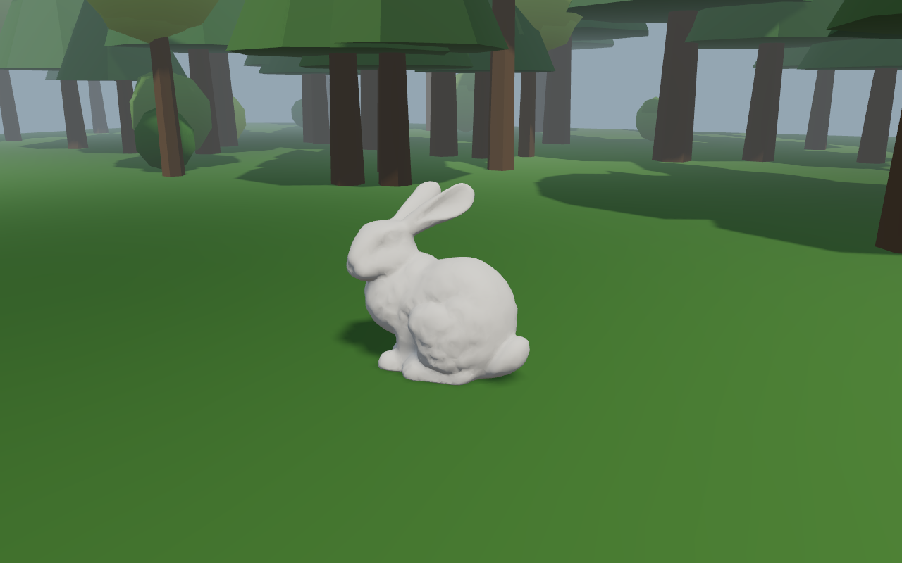
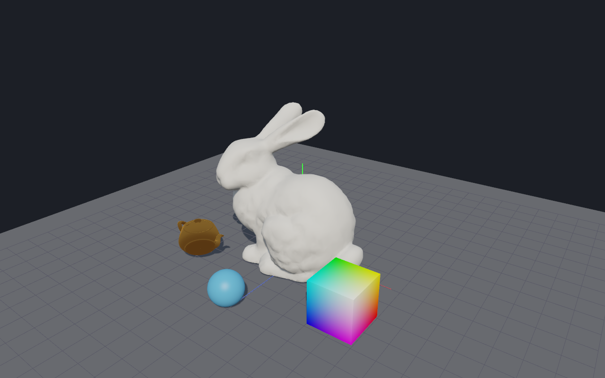

# 三维模型查看器 —— 计算机图形学总结实验

双击 `viewer.exe` 或 `Start-Forest.bat`，原创方块机器人会沿林间小径巡游。
`Shift+P` 暂停或继续，`Shift+B` 显示或隐藏曲线与控制点，`H` 打开操作页。
操作页可用鼠标点页签或按 `1` / `2` / `3` 切换。按 `Tab` 选中机器人后，底部会提示整体变换。

### 导入角色

在森林中按 `i` 选一个 64×64 Classic PNG 皮肤或 Y-up OBJ；Slim 皮肤用 `Shift+I`。
按 `k` 在内置机器人、最近导入的 PNG 和最近导入的 OBJ 之间循环。右上角显示当前文件名，运行日志记录路径。

- PNG 按 Classic／Slim 的六部件布局采样，透明外层合成到对应面上，继续使用现有挥手、走路和巡游动画。
- OBJ 从文件加载完整网格，约定 Y 向上、+Z 向前，按高度缩放并对齐地面。OBJ 可随机器人根节点巡游、转向和做整体变换。带骨骼的格式、部件级 OBJ 绑定和旧版 64×32 皮肤未实现。
- [TrailSurveyor 样例](Models/TrailSurveyor/)采用自绘像素纹理与原创方块造型。答辩时可依次从文件对话框选 PNG 和 OBJ，再按 `k` 比较三种外观。OBJ 的天线和立体背包来自文件里的几何。


```powershell
.\viewer.exe --character Models/TrailSurveyor/TrailSurveyor.png
.\viewer.exe --character Models/TrailSurveyor/TrailSurveyor.obj
```

## 2026-11-14 成果复查

当前进度、已修复问题、未完成事项及扩展优先级见 [复查与扩展清单](docs/REVIEW_AND_EXTENSIONS.md)；
课程材料缺口见 [依赖与课程计划](docs/IMPLEMENTATION_PLAN.md)。今年任务书尚待补充，项目中的评分映射暂按开发记录保留。

根目录 `viewer.exe` 已同步本次修复版，三份 Start BAT 均可直接运行。
修复包括动物脚底高度与吃草方向、警觉中断吃草、路径/追赶与手动姿势的接管、
追赶切换位置连续、森林全景取景和默认录制机位。`n` / `b` 会接管自动运动，`P` 会结束追赶并进入路径。

```powershell
powershell -NoProfile -File tools/setup_dependencies.ps1 -InstallFfmpeg
python tools/render_smoke.py
python tools/record_demos.py
```

出图检查默认写入 `out/review/render/`，不覆盖历史截图；四段演示及抽帧在 `report-assets/review/video/`。
森林录制默认保留机位，展示台默认模型自转；`--anim none` 可显式保持机位。
测试状态与人工操作尚待验收的范围见复查清单。

用 OpenGL + GLUT 实现的三维模型查看器，默认使用 GLSL 逐像素光照和阴影，保留固定管线对照模式。覆盖实验四（立方体绘制）、实验五、六
（几何变换与用户交互）、实验七（观察变换）、实验十（导入 OBJ 模型），并额外实现了
斜平行投影、四视口三视图，以及一个程序化生成的森林场景。

**双击运行就进森林**：一只兔子站在林间空地上，左键拖动可做几何变换，WASD / 右键拖动
可移动相机，**空格**让兔子蹦跳漫步。实验四那套展示台（立方体 / 茶壶 / 球）用
`--scene studio` 进。

## 2026-10-14 渲染与结构重构

直接启动 `build/Release/viewer.exe`，或打开 `viewer.sln` 后选择 Release / x64。

- **F2**：增强 GLSL / 经典固定管线对比；命令行 `--classic`。
- **F3**：开关动态阴影；命令行 `--no-shadows`。
- 增强模式：逐像素 Blinn–Phong 光照、天空/地面半球环境光、线性色彩运算、色调映射、逐像素雾和 2048² PCF 阴影。
- 网格使用 VBO/EBO，几何仅首次绘制上传；多视口和阴影通道复用 GPU 数据。
- 修复地面色块接缝、立方体法线、雾颜色数组越界、HUD 状态污染与四视口叠加位置、森林相机复位。
- 离线录制显式逐帧驱动，隐藏窗口也能输出视频；编码或写帧失败返回非零退出码。
- OBJ 缺失法线自动生成，非法面索引明确报错；保留原有投影、变换、录制和模型上轴功能。





渲染模块在 `src/renderer.cpp`，GLSL 在 `src/shaders.h`（内嵌以支持任意工作目录启动），
OpenGL 扩展入口在 `src/gl_api.h`，网格 GPU 资源在 `src/mesh.cpp`。
这是**兼容上下文中的可编程着色路径**，仍使用课程要求的矩阵栈和 GLUT 图元，并非 OpenGL Core Profile 全量迁移。
硬件缺少入口或 shader 编译失败时回退经典模式；仅阴影 FBO 不可用时保留 GLSL 无阴影绘制，日志记录原因。

验证命令（CMake / CTest 不在 PATH 时，使用下文的 VS 自带完整路径）：

```powershell
cmake --build build --config Release
ctest --test-dir build -C Release --output-on-failure
python tools/render_smoke.py
```

`tests/obj_loader_test.cpp` 覆盖缺失/混合法线、负索引、空白与注释、非法索引、空模型和四边形。
`tools/render_smoke.py` 运行 22 组真实 OpenGL 出图，检查返回码、GL 错误、shader 初始化与图像内容，
结果及截图默认在 `out/review/render/`（`--out` 可更改）。窗口实际宽度受屏幕限制，最终以日志为准。
测试不以 FPS 承诺性能收益；VBO 减少重复上传，而阴影新增一次场景绘制和采样成本。

已知边界：仍为单材质 OBJ 导入器，凹多边形的扇形三角化不保证正确；
阴影使用固定世界范围，超出范围不投影，不是级联阴影；透明材质/PBR/SSAO 尚未实现。
森林地面与树木仍合成同一场景网格，`p` 地面开关主要用于展示台。
`m` 在增强模式切换光照法线的平滑/面法线；精确演示固定管线颜色 flat/smooth 请先 F2 切回经典模式。

源码历史可通过 Git 提交记录查看，仓库不含单独的 refactor 备份目录。
下方为课程功能及原有操作说明；其中固定管线实现说明对应经典模式。

---


---

## 一、对应打分点

| 打分点 | 实现 | 截图 |
|---|---|---|
| 实验四立方体绘制（基准分） | 8 顶点 / 6 面 / 顶点色，`GL_SMOOTH` 双线性插值出「五彩斑斓的立方体」 | 下图中右下角的彩色立方体 |
| 场景包含多个三维物体（加分） | 兔子(OBJ) + 彩色立方体 + 茶壶 + 球 + 地面平台 + 网格 + 坐标轴；另有一套程序化森林场景 | `shots/01_perspective.png` `shots/15_forest.png` |
| 导入 3D 模型数据文件（加分） | `obj_loader.cpp` 解析 `v/vt/vn/f/mtllib/usemtl`（含四边形扇形三角化与 `(v,vt,vn)` 三元组去重）；自动判别模型上轴 | `shots/01_perspective.png` |
| 实验五几何变换（基准分） | `objectXform` 累积变换矩阵，`glPushMatrix` / `glMultMatrixf` / `glGetFloatv` | — |
| 交互式平移/旋转/缩放（加分） | `TransMode` + 鼠标拖动 + `t`/`r`/`y` 切换 | — |
| 正平行投影三视图 + 透视投影（基准分） | 六个正投影视图（前/后/左/右/顶/仰），**六个视图共用同一缩放** | `shots/09_quadview.png` |
| 相机漫游（加分） | WASD 前后左右、QE 升降、右键拖动 `quatRotate` 旋转视角、滚轮推拉 | — |
| 斜平行投影（加分） | 斜等测 cavalier(L=1) / 斜二测 cabinet(L=0.5) | `shots/05_cavalier.png` |
| 窗口变化图形不变形 | 透视 / 正交 / 斜平行 / 四视口各自按 aspect 修正投影 | `shots/11_wide_1600x300.png` |
| 程序正常退出 | `GLUT_ACTION_GLUTMAINLOOP_RETURNS` + `glutLeaveMainLoop` + `cleanup()` | — |
| 程序化动画（额外） | 森林场景里兔子蹦跳漫步：抛物线弧 + 落地压缩/腾空拉伸 + 转弯朝向 | `video/forest_roam.mp4` |
| **机器人绘制（2026 基准分）** | 9 个长方体层级建模的机器人在林间空地：多姿势、多视图可展示各个侧面 | `report-assets/W1/W1-1_stand.png` |
| **机器人局部几何变换（2026 加分）** | 关节级动画：手臂绕肩旋转（挥手）、**两条腿交换向前**（行走循环，1.6Hz 正弦关节曲线，双臂与同侧腿反相）；`n`/`b`/菜单交互 | `report-assets/W1/W1-1_wave.png`、`report-assets/W1/W1-2_walk_t*.png` |
| **机器人整体变换（2026 基准分）** | 选中 `Robot` 根物体后 `t`/`r`/`y` + 左键拖动做整体平移 / 旋转 / 缩放，四肢跟随根矩阵 | — |
| **森林草地树木（2026 基准分）** | 草地 + 150 棵程序化树 + 草簇花草，避让漫步路线 | `report-assets/W2/W2-1_forest_default.png` |
| **分形算法树木花草（2026 加分）** | **L-system 字符串重写 + 3D 海龟**生成树（针叶/阔叶/灌木三套文法预设）；迭代深度 `f`、分支角 `u`/`j` 运行期可调、即时重建；草簇与花朵同为程序化生成 | `report-assets/W2/W2-1_forest_default.png`；selftest 含确定性与迭代增长断言 |
| **小动物（2026 加分）** | 程序化低多边形**鹿 + 狐狸**（与树同一套形状库拼装），「走 11s / 吃草 4s」状态机；W3 起改走贝塞尔闭环（见下两行）；兔子另由蹦跳漫游动画负责 | `report-assets/W3/W3-2_loops_2up.png` |
| **贝塞尔曲线漫步（2026 加分）** | 三次贝塞尔**闭曲线**：锚点自动生成 Catmull-Rom 手柄，de Casteljau 求值；按**弧长参数化**行走，速度恒定（自检 \|步长−0.15\|<0.005）；`P` 开关漫步、`B` 显示曲线/锚点/手柄 | `report-assets/W3/W3-1_path_default.png`、`W3-1_path_guide.png`、`W3-1_path_quarters.png` |
| **动物漫游 + 追赶戏码（2026 加分）** | 鹿与狐狸各沿一条贝塞尔闭环行走（同样弧长参数化）；机器人靠近鹿 1.35 内鹿抬头警觉；`G` 追赶：鹿提速逃跑（不再吃草），机器人保持 1.25 单位跟在鹿正后方、朝向与鹿前进方向一致 | `report-assets/W3/W3-2_loops_2up.png`、`W3-2_chase_2up.png` |

---

## 二、构建

### 依赖

仓库已 vendor 全部依赖，**不需要联网、不需要额外安装**：

- `third_party/freeglut/` —— freeglut，**32 位和 64 位都有**：
  `include/GL/`（架构无关）、`lib/Win32|x64/`、`bin/Win32|x64/`
- `third_party/stb/stb_image.h` —— v2.30，public domain，单头文件，用于加载 OBJ 的 `.mtl` 贴图

### 环境

- Visual Studio 2022（含 MSVC 与自带的 CMake）
- Windows 10 及以上

### 从压缩包开始

解压到一个**新的空文件夹**（包内没有顶层目录，直接解压会散在当前目录里），
然后从下面四种方式里挑一种。包内不含 `build/` 和 `x64/`（都是构建产物），
但源码、依赖、工程文件齐全，**不需要联网也不需要额外安装**。

### 方式一：双击 viewer.sln（纯 VS 流程，推荐）

包内带了**手写的、自包含的**经典 VS 工程，不依赖 CMake：

```
viewer.sln                  双击这个
viewer.vcxproj              工程文件，已经配好一切
viewer.vcxproj.filters      解决方案资源管理器里的分组
```

双击 `viewer.sln`，在顶部选一个配置，F5：

| 配置 | 说明 |
|---|---|
| `Release` / `Win32` | **32 位**，指导书默认的「Debug Win32」就是这个 |
| `Release` / `x64` | 64 位 |
| `Debug` / 上面任一 | 调试用 |

产物在 `bin\<平台>\<配置>\viewer.exe`，例如 `bin\Win32\Release\viewer.exe`。

工程里已经配好，不需要你再去「附加依赖项」里手动加东西：

| 配置项 | 值 |
|---|---|
| 附加包含目录 | `src`、`third_party\freeglut\include`、`third_party\stb` |
| 附加依赖项 | `opengl32.lib`、`glu32.lib`、`third_party\freeglut\lib\$(Platform)\freeglut.lib` |
| 入口点 | `mainCRTStartup` |
| 子系统 | Windows |
| 附加选项 | `/utf-8`、`/wd4819` |
| 生成后事件 | 自动把 `freeglut.dll` 拷到 exe 旁边 |

两个平台都能编：依赖按架构分目录，工程里用 `$(Platform)` 拼路径（VS 的平台名正好
就是 `Win32` 和 `x64`）。所有路径都用 `$(ProjectDir)` 相对定位，整个文件夹搬到哪都能编。

### 方式二：一键脚本（不打开 VS）

包内自带两个脚本，会自己找 CMake（PATH 里没有就用 VS 2022 自带的那份），不需要配环境：

```bat
build.bat              :: 默认 64 位
build.bat Win32        :: 32 位
```

```bash
bash build.sh          # 64 位
bash build.sh Win32    # 32 位
```

两者都做 configure + 编译 Release，结束时打印可执行文件路径。`build.bat` 双击也能跑。
两个架构用不同的构建目录（`build/` 和 `build32/`）—— CMake 缓存和生成器平台绑死，
同一个目录里切架构会报 generator platform does not match。

### 方式三：用 CMake 打开文件夹

如果你更想走 CMake 那条路：**文件 → 打开 → 文件夹**，选中项目根目录
（含 `CMakeLists.txt` 的那一层）。`CMakePresets.json` 已经把预设限定成 `x64-Debug` /
`x64-Release`，顶部配置下拉里不会有 Win32，选不错。然后 F5 运行。

### 32 位 / 64 位怎么选

两个都能编，产物分别落在 `bin\Win32\` 和 `bin\x64\`（CMake 路径是 `build32/` 和 `build/`）。

课程指导书的环境配置用的是「Debug Win32」（32 位），要跟指导书一致就选 Win32；
自己机器上跑无所谓，x64 略快一点。**两者都能正常出图和录视频，已实测。**

万一遇到 `LNK2019 ... __imp__glutInitWindowSize@8` 这类错误，看符号名就能判断：
**带 `@数字` 后缀就是 32 位**（x86 stdcall 的名字修饰，x64 下不存在），
说明编译目标和 `third_party/freeglut/lib/<平台>/` 里的导入库对不上。

### 方式四：手动命令行

CMake **不在 PATH 里**，要用 VS 自带的那份。git-bash：

```bash
CM="/c/Program Files/Microsoft Visual Studio/2022/Community/Common7/IDE/CommonExtensions/Microsoft/CMake/CMake/bin/cmake.exe"
"$CM" -S . -B build -G "Visual Studio 17 2022" -A x64
"$CM" --build build --config Release
```

cmd / PowerShell 下同理，用完整路径替换即可：

```bat
"C:\Program Files\Microsoft Visual Studio\2022\Community\Common7\IDE\CommonExtensions\Microsoft\CMake\CMake\bin\cmake.exe" -S . -B build -G "Visual Studio 17 2022" -A x64
"C:\Program Files\Microsoft Visual Studio\2022\Community\Common7\IDE\CommonExtensions\Microsoft\CMake\CMake\bin\cmake.exe" --build build --config Release
```

> 别想着用 `set CM=...` 再 `%CM%` 省字数：cmd 在**解析整行时**就把 `%CM%` 展开成空串了，
> 而 `set` 要到执行时才生效，所以那条命令什么都不会干。要用变量就写进 .bat 里。

产物在 **`build/Release/viewer.exe`** —— 注意 VS 生成器是「多配置」的，exe 在 `Release/`
子目录下而不是 `build/` 根下。`freeglut.dll` 由构建后步骤自动拷到 exe 旁边，不用手动处理。

### 常见问题

| 现象 | 原因 |
|---|---|
| `cmake: command not found` | CMake 不在 PATH，用上面 VS 自带的完整路径 |
| 三十多个 `LNK2019: ... __imp__glutInitWindowSize@8` | 编译目标与 freeglut 的架构对不上。`@8` 是 x86 stdcall 修饰，说明编的是 32 位。**本项目两个架构都支持，正常不会出现**；若出现，多半是 `third_party/freeglut/lib/<平台>/` 被动过 |
| `LNK1112: 模块计算机类型 x64 与 x86 冲突` | 同上 |
| CMake 报 `generator platform does not match` | 同一个 `build/` 里从 x64 切到了 Win32。删掉该目录重来，或用 `build32/` |
| 运行时提示找不到 `freeglut.dll`，或报 `0xc000007b` | 同样是位数不匹配，必须是 x64 |
| 直接双击 `build/viewer.vcxproj` 打不开 | 那是 CMake 生成的、依赖 CMake 缓存；纯 VS 流程请双击根目录的 **`viewer.sln`** |
| 换了生成器后 configure 报 generator does not match | 删掉 `build/CMakeCache.txt` 和 `build/CMakeFiles/` 重新 configure |

---

## 三、运行

```bash
./build/Release/viewer.exe
```

不带参数启动 = **森林场景 + 兔子**。程序会自动从 exe 所在目录逐级向上查找
`Models/bunny_10k.obj`（Stanford Bunny，10000 面），
所以从 VS 启动、命令行启动、双击启动都能找到模型。也可以显式指定任意 OBJ：

```bash
# 换回另一只兔子（38352 四边形面、Z-up、带贴图）
./build/Release/viewer.exe Models/Rabbit/10037_Rabbit_v1_L3.obj
```

模型的上轴会自动判别（老兔子 Z-up、新兔子 Y-up，两者都能正确立起来），也可用 `--up` 强制指定。

```bash
./build/Release/viewer.exe "D:/some/other/model.obj"
```

### 两个场景

| 场景 | 怎么进 | 里面有什么 |
|---|---|---|
| `forest` | 默认，或 `--scene forest` | Stanford Bunny + 程序化森林（地面 / 三种树型 / 雾）|
| `studio` | `--scene studio` | 实验四的彩色立方体、茶壶、球、地面、网格、坐标轴 |

**两个场景里的交互完全一样**，鼠标键盘都不用换：

- 左键拖动 → 对选中物体做几何变换（实验五 / 六）
- 右键拖动 → 旋转相机；WASD / QE → 相机漫游；滚轮 → 推拉
- 空格 → 播放 / 暂停动画（森林里就是兔子蹦跳漫步）

> 手动一拖鼠标、一按方向键，正在播的动画会自动停下，把控制权交回给你 ——
> 否则动画每帧都在覆写相机和物体位置，你拖半天看不到反应。想接着看再按空格。

### 命令行参数（写实验报告时批量出图用）

| 参数 | 说明 |
|---|---|
| `--shot out.bmp` | 渲染一帧、截图存为 BMP 后直接退出（窗口是隐藏的，批处理不会闪窗口） |
| `--proj persp\|ortho\|cav\|cab` | 指定投影模式 |
| `--view front\|back\|left\|right\|top\|bottom\|free` | 指定视图 |
| `--render solid\|wire\|points` | 指定绘制模式 |
| `--size 1600x300` | 指定窗口尺寸（用来验证窗口变化不变形） |
| `--quad` | 四视口布局 |
| `--no-hud` | 不画 HUD |
| `--show-help` | 显示帮助界面 |
| `--selftest` | 跑数学/相机自检，不开窗口 |
| `--scene forest\|studio` | 场景：`forest`（**默认**，兔子 + 程序化森林）/ `studio`（展示台：实验四立方体 / 茶壶 / 球）|
| `--up y\|z\|auto` | 指定模型上轴，默认 `auto` 按几何自动判别 |
| `--pose stand\|wave\|tpose\|walk` | 定格机器人姿势（headless 单帧出图直接到位，不播过渡） |
| `--robot-walk` | 开启行走循环，配合 `--time` 定格任意相位 |
| `--path` | 机器人沿贝塞尔闭曲线漫步（配合 `--time` 定格） |
| `--path-guide` | 显示路径曲线与锚点 / 手柄 |
| `--chase` | 追赶演示（鹿逃跑，机器人跟随） |
| `--time <秒>` | 锁定动画时间轴（机器人与动物共用），出图 / 自检可复现 |
| `--eye x,y,z`、`--target x,y,z` | 覆盖自由相机的机位与看向点（出图取景） |
| `--record demo.mp4` | 录制演示视频（H.264 mp4），见下 |
| `--anim <类型>` | 动画：`turntable` / `orbit` / `projections` / `transforms` / `roam`。**配合 `--record` 是录制，不配合就是实时预览** |
| `--seconds <秒>` | 录制时长，默认 6 |
| `--fps <帧率>` | 录制帧率，默认 30 |

批量出图示例：

```bash
V=./build/Release/viewer.exe
$V --shot out/front.bmp     --proj ortho --view front --no-hud
$V --shot out/cavalier.bmp  --proj cav   --view front --no-hud
$V --shot out/wide.bmp      --size 1600x300 --no-hud
python tools/bmp2png.py out/front.bmp      # BMP 转 PNG
```

`tools/bmp2png.py` 只用标准库，把查看器导出的 BMP 转成 PNG，方便插进报告。

### 录制演示视频

直接输出 H.264 mp4，逐帧数据用管道喂给 ffmpeg，不落临时文件。

```bash
V=./build/Release/viewer.exe
$V --record video/turntable.mp4 --anim turntable --seconds 6 --fps 30 --size 960x600
```

| `--anim` | 内容 | 对应打分点 |
|---|---|---|
| `turntable` | 模型绕 Y 轴自转，相机不动 | 三维场景 / 光照 / 纹理 |
| `orbit` | 相机绕模型环绕一圈，模型不动 | 实验七 观察变换 + 相机漫游（加分） |
| `projections` | 依次切换 透视 → 正平行 → 斜等测 → 斜二测 | 三视图基准分 + 斜平行投影（加分） |
| `transforms` | 立方体依次做 平移 → 旋转 → 缩放 | 实验五 几何变换 + 交互（加分） |
| `roam` | 兔子在森林里蹦跳漫步，追尾相机跟随（森林是默认场景，不用加参数） | 程序化动画（额外） |

本轮四段功能样例在 `report-assets/review/video/`，由 `tools/record_demos.py` 生成并用 ffprobe 验证。
下方 `video/` 命令为自定义输出示例，需先创建目录。`transforms` 会把其它物体临时隐藏，只留立方体和地面/坐标轴 ——
兔子半径 1.0、离相机又近，不藏起来立方体根本看不清。

森林漫步的录制命令：

```bash
$V Models/bunny_10k.obj --scene forest \
   --record video/forest_roam.mp4 --anim roam --seconds 10 --fps 30 --size 960x600
```

> 想先在窗口里看看效果，不用急着录：`--anim roam` 不加 `--record` 就是实时预览
> （空格键播放/暂停）。预览走真实时钟、循环播放；录制走「帧序号 / fps」、可复现，两者刻意分开。

**出帧是离线渲染**：每帧画完立刻请求下一帧，不等真实时间，所以 180 帧约 3 秒就渲完了
（比实时快一倍）。动画时间取 `帧序号 / fps`，是个纯函数 —— 换台渲染慢的机器，输出的视频
依然严格是 6.000 秒 / 30fps，不会忽快忽慢。

> 依赖：`ffmpeg.exe` 要在 PATH 里，可运行 `tools/setup_dependencies.ps1 -InstallFfmpeg` 安装。找不到时程序报
> `failed to start ffmpeg` 并正常退出，不会崩。

---

## 四、操作说明

按 `h` 或 `F1` 可以在程序内查看同一份帮助。

### 鼠标

| 操作 | 功能 |
|---|---|
| 左键拖动 | 按当前变换模式操作**选中物体** |
| 右键拖动 | 旋转相机（绕参考点，四元数旋转） |
| Shift + 左键拖动 | 平移相机 |
| **中键点击** | 弹出菜单 |
| 滚轮 | 推拉相机（缩放） |

> 菜单绑在**中键**而不是右键，是为了给右键拖动漫游让路 —— 这也是指导书实验七的做法。

### 几何变换（实验五 / 六）

| 按键 | 功能 |
|---|---|
| `t` / `r` / `y` | 切换 平移 / 旋转 / 缩放 模式 |
| `0` | 复位选中物体的变换矩阵 |
| `Tab` | 切换到下一个物体 |

> 缩放用 `y` 而不是 `s`，因为 `s` 已经被相机漫游的后退占用 —— 指导书里专门提醒过这一点。

### 机器人（2026 实验主角）

| 按键 | 功能 |
|---|---|
| `n` | 切换姿势：站立 / 挥手 / T-pose / 行走定格 |
| `b` | 行走动画开关（双腿交替 + 摆臂 + 重心起伏） |
| `P` | 贝塞尔路径漫步开关（沿闭曲线匀速走，覆写根位置与朝向） |
| `B` | 显示 / 隐藏路径曲线、锚点（金色）与手柄（蓝灰） |
| `G` | 追赶演示开关（鹿逃跑，机器人跟在其正后方） |
| `Tab` 选中 `Robot` + `t`/`r`/`y` | 对机器人**整体**做平移 / 旋转 / 缩放 |

机器人由 9 个长方体层级建模（躯干 / 头 / 双眼 / 天线 / 双臂 / 双腿），
四肢采用 `T(关节)·R(关节角)·T(杆件偏移)` 三明治链，旋转支点在肩 / 胯而非杆件中心；
头链上还挂着天线与双眼，演示层级可以嵌套。关节角的取值与插值见 `src/robot.cpp`，
`--selftest` 里有一组几何不变量断言（T-pose 臂高等于肩高、站立脚底贴地等）。
出图钩子：`--pose stand|wave|tpose|walk` 定格姿势，`--robot-walk --time <秒>`
锁定时间轴渲染行走循环任意相位。

W3 的路径漫步实现在 `src/bezier.cpp`：8 个锚点 → 每段用 Catmull-Rom 公式自动求
两个控制点（`C1 = P1 + (P2−P0)/6`，`C2 = P2 − (P3−P1)/6`），保证接缝处 C1 连续；
每段采样 24 个点累计**弧长表**，运行时按 `s = speed · t` 反查采样点插值，
所以按参数 `u` 均匀取点会「忽快忽慢」的问题不存在。动物的两条环（6 个锚点）
用同一套 `BezierPath`，只是锚点手摆在空地左右两侧。

### 投影（实验七 + 斜平行投影）

| 按键 | 功能 |
|---|---|
| `3` | 透视投影 |
| `o` | 正平行投影（正交） |
| `7` / `9` | 斜平行投影：斜等测(cavalier, L=1) / 斜二测(cabinet, L=0.5) |
| `-` / `=` | 调整斜边与水平方向的夹角（屏幕上呈现的角度） |
| `[` / `]` | 减小 / 增大透视视场角 FOV |

### 视图

| 按键 | 功能 |
|---|---|
| `2` / `8` | 正视图 / 后视图 |
| `4` / `6` | 左视图 / 右视图 |
| `5` | 顶视图 |
| `v` | 四视口布局（三视图 + 透视同屏） |

### 动画预览

| 按键 | 功能 |
|---|---|
| `空格` | 播放 / 暂停动画 |

森林场景下默认播放**兔子蹦跳漫步**，展示台场景下默认是模型自转。
想换别的动画，用 `--anim` 启动时指定：

```bash
# 森林里看兔子漫步
./build/Release/viewer.exe --scene forest --anim roam

# 展示台看模型自转 / 投影切换
./build/Release/viewer.exe --anim turntable
```

预览走真实时钟、循环播放，方便随时看效果；要输出成文件再用下面的 `--record`。

### 相机漫游（实验七加分项）

| 按键 | 功能 |
|---|---|
| `W` `A` `S` `D` | 前进 / 左移 / 后退 / 右移 |
| `Q` / `E` | 下降 / 上升 |
| `Shift+0` | 复位相机 |

### 渲染与显示

| 按键 | 功能 |
|---|---|
| `1` | 实体 → 线框 → 点 循环 |
| `c` | 背面剔除开关 |
| `m` | 平滑 / 平面着色 |
| `l` | 光照开关 |
| `T` | 贴图开关 |
| `g` / `x` / `p` | 网格 / 坐标轴 / 地面 显示开关 |
| `F12` | 保存截图 `screenshot.bmp` |
| `ESC` | 退出 |

---

## 五、项目结构

```
CG-Experiment/
├── CMakeLists.txt
├── src/
│   ├── main.cpp          GLUT 初始化、命令行解析、回调注册、主循环、自检
│   ├── app.{h,cpp}       全局状态、渲染主流程、HUD、截图、四视口
│   ├── input.{h,cpp}     键盘 / 鼠标 / 滚轮 / 右键菜单
│   ├── scene.{h,cpp}     两套场景：展示台（实验四立方体/图元/地面/网格/坐标轴）与森林
│   ├── mesh.{h,cpp}      网格：归一化、材质、客户端顶点数组绘制
│   ├── obj_loader.{h,cpp} OBJ / MTL 解析（实验十）
│   ├── texture.{h,cpp}   stb_image → OpenGL 纹理
│   ├── camera.{h,cpp}    观察变换、漫游、四元数旋转、退化保护
│   ├── projection.{h,cpp} 透视 / 正交 / 斜平行投影，保宽高比
│   ├── lighting.{h,cpp}  光照与材质（展示台点光源 / 森林太阳光）
│   ├── hud.{h,cpp}       屏幕叠加文字
│   ├── anim.{h,cpp}      脚本动画（时间的纯函数）：自转/环绕/投影切换/几何变换/森林漫步
│   ├── forest.{h,cpp}    程序化森林：地面 + 三种树型，烘焙成一个带顶点色的网格
│   ├── recorder.{h,cpp}  逐帧数据管道进 ffmpeg 编码 mp4
│   ├── math3d.h          向量 / 矩阵 / 四元数工具
│   └── types.h           模式枚举
├── third_party/          vendor 的 freeglut 与 stb_image
├── Models/
│   ├── bunny_10k.obj     默认模型（Stanford Bunny，10000 面，Y-up）
│   └── Rabbit/           另一只兔子（38352 四边形面，Z-up，带法线/UV/贴图）
├── video/                五段演示视频（已录好）
├── shots/                各模式的验证截图
└── tools/
    ├── bmp2png.py        截图格式转换（纯标准库）
    └── make_shots.sh     一键重新生成 shots/ 全部截图
```

---

## 六、实现要点

### 1. 导入 38352 个四边形面的 OBJ

指导书的 `OBJImporter` 只支持三角形面，而本模型 **38352 个面全部是四边形**，
必须做扇形三角化 `(0,1,2)+(0,2,3)`，最终得到 **76704 个三角形**。

同时指导书是逐三角形 `glBegin/glEnd` 绘制，对 7.6 万面意味着每帧约 46 万次立即模式调用。
本项目改为**客户端顶点数组 + 一次 `glDrawElements`**：

```cpp
glVertexPointer(3, GL_FLOAT, 0, positions.data());
glNormalPointer(GL_FLOAT, 0, normals.data());
glTexCoordPointer(2, GL_FLOAT, 0, uvs.data());
glDrawElements(GL_TRIANGLES, idx.size(), GL_UNSIGNED_INT, idx.data());
```

`(v,vt,vn)` 三元组用哈希去重后，40194 个唯一顶点复用，内存和调用次数都大幅下降。
线框模式只需要 `glPolygonMode(GL_FRONT_AND_BACK, GL_LINE)`，不用第二份索引。

（Windows SDK 的 `<GL/gl.h>` 只到 OpenGL 1.1，没有 `glGenBuffers`，所以走客户端数组而非 VBO。）

### 2. 斜平行投影

斜平行投影 = 正交投影 ∘ 沿视线方向的错切。眼空间可见点 `z_e = -d (d>0)`，于是

```
x' = x - L·cosφ·z_e
y' = y - L·sinφ·z_e
```

斜等测 `L = 1`，斜二测 `L = 0.5`。矩阵放在**投影矩阵**上，紧跟 `glOrtho` 之后
`glMultMatrixf`（`glMultMatrixf` 右乘，等价于先错切再正交，正是定义）。

两个容易踩的坑：

- **`m[10]` 必须保持 1。** 教材上那个斜投影矩阵是奇异的（把 z 压平成平面），
  直接拿来用会让所有片元落到同一个 NDC 深度，深度测试彻底失效、整个模型 z-fighting。
  保持仿射形式投影方向完全一致，但深度缓冲仍可用。
- **错切必须放在投影矩阵而不是 modelview。** 错切是相对投影平面（眼空间）定义的，
  放 modelview 就变成世界空间错切，相机一转斜边方向就错了。

另外屏幕上看到的夹角 θ 与世界空间的 φ 满足 `tanθ = tanφ · aspect`，
所以反解 `φ = atan(tanθ / aspect)`，这样窗口比例变化时屏幕上始终是 45° 斜二测。

### 3. 窗口变化图形不变形

指导书实验四的 `glFrustum(-2.5, 2.5, -2.5, 2.5, near, far)` **本身就是错的**：
它在近平面上永远是 1:1，窗口一变宽图形就被压扁 —— 正好是要求 3 要考的情况。

正确做法是保证「世界单位/像素」在 x、y 两方向相等：

- 正交：`halfW = halfH * aspect`，再 `glOrtho(-halfW, halfW, -halfH, halfH, ...)`
- 透视：`halfH = nearZ * tan(fovY/2)`，`halfW = halfH * aspect`，再 `glFrustum(...)`
- 四视口布局下每个视口按**自己的**尺寸算 aspect，所以四个视口都不变形

正交投影用 `glOrtho(..., -1000, 1000)` 这种「永不裁剪」的近远平面：`glOrtho` 允许
near 为负，且正交深度精度是线性的，这样六种视图和相机漫游都不会把物体裁掉。

### 4. 三视图共用同一缩放

模型加载后归一化到单位包围球。六个视图方向下包围球投影都是半径 R 的圆，
所以统一用 `halfH = R * 1.06`，各视图放大率完全一致 ——
如果每个视图各自独立取景，正视图和左视图会一大一小，看起来就不是一张三视图了。

### 5. 顶视图的退化情况

顶视图视线方向 `f = (0,-1,0)` 与默认 `up = (0,1,0)` 反平行，叉积为零，
`gluLookAt` 的基奇异 —— 而且它**不报错**，画面直接空白或乱码。
解决方法是顶视图用 `up = (0,0,-1)`（指导书也是这样），并额外写了 `safeLookAt()`，
当 `|f·up| > 0.999` 时自动切到备用 up，防止相机漫游时撞上同一奇点。

### 6. 光照

- **`glLightfv(GL_LIGHT0, GL_POSITION, ...)` 会被当前的 MODELVIEW 矩阵变换**，
  所以必须在 `gluLookAt` 之后、任何物体变换之前调用，否则光会跟着模型转。
- `glEnable(GL_NORMALIZE)`：交互缩放会产生非均匀缩放，法线必须重新归一化。
- 图元用 `glColorMaterial` + `GL_COLOR_MATERIAL`，否则 `glColor3f` 在光照下被完全忽略。
  但绘制 OBJ 时要**先关掉** `GL_COLOR_MATERIAL`，否则它会覆盖 `glMaterialfv` 设的
  `AMBIENT`/`DIFFUSE`，`.mtl` 材质就失效了。

### 7. 正常退出

```cpp
glutSetOption(GLUT_ACTION_ON_WINDOW_CLOSE, GLUT_ACTION_GLUTMAINLOOP_RETURNS);
...
glutMainLoop();
appCleanup();          // 现在真的会执行
```

默认的 `GLUT_ACTION_EXIT` 会从回调里直接 `exit()`，跳过所有清理代码。
另外**没有**照抄指导书在 `display()` 末尾无条件 `glutPostRedisplay()` ——
那会让 CPU 空转 100%，本项目改为按需重绘（只在输入回调里 post）。

---

### 8. 森林场景与蹦跳步态

**为什么不是骨骼动画**：Stanford Bunny 是一坨静态三角网格，既没有骨架也没有蒙皮权重。
要做四条腿交替迈步，得先自动绑骨 —— 那是研究级的问题，在这个项目里做不可靠。
好在兔子真实的移动方式是**蹦跳**而不是走，而且这个模型本来就是蹲坐姿、腿收在身下，
没有可迈的腿。所以改用程序化步态，观感反而更贴切：

- **跳跃弧线**用抛物线 `4k(1-k)` 而不是正弦，更接近真实弹道，落地那一下的顿挫明显得多
- **落地压缩 / 腾空拉伸**（动画十二原则的 squash & stretch），用 `1/√sy` 保持体积
- **起跳抬头、下落低头** —— 注意轴：模型自身朝 `-X`，所以俯仰要绕 **Z** 轴转，
  绕 X 只会让它左右翻滚（这个坑踩过一次）
- **转弯朝向**取路径切线，`θ = atan2(h.z, -h.x)`

模型原点在包围球中心而不是脚底，所以要垫高 `-bboxMin[1]` 才踩在地上；压扁时脚会往上跑，
再乘 `sy` 抵回来，保证脚始终贴地。

**森林**是程序化生成的，全部烘焙进**一个**带顶点色的网格（一次 draw call 画完）：
地面细分网格（雾是逐顶点的，不细分远处会突变成硬边）+ 三种树型（针叶 / 阔叶 / 灌木）。
用固定种子的 xorshift 而不是 `rand()` —— 各 C 运行库实现不同，换个编译器森林就变了，
录出来的视频没法复现。

种树时会避开兔子的漫游路线，**避让半径必须大于追尾相机的跟随距离**：相机吊在兔子后面
4.6 单位，树只让开 3.6 的话相机会一头扎进树干里，而背面剔除会让那棵树直接"闪没"。

## 七、自检

```bash
./build/Release/viewer.exe --selftest
```

38 项断言覆盖截图验证不了的逻辑：矩阵乘法、轴角旋转、四元数旋转与矩阵形式的一致性、
绕参考点旋转保持距离、旋转 360° 回到原点、推拉改变距离、顶视图 up 向量非退化、
六个视图预设共用同一距离、漫游沿视线平移且不改变距离。
还覆盖机器人层级与模式接管、贝塞尔与弧长参数化、森林完整几何确定性、动物脚底/俯身/警觉、追赶间距/朝向及切换连续性。

---

## 八、已知限制

- **HUD 与菜单文字只支持 ASCII。** GLUT 的位图字体（`glutBitmapCharacter`）只能画 ASCII，
  中文会变成空白或乱码。程序内所有界面文字和窗口标题都用英文。若要中文界面，
  需要改用 `wglUseFontBitmaps` 加载中文字体。
- 交互缩放只有鼠标拖动一条路径，没有数值输入框。
- **`--size` 请求的尺寸会被屏幕尺寸截断。** Windows 不允许窗口比屏幕还高，
  例如在 1920×1080 上请求 `--size 300x1600`，实际只得到 300×1061。
  程序会查询真实的可绘制尺寸（`glutGet(GLUT_WINDOW_WIDTH/HEIGHT)`）而不是用请求值，
  所以宽高比始终按真实尺寸算、截图也不会出现黑边；但想要某个特定极端比例，
  得选一个屏幕放得下的尺寸。
- `models/` 里只有兔子一个模型；PLY 格式未实现（实验十的 PLY 部分需要额外的模型文件）。
