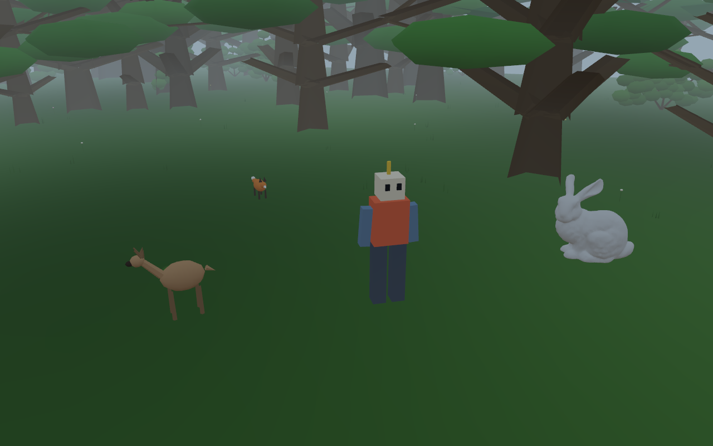

# 机器人森林漫步

2026 年计算机图形学综合实验。使用 C++、OpenGL／GLSL 和 freeglut 实现一个 Windows 三维查看器。默认森林场景可以演示机器人巡游、关节动画、动物行为、角色导入和多视图观察。

[课程要求与完成状态报告](docs/PROJECT_STATUS.md) · [启动与安装说明](START-HERE.txt) · [答辩知识卡](docs/DEFENSE_CARDS.md)



## 快速运行

在 Windows 10／11 x64 上完整解压仓库，保留 `viewer.exe` 旁的 DLL 和 `Models/`。双击启动文件，点击或按任意键关闭操作清单。按 `H` 可随时查看完整帮助。

| 启动文件 | 进入的演示 |
| --- | --- |
| [viewer.exe](viewer.exe) 或 [Start-Forest.bat](Start-Forest.bat) | 森林和机器人巡游 |
| [Start-Bunny-Hop.bat](Start-Bunny-Hop.bat) | 兔子蹦跳和漫游镜头 |
| [Start-Studio.bat](Start-Studio.bat) | 彩色立方体、茶壶、球和投影展示 |
| [Start-Character.bat](Start-Character.bat) | 加载本地 `Skins/steve_64x64.png`，缺少文件时启动默认森林 |

## 操作

| 操作 | 功能 |
| --- | --- |
| `Tab` 或左键点击物体 | 循环选择或点选。选择机器人时状态栏显示 `Robot` |
| `t`／`r`／`y` 后左键拖动 | 平移／旋转／缩放选中物体。演示时可先暂停巡游 |
| `0`／`Shift+0` | 复位物体变换／相机 |
| `n`／`b` | 切换站立、挥手、T 姿势和行走定格／开关原地行走 |
| `Shift+P`／`Shift+B`／`Shift+G` | 开关路径巡游／路径与控制点显示／追赶 |
| `w` `a` `s` `d`、`q`／`e` | 相机前后左右和升降 |
| 右键拖动、`Shift` + 左键拖动、滚轮 | 旋转、平移和推拉相机 |
| `2`／`8`、`4`／`6`、`5`、`v` | 前／后、左／右、顶、四视口 |
| `3`／`o`／`7`／`9` | 透视、正交、斜等测、斜二测 |
| `f`、`u`／`j` | 调整树木分形迭代深度和分支角 |
| `F2`／`F3`、`1` | 增强 GLSL 与经典管线切换、阴影开关、实体／线框／点 |
| `空格`、`F12` | 播放或暂停动画预览、保存 `screenshot.bmp` |
| 中键、`H`／`F1`、`Esc` | 打开菜单、打开帮助、关闭帮助或退出 |

### 导入外部角色

在森林中按 `i` 打开文件对话框，可加载 Y-up OBJ 或 Classic PNG 皮肤。用 `Shift+I` 加载 Slim 皮肤。按 `k` 在内置机器人、已导入的 PNG 和 OBJ 之间循环，按 `Shift+M` 在内置机器人和最近导入的角色之间切换。

| 格式 | 支持范围 |
| --- | --- |
| OBJ | Y 向上、+Z 向前，按高度缩放并对齐地面。单材质网格随机器人根节点巡游、转向和整体变换 |
| PNG | 64×64 Classic／Slim、64×32 旧版 Classic、64 整数倍的正方形高清皮肤。皮肤贴到原有部件上，支持挥手与行走 |

使用随仓库提供的 [TrailSurveyor](Models/TrailSurveyor/) 可离线演示：

```powershell
.\viewer.exe --character Models/TrailSurveyor/TrailSurveyor.obj
.\viewer.exe --character Models/TrailSurveyor/TrailSurveyor.png
.\viewer.exe --skin-info Models/TrailSurveyor/TrailSurveyor.png
```

[OBJ 与 PNG 导入对照图](report-assets/review/render/character-import.png) · [本地测试皮肤脚本](tools/fetch_skins.ps1)

## 构建与验证

从源码构建需要 Visual Studio 2022 的「使用 C++ 的桌面开发」工作负载、MSVC v143 和 Windows SDK。仓库内含 Win32／x64 freeglut 和 stb_image。打开 [viewer.sln](viewer.sln) 后选择 `Release | x64`，生成的程序在 `bin/x64/Release/viewer.exe`。也可通过 CMake 只构建查看器：

```powershell
cmake -S . -B build -G "Visual Studio 17 2022" -A x64
cmake --build build --config Release --target viewer
ctest --test-dir build -C Release -R "^math_camera$" --output-on-failure
```

CMake 未加入 PATH 时，可使用 Visual Studio 附带的 CMake。Win32 构建请使用独立目录（如 `build32`）和 `-A Win32`。当前完整 CMake 构建会因独立的 `obj_loader_test` 缺少启动日志函数而报链接错误，查看器目标可以单独构建。详见 [最新复验结果](docs/PROJECT_STATUS.md#验证结果)。

```powershell
python tools/render_smoke.py .\viewer.exe --out out/review/current-render
python tools/record_demos.py --exe .\viewer.exe --out out/review/current-video
python tools/update_manifest.py --check
```

截图脚本需要可用的 OpenGL 图形上下文。视频录制另外需要 PATH 中的 FFmpeg 和 FFprobe。测试和录制输出写到 `out/`，便于保留仓库中的原始证据。

| 用途 | 参数示例 |
| --- | --- |
| 自检 | `--selftest` |
| 机器人的局部动作 | `--pose wave` 或 `--robot-walk --time 0.31` |
| 路径、追赶与多视图 | `--path --path-guide`、`--chase`、`--quad` |
| 投影与极端比例 | `--proj ortho --view front --size 1600x300` |
| 绘制与阴影对照 | `--render wire`、`--classic`、`--no-shadows` |
| 单帧截图 | `--shot out/frame.bmp`，再用 `python tools/bmp2png.py out/frame.bmp` 转为 PNG |
| 单段录制 | `--record out/path.mp4 --path --path-guide --anim none --seconds 10 --fps 24 --size 960x600` |

## 实现与证据

| 模块 | 实现 | 证据 |
| --- | --- | --- |
| [机器人](src/robot.cpp) | 九个长方体做层级变换，四肢绕肩或髋旋转 | [挥手视频](report-assets/review/video/robot-wave.mp4) |
| [森林](src/forest.cpp) | L-system 和三维海龟生成树木，程序化生成花草 | [森林截图](report-assets/W2/W2-1_forest_default.png) |
| [路径](src/bezier.cpp)与[动物](src/animals.cpp) | 三次贝塞尔闭环、弧长查表、走动与吃草状态、追赶 | [巡游视频](report-assets/review/video/robot-path.mp4) · [动物视频](report-assets/review/video/animals.mp4) · [追赶视频](report-assets/review/video/chase.mp4) |
| [投影](src/projection.cpp)与[渲染](src/renderer.cpp) | 透视、正交、斜投影和四视口。兼容上下文内提供经典固定管线与 GLSL 逐像素光照、雾和 PCF 阴影 | [森林四视口](report-assets/review/render/forest-quad.png) |
| [OBJ 加载](src/obj_loader.cpp) | 解析网格与贴图，支持负索引并补全缺失法线。凹多边形建议预先三角化 | [样例模型](Models/TrailSurveyor/TrailSurveyor.obj) |

课程验收范围、技术限制和报告提交要求见 [课程要求与完成状态报告](docs/PROJECT_STATUS.md)。开发中使用 AI 的方式与问题处理见 [过程记录](report-assets/ai-process-log.md)。
